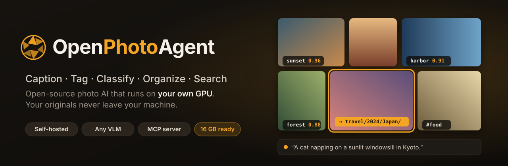
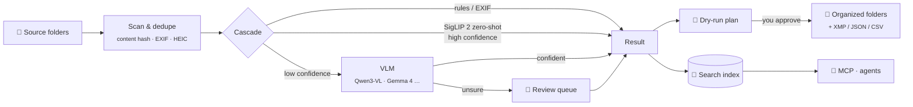
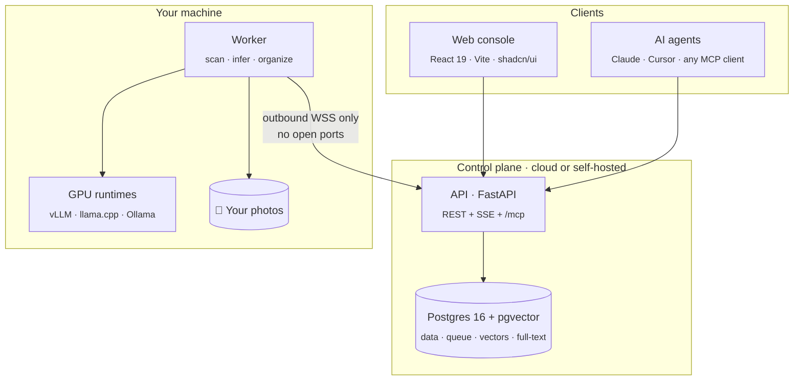

<div align="center">

<picture>
  <source media="(prefers-color-scheme: dark)" srcset="assets/banner-dark.svg">
  <source media="(prefers-color-scheme: light)" srcset="assets/banner-light.svg">
  
</picture>

<br/>

**Point it at a folder of photos. Pick a model. Get captions, tags and categories, then sort everything into folders, search it in plain language, or hand it to any AI agent over MCP.**

[](https://github.com/romanticamaj/openphotoagent/releases)
[](LICENSE)
[](#-roadmap)
[](#-privacy-by-design)
[](#-for-ai-agents-mcp)
[](#-models)
[](CONTRIBUTING.md)

**English** · [繁體中文](README.zh-TW.md)

[Features](#-features) · [How it works](#-how-it-works) · [Models](#-models) · [MCP](#-for-ai-agents-mcp) · [Roadmap](#-roadmap) · [Design docs](#-design-docs)

</div>

---

> [!NOTE]
> **OpenPhotoAgent is in the design phase.** The full technical specs are in [`docs/`](docs/), and the MVP is being built in the open. Star or watch the repo to follow along. Feedback on the design is very welcome in [Discussions](../../discussions) and [Issues](../../issues).

## ✨ Why

You have 40,000 photos in `DCIM/`, `Downloads/` and old backup drives. Cloud photo apps want your originals. Self-hosted galleries can search with CLIP, but they won't **caption, classify into _your_ categories, and file things into folders** for you. Dataset captioning tools are single-machine desktop apps with no organizing, no search and no API.

**OpenPhotoAgent fills that gap.** Think of it as *Hazel + Label Studio for photos, with an MCP interface*. It is a self-hosted web console that runs today's best open vision-language models on **your own GPU**, previews every change before touching a file, and makes your whole library searchable by you and your AI agents.

## 🎞 Features

<table>
<tr>
<td width="50%" valign="top">

### 🏷 Three tasks, one pass
**Caption**, **Tagging** and **Classification**, run separately or fused into a single structured JSON inference. Captions can be multilingual (English / 繁體中文), tags follow a controlled vocabulary with synonym merging, and classes are **your own** categories, defined by name, description and example photos.

</td>
<td width="50%" valign="top">

### 🧠 Bring any model
A YAML model registry with VRAM badges covers Qwen3-VL, Qwen3.6, Gemma 4, JoyCaption, Florence-2, SigLIP 2 and more, on **vLLM, llama.cpp, Ollama, transformers** or any OpenAI-compatible endpoint. A built-in **mini benchmark** compares models on *your* golden set.

</td>
</tr>
<tr>
<td valign="top">

### 📁 Safe, reversible organizing
Choose source and output folders, then template your paths with `{category}/{date:YYYY}/{place}`. Every run produces a **dry-run plan → approval → journal → execute** sequence. Moves are copy-verify-delete, and **every operation can be undone**. You can also write results back to **XMP sidecars**, JSON or CSV.

</td>
<td valign="top">

### 🔎 Hybrid AI search
*"cats on a windowsill in Kyoto, last spring"* is answered with image vectors, full-text search (with proper Traditional Chinese segmentation) and tags, fused with RRF. Also supports search-by-image, duplicate detection and facets for date, place, camera and tag. Any search can be **saved as a sorting rule**.

</td>
</tr>
<tr>
<td valign="top">

### 🤖 MCP server for any AI agent
Connect **Claude Desktop, Claude Code, Cursor** or any MCP client. It exposes 21 tools, including `search_photos`, `find_similar`, `run_labeling_job` and `propose_organize`. Access is read-only by default and can be limited to specific folders, and agents can **propose** file changes but **you approve** them in the browser.

</td>
<td valign="top">

### 🖥 A console you'll enjoy using
A *"lightbox in a darkroom"* UI that keeps your photos center stage. Changing a setting re-renders a **live 10-photo preview**. You can drag to create classes, set rules up in plain language, review results with keyboard-first shortcuts and monitor GPU and throughput live. Light and dark themes, WCAG 2.2 AA.

</td>
</tr>
</table>

## 🔄 How it works



Inference results are cached by **(photo hash, task config hash, model fingerprint)**, so moving files, re-running jobs or tweaking a confidence threshold never re-computes what's already known.

## 🧩 Models

Default stack for a **16 GB GPU** (e.g. RTX 5070 Ti / 4080 / 4070 Ti Super):

| Role | Default | VRAM (est.) |
|---|---|---|
| Always-on embedding / zero-shot | **SigLIP 2** so400m-384 (fp16) | ~1.5 GB |
| Main VLM | **Qwen3-VL-8B-Instruct** FP8 on vLLM (or Q4/Q5 GGUF on llama.cpp) | ~11.5 GB |
| Hard-case reviewer | **Qwen3.6-35B-A3B** Q4, MoE experts partly offloaded to CPU | partial offload |
| Long captions (optional) | **JoyCaption Beta One** (EN) · Qwen3.6-35B-A3B (繁中) | — |

<details>
<summary><b>Other tiers and supported families</b></summary>

| Tier | Suggested models |
|---|---|
| **8 GB** | Gemma 4 E4B / E2B, Qwen3-VL-8B (Q4), Florence-2, SigLIP 2 |
| **16 GB** | Qwen3-VL-8B FP8, Qwen3.5-9B, Gemma 4 26B-A4B (tight), InternVL3.5-8B, MiniCPM-V |
| **24 GB+** | Qwen3.6-27B, Qwen3.6-35B-A3B fully on GPU, Gemma 4 31B |
| **Remote** | Any OpenAI-compatible endpoint (your own vLLM / Ollama / LM Studio, or a cloud API) |

Specialized: WD tagger v3 / Camie (anime and illustration), JoyTagger, Meta PE-Core. VRAM figures are estimates and will be measured during the M0 spike. See [docs/03](docs/03-inference-layer.md).

</details>

## 🤖 For AI agents (MCP)

OpenPhotoAgent runs as an **MCP server** that any MCP client can use, over local `stdio` or remote Streamable HTTP with OAuth 2.1.

```bash
# Claude Code: local
opl login --server http://127.0.0.1:8080 --scopes photos:read,photos:media,organize:propose
claude mcp add openphotoagent -- opl mcp

# Claude Code: remote
claude mcp add --transport http openphotoagent https://photos.example.com/mcp
```

<details>
<summary><b>Claude Desktop · <code>claude_desktop_config.json</code></b></summary>

```json
{
  "mcpServers": {
    "openphotoagent": {
      "command": "opl",
      "args": ["mcp", "--server", "http://127.0.0.1:8080"],
      "env": { "OPL_MCP_READONLY": "1" }
    }
  }
}
```

</details>

Then just ask:

> **You:** Find my Japan trip photos from last spring with cats in them, and put them in a "Kyoto cats" album.
>
> **Agent:** *calls* `search_photos` → `create_collection` → `add_to_collection`
> Found 23 photos (Mar–Apr 2025, Kyoto & Osaka). Album **Kyoto cats** created.
>
> **You:** Now sort the rest of that trip into folders by city.
>
> **Agent:** *calls* `propose_organize` → *Plan ready: 412 files → `travel/2025/Japan/{city}/`. **Review and approve it here:** `http://127.0.0.1:8080/approvals/…`*

| Tool group | Tools |
|---|---|
| Search & read | `search_photos` `get_photo` `find_similar` `find_duplicates` `list_tags` `list_categories` `list_facets` `list_folders` |
| Describe & fix | `describe_photo` `update_labels` |
| Collections | `create_collection` `add_to_collection` `remove_from_collection` `list_collections` |
| Jobs | `run_labeling_job` `get_job_status` `cancel_job` |
| Organize | `propose_organize` `get_organize_plan` `apply_organize`¹ `undo_organize` |

¹ `apply_organize` never executes on its own. It returns an approval link, and only a human in the browser can apply the plan.

## 🔒 Privacy by design

- **Originals never leave your machine.** Only the local worker can touch the filesystem or the GPU, and this is enforced in CI with import rules.
- **Sandboxed paths.** The worker only touches the root folders you allow, and blocks path traversal.
- **Four egress levels per workspace**, up to `results-only`, where not even thumbnails leave the worker.
- **Agents are untrusted.** MCP access is read-only by default, every write is approval-gated, sharing photos with an MCP client needs explicit permission, and text found in photos or EXIF is treated as untrusted data to block prompt injection.
- **Audit log** of every job, file operation and agent call.

## 🏗 Architecture



**One codebase, two ways to deploy:**
- **All-in-one:** a single `docker compose up` on your GPU box.
- **Control plane + edge worker:** host the console on a NAS or in the cloud and pair a worker on your GPU machine with a one-time code.

## 🚀 Quick start

> [!IMPORTANT]
> Not runnable yet. This is the planned experience for **v0.1**.

```bash
git clone https://github.com/romanticamaj/openphotoagent && cd openphotoagent
cp deploy/compose/.env.example .env      # set PHOTO_ROOTS=/path/to/photos
docker compose -f deploy/compose/allinone.yml up -d
open http://localhost:8080               # onboarding detects your GPU and suggests models
```

Requirements: NVIDIA GPU with 8 GB+ VRAM (16 GB recommended), recent driver with CUDA 12.8+ (needed for RTX 50-series Blackwell), and Docker with NVIDIA Container Toolkit.

## 🗺 Roadmap

- [x] **Design** · [`v0.0.1`](https://github.com/romanticamaj/openphotoagent/releases/tag/v0.0.1): prior-art survey, architecture, inference layer, UX, search & MCP specs
- [ ] **M0 · Spike:** measure vLLM + Qwen3-VL-8B FP8 and SigLIP 2 on an RTX 5070 Ti, and test Traditional Chinese zero-shot quality
- [ ] **v0.1 · MVP:** all-in-one compose, New Job wizard, Caption / Tag / Classify, dry-run → approve → undo, review queue, gallery
- [ ] **v0.2 · Search + MCP:** hybrid search, search-by-image, duplicates, `stdio` MCP server, watch folders
- [ ] **v0.3 · Models:** model manager, mini benchmark, presets, XMP write-back, Immich & Label Studio integration
- [ ] **v1.0 · SaaS-ready:** control plane + paired edge workers, multi-tenant RBAC, OAuth 2.1 MCP over HTTP, desktop app (Tauri)
- [ ] **v2:** VLM re-ranking, face groups (opt-in), smart collections, built-in chat assistant

## 🆚 How it compares

| | Custom classes | Picks your model | Sorts into folders | Hybrid search | MCP for agents | Web UI |
|---|:-:|:-:|:-:|:-:|:-:|:-:|
| Immich | — | partial | — | CLIP | — | ✅ |
| PhotoPrism | — | Ollama | — | partial | — | ✅ |
| TagGUI / qapyq | — | ✅ | — | — | — | desktop |
| AI file sorters | partial | partial | ✅ | — | — | — |
| **OpenPhotoAgent** | ✅ | ✅ | ✅ (reversible) | ✅ | ✅ | ✅ |

Based on each project's docs as of 2026-11 ([full survey](docs/01-prior-art-and-naming.md)). OpenPhotoAgent aims to **integrate** with Immich and Label Studio, not replace them.

## 📚 Design docs

| | Doc | What's inside |
|---|---|---|
| 00 | [Master plan](docs/00-master-plan.md) | Positioning, requirement mapping, cross-doc decisions, roadmap |
| 01 | [Prior art & naming](docs/01-prior-art-and-naming.md) | About 30 related projects, gap matrix, build-vs-fork decision |
| 02 | [System architecture](docs/02-system-architecture.md) | Deployment modes, data model, job lifecycle, APIs, security, monorepo |
| 03 | [Inference layer](docs/03-inference-layer.md) | Model registry, adapters, task strategies, VRAM management, benchmarks |
| 04 | [Control panel UX](docs/04-control-panel-ux.md) | User journeys, 14 page wireframes, design system, frontend stack |
| 05 | [Search & MCP](docs/05-search-and-mcp.md) | Hybrid index, Traditional Chinese full-text, MCP tools, approval flow, threat model |

The specs are currently written in Traditional Chinese (繁體中文). English translations are welcome as contributions.

## 🤝 Contributing

Early contributors can shape the project. Good first areas:
- 🧪 **Benchmarks:** run the M0 spike on your GPU and share your numbers
- 🧠 **Model adapters:** add a runtime or model family
- 🎨 **Design:** UI mockups for the [UX spec](docs/04-control-panel-ux.md)
- 🌐 **Translation:** the design docs into English

See [CONTRIBUTING.md](CONTRIBUTING.md). Security issues: [SECURITY.md](SECURITY.md).

Releases follow [SemVer](VERSIONING.md) and are cut automatically from [Conventional Commits](https://www.conventionalcommits.org/). See [CHANGELOG.md](CHANGELOG.md) for what changed in each version.

## 📄 License

[Apache License 2.0](LICENSE). Model weights carry their own licenses, which OpenPhotoAgent shows before every download.

<div align="center">
<br/>
<sub>Built for people with too many photos and too little time ·
<a href="https://github.com/romanticamaj/openphotoagent">github.com/romanticamaj/openphotoagent</a></sub>
</div>
