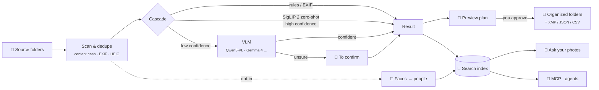
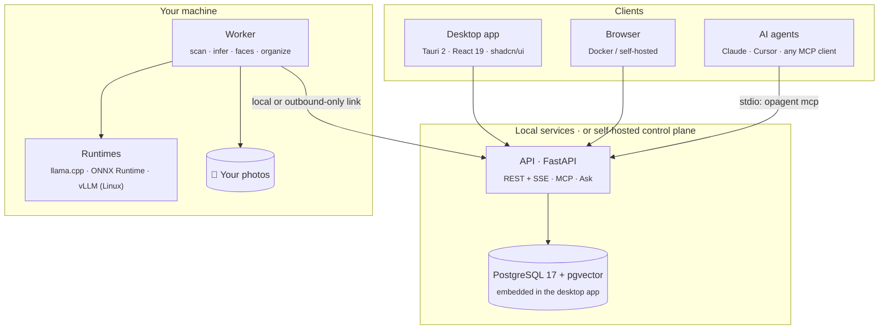

<div align="center">

<picture>
  <source media="(prefers-color-scheme: dark)" srcset="assets/banner-dark.svg">
  <source media="(prefers-color-scheme: light)" srcset="assets/banner-light.svg">
  
</picture>

<br/>

**Install the app. Point it at your photos. It sorts them into the folders you want, finds everyone by face, and answers questions about your library, all on your own computer. Any AI agent can search it too, over MCP.**

[](https://github.com/romanticamaj/openphotoagent/releases)
[](LICENSE)
[](#-roadmap)
[](#-quick-start)
[](#-privacy-by-design)
[](#-for-ai-agents-mcp)
[](#-models)
[](CONTRIBUTING.md)

**English** · [繁體中文](README.zh-TW.md)

[Features](#-features) · [How it works](#-how-it-works) · [Models](#-models) · [MCP](#-for-ai-agents-mcp) · [Roadmap](#-roadmap) · [Design docs](#-design-docs)

</div>

---

> [!NOTE]
> **OpenPhotoAgent is in the design phase.** The full technical specs are in [`docs/`](docs/), and the MVP is being built in the open. Star or watch the repo to follow along. Feedback on the design is very welcome in [Discussions](../../discussions) and [Issues](../../issues).
>
> OpenPhotoAgent is and will stay **free and open source** (Apache-2.0). There is no paid tier and no hosted service.

## ✨ Why

You have 40,000 photos in `DCIM/`, `Downloads/` and old backup drives. Cloud photo apps want your originals. Self-hosted galleries can search with CLIP, but they won't **caption, classify into _your_ categories, and file things into folders** for you. Dataset captioning tools are single-machine apps with no organizing, no search and no API.

**OpenPhotoAgent fills that gap.** Think of it as *Hazel + Label Studio for photos, with an MCP interface*. It is a **desktop app for Windows, macOS and Linux** (or a Docker stack for your home server) that runs today's best open vision-language models on **your own hardware**, previews every change before touching a file, tells you how long everything will take, and makes your whole library searchable by you and your AI agents.

## 🎞 Features

<table>
<tr>
<td width="50%" valign="top">

### 📁 Auto-sort into your folders
Pick a source folder and where results should go, then choose **by date**, **by content** (12 built-in categories) or **your own categories** defined by name, description and example photos. Paths use templates like `{category}/{date:YYYY}/{place}`. Every run is a **preview → approve → journal → execute** sequence. It **copies by default**, moves are copy-verify-delete, and **every operation can be undone**. Results can also go to **XMP sidecars**, JSON or CSV.

</td>
<td width="50%" valign="top">

### 🧑‍🤝‍🧑 Find photos by face
Turn on people recognition (it's **off by default** and runs only on your machine), name the faces it groups, then click a face or **drop in a photo** to find every picture of that person. Combine people with anything else: *"Mom at the beach"*. Merge, split and fix mistakes in seconds, use `{person}` in folder templates, and **delete all face data with one click**.

</td>
</tr>
<tr>
<td valign="top">

### 💬 Ask your photos
*"How many photos did I take in Kyoto last year? Pick the 5 best."* Ask in plain language and get an answer with the photos it's based on. Each step (searching, counting, looking at photos) shows live progress and time. Answers can only cite photos the tools actually returned, and anything that would move files becomes a plan you approve.

</td>
<td valign="top">

### 🧠 Model manager & environment doctor
One recommended setup for your hardware, with download size and time shown up front. Downloads **pause, resume and really cancel**, with checksums. The **environment doctor** checks GPU, driver, memory and disk on NVIDIA, AMD, Intel and Apple Silicon. When something can't run, it says why and offers a **one-click fix** or a slower way to keep going. Bring Qwen3-VL, Gemma 4, SigLIP 2, JoyCaption and more, on **llama.cpp, ONNX Runtime, vLLM, Ollama** or any OpenAI-compatible endpoint.

</td>
</tr>
<tr>
<td valign="top">

### ⏱ Every task tells you how long
Before you start: an estimate (*"about 2 h 10 min for 28,412 photos"*). While it runs: elapsed time, remaining time based on real throughput, and the reason if it's waiting (on battery, GPU busy with a game). Close the window and get a notification when it's done.

</td>
<td valign="top">

### 🖼 A photo viewer you'll enjoy
A *"lightbox in a darkroom"* look that keeps photos center stage: a justified timeline grid with a **date scrubber**, instant ThumbHash placeholders, smooth zoom and transitions, an info panel that shows what the AI decided and lets you fix it in place, plus multi-select and batch actions. Light and dark themes, keyboard-first, WCAG 2.2 AA.

</td>
</tr>
<tr>
<td valign="top">

### 🔎 Hybrid AI search
*"cats on a windowsill in Kyoto, last spring"* is answered with image vectors, full-text search (with proper Traditional Chinese segmentation) and tags, fused with RRF. Also supports search-by-image, duplicate detection and facets for date, place, camera, tag and person. Any search can be **saved as a sorting rule**.

</td>
<td valign="top">

### 🤖 MCP server for any AI agent
Connect **Claude Desktop, Claude Code or Cursor** in one click from the app. Agents can search by keyword, label, person or meaning (`search_photos`, `find_similar`, `find_photos_of_person` and more). Access is **read-only by default** and can be limited to specific folders. Agents can **propose** file changes, but **you approve** them in the app.

</td>
</tr>
</table>

## 🔄 How it works



Inference results are cached by **(photo hash, task config hash, model fingerprint)**, so moving files, re-running jobs or tweaking a confidence threshold never re-computes what's already known.

## 🧩 Models

The app detects your hardware and recommends **one** setup. Defaults run on **llama.cpp (GGUF) + ONNX Runtime** on every platform; vLLM is an optional fast path for Linux / Docker.

| Your hardware | Main VLM (llama.cpp) | Always-on small models (ONNX) |
|---|---|---|
| **NVIDIA ≥ 16 GB** (e.g. RTX 5070 Ti / 4080) | **Qwen3-VL-8B** Q5_K_M (~8–9 GB) | **SigLIP 2** so400m + face models |
| 10–12 GB (NVIDIA / AMD / Intel) | Qwen3-VL-8B Q4_K_M (~6.5 GB) | same |
| 6–8 GB (e.g. RTX 4060) | Qwen3-VL-4B Q4_K_M (~3.5 GB) | same (run one after another) |
| **Mac 16 GB** (Apple Silicon) | Qwen3-VL-4B Q4_K_M | SigLIP 2 (Core ML) + face models |
| Mac 24–36 GB | Qwen3-VL-8B Q5_K_M | same |
| CPU only | *Fast mode*: SigLIP 2 sorting + search + faces, no VLM by default | ONNX CPU |

<details>
<summary><b>Advanced and optional models</b></summary>

| Option | Models |
|---|---|
| **Hard-case reviewer** | Qwen3.6-35B-A3B Q4 with MoE experts offloaded to CPU (needs 32 GB+ RAM) |
| **Linux / Docker batch** | Qwen3-VL-8B-Instruct FP8 on vLLM (~11.5 GB, highest throughput) |
| **Long captions** | JoyCaption Beta One (EN) · Qwen3.6-35B-A3B (繁中) |
| **Alternatives** | Gemma 4 E4B / E2B / 26B-A4B, Qwen3.5-9B, InternVL3.5-8B, MiniCPM-V, Florence-2 |
| **Remote** | Any OpenAI-compatible endpoint (your own Ollama / LM Studio / vLLM, or a cloud API, with a clear warning) |

Specialized: WD tagger v3 / Camie (anime and illustration), JoyTagger, Meta PE-Core. Default face models are YuNet + AuraFace (Apache-2.0 / MIT). VRAM figures are estimates and will be measured during the M0 spike. See [docs/03](docs/03-inference-layer.md) and [docs/08 §3](docs/08-desktop-packaging-and-final-review.md).

</details>

## 🤖 For AI agents (MCP)

OpenPhotoAgent runs as an **MCP server**. In the desktop app, **Settings → Connect AI assistant** detects Claude Desktop, Claude Code and Cursor, shows you the config change and writes it for you. Nothing to type.

Manual setup with the `opagent` CLI (for example against a Docker install):

```bash
# Claude Code: local stdio
opagent login --server http://127.0.0.1:8080 --scopes photos:read,photos:media,organize:propose
claude mcp add openphotoagent -- opagent mcp

# Claude Code: self-hosted control plane over HTTP (v0.5)
claude mcp add --transport http openphotoagent https://photos.example.com/mcp
```

<details>
<summary><b>Claude Desktop · <code>claude_desktop_config.json</code></b></summary>

```json
{
  "mcpServers": {
    "openphotoagent": {
      "command": "opagent",
      "args": ["mcp", "--server", "http://127.0.0.1:8080"],
      "env": { "OPAGENT_MCP_READONLY": "1" }
    }
  }
}
```

The desktop app writes the absolute path of its bundled `opagent` instead, and finds its own port automatically.

</details>

Then just ask:

> **You:** Find my Japan trip photos from last spring with cats in them, and put them in a "Kyoto cats" album.
>
> **Agent:** *calls* `search_photos` → `create_collection` → `add_to_collection`
> Found 23 photos (Mar–Apr 2025, Kyoto & Osaka). Album **Kyoto cats** created.
>
> **You:** Now sort the rest of that trip into folders by city.
>
> **Agent:** *calls* `propose_organize` → *Plan ready: 412 files → `travel/2025/Japan/{city}/`. **Review and approve it in OpenPhotoAgent.*** (the app pops a notification)

| Tool group | Tools |
|---|---|
| Search & read | `search_photos` `get_photo` `find_similar` `find_duplicates` `list_tags` `list_categories` `list_facets` `list_folders` |
| People² | `list_people` `get_person` `find_photos_of_person` |
| Describe & fix | `describe_photo` `update_labels` |
| Collections | `create_collection` `add_to_collection` `remove_from_collection` `list_collections` |
| Jobs | `run_labeling_job` `get_job_status` `cancel_job` |
| Organize | `propose_organize` `get_organize_plan` `apply_organize`¹ `undo_organize` |

¹ `apply_organize` never executes on its own. It returns an approval request, and only you, in the app, can apply the plan.
² Off unless you enable people recognition **and** allow it for agents. Agents never get face embeddings and can't upload a face to search with.

## 🔒 Privacy by design

- **Originals never leave your machine.** Only the local worker can touch the filesystem or the GPU, and this is enforced in CI with import rules.
- **Local by default.** The desktop app has no account and listens only on `127.0.0.1`, protected by a fresh token each launch. Data only leaves your computer if you connect a remote model, let an AI agent see thumbnails, or point *Ask your photos* at a cloud LLM, and each of those is clearly flagged.
- **Sandboxed paths.** The worker only touches folders you added yourself, and blocks path traversal. Neither the API nor agents can add new folders.
- **Faces are opt-in.** Face data lives in a separate schema, never goes to agents as vectors, and can be wiped with one click.
- **Agents are untrusted.** MCP access is read-only by default, every write is approval-gated, sharing photos with an MCP client needs explicit permission, and text found in photos, EXIF or names is treated as untrusted data to block prompt injection.
- **Audit log** of every job, file operation and agent call, with undo.

## 🏗 Architecture



**One codebase, three ways to run it:**
- **Desktop app** (main way): Windows x64, macOS Apple Silicon, Linux x64. Single-user, no login, everything bundled.
- **Docker all-in-one:** a single `docker compose up` on your GPU box or home server.
- **Self-hosted control plane + workers** (v0.5): host the console on a NAS and pair GPU machines with a one-time code.

## 🚀 Quick start

> [!IMPORTANT]
> Not runnable yet. This is the planned experience for **v0.1**.

**Desktop:** download the installer for your OS from [Releases](https://github.com/romanticamaj/openphotoagent/releases) (about 150 MB, no admin rights needed), open it, pick your photo folder, and follow the single recommended setup. Models download in the background while your library is scanned.

**Docker:**

```bash
git clone https://github.com/romanticamaj/openphotoagent && cd openphotoagent
cp deploy/compose/.env.example .env      # set PHOTO_ROOTS=/path/to/photos
docker compose -f deploy/compose/allinone.yml up -d
open http://localhost:8080               # onboarding detects your GPU and suggests models
```

Works on NVIDIA, AMD and Intel GPUs (6 GB+ VRAM recommended), Apple Silicon Macs (16 GB recommended), or CPU only in fast mode. The environment doctor tells you what your machine can run and how to fix anything that's missing.

## 🗺 Roadmap

- [x] **Design** · [`v0.0.1`](https://github.com/romanticamaj/openphotoagent/releases/tag/v0.0.1): prior-art survey, architecture, inference layer, UX, search & MCP specs; then models & doctor, faces, desktop packaging, viewer & Ask specs
- [ ] **M0 · Spike:** desktop shell + embedded Postgres on all three OSes, llama.cpp Qwen3-VL GGUF and SigLIP 2 ONNX on NVIDIA / AMD / Apple, installer size, signing
- [ ] **v0.1 · Desktop MVP — auto-sort into folders:** installers + Docker, environment doctor, model manager, time estimates, three ways to organize, preview → approve → undo, photo viewer, basic search
- [ ] **v0.2 · Find by face + search + MCP:** people recognition, hybrid search, duplicates, `opagent mcp` with one-click connect, XMP
- [ ] **v0.3 · Ask your photos:** in-app AI chat, watch folders, mini benchmark, presets sharing
- [ ] **v0.4 · Ecosystem:** MLX / vLLM / torch packs, Immich & Label Studio, map view, package managers
- [ ] **v0.5 · Self-hosted control plane:** remote workers, multi-user RBAC, OIDC, OAuth MCP over HTTP
- [ ] **v1.0 · Stable:** frozen APIs, security review, full i18n and accessibility

## 🆚 How it compares

| | Custom classes | Picks your model | Sorts into folders | Find by face | Ask in plain language | MCP for agents | Desktop app |
|---|:-:|:-:|:-:|:-:|:-:|:-:|:-:|
| Immich | — | partial | — | ✅ | — | — | — (web) |
| PhotoPrism | — | Ollama | — | ✅ | — | — | — (web) |
| TagGUI / qapyq | — | ✅ | — | — | — | — | ✅ |
| AI file sorters | partial | partial | ✅ | — | — | — | partial |
| **OpenPhotoAgent** | ✅ | ✅ | ✅ (reversible) | ✅ (opt-in) | ✅ | ✅ | ✅ + web |

Based on each project's docs as of 2026-11 ([full survey](docs/01-prior-art-and-naming.md)). OpenPhotoAgent aims to **integrate** with Immich and Label Studio, not replace them.

## 📚 Design docs

| | Doc | What's inside |
|---|---|---|
| 00 | [Master plan](docs/00-master-plan.md) | Positioning, killer features, requirement mapping, cross-doc decisions, roadmap |
| 01 | [Prior art & naming](docs/01-prior-art-and-naming.md) | About 30 related projects, gap matrix, build-vs-fork decision |
| 02 | [System architecture](docs/02-system-architecture.md) | Deployment modes, data model, job lifecycle, APIs, security, monorepo |
| 03 | [Inference layer](docs/03-inference-layer.md) | Model registry, adapters, task strategies, VRAM management, benchmarks |
| 04 | [Control panel UX](docs/04-control-panel-ux.md) | User journeys, page wireframes, design system, frontend stack |
| 05 | [Search & MCP](docs/05-search-and-mcp.md) | Hybrid index, Traditional Chinese full-text, MCP tools, approval flow, threat model |
| 06 | [Models, doctor & operations](docs/06-models-environment-operations.md) | Model & download manager, environment doctor, preflight with fix buttons, ETAs for every task |
| 07 | [Face recognition](docs/07-face-recognition.md) | Model & license survey, clustering, find-by-face, consent, deletion, MCP scopes |
| 08 | [Desktop packaging & final review](docs/08-desktop-packaging-and-final-review.md) | Tauri shell, embedded Postgres, runtime packs, signing & updates, first-run review, **current roadmap** |
| 10 | [Photo viewer & Ask your photos](docs/10-photo-viewer-and-ask-ai.md) | Timeline grid, scrubber, lightbox, batch actions; agent loop, grounding, latency targets |
| 11 | [Feature coverage review](docs/11-feature-coverage-review.md) | Requirement → spec coverage matrix, conflict fixes, v0.1 definition of done |

A test-strategy spec (09) is in progress. The specs are currently written in Traditional Chinese (繁體中文). English translations are welcome as contributions.

## 🤝 Contributing

Early contributors can shape the project. Good first areas:
- 🧪 **Benchmarks:** run the M0 spike on your GPU or Mac and share your numbers
- 🧠 **Model adapters:** add a runtime or model family
- 🎨 **Design:** UI mockups for the [UX spec](docs/04-control-panel-ux.md) and the [viewer](docs/10-photo-viewer-and-ask-ai.md)
- 🌐 **Translation:** the design docs into English

See [CONTRIBUTING.md](CONTRIBUTING.md). Security issues: [SECURITY.md](SECURITY.md).

Releases follow [SemVer](VERSIONING.md) and are cut automatically from [Conventional Commits](https://www.conventionalcommits.org/). See [CHANGELOG.md](CHANGELOG.md) for what changed in each version.

## 📄 License

[Apache License 2.0](LICENSE). Free for everyone, with no paid edition. Model weights carry their own licenses, which OpenPhotoAgent shows before every download; non-commercial face models are never bundled.

<div align="center">
<br/>
<sub>Built for people with too many photos and too little time ·
<a href="https://github.com/romanticamaj/openphotoagent">github.com/romanticamaj/openphotoagent</a></sub>
</div>
