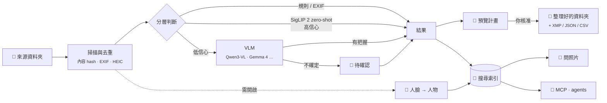
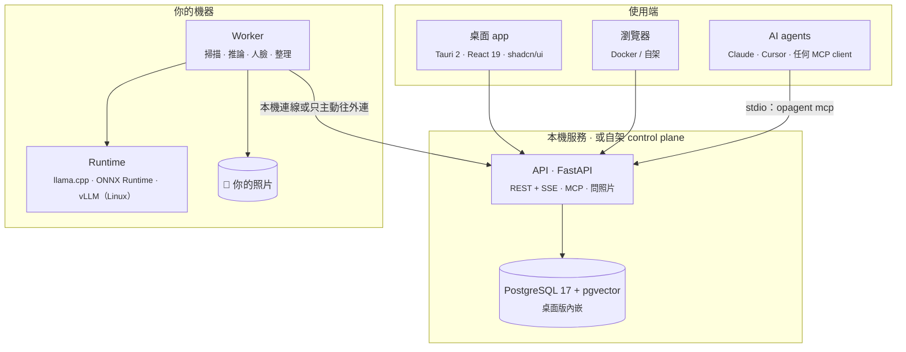

<div align="center">

<picture>
  <source media="(prefers-color-scheme: dark)" srcset="assets/banner-dark.svg">
  <source media="(prefers-color-scheme: light)" srcset="assets/banner-light.svg">
  
</picture>

<br/>

**裝好 app、選好照片資料夾，它就幫你把照片整理到指定的資料夾、用人臉找出每個人的照片，還能回答你對照片庫的任何問題。全部在你自己的電腦上完成，任何 AI agent 也能透過 MCP 來搜尋。**

[](https://github.com/romanticamaj/openphotoagent/releases)
[](LICENSE)
[](#-路線圖)
[](#-快速開始)
[](#-隱私優先的設計)
[](#-給-ai-agent-用mcp)
[](#-模型)
[](CONTRIBUTING.md)

[English](README.md) · **繁體中文**

[功能](#-功能) · [運作方式](#-運作方式) · [模型](#-模型) · [MCP](#-給-ai-agent-用mcp) · [路線圖](#-路線圖) · [設計文件](#-設計文件)

</div>

---

> [!NOTE]
> **OpenPhotoAgent 目前在設計階段。** 完整的技術規格放在 [`docs/`](docs/)，MVP 會公開開發。歡迎 Star 或 Watch 追蹤進度，也歡迎到 [Discussions](../../discussions) 或 [Issues](../../issues) 對設計提出意見。
>
> OpenPhotoAgent 現在是、以後也會是**免費的開源軟體**（Apache-2.0），沒有付費版，也沒有託管服務。

## ✨ 為什麼要做這個

你的 `DCIM/`、`Downloads/` 和舊備份硬碟裡大概躺著四萬張照片。雲端相簿要你上傳原檔；自架相簿雖然能用 CLIP 搜尋，卻不會幫你**寫描述、照「你的」類別分類、再歸檔到資料夾**；資料集 caption 工具則多半是單機程式，不能整理、不能搜尋，也沒有 API。

**OpenPhotoAgent 就是來補這個缺口的。** 你可以把它想成「照片版的 Hazel + Label Studio，再加上一個 MCP 介面」：一個 **Windows、macOS、Linux 都能用的桌面 app**（也可以用 Docker 架在家裡的伺服器上），在**你自己的硬體**上跑目前最好的開源視覺語言模型。每個變更動到檔案之前都會先給你預覽，每件事都告訴你要花多久，整理完的照片庫你和你的 AI agent 都能搜尋。

## 🎞 功能

<table>
<tr>
<td width="50%" valign="top">

### 📁 自動分類到你指定的資料夾
選好來源資料夾和要整理到哪裡，再選**依日期**、**依內容**（內建 12 類）或**你自己定義的類別**（用名稱、說明和範例照片描述）。路徑可以用 `{category}/{date:YYYY}/{place}` 這類樣板。每次執行都走**預覽 → 核准 → 寫操作日誌 → 執行**；**預設是複製**，搬檔一律先複製、驗證、再刪除，**每個操作都能復原**。結果也可以寫回 **XMP sidecar**、JSON 或 CSV。

</td>
<td width="50%" valign="top">

### 🧑‍🤝‍🧑 用人臉找照片
開啟人物辨識（**預設關閉**，而且只在你的電腦上執行），幫它分好的臉取名字，之後點一張臉或**拖進一張照片**，就能找出這個人的所有照片。也能和其他條件組合，例如「媽媽 海邊」。合併、拆分、修正錯誤都只要幾秒；資料夾樣板可以用 `{person}`；**一鍵刪除所有人臉資料**。

</td>
</tr>
<tr>
<td valign="top">

### 💬 問你的照片
「我去年在京都拍了幾張？挑 5 張最好看的。」直接用一句話問，回答會附上它依據的照片。每個步驟（搜尋、計數、看照片）都即時顯示進度和時間。回答只能引用工具真的找到的照片；需要動到檔案時，會先變成一份等你核准的計畫。

</td>
<td valign="top">

### 🧠 模型管理與環境醫生
依你的硬體只推薦**一個**組合，事先告訴你要下載多大、要多久。下載可以**暫停、續傳、真的取消**，並驗證 checksum。**環境醫生**會檢查 NVIDIA、AMD、Intel、Apple Silicon 的 GPU、驅動、記憶體和磁碟；不能執行時會說明原因，給你**一鍵修復**，或先用較慢的方式繼續。支援 Qwen3-VL、Gemma 4、SigLIP 2、JoyCaption 等模型，可以跑在 **llama.cpp、ONNX Runtime、vLLM、Ollama** 或任何 OpenAI 相容的端點上。

</td>
</tr>
<tr>
<td valign="top">

### ⏱ 每件事都告訴你要多久
開始之前先給預估（「28,412 張，約 2 小時 10 分」）；執行中顯示經過時間、依實測速度算出的剩餘時間，以及正在等待的原因（用電池中、GPU 被遊戲占用）。關掉視窗也沒關係，完成時會通知你。

</td>
<td valign="top">

### 🖼 看照片是種享受
「暗房裡的燈箱」風格，照片永遠是主角：justified 時間軸網格加上**日期 scrubber**、ThumbHash 即時佔位圖、流暢的縮放與轉場；資訊面板會顯示 AI 的判斷，可以直接就地修正；支援多選與批次操作。深色／淺色主題、全程鍵盤操作，符合 WCAG 2.2 AA。

</td>
</tr>
<tr>
<td valign="top">

### 🔎 混合式 AI 搜尋
像「去年春天在京都窗台上的貓」這種查詢，會同時用影像向量、全文搜尋（有正確的繁中斷詞）和標籤去找，再用 RRF 融合結果。也支援以圖搜圖、找重複照片，以及日期、地點、相機、標籤、人物等篩選條件。任何一次搜尋都可以**存成分類規則**。

</td>
<td valign="top">

### 🤖 給任何 AI agent 用的 MCP server
在 app 裡一鍵連接 **Claude Desktop、Claude Code 或 Cursor**。agent 可以用關鍵字、標籤、人物或語意來搜尋（`search_photos`、`find_similar`、`find_photos_of_person` 等）。**預設唯讀**、可限定資料夾範圍；agent 只能**提出**檔案變更，必須由**你**在 app 裡核准。

</td>
</tr>
</table>

## 🔄 運作方式



推論結果以 **（照片 hash、任務設定 hash、模型 fingerprint）** 當快取鍵，所以搬移檔案、重跑任務或調整信心門檻時，算過的東西都不會再算一次。

## 🧩 模型

app 會偵測你的硬體，只推薦**一個**組合。預設在所有平台上都跑 **llama.cpp（GGUF）+ ONNX Runtime**；vLLM 是 Linux／Docker 的選用加速路線。

| 你的硬體 | 主力 VLM（llama.cpp） | 常駐小模型（ONNX） |
|---|---|---|
| **NVIDIA ≥ 16 GB**（例如 RTX 5070 Ti / 4080） | **Qwen3-VL-8B** Q5_K_M（約 8–9 GB） | **SigLIP 2** so400m + 人臉模型 |
| 10–12 GB（NVIDIA / AMD / Intel） | Qwen3-VL-8B Q4_K_M（約 6.5 GB） | 同上 |
| 6–8 GB（例如 RTX 4060） | Qwen3-VL-4B Q4_K_M（約 3.5 GB） | 同上（輪流執行） |
| **Mac 16 GB**（Apple Silicon） | Qwen3-VL-4B Q4_K_M | SigLIP 2（Core ML）+ 人臉模型 |
| Mac 24–36 GB | Qwen3-VL-8B Q5_K_M | 同上 |
| 只有 CPU | **快速模式**：SigLIP 2 分類 + 搜尋 + 人臉，預設不跑 VLM | ONNX CPU |

<details>
<summary><b>進階與選用模型</b></summary>

| 選項 | 模型 |
|---|---|
| **難例複核** | Qwen3.6-35B-A3B Q4，MoE 的 expert 卸載到 CPU（需要 32 GB 以上 RAM） |
| **Linux／Docker 批次** | Qwen3-VL-8B-Instruct FP8 on vLLM（約 11.5 GB，吞吐量最高） |
| **長描述** | JoyCaption Beta One（英文）· Qwen3.6-35B-A3B（繁中） |
| **其他選擇** | Gemma 4 E4B / E2B / 26B-A4B、Qwen3.5-9B、InternVL3.5-8B、MiniCPM-V、Florence-2 |
| **遠端** | 任何 OpenAI 相容端點（你自己的 Ollama / LM Studio / vLLM，或雲端 API，會明確警示） |

專用模型：WD tagger v3 / Camie（動漫插畫）、JoyTagger、Meta PE-Core。預設人臉模型是 YuNet + AuraFace（Apache-2.0／MIT）。VRAM 數字都是估算，會在 M0 spike 實測，詳見 [docs/03](docs/03-inference-layer.md) 與 [docs/08 §3](docs/08-desktop-packaging-and-final-review.md)。

</details>

## 🤖 給 AI agent 用（MCP）

OpenPhotoAgent 本身就是一個 **MCP server**。桌面版在**設定 → 連接 AI 助手**會偵測 Claude Desktop、Claude Code 和 Cursor，先給你看設定檔要改什麼，再幫你寫入，不用打任何指令。

也可以用 `opagent` CLI 手動設定（例如連到 Docker 版）：

```bash
# Claude Code：本機 stdio
opagent login --server http://127.0.0.1:8080 --scopes photos:read,photos:media,organize:propose
claude mcp add openphotoagent -- opagent mcp

# Claude Code：自架 control plane，走 HTTP（v0.5）
claude mcp add --transport http openphotoagent https://photos.example.com/mcp
```

<details>
<summary><b>Claude Desktop · <code>claude_desktop_config.json</code></b></summary>

```json
{
  "mcpServers": {
    "openphotoagent": {
      "command": "opagent",
      "args": ["mcp", "--server", "http://127.0.0.1:8080"],
      "env": { "OPAGENT_MCP_READONLY": "1" }
    }
  }
}
```

桌面版會改寫成 app 內附 `opagent` 的絕對路徑，port 也會自動找到。

</details>

接上之後直接問就好：

> **你：** 幫我找去年春天日本旅行裡有貓的照片，放進一個叫「京都的貓」的相簿。
>
> **Agent：** *呼叫* `search_photos` → `create_collection` → `add_to_collection`
> 找到 23 張（2025 年 3–4 月，京都與大阪），已建立相簿**京都的貓**。
>
> **你：** 那這趟旅行剩下的照片，依城市分資料夾。
>
> **Agent：** *呼叫* `propose_organize` → *計畫已產生：412 個檔案 → `travel/2025/Japan/{city}/`。**請到 OpenPhotoAgent 裡檢查並核准。***（app 會跳出通知）

| 類別 | Tools |
|---|---|
| 搜尋與讀取 | `search_photos` `get_photo` `find_similar` `find_duplicates` `list_tags` `list_categories` `list_facets` `list_folders` |
| 人物² | `list_people` `get_person` `find_photos_of_person` |
| 描述與修正 | `describe_photo` `update_labels` |
| 相簿 | `create_collection` `add_to_collection` `remove_from_collection` `list_collections` |
| 任務 | `run_labeling_job` `get_job_status` `cancel_job` |
| 整理 | `propose_organize` `get_organize_plan` `apply_organize`¹ `undo_organize` |

¹ `apply_organize` 不會自己執行，只會送出核准請求，必須由你在 app 裡按下核准才會套用。
² 要先開啟人物辨識，**並且**另外允許 agent 使用才會出現。agent 永遠拿不到臉部特徵向量，也不能上傳人臉照片來找人。

## 🔒 隱私優先的設計

- **原檔永遠不離開你的機器。** 只有地端 Worker 能碰檔案系統和 GPU，CI 會用 import 規則強制檢查。
- **預設全部在本機。** 桌面版不需要帳號，只聽 `127.0.0.1`，每次啟動都換一組新的 token 保護。只有在你接上遠端模型、讓 AI agent 看縮圖、或讓「問照片」使用雲端 LLM 時，資料才會離開電腦，而且每一種都會清楚標示。
- **路徑沙箱。** Worker 只能存取你自己加入的資料夾，並阻擋 path traversal；API 和 agent 都不能新增資料夾。
- **人臉需要你主動開啟。** 人臉資料放在獨立的 schema，不會以向量形式交給 agent，一鍵就能全部刪除。
- **預設不信任 agent。** MCP 預設唯讀、所有寫入都要核准、把照片傳給 MCP client 需要另外授權；照片裡的文字、EXIF 和人名一律當成不可信資料處理，防止 prompt injection。
- 每個任務、檔案操作和 agent 呼叫都會留下**稽核紀錄**，而且可以復原。

## 🏗 架構



**同一套程式碼，三種使用方式：**
- **桌面 app**（主要方式）：Windows x64、macOS Apple Silicon、Linux x64。單人使用、不用登入，所有東西都包好了。
- **Docker all-in-one：** 在你的 GPU 主機或家用伺服器上 `docker compose up` 一行搞定。
- **自架 control plane + Worker**（v0.5）：控制台放在 NAS，GPU 主機用一次性配對碼連上。

## 🚀 快速開始

> [!IMPORTANT]
> 目前還不能執行，以下是 **v0.1** 規劃中的使用方式。

**桌面版：** 到 [Releases](https://github.com/romanticamaj/openphotoagent/releases) 下載你的作業系統的安裝檔（約 150 MB，不需要管理員權限），打開後選照片資料夾，照著唯一的推薦組合按「開始」。模型會在背景下載，同時開始掃描你的照片。

**Docker：**

```bash
git clone https://github.com/romanticamaj/openphotoagent && cd openphotoagent
cp deploy/compose/.env.example .env      # 設定 PHOTO_ROOTS=/path/to/photos
docker compose -f deploy/compose/allinone.yml up -d
open http://localhost:8080               # 首次啟動會偵測 GPU 並推薦模型
```

支援 NVIDIA、AMD、Intel GPU（建議 VRAM 6 GB 以上）、Apple Silicon Mac（建議 16 GB），或只有 CPU 的快速模式。環境醫生會告訴你這台電腦能跑什麼，缺什麼也會告訴你怎麼補。

## 🗺 路線圖

- [x] **設計** · [`v0.0.1`](https://github.com/romanticamaj/openphotoagent/releases/tag/v0.0.1)：競品調查、系統架構、推論層、UX、搜尋與 MCP 規格；接著補上模型與環境醫生、人臉、桌面打包、viewer 與問照片規格
- [ ] **M0 · Spike：** 三個作業系統上的桌面殼 + 嵌入式 Postgres、NVIDIA / AMD / Apple 上的 llama.cpp Qwen3-VL GGUF 與 SigLIP 2 ONNX、安裝包大小、簽章
- [ ] **v0.1 · 桌面 MVP：自動分類到資料夾：** 安裝包 + Docker、環境醫生、模型管理、時間預估、三種整理方式、預覽 → 核准 → 復原、照片 viewer、基礎搜尋
- [ ] **v0.2 · 人臉找照片 + 搜尋 + MCP：** 人物辨識、混合搜尋、找重複、`opagent mcp` 一鍵連接、XMP
- [ ] **v0.3 · 問照片：** app 內 AI 對話、監看資料夾自動處理、mini benchmark、預設組合分享
- [ ] **v0.4 · 生態：** MLX / vLLM / torch pack、Immich 與 Label Studio、地圖檢視、套件管理器
- [ ] **v0.5 · 自架 control plane：** 遠端 Worker、多人 RBAC、OIDC、MCP over HTTP + OAuth
- [ ] **v1.0 · 穩定版：** API 凍結、安全審查、完整的多語與無障礙

## 🆚 跟其他專案比較

| | 自訂類別 | 自選模型 | 整理到資料夾 | 用人臉找 | 用一句話問 | 給 agent 的 MCP | 桌面 app |
|---|:-:|:-:|:-:|:-:|:-:|:-:|:-:|
| Immich | — | 部分 | — | ✅ | — | — | —（Web） |
| PhotoPrism | — | Ollama | — | ✅ | — | — | —（Web） |
| TagGUI / qapyq | — | ✅ | — | — | — | — | ✅ |
| AI 檔案整理工具 | 部分 | 部分 | ✅ | — | — | — | 部分 |
| **OpenPhotoAgent** | ✅ | ✅ | ✅（可復原） | ✅（需開啟） | ✅ | ✅ | ✅ + Web |

依各專案 2026-11 的官方文件整理（[完整調查](docs/01-prior-art-and-naming.md)）。OpenPhotoAgent 的目標是跟 Immich、Label Studio **整合**，而不是取代它們。

## 📚 設計文件

| | 文件 | 內容 |
|---|---|---|
| 00 | [總規劃書](docs/00-master-plan.md) | 定位、三個主打功能、需求對照、跨文件裁決、路線圖 |
| 01 | [競品調查與命名](docs/01-prior-art-and-naming.md) | 約 30 個相關專案、缺口矩陣、build 還是 fork 的決策 |
| 02 | [系統架構](docs/02-system-architecture.md) | 部署形態、資料模型、任務生命週期、API、安全、monorepo |
| 03 | [推論層](docs/03-inference-layer.md) | 模型清單、adapter、三種任務策略、VRAM 管理、benchmark |
| 04 | [控制台 UX](docs/04-control-panel-ux.md) | 使用者旅程、頁面線框圖、設計系統、前端技術棧 |
| 05 | [搜尋與 MCP](docs/05-search-and-mcp.md) | 混合索引、繁中全文、MCP tools、核准流程、威脅模型 |
| 06 | [模型、環境醫生與長任務](docs/06-models-environment-operations.md) | 模型與下載管理、環境醫生、附修復按鈕的 preflight、每個操作的 ETA |
| 07 | [人臉辨識](docs/07-face-recognition.md) | 模型與授權調查、分群、以臉找人、同意與刪除、MCP scope |
| 08 | [桌面打包與最終審查](docs/08-desktop-packaging-and-final-review.md) | Tauri 殼、嵌入式 Postgres、runtime pack、簽章與更新、新手首次使用審查、**目前的路線圖** |
| 09 | [TDD 與測試套件](docs/09-tdd-and-test-suite.md) · [v0.1 案例](docs/09a-test-cases-v0.1.md) · [v0.2+ 案例](docs/09b-test-cases-v0.2-plus.md) | TDD 流程、測試替身、CI 矩陣、M0 實驗、840 條測試案例 |
| 10 | [照片 viewer 與問照片](docs/10-photo-viewer-and-ask-ai.md) | 時間軸網格、scrubber、Lightbox、批次操作；agent 迴圈、防幻覺、延遲目標 |
| 11 | [功能覆蓋審查](docs/11-feature-coverage-review.md) | 需求 → 規格覆蓋矩陣、衝突修正紀錄、v0.1 完成定義 |

測試策略規格（09）撰寫中。

## 🤝 參與貢獻

現在加入，就能一起決定這個專案的樣子。適合入手的方向：
- 🧪 **Benchmark：** 在你的 GPU 或 Mac 上跑 M0 spike，分享實測數據
- 🧠 **模型 adapter：** 新增一種 runtime 或模型
- 🎨 **設計：** 依照 [UX 規格](docs/04-control-panel-ux.md)和 [viewer 規格](docs/10-photo-viewer-and-ask-ai.md)畫 UI mockup
- 🌐 **翻譯：** 把設計文件翻成英文

詳見 [CONTRIBUTING.md](CONTRIBUTING.md)。安全性問題請看 [SECURITY.md](SECURITY.md)。

版本遵循 [SemVer](VERSIONING.md)，依 [Conventional Commits](https://www.conventionalcommits.org/) 自動發版；每個版本的變更請看 [CHANGELOG.md](CHANGELOG.md)。

## 📄 授權

[Apache License 2.0](LICENSE)。所有人都能免費使用，沒有付費版。模型權重各有自己的授權，OpenPhotoAgent 會在每次下載前顯示給你確認；非商用的人臉模型一律不隨 app 散布。

<div align="center">
<br/>
<sub>獻給照片太多、時間太少的你 ·
<a href="https://github.com/romanticamaj/openphotoagent">github.com/romanticamaj/openphotoagent</a></sub>
</div>
