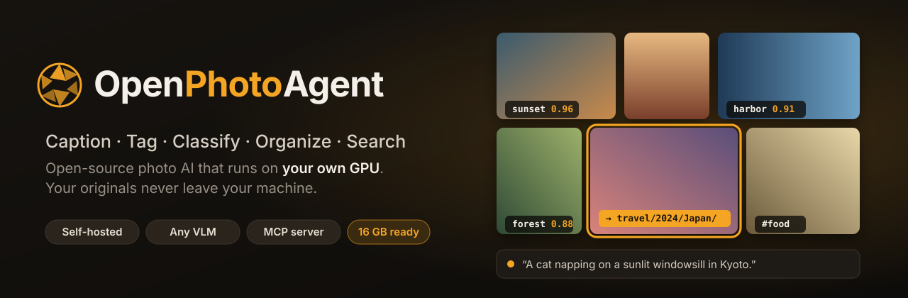
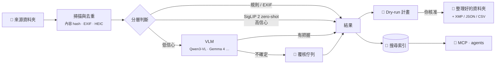
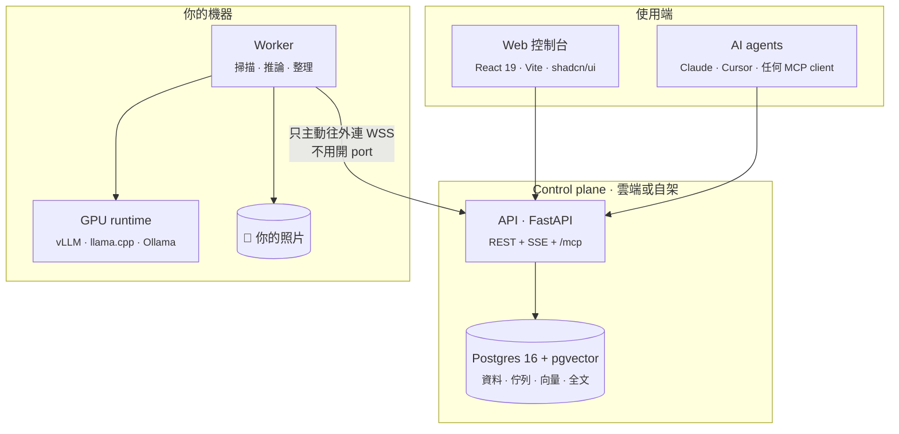

<div align="center">

<picture>
  <source media="(prefers-color-scheme: dark)" srcset="assets/banner-dark.svg">
  <source media="(prefers-color-scheme: light)" srcset="assets/banner-light.svg">
  
</picture>

<br/>

**選一個資料夾、挑一個模型，就能為照片產生描述、標籤和分類。接著可以自動整理進資料夾、用自然語言搜尋，或透過 MCP 交給任何 AI agent 使用。**

[](https://github.com/romanticamaj/openphotoagent/releases)
[](LICENSE)
[](#-路線圖)
[](#-隱私優先的設計)
[](#-給-ai-agent-用mcp)
[](#-模型)
[](CONTRIBUTING.md)

[English](README.md) · **繁體中文**

[功能](#-功能) · [運作方式](#-運作方式) · [模型](#-模型) · [MCP](#-給-ai-agent-用mcp) · [路線圖](#-路線圖) · [設計文件](#-設計文件)

</div>

---

> [!NOTE]
> **OpenPhotoAgent 目前在設計階段。** 完整的技術規格放在 [`docs/`](docs/)，MVP 會公開開發。歡迎 Star 或 Watch 追蹤進度，也歡迎到 [Discussions](../../discussions) 或 [Issues](../../issues) 對設計提出意見。

## ✨ 為什麼要做這個

你的 `DCIM/`、`Downloads/` 和舊備份硬碟裡大概躺著四萬張照片。雲端相簿要你上傳原檔；自架相簿雖然能用 CLIP 搜尋，卻不會幫你**寫描述、照「你的」類別分類、再歸檔到資料夾**；資料集 caption 工具則多半是單機桌面程式，不能整理、不能搜尋，也沒有 API。

**OpenPhotoAgent 就是來補這個缺口的。** 你可以把它想成「照片版的 Hazel + Label Studio，再加上一個 MCP 介面」：一個自架的 Web 控制台，在**你自己的 GPU** 上跑目前最好的開源視覺語言模型。每個變更動到檔案之前都會先給你預覽，整理完的照片庫你和你的 AI agent 都能搜尋。

## 🎞 功能

<table>
<tr>
<td width="50%" valign="top">

### 🏷 三種任務，一次推論
**Caption（描述）**、**Tagging（標籤）**、**Classification（分類）** 可以單獨跑，也可以合併成一次 structured JSON 推論。描述支援多語（繁中／英文）；標籤採用受控詞彙，同義詞會自動合併；分類用的是**你自己定義**的類別，用名稱、說明和範例照片來描述。

</td>
<td width="50%" valign="top">

### 🧠 什麼模型都能接
模型清單用 YAML 管理，每個模型都標出 VRAM 需求。支援 Qwen3-VL、Qwen3.6、Gemma 4、JoyCaption、Florence-2、SigLIP 2 等，可以跑在 **vLLM、llama.cpp、Ollama、transformers** 或任何 OpenAI 相容的端點上。內建 **mini benchmark**，直接用**你自己的**照片比較各模型的表現。

</td>
</tr>
<tr>
<td valign="top">

### 📁 安全、可復原的整理
選好來源和輸出資料夾，路徑可以用 `{category}/{date:YYYY}/{place}` 這類樣板。每次執行都走 **dry-run 預覽 → 核准 → 寫操作日誌 → 執行**；搬檔一律先複製、驗證、再刪除，**每個操作都能 undo**。結果也可以寫回 **XMP sidecar**、JSON 或 CSV。

</td>
<td valign="top">

### 🔎 混合式 AI 搜尋
像「去年春天在京都窗台上的貓」這種查詢，會同時用影像向量、全文搜尋（有正確的繁中斷詞）和標籤去找，再用 RRF 融合結果。也支援以圖搜圖、找重複照片，以及日期、地點、相機、標籤等篩選條件。任何一次搜尋都可以**存成分類規則**。

</td>
</tr>
<tr>
<td valign="top">

### 🤖 給任何 AI agent 用的 MCP server
**Claude Desktop、Claude Code、Cursor** 和任何 MCP client 都能接上。提供 21 個 tools，例如 `search_photos`、`find_similar`、`run_labeling_job`、`propose_organize`。預設唯讀、可限定資料夾範圍；agent 只能**提出**檔案變更，必須由**你**在瀏覽器上核准。

</td>
<td valign="top">

### 🖥 用起來很舒服的控制台
「暗房裡的燈箱」風格，照片永遠是主角。改任何設定，右側 **10 張樣本預覽**就會即時更新。可以拖拉建立類別、用一句話設定規則，覆核時全程鍵盤操作，GPU 使用率和處理速度也能即時監看。支援深色／淺色主題，符合 WCAG 2.2 AA。

</td>
</tr>
</table>

## 🔄 運作方式



推論結果以 **（照片 hash、任務設定 hash、模型 fingerprint）** 當快取鍵，所以搬移檔案、重跑任務或調整信心門檻時，算過的東西都不會再算一次。

## 🧩 模型

**16 GB GPU**（例如 RTX 5070 Ti / 4080 / 4070 Ti Super）的預設組合：

| 角色 | 預設 | VRAM（估算） |
|---|---|---|
| 常駐 embedding / zero-shot | **SigLIP 2** so400m-384（fp16） | 約 1.5 GB |
| 主力 VLM | **Qwen3-VL-8B-Instruct** FP8（vLLM），或 Q4/Q5 GGUF（llama.cpp） | 約 11.5 GB |
| 難例複核 | **Qwen3.6-35B-A3B** Q4，MoE 的 expert 部分卸載到 CPU | 部分卸載 |
| 長描述（選用） | **JoyCaption Beta One**（英文）· Qwen3.6-35B-A3B（繁中） | — |

<details>
<summary><b>其他 VRAM 級距與支援的模型</b></summary>

| 級距 | 建議模型 |
|---|---|
| **8 GB** | Gemma 4 E4B / E2B、Qwen3-VL-8B（Q4）、Florence-2、SigLIP 2 |
| **16 GB** | Qwen3-VL-8B FP8、Qwen3.5-9B、Gemma 4 26B-A4B（很緊）、InternVL3.5-8B、MiniCPM-V |
| **24 GB+** | Qwen3.6-27B、Qwen3.6-35B-A3B 全放 GPU、Gemma 4 31B |
| **遠端** | 任何 OpenAI 相容端點（你自己的 vLLM / Ollama / LM Studio，或雲端 API） |

專用模型：WD tagger v3 / Camie（動漫插畫）、JoyTagger、Meta PE-Core。VRAM 數字都是估算，會在 M0 spike 實測，詳見 [docs/03](docs/03-inference-layer.md)。

</details>

## 🤖 給 AI agent 用（MCP）

OpenPhotoAgent 本身就是一個 **MCP server**，任何 MCP client 都能接，可以走本機 `stdio`，也可以走遠端 Streamable HTTP + OAuth 2.1。

```bash
# Claude Code：本機
opl login --server http://127.0.0.1:8080 --scopes photos:read,photos:media,organize:propose
claude mcp add openphotoagent -- opl mcp

# Claude Code：遠端
claude mcp add --transport http openphotoagent https://photos.example.com/mcp
```

<details>
<summary><b>Claude Desktop · <code>claude_desktop_config.json</code></b></summary>

```json
{
  "mcpServers": {
    "openphotoagent": {
      "command": "opl",
      "args": ["mcp", "--server", "http://127.0.0.1:8080"],
      "env": { "OPL_MCP_READONLY": "1" }
    }
  }
}
```

</details>

接上之後直接問就好：

> **你：** 幫我找去年春天日本旅行裡有貓的照片，放進一個叫「京都的貓」的相簿。
>
> **Agent：** *呼叫* `search_photos` → `create_collection` → `add_to_collection`
> 找到 23 張（2025 年 3–4 月，京都與大阪），已建立相簿**京都的貓**。
>
> **你：** 那這趟旅行剩下的照片，依城市分資料夾。
>
> **Agent：** *呼叫* `propose_organize` → *計畫已產生：412 個檔案 → `travel/2025/Japan/{city}/`。**請到這裡檢查並核准：** `http://127.0.0.1:8080/approvals/…`*

| 類別 | Tools |
|---|---|
| 搜尋與讀取 | `search_photos` `get_photo` `find_similar` `find_duplicates` `list_tags` `list_categories` `list_facets` `list_folders` |
| 描述與修正 | `describe_photo` `update_labels` |
| 相簿 | `create_collection` `add_to_collection` `remove_from_collection` `list_collections` |
| 任務 | `run_labeling_job` `get_job_status` `cancel_job` |
| 整理 | `propose_organize` `get_organize_plan` `apply_organize`¹ `undo_organize` |

¹ `apply_organize` 不會自己執行，只會回傳一個核准連結，必須由人在瀏覽器上按下核准才會套用。

## 🔒 隱私優先的設計

- **原檔永遠不離開你的機器。** 只有地端 Worker 能碰檔案系統和 GPU，CI 會用 import 規則強制檢查。
- **路徑沙箱。** Worker 只能存取你允許的根目錄，並阻擋 path traversal。
- **每個 workspace 有四級資料外送設定**，最嚴格的 `results-only` 連縮圖都不會離開 Worker。
- **預設不信任 agent。** MCP 預設唯讀、所有寫入都要核准、把照片傳給 MCP client 需要另外授權；照片裡的文字和 EXIF 一律當成不可信資料處理，防止 prompt injection。
- 每個任務、檔案操作和 agent 呼叫都會留下**稽核紀錄**。

## 🏗 架構



**同一套程式碼，兩種部署方式：**
- **All-in-one：** 在你的 GPU 主機上 `docker compose up` 一行搞定。
- **Control plane + 地端 Worker：** 控制台放在 NAS 或雲端，GPU 主機上的 Worker 用一次性配對碼連上。

## 🚀 快速開始

> [!IMPORTANT]
> 目前還不能執行，以下是 **v0.1** 規劃中的使用方式。

```bash
git clone https://github.com/romanticamaj/openphotoagent && cd openphotoagent
cp deploy/compose/.env.example .env      # 設定 PHOTO_ROOTS=/path/to/photos
docker compose -f deploy/compose/allinone.yml up -d
open http://localhost:8080               # 首次啟動會偵測 GPU 並推薦模型
```

需求：VRAM 8 GB 以上的 NVIDIA GPU（建議 16 GB）、支援 CUDA 12.8+ 的新版驅動（RTX 50 系列 Blackwell 必須）、Docker 與 NVIDIA Container Toolkit。

## 🗺 路線圖

- [x] **設計** · [`v0.0.1`](https://github.com/romanticamaj/openphotoagent/releases/tag/v0.0.1)：競品調查、系統架構、推論層、UX、搜尋與 MCP 規格
- [ ] **M0 · Spike：** 在 RTX 5070 Ti 上實測 vLLM + Qwen3-VL-8B FP8 和 SigLIP 2，並驗證繁中 zero-shot 的品質
- [ ] **v0.1 · MVP：** all-in-one compose、建立任務精靈、Caption / Tag / 分類、dry-run → 核准 → undo、覆核佇列、照片瀏覽
- [ ] **v0.2 · 搜尋 + MCP：** 混合搜尋、以圖搜圖、找重複、`stdio` MCP server、監看資料夾自動處理
- [ ] **v0.3 · 模型：** 模型管理、mini benchmark、預設組合分享、XMP 寫回、Immich 與 Label Studio 整合
- [ ] **v1.0 · SaaS 化：** control plane + 配對的地端 Worker、多租戶 RBAC、MCP over HTTP + OAuth 2.1、桌面版（Tauri）
- [ ] **v2：** VLM 重新排序、人臉群組（需使用者同意）、智慧相簿、內建 chat 助手

## 🆚 跟其他專案比較

| | 自訂類別 | 自選模型 | 整理到資料夾 | 混合搜尋 | 給 agent 的 MCP | Web UI |
|---|:-:|:-:|:-:|:-:|:-:|:-:|
| Immich | — | 部分 | — | CLIP | — | ✅ |
| PhotoPrism | — | Ollama | — | 部分 | — | ✅ |
| TagGUI / qapyq | — | ✅ | — | — | — | 桌面程式 |
| AI 檔案整理工具 | 部分 | 部分 | ✅ | — | — | — |
| **OpenPhotoAgent** | ✅ | ✅ | ✅（可復原） | ✅ | ✅ | ✅ |

依各專案 2026-11 的官方文件整理（[完整調查](docs/01-prior-art-and-naming.md)）。OpenPhotoAgent 的目標是跟 Immich、Label Studio **整合**，而不是取代它們。

## 📚 設計文件

| | 文件 | 內容 |
|---|---|---|
| 00 | [總規劃書](docs/00-master-plan.md) | 定位、需求對照、跨文件裁決、路線圖 |
| 01 | [競品調查與命名](docs/01-prior-art-and-naming.md) | 約 30 個相關專案、缺口矩陣、build 還是 fork 的決策 |
| 02 | [系統架構](docs/02-system-architecture.md) | 部署形態、資料模型、任務生命週期、API、安全、monorepo |
| 03 | [推論層](docs/03-inference-layer.md) | 模型清單、adapter、三種任務策略、VRAM 管理、benchmark |
| 04 | [控制台 UX](docs/04-control-panel-ux.md) | 使用者旅程、14 個頁面的線框圖、設計系統、前端技術棧 |
| 05 | [搜尋與 MCP](docs/05-search-and-mcp.md) | 混合索引、繁中全文、MCP tools、核准流程、威脅模型 |

## 🤝 參與貢獻

現在加入，就能一起決定這個專案的樣子。適合入手的方向：
- 🧪 **Benchmark：** 在你的 GPU 上跑 M0 spike，分享實測數據
- 🧠 **模型 adapter：** 新增一種 runtime 或模型
- 🎨 **設計：** 依照 [UX 規格](docs/04-control-panel-ux.md)畫 UI mockup
- 🌐 **翻譯：** 把設計文件翻成英文

詳見 [CONTRIBUTING.md](CONTRIBUTING.md)。安全性問題請看 [SECURITY.md](SECURITY.md)。

版本遵循 [SemVer](VERSIONING.md)，依 [Conventional Commits](https://www.conventionalcommits.org/) 自動發版；每個版本的變更請看 [CHANGELOG.md](CHANGELOG.md)。

## 📄 授權

[Apache License 2.0](LICENSE)。模型權重各有自己的授權，OpenPhotoAgent 會在每次下載前顯示給你確認。

<div align="center">
<br/>
<sub>獻給照片太多、時間太少的你 ·
<a href="https://github.com/romanticamaj/openphotoagent">github.com/romanticamaj/openphotoagent</a></sub>
</div>
