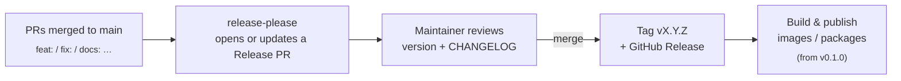

# Versioning & Releases

[繁體中文摘要在下方](#繁體中文摘要)

OpenPhotoAgent follows **[Semantic Versioning 2.0.0](https://semver.org/)**, and every release is tagged `vMAJOR.MINOR.PATCH` on `main`.

## 1. One product version

The whole monorepo (web, api, worker, cli and all packages) shares **one version number**, kept in [`version.txt`](version.txt). A control plane and a worker with the same `MAJOR.MINOR` are always compatible. When Python (`pyproject.toml`) and npm (`package.json`) packages are added, release-please will keep their versions in sync through `extra-files`.

## 2. What bumps what

| Phase | Breaking change | New feature | Fix / docs |
|---|---|---|---|
| **0.0.x**: design phase (now) | patch | patch | patch |
| **0.x**: pre-1.0 (MVP onward) | **minor** (`0.3 → 0.4`) | patch | patch |
| **≥ 1.0**: stable | **major** | minor | patch |

Pre-1.0 means **anything may change between minor versions**. Breaking changes are always called out in the release notes under ⚠️ *Breaking Changes*, together with a migration note.

### Pre-releases

| Tag | Meaning |
|---|---|
| `v0.1.0-alpha.1` | Feature-incomplete, for early testers |
| `v0.1.0-beta.1` | Feature-complete, still stabilizing |
| `v0.1.0-rc.1` | Release candidate. If no blockers turn up, it ships unchanged |

Pre-release tags and the whole `v0.0.x` line are marked as **Pre-release** on GitHub.

## 3. Milestones → versions

| Version | Milestone (see [roadmap](README.md#-roadmap)) |
|---|---|
| `v0.0.x` | Design specs, M0 spike results |
| `v0.1.0` | **Desktop MVP** (Windows / macOS / Linux installers + Docker all-in-one): auto-sort photos into folders, model manager, environment doctor, ETAs, dry-run → approve → undo, photo viewer |
| `v0.2.0` | **Find photos by face** + hybrid search + `stdio` MCP server (`opagent mcp`), XMP |
| `v0.3.0` | **Ask your photos** (in-app AI chat), watch folders, mini benchmark, presets sharing |
| `v0.4.0` | Ecosystem: MLX / vLLM / torch packs, Immich / Label Studio, package managers |
| `v0.5.0` | Self-hosted control plane + remote workers, multi-user RBAC / OIDC, OAuth MCP over HTTP |
| `v1.0.0` | Stable: REST, worker protocol, MCP tool manifest and `pack_api` frozen; security review |

> The authoritative roadmap is [docs/08 §9](docs/08-desktop-packaging-and-final-review.md). "SaaS" anywhere in the docs means a **self-hosted** control plane; there is no paid hosted service.

## 4. Interfaces versioned separately

Some contracts are consumed by other software. They carry their own versions so they can stay stable while the product moves fast:

| Contract | Scheme | Compatibility promise |
|---|---|---|
| REST API | URL prefix `/api/v1` | Additive changes only within `v1`; removing or renaming a field requires `/api/v2`, and both are served for at least one minor release |
| Worker ↔ control plane protocol | `protocol_version` string `"MAJOR.MINOR"`, negotiated in the `hello`/`welcome` handshake (independent of the product version) | Minor bumps are additive only (new optional fields, messages or task types; nothing removed or tightened). Any breaking change bumps the major. The control plane serves protocol majors **N and N-1**; older workers get `welcome.status = "upgrade_required"` (lease/poll return 426), newer ones get `"server_too_old"`. Enforced by the FRZ-002 contract snapshot (ADR-0017) |
| MCP tools | MCP spec version negotiated by the transport, plus a tool manifest `version` | Adding tools or optional params is non-breaking. Removing or renaming a tool is a breaking change and goes in the release notes |
| Model registry YAML | `schema_version` field | Older registry files are auto-migrated on load |
| Database | Alembic migrations, forward-only | Upgrading from **any release of the previous minor** is supported. Downgrades mean restoring a backup |
| Pipeline / preset files | `schema_version` field | Presets exported from an older version import into newer ones |
| Runtime pack | `pack_api` integer + `packs.lock.json` | No breaking pack changes within a minor release; the app refuses incompatible or unsigned packs |
| Desktop data dir layout | `layout_version` | Migrated automatically on first launch of a newer version, after a backup |

From v1.0 every contract above has a snapshot in `contracts/` (`just contracts` checks, `just contracts-update` rewrites; 09b §9.1). A difference that is only additive needs the snapshot updated in the same PR; a breaking one needs the new major and a `Migration:` note in the CHANGELOG.

## 5. Artifacts per release *(from v0.1.0)*

| Artifact | Tags |
|---|---|
| Docker images: `ghcr.io/romanticamaj/openphotoagent-{api,worker,web}` | `X.Y.Z`, `X.Y`, `latest` (stable only), `edge` (every commit on `main`) |
| Python packages (PyPI) / CLI | `X.Y.Z` |
| Desktop installers (v0.1+) | `X.Y.Z` installers (NSIS / dmg / AppImage / deb / rpm) attached to the GitHub Release; `stable` and `beta` updater channels |

## 6. How a release happens

We use **[Conventional Commits](https://www.conventionalcommits.org/)** with **[release-please](https://github.com/googleapis/release-please)**:



| Commit | Effect |
|---|---|
| `fix: …` | patch |
| `feat: …` | minor (patch while pre-1.0) |
| `feat!: …` or a `BREAKING CHANGE:` footer | major (minor while pre-1.0) |
| `docs:` `perf:` `security:` | listed in the changelog, patch |
| `chore:` `ci:` `test:` `refactor:` `build:` | hidden from the changelog |

**Manual or emergency release:** bump `version.txt`, add a `## [X.Y.Z] - YYYY-MM-DD` section to `CHANGELOG.md`, update `.release-please-manifest.json`, commit, then push an annotated tag:

```bash
git tag -a v0.0.2 -m "v0.0.2" && git push origin v0.0.2
```

The [`release-on-tag`](.github/workflows/release-on-tag.yml) workflow checks that the tag matches `version.txt`, pulls that version's section out of `CHANGELOG.md`, and publishes the GitHub Release.

> **One-time repo setting:** Settings → Actions → General → Workflow permissions → enable **"Allow GitHub Actions to create and approve pull requests"**. Without it, release-please cannot open its Release PR.

---

## 繁體中文摘要

- 採用 **SemVer 2.0**，tag 格式為 `vX.Y.Z`；整個 monorepo **共用同一個版號**（`version.txt`）。
- **0.0.x**（目前的設計階段）：任何變更都只升 patch。**0.x**（MVP 之後）：破壞性變更升 minor，新功能和修正升 patch。**1.0 以後**：照標準 SemVer。
- 預發布版本依序是 `-alpha.N`、`-beta.N`、`-rc.N`；預發布版本和整個 v0.0.x 系列在 GitHub 上都標示為 Pre-release。
- 里程碑：v0.1 桌面 MVP（自動分類到資料夾）→ v0.2 人臉找照片 + 混合搜尋 + MCP → v0.3 AI 問照片 + watch folder → v0.4 生態 → v0.5 自架 control plane → v1.0 穩定（以 docs/08 §9 為準）。桌面安裝包從 v0.1 起隨 GitHub Release 發佈。
- REST API（`/api/v1`）、Worker 協定、MCP tools、Model registry、DB migration、Preset 檔、Runtime pack（`pack_api`）、桌面資料目錄（`layout_version`）都**各自有版本**和相容性承諾，產品版號跳得快也不會打壞外部整合。
- 發版流程：commit 遵循 Conventional Commits → release-please 自動開 Release PR → 維護者審核後合併 → 自動打 tag、產生 CHANGELOG、建立 GitHub Release。緊急時也可以手動打 tag，由 `release-on-tag` workflow 從 CHANGELOG 擷取 release note 並發布。
- 需要在 repo 設定裡開啟「Allow GitHub Actions to create and approve pull requests」一次。
