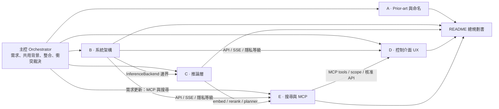
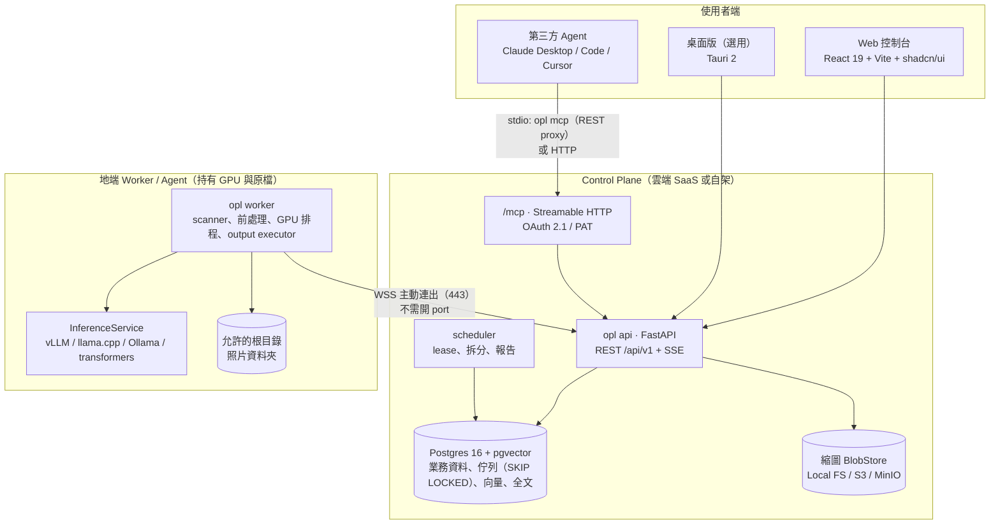

# OpenPhotoAgent — 總規劃書

> 開源、可自架的照片 AI 標註與整理平台：**Caption / Tagging / 分類 → 安全歸檔 → 混合搜尋 → 以 MCP 開放給第三方 AI agent**。
> 狀態：規劃 Draft v0.1（2026-11）｜參考硬體：RTX 5070 Ti 16GB（Blackwell sm_120，CUDA 12.8+）
> 授權建議：Apache-2.0（與主要模型 Qwen / Gemma 4 / SigLIP2 授權一致，利於企業採用）

---

## 0. 一句話定位

**「照片版的 Hazel + Label Studio，再加上一個 MCP 介面」**：自架的 Web 控制台讓你選模型、定義任務與類別，在自己的 GPU 上批次處理，dry-run 預覽後再把照片安全地整理到資料夾（可 undo，可寫回 XMP）。處理完的索引可以混合搜尋，也透過 MCP 開放給 Claude Desktop、Claude Code、Cursor 等第三方 agent 查詢與操作。照片原檔永遠不會離開你的機器。

### 為什麼不 fork 現有專案（詳見 [01](01-prior-art-and-naming.md)）

| 現有專案 | 有的 | 缺的 |
|---|---|---|
| Immich（約 118k★）| CLIP 搜尋、人臉 | 沒有 VLM caption、不能自訂分類、不搬檔，plugin 要等 v3 |
| PhotoPrism（約 40k★）| 可接 Ollama 產生 caption 與 labels | 不能自訂類別、不整理資料夾 |
| TagGUI / qapyq | 可選多種模型、caption 品質好 | 只是桌面單機工具，沒有歸檔、搜尋、API |
| ai-file-sorter / Local-File-Organizer | 會搬檔 | 不是專為照片設計、沒有 Web UI、不能選模型 |
| Label Studio（約 28.6k★）| 標註平台 | 不是給個人整理照片用的 → 只做**匯出相容** |

結論：**核心自己寫（build）**；透過 Immich API 回寫結果，支援 Label Studio 匯出格式，並借用 organize 的規則語法和 PhotoPrism `vision.yml` 的設定結構。

---

## 1. 規劃方式：sub-agent 架構

這份規劃由 1 個主控（orchestrator）與 5 個平行的專職 sub-agent 完成。每個 sub-agent 負責一份規格文件，只透過「介面邊界」和其他文件溝通；主控負責分派、處理跨文件衝突，並整合成本文件。



| 文件 | Sub-agent | 內容 |
|---|---|---|
| [01-prior-art-and-naming.md](01-prior-art-and-naming.md) | A · 研究員 | 20 多個相似專案的缺口矩陣、build / fork / 整合建議、名稱可用性 |
| [02-system-architecture.md](02-system-architecture.md) | B · 系統架構師 | 部署形態、技術棧、ER 模型、Job 生命週期、REST 與 Worker 協定、安全、monorepo |
| [03-inference-layer.md](03-inference-layer.md) | C · ML 架構師 | Model Registry、Adapter / InferenceService、三種任務策略、VRAM 管理、benchmark |
| [04-control-panel-ux.md](04-control-panel-ux.md) | D · 產品設計師 | 使用者旅程、14 個頁面的 wireframe、設計系統、前端技術棧 |
| [05-search-and-mcp.md](05-search-and-mcp.md) | E · 搜尋與 Agent 整合架構師 | 混合搜尋索引、繁中全文、MCP server（21 個 tools）、核准流程、prompt injection 防護 |

> 這套分工之後可以延續到實作：每份文件對應一個實作 sub-agent 與一組 package，各自以「一致性測試」作為合約（見 §6）。

---

## 2. 系統全貌



**兩種部署形態，同一套程式碼**（[02 §1](02-system-architecture.md)）
- **All-in-one**：一個 `docker compose`（web + api + worker[GPU] + postgres）。個人在 5070 Ti 機器上一鍵安裝。
- **Control plane + 地端 Agent**：控制台放雲端或 NAS，Worker 留在 GPU 機器上，用一次性配對碼加 ed25519 金鑰配對。多租戶使用 org / workspace / RBAC。

---

## 3. 需求對照

| 需求 | 對應設計 | 文件 |
|---|---|---|
| 1. 精美控制介面 | 「暗房裡的燈箱」深色 UI、單一琥珀強調色、OKLCH token、Inter + Noto Sans TC、WCAG 2.2 AA、全鍵盤操作；New Job 精靈右側常駐 10 張樣本的「顯影」預覽 | 04 §3–4 |
| 2. 可選不同模型 | YAML Model Registry 依 8 / 16 / 24GB+ 分級；Models 頁有 VRAM 徽章、一鍵下載；內建 mini benchmark，用你自己的 golden set 比較準確率、速度、VRAM | 03 §1, §6；04 §3.8 |
| 3. 任務類型 | Caption / Tagging / Classification 可單選或合併成一次 fused JSON 推論；分類用 cascade：規則 → SigLIP2 → VLM enum → needs_review | 03 §3 |
| 4. 來源 / 分類 / 輸出資料夾 | Sources 可瀏覽 Worker 端遠端資料夾（只限允許的根目錄）；輸出樣板如 `{category}/{date:YYYY}/`；動作有 copy / move / symlink / sidecar（XMP / JSON / CSV）；流程為 dry-run → 核准 → journal → 執行 → 可 undo | 02 §4, §6；04 §3.2–3.5 |
| 延伸：AI 搜尋 | 影像向量 + 全文（jieba + OpenCC + bigram）+ tag 混合搜尋，以加權 RRF 融合；提供以圖搜圖、找重複照片、自然語言轉 filter chips | 05 §1–2 |
| 延伸：MCP 給第三方 agent | 21 個 tools；預設唯讀 scope、可限定資料夾範圍；檔案變更只產生計畫，必須在網頁人工核准；`mcp_media_policy` 控制縮圖外送 | 05 §3 |

### 16GB 預設模型組合（[03 §8](03-inference-layer.md)）

| 角色 | 預設 | VRAM（估算） |
|---|---|---|
| 常駐小模型（embedding / zero-shot） | SigLIP2 so400m-384 fp16 | 約 1.5GB |
| 主力 VLM | Qwen3-VL-8B-Instruct FP8（vLLM）；沒有 vLLM 時改用 Q4 / Q5 GGUF（llama.cpp） | 約 11.5GB |
| 難例複核（序列切換） | Qwen3.6-35B-A3B Q4（llama.cpp `--n-cpu-moe`，需要 32GB 以上 RAM） | 部分卸載到 CPU |
| 長 caption（選用） | JoyCaption Beta One（英文）/ Qwen3.6-35B-A3B（繁中） | — |

---

## 4. 主控裁決：跨文件介面整合

5 份文件是平行寫的，下列不一致之處以本節為準，實作時再回寫到各文件。

| # | 衝突 / 缺口 | 裁決 |
|---|---|---|
| R1 | 02 定義 `InferenceBackend`（每個模型一個 backend，`run_batch`）；03 定義 `InferenceService`（門面，負責路由、fallback、cascade） | **兩層都保留**：Worker 只依賴 03 的 `InferenceService`（唯一門面）；02 的 `InferenceBackend` 降為 adapter 層的 SPI，放在 `packages/inference-sdk`，附 FakeBackend 與一致性測試。`ItemResult` 補上 `model_fingerprint`（每個 provenance 一個）與 `confidence`，滿足 02 的快取合約 |
| R2 | 快取鍵（02）需要穩定的 fingerprint | fingerprint = hash(model_id, 權重 revision / checksum, 量化, runtime 版本, prompt_template 版本)。門檻不算進去（02 原則） |
| R3 | 05 需要 03 提供 `embed_texts`、`query.plan`、`rerank`、`describe`、`contains_image_text` | 納入 03 v0.2 範圍。text embedding 的 `space` 用 fingerprint + modality 識別；caption 同時存 zh-Hant 與短英文 `caption_en`（方便 SigLIP 與英文全文搜尋） |
| R4 | 05 需要多語 text embedding（R2 路線，v1） | v1 再選型（候選：bge-m3、Qwen3-Embedding 系列，【未驗證】），與 VLM 序列載入 |
| R5 | 04 §7.3 需要的 SSE 事件與欄位 | 加入 02 的 API：SSE 事件 `preview.item`、`model.download.progress`、`plan.apply.progress`、`scan.progress`、`mcp.call`、`mcp.approval`；`GET /output-plans/{id}/tree?depth=`；`asset` 增加 `thumbhash`、`width`、`height` |
| R6 | 門檻判定與 path template 前後端都要算（04 的即時預覽） | 在 `packages/core` 寫純函式，TS 版用 golden test 對齊（之後可考慮 WASM） |
| R7 | MCP token scope 要和 RBAC 對齊 | scope 字串 = RBAC permission string（例如 `photos:read`、`photos:media`、`jobs:run`、`organize:propose`）；`organize:apply` **不發給** MCP token，只能在瀏覽器核准 |
| R8 | CLI 名稱 | 文件暫用 `opl`。`opa` 已是 Open Policy Agent 的 CLI，所以**不採用**；正式名稱待定（候選 `opagent` / `photoagent`），見 §8 |

---

## 5. 版本路線圖

| 階段 | 目標 | 範圍 |
|---|---|---|
| **M0 · Spike（2 週）** | 消除最大的技術風險 | 03 §9、05 §10 的待驗證清單：5070 Ti 上 vLLM（sm_120）跑 Qwen3-VL-8B FP8 的吞吐量、llama.cpp mmproj 加 logprobs、SigLIP2 對繁中類別的 zero-shot 品質、Gemma 4 26B-A4B 在 16GB 能用多長的 context |
| **MVP v0.1** | 單機 all-in-one，跑完整的「選資料夾 → 分類 → 歸檔」 | docker compose；Sources（本機 Worker）；New Job 精靈；三種任務 + fused 推論；Qwen3-VL-8B + SigLIP2；dry-run、核准、journal、undo；Review 佇列；Gallery；JSON / CSV sidecar；Onboarding 偵測 GPU |
| **v0.2** | 搜尋 + MCP（唯讀為主） | `search_doc` + 繁中斷詞 + facet + 影像向量 + RRF；以圖搜圖、找重複照片；**stdio `opl mcp` + PAT**；MCP tools：search / get_photo / find_similar / list_* / run_labeling_job / propose_organize（套用時導到 UI 核准）；watch folder 自動標註 |
| **v0.3** | 選模型與評估 | Models 頁、HF 下載與 checksum、mini benchmark、Presets 分享、XMP 寫回、Immich 回寫、Label Studio 匯出 |
| **v1.0** | Control plane + 地端 Agent，可作為 SaaS | Worker 配對（WSS）、多租戶 RBAC、四級隱私設定、OIDC；MCP over HTTP + OAuth 2.1、URL elicitation 核准、collections；caption 文字向量；本地 LLM query planner；Tauri 桌面版 |
| **v2** | 進階功能 | VLM rerank、results-only 邊緣索引、人臉群組（需同意機制）、內建 chat 助手（重用同一組 MCP tools）、智慧集合、Helm chart |

---

## 6. Monorepo 與實作分工

```
openphotoagent/
├─ apps/        web · api（含 mcp/、oauth/）· scheduler · worker · cli（opl login / opl mcp）
├─ packages/    core · schemas · db · storage · fs-sandbox · inference-sdk · inference-adapters
│               output-actions · search · mcp-tools · geo · integrations · ts-client
├─ deploy/      compose（allinone / controlplane / worker）· docker（worker.cuda128）· helm
└─ docs/        ← 本規劃（01–05）
```

**強制的依賴規則**（CI 用 import-linter 檢查）：`api` 不得依賴 `fs-sandbox` 和 `inference-*`，從結構上保證 control plane 碰不到原檔與 GPU；`core` 是純函式；`cli` 只依賴 `schemas` 加 HTTP client。

**實作階段的 sub-agent 分工**（建議）：

| 實作 agent | 負責 packages | 合約 / 驗收 |
|---|---|---|
| Core & Schemas | core、schemas、db | 狀態機與 config_hash 的單元測試；產生 OpenAPI 與 TS 型別 |
| Worker & Sandbox | worker、fs-sandbox、output-actions | path traversal 模糊測試；move / undo 在當機注入下的恢復測試 |
| Inference | inference-sdk、inference-adapters | `InferenceBackend` 一致性測試套件；fixtures 上的 golden 輸出 |
| Search & MCP | search、mcp-tools、geo、apps/api/mcp、cli | RRF 回歸測試；MCP tool schema 快照；prompt injection 紅隊測試集 |
| Web | apps/web、ts-client | Playwright E2E 跑完旅程 A / B；axe 無障礙檢查；視覺回歸 |

---

## 7. 關鍵設計決策（跨文件 ADR 摘要）

1. **只有 Worker 能碰原檔與 GPU**；路徑一律用「根目錄別名 + 相對路徑」，在 Worker 端檢查（02）。
2. **用內容 hash 識別照片**，推論快取鍵 =（照片 hash、任務設定 hash、模型 fingerprint）；檔案搬家、重跑都不用重算，調門檻也不用重新推論（02）。
3. **輸出動作一律是「計畫 → 核准 → journal → 執行」**；move 先 copy 並驗證 hash 再刪原檔，原檔進 trash，全部可 undo（02）。
4. **分類用 cascade**，先用便宜的方法，只有低信心才交給 VLM；信心來自 logprob 或相似度差距，低於門檻就進覆核佇列（03）。
5. **佇列直接用 Postgres `SKIP LOCKED`**，不用 Redis 或 Celery；整個系統一個 DB 就能跑（02）。
6. **混合搜尋用加權 RRF**；向量依 `embedding_space` 分版本，換模型時藍綠切換（05）。
7. **MCP 不能自行套用檔案變更**；agent 只能提案，套用必須在瀏覽器人工核准；照片傳給 MCP client 視為一種資料外送，需要另外授權（05）。
8. **照片裡的文字和 EXIF 一律當不可信資料**，隔離並淨化後才放進 tool 結果，防止 prompt injection（05）。

---

## 8. 待決事項（需要你決定）

| # | 事項 | 選項 / 建議 |
|---|---|---|
| Q1 | 正式名稱與 CLI | `OpenPhotoAgent`（GitHub repo、PyPI、npm 的 `openphotoagent` / `open-photo-agent` 目前都沒人用；GitHub 帳號名和商標未查）。CLI 建議 `opagent` |
| Q2 | 授權 | 建議 Apache-2.0。如果要防止雲端廠商直接拿去包成服務，可考慮 AGPL-3.0（與 Immich 相同） |
| Q3 | 商業模式 | 純社群專案 / open-core（託管 control plane 收費，地端 Worker 免費）/ 只做自架 |
| Q4 | MVP 是否先做桌面版 | Tauri 版選資料夾體驗最好，但會多一條打包線；建議 v1 再做 |

---

## 9. 下一步

1. 你確認 §8 的 Q1–Q3。
2. 執行 M0 spike：在你的 5070 Ti 上跑 vLLM + Qwen3-VL-8B FP8 和 SigLIP2，用 100 張照片量測吞吐量與分類準確率。
3. 建立 monorepo 骨架（uv + pnpm workspace、compose、CI 依賴規則），開始做 MVP v0.1。
