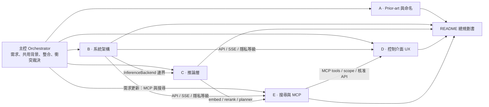
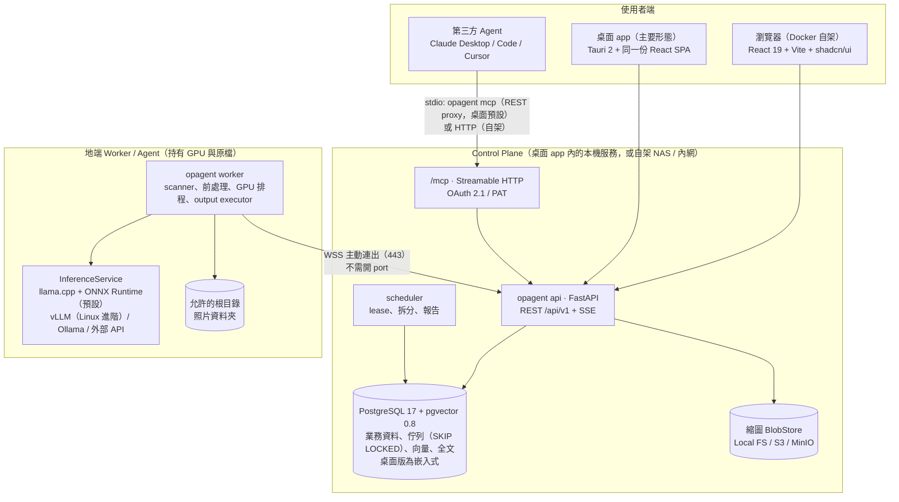

# OpenPhotoAgent — 總規劃書

> 純開源、免費的照片 AI 整理工具：**下載即用的跨平台桌面 app（也能 Docker 自架）**。三個主打功能：**① 照片自動分類到你指定的資料夾 ② 用人臉找照片 ③ 用自然語言問你的照片**；另外有模型管理與環境醫生、精美的照片 viewer，以及給第三方 AI agent 用的 MCP。
> 狀態：規劃 Draft v0.2（2026-11，審查整合後）｜參考硬體：RTX 5070 Ti 16GB、RTX 4060 8GB、M2 MacBook Air 16GB
> 授權：**Apache-2.0（已定案）**｜CLI：**`opagent`（已定案）**｜商業模式：**純開源社群專案，不收費、沒有付費託管、沒有 open-core（已定案）**。文件中的「SaaS」一律指「自架 control plane」（家用 NAS 或公司內網）。

---

## 0. 一句話定位

**「照片版的 Hazel + Label Studio，再加上一個 MCP 介面」**：裝好桌面 app、選好照片資料夾，它就在你自己的電腦上（NVIDIA / AMD / Intel / Apple Silicon / 只有 CPU 都能跑）幫照片寫 caption、打標籤、分類，先讓你預覽會怎麼整理，再安全地整理到資料夾（預設複製、可 undo、可寫回 XMP）。每個操作開始前就告訴你要多久、執行中顯示經過時間與剩餘時間；不能執行時告訴你缺什麼、按一下就能修。整理好的圖庫可以用文字、標籤、人臉、相似照片搜尋，可以直接用自然語言問，也透過 MCP 開放給 Claude Desktop、Claude Code、Cursor 等第三方 agent。照片原檔永遠不會離開你的機器。

### 為什麼不 fork 現有專案（詳見 [01](01-prior-art-and-naming.md)）

| 現有專案 | 有的 | 缺的 |
|---|---|---|
| Immich（約 118k★）| CLIP 搜尋、人臉 | 沒有 VLM caption、不能自訂分類、不搬檔，plugin 要等 v3 |
| PhotoPrism（約 40k★）| 可接 Ollama 產生 caption 與 labels | 不能自訂類別、不整理資料夾 |
| TagGUI / qapyq | 可選多種模型、caption 品質好 | 只是桌面單機工具，沒有歸檔、搜尋、API |
| ai-file-sorter / Local-File-Organizer | 會搬檔 | 不是專為照片設計、沒有 Web UI、不能選模型 |
| Label Studio（約 28.6k★）| 標註平台 | 不是給個人整理照片用的 → 只做**匯出相容** |

結論：**核心自己寫（build）**；透過 Immich API 回寫結果，支援 Label Studio 匯出格式，並借用 organize 的規則語法和 PhotoPrism `vision.yml` 的設定結構。

---

## 1. 規劃方式：sub-agent 架構

這份規劃由 1 個主控（orchestrator）與多個平行的專職 sub-agent 完成（第一輪 5 個：01–05；第二輪依使用者需求追加 06、07、08、10，並由 11 做完整性審查）。每個 sub-agent 負責一份規格文件，只透過「介面邊界」和其他文件溝通；主控負責分派、處理跨文件衝突，並整合成本文件。



| 文件 | Sub-agent | 內容 |
|---|---|---|
| [01-prior-art-and-naming.md](01-prior-art-and-naming.md) | A · 研究員 | 20 多個相似專案的缺口矩陣、build / fork / 整合建議、名稱可用性 |
| [02-system-architecture.md](02-system-architecture.md) | B · 系統架構師 | 部署形態、技術棧、ER 模型、Job 生命週期、REST 與 Worker 協定、安全、monorepo |
| [03-inference-layer.md](03-inference-layer.md) | C · ML 架構師 | Model Registry、Adapter / InferenceService、三種任務策略、VRAM 管理、benchmark |
| [04-control-panel-ux.md](04-control-panel-ux.md) | D · 產品設計師 | 使用者旅程、14 個頁面的 wireframe、設計系統、前端技術棧 |
| [05-search-and-mcp.md](05-search-and-mcp.md) | E · 搜尋與 Agent 整合架構師 | 混合搜尋索引、繁中全文、MCP server（21 個 tools，加上 07／10 新增的人物與問照片 tools）、核准流程、prompt injection 防護 |
| [06-models-environment-operations.md](06-models-environment-operations.md) | F · 模型與維運 | Model Manager、Download Manager（暫停／續傳／真取消）、Environment Doctor、Preflight 與修復 CTA、統一長任務 Operation（開始前預估、ETA、經過時間） |
| [07-face-recognition.md](07-face-recognition.md) | G · 人臉辨識 | 模型與授權調查、偵測→對齊→embedding→分群、以臉找人、`bio` schema、同意與刪除、MCP `faces:*` |
| [08-desktop-packaging-and-final-review.md](08-desktop-packaging-and-final-review.md) | H · 跨平台交付與最終審查 | Tauri 2 殼與進程模型、嵌入式 PG 17、runtime 矩陣與 pack、安裝／簽章／更新、新手「好用」審查、**新路線圖（以此為準）** |
| 09（撰寫中） | I · TDD 測試策略 | 測試金字塔、嵌入式 PG fixture、殼的監管測試、各版本的驗收測試 |
| [10-photo-viewer-and-ask-ai.md](10-photo-viewer-and-ask-ai.md) | J · Viewer 與 AI 問照片 | 時間軸網格與日期 scrubber、Lightbox、批次、效能預算；Ask 的意圖路由 + 有界 tool loop、SSE 步驟可視化、防幻覺 |
| [11-feature-coverage-review.md](11-feature-coverage-review.md) | K · 規格完整性審查 | 需求→能力覆蓋矩陣、跨文件衝突修正紀錄、v0.1 MVP 驗收清單（Definition of Done） |
| [research/voicebox-study.md](research/voicebox-study.md) | 研究 | voicebox（Tauri + Python sidecar）的借鏡與缺陷 |

> 這套分工之後可以延續到實作：每份文件對應一個實作 sub-agent 與一組 package，各自以「一致性測試」作為合約（見 §6）。

---

## 2. 系統全貌



**三種部署形態，同一套程式碼**（[02 §1](02-system-architecture.md)、[08 §1](08-desktop-packaging-and-final-review.md)）
- **桌面 app（主要形態，v0.1 起）**：Windows x64 / macOS arm64 / Linux x64 安裝包。Rust 殼監管嵌入式 PostgreSQL 17、`opagent api`、`opagent worker` 三個子進程；api ↔ worker 仍走 loopback Worker 協定。預設**單人模式、免登入**，API 只綁 `127.0.0.1` 並以每次啟動產生的 launch token 保護；MCP 走 stdio。
- **Docker all-in-one（v0.1 起）**：一個 `docker compose`（web + api + worker[GPU] + postgres），給 homelab 與 Linux 伺服器。
- **自架 control plane + 地端 Worker（v0.5）**：控制台放 NAS 或內網，Worker 留在 GPU 機器上，用一次性配對碼加 ed25519 金鑰配對；多使用者 RBAC、OIDC、MCP over HTTP + OAuth。

---

## 3. 需求對照

### 3.1 三個 killer 功能

| Killer 功能 | 版本 | 對應設計 | 文件 |
|---|---|---|---|
| **① 照片自動分類到指定資料夾** | **v0.1** | 「依日期／依內容（內建 12 類）／自訂類別（名稱 + 描述 + 範例照片）」三種整理方式；fused caption + tag + classify；cascade（規則 → SigLIP2 → VLM → 待確認）；10 張即時預覽 + 全庫預估；預覽變更 → 核准 → journal → 執行 → 復原；預設複製、移動需二次確認；輸出樣板如 `{category}/{date:YYYY}/` | 02 §4、§6；03 §3；04 §3.2；08 §8.1 |
| **② 人臉找照片** | **v0.2** | 預設關閉、opt-in；YuNet + AuraFace（Apache-2.0，ORT）；線上 k-NN 指派 + HDBSCAN；人物牆、命名、合併、拆分；點一張臉或拖一張照片找人；「媽媽 海邊」組合查詢；`{person}` 輸出樣板；一鍵刪除所有人臉資料 | 07；05 §1.4 |
| **③ AI 問照片** | **v0.3** | app 內 chat（⌘J）；意圖路由 + 有界 tool loop，重用 MCP 的 ToolRegistry；步驟可視化（每步預估與經過時間）；答案只能引用工具回傳過的照片；需要動檔案時出計畫卡、人工核准 | 10 §B |

### 3.2 最重要的能力

| 需求 | 對應設計 | 文件 |
|---|---|---|
| (1) **模型管理、環境醫生、預估時間**；支援各種模型 | Model Manager（compat 三級徽章 + 原因碼、授權同意、匯入 Ollama／LM Studio／HF cache、搬移目錄）；Download Manager（暫停、續傳、真取消、sha256、磁碟預檢、鏡像）；Environment Doctor（不需 torch 就能偵測 NVIDIA／AMD／Intel／Apple）；**Preflight + 修復 CTA**（停用必附理由與 fix）；**Operation**：開始前預估、執行中 ETA（附可信度與依據）、經過時間、等待原因；YAML Model Registry 支援 llama.cpp／ONNX／vLLM／Ollama／外部 OpenAI 相容 | 06；03 §1；08 §3–4 |
| (2) **常用照片管理、自動分類、標記、批次、caption**；可選來源／分類／輸出資料夾 | 原生資料夾選擇器、拖放加入來源；Caption／Tagging／Classification 可合併成一次推論；Review「待確認」佇列（鍵盤）；Viewer 內就地修正與批次動作；JSON／CSV／XMP sidecar | 02 §4、§6；03 §3；04 §3；10 §4 |
| (3) **MCP 給第三方 AI 搜尋照片**（抽象關鍵字、label、latent space） | stdio `opagent mcp` + 本機 PAT（「連接 AI 助手」精靈一鍵寫入 Claude Desktop／Code／Cursor）；`search_photos`（全文 + tag + facet + SigLIP 跨模態向量，RRF 融合）、`find_similar`（以圖搜圖）、`find_duplicates`、`list_*`、人物 tools；預設唯讀、檔案變更只能提案、人工核准 | 05 §2–3；07 §5 |
| (4) **人臉找照片** | 見 killer ② | 07 |
| (5) **精美的 React 照片 viewer** | 「暗房裡的燈箱」設計系統；justified 時間軸網格 + 日期 scrubber；ThumbHash 漸進載入；Lightbox（View Transitions、縮放平移、預載、資訊面板）；選取與批次；60 fps 效能預算 | 04 §4；10 §A |
| 交付形態 | 跨平台桌面執行檔（Tauri 2 + Python sidecar）＋ Docker 自架 | 08 §1、§5 |

### 3.3 預設模型組合（以 [08 §3.3](08-desktop-packaging-and-final-review.md) 為準）

預設推論主軸是 **llama.cpp（GGUF）+ ONNX Runtime**，三個平台都能跑；vLLM 是 Linux／Docker 的進階批次選項（v0.4 pack）。onboarding 依硬體只推薦**一個**組合：

| 檔位 | 預設 VLM（llama.cpp） | 小模型（ORT） |
|---|---|---|
| NVIDIA ≥ 16 GB（參考 5070 Ti） | Qwen3-VL-8B Q5_K_M（約 8–9 GB）；可選高品質複核 Qwen3.6-35B-A3B Q4（`--n-cpu-moe`，RAM ≥ 32 GB） | SigLIP2 so400m fp16 + 人臉（v0.2） |
| 10–12 GB | Qwen3-VL-8B Q4_K_M（約 6.5 GB） | 同上 |
| 6–8 GB | Qwen3-VL-4B Q4_K_M（約 3.5 GB） | 同上（序列模式） |
| Mac 16 GB | Qwen3-VL-4B Q4_K_M | SigLIP2（CoreML）+ 人臉 |
| Mac 24–36 GB | Qwen3-VL-8B Q5_K_M | 同上 |
| 只有 CPU | 預設不跑 VLM：「快速模式」= SigLIP2 分類 + 以文搜圖 + 人臉 | ORT CPU int8 |
| Linux／Docker 進階 | Qwen3-VL-8B-Instruct FP8 on vLLM（約 11.5 GB，批次吞吐最高） | 同上 |

> 所有 VRAM 與吞吐數字都是估算，M0 spike 實測後更新。

---

## 4. 主控裁決：跨文件介面整合

5 份文件是平行寫的，下列不一致之處以本節為準，實作時再回寫到各文件。

| # | 衝突 / 缺口 | 裁決 |
|---|---|---|
| R1 | 02 定義 `InferenceBackend`（每個模型一個 backend，`run_batch`）；03 定義 `InferenceService`（門面，負責路由、fallback、cascade） | **兩層都保留**：Worker 只依賴 03 的 `InferenceService`（唯一門面）；02 的 `InferenceBackend` 降為 adapter 層的 SPI，放在 `packages/inference-sdk`，附 FakeBackend 與一致性測試。`ItemResult` 補上 `model_fingerprint`（每個 provenance 一個）與 `confidence`，滿足 02 的快取合約 |
| R2 | 快取鍵（02）需要穩定的 fingerprint | fingerprint = hash(model_id, 權重 revision / checksum, 量化, runtime 版本, prompt_template 版本)。門檻不算進去（02 原則） |
| R3 | 05 需要 03 提供 `embed_texts`、`query.plan`、`rerank`、`describe`、`contains_image_text` | 納入 03 v0.2 範圍。text embedding 的 `space` 用 fingerprint + modality 識別；caption 同時存 zh-Hant 與短英文 `caption_en`（方便 SigLIP 與英文全文搜尋） |
| R4 | 05 需要多語 text embedding（R2 路線，v1） | v1 再選型（候選：bge-m3、Qwen3-Embedding 系列，【未驗證】），與 VLM 序列載入 |
| R5 | 04 §7.3 需要的 SSE 事件與欄位 | 加入 02 的 API：SSE 事件 `preview.item`、`mcp.call`、`mcp.approval`；`GET /output-plans/{id}/tree?depth=`；`asset` 增加 `thumbhash`、`width`、`height`。**（審查更新）**`model.download.progress`、`plan.apply.progress`、`scan.progress` 改由 06 的 `operation.*` 事件統一表達（02 §10.3） |
| R6 | 門檻判定與 path template 前後端都要算（04 的即時預覽） | 在 `packages/core` 寫純函式，TS 版用 golden test 對齊（之後可考慮 WASM） |
| R7 | MCP token scope 要和 RBAC 對齊 | scope 字串 = RBAC permission string（例如 `photos:read`、`photos:media`、`jobs:run`、`organize:propose`）；`organize:apply` **不發給** MCP token，只能在瀏覽器核准 |
| R8 | CLI 名稱 | **已定案：`opagent`**（`opa` 已是 Open Policy Agent 的 CLI，不採用）。環境變數前綴 `OPAGENT_`；設定與資料目錄依 08 §1.5 的各 OS 慣例（`OPAGENT_HOME` 可覆寫）；全部文件已從暫名 `opl` 替換 |
| R9 | 06／07／08／10 各自列出對 02–05 的介面變更，但沒有寫回 | 已集中寫回：02 §10、03 §10、04 §8、05 §11（標註「審查補充」）；修改紀錄見 11 |
| R10 | 人臉版本：07 寫「v0.3 實驗、v1.0 完整」；10 的 Ask 寫「v0.2 lite、v1.0 完整」 | 以 08 §9 為準：**人臉 v0.2、問照片 v0.3**；07 §10、10 §D 已改寫 |
| R11 | 人臉 MCP scope：07 用 `faces:read`／`faces:media`，08 C-25 與 10 用 `people:read`；filter 名稱 07 用 `persons_*`、10 用 `people_*` | 統一採 07：`faces:read`（預設不授予，且需 `mcp.faces_enabled`）、`faces:media`（受 `mcp_face_media_policy`，預設 `none`）；filter 為 `persons_all/any/none` |
| R12 | 桌面免登入下的本機安全 | 桌面 UI 用 launch token（每次啟動輪替、只在記憶體）；MCP 用 keyring 裡的本機 PAT，預設只有 `photos:read`；所有 API 驗證 Host／Origin；新增 root 只能經由殼 IPC（使用者手勢）；核准走 `openphotoagent://approvals/{id}` |
| R13 | 外送的三個 media policy | `mcp_media_policy`、`mcp_face_media_policy`、`assistant_media_policy` 與 `egress_policy` 一律取最嚴格者；桌面 `egress_policy` 固定 `full` 並隱藏，只在外部推論 API、MCP 縮圖、問照片外部 LLM 時警示 |

---

## 5. 版本路線圖（以 [08 §9](08-desktop-packaging-and-final-review.md) 為準）

原則：三個 killer 功能都在 v1.0 前交付；每一版只引入一個新的大型風險；自架多人放最後。

| 階段 | 主題 | 範圍 |
|---|---|---|
| **M0 · Spike（3 週）** | 消除最大的技術風險 | 08 §9.4 的 S1–S7：Tauri 殼 + 嵌入式 PG 三平台、安裝包 ≤ 200 MB、llama.cpp Qwen3-VL GGUF（CUDA 13／CUDA／Vulkan／Metal）結構化 JSON ≥ 99%、SigLIP2 ONNX 匯出對齊、人臉模型授權、簽章演練、`--jinja` tool-calling |
| **v0.1 · 桌面 MVP** | **killer ①：照片自動分類到指定資料夾** | 三平台安裝包 + Docker all-in-one；環境醫生、模型管理精簡版（推薦組合、下載、續傳、刪除、搬移）、每個操作的預估與 ETA；三種整理方式 + cascade + 10 張預覽 + 預覽變更 → 核准 → 復原；待確認佇列；Gallery + 時間軸 + Lightbox；關鍵字／tag／日期搜尋 + SigLIP 以文搜圖。驗收清單見 11 §5 |
| **v0.2 · 找人 + 搜尋 + MCP** | **killer ②：人臉找照片** | 人臉（07）；人物頁與 `person` facet；混合搜尋完整版（RRF、規則式 planner、重複照片）；stdio `opagent mcp` + PAT +「連接 AI 助手」精靈；XMP 寫回；viewer 強化 |
| **v0.3 · 問照片** | **killer ③：AI 問照片** | app 內 chat（10）；本地 tool-calling LLM + 低階機器的外部 endpoint 選項；本地 LLM query planner；watch folder 自動標註；mini benchmark；Presets 匯入匯出；`describe_photo`、collections |
| **v0.4 · 生態與效能** | 讓更多人用得順 | MLX（Mac）、vLLM（Linux）、torch pack；Immich 回寫、Label Studio 匯出；winget／Homebrew；caption 文字向量；地圖與比較模式 |
| **v0.5 · 自架 control plane** | homelab 與小團隊 | control plane（Docker on NAS）+ 遠端 Worker 配對；多使用者 RBAC、OIDC；四級隱私政策；`/mcp` HTTP + OAuth |
| **v1.0 · 穩定** | 承諾相容性 | REST、Worker 協定、MCP tool manifest、`pack_api` 凍結；安全審查（路徑沙箱 fuzz、MCP 紅隊、人臉資料刪除驗證）；完整 i18n 與 a11y |
| v1.x | 進階 | VLM rerank、results-only 邊緣索引、智慧集合、事件觸發的 agent 工作流、影片人臉、Helm chart |

---

## 6. Monorepo 與實作分工

```
openphotoagent/
├─ apps/        desktop（Tauri 2 殼）· web · api（含 mcp/、assistant/、oauth/）· scheduler · worker · cli（opagent login / opagent mcp / opagent doctor）
├─ packages/    core · schemas · db · storage · fs-sandbox · inference-sdk · inference-adapters
│               output-actions · search · mcp-tools · geo · faces-core · viewer · integrations · ts-client
├─ deploy/      compose（allinone / controlplane / worker）· docker（worker.cuda128）· helm
├─ packaging/   python-build-standalone 環境、簽章腳本、runtime packs 配方
└─ docs/        ← 本規劃（00–11）
```

**強制的依賴規則**（CI 用 import-linter 檢查）：`api` 不得依賴 `fs-sandbox` 和 `inference-*`，從結構上保證 control plane 碰不到原檔與 GPU；`core` 是純函式；`cli` 只依賴 `schemas` 加 HTTP client。

**實作階段的 sub-agent 分工**（建議）：

| 實作 agent | 負責 packages | 合約 / 驗收 |
|---|---|---|
| Core & Schemas | core、schemas、db | 狀態機與 config_hash 的單元測試；產生 OpenAPI 與 TS 型別 |
| Worker & Sandbox | worker、fs-sandbox、output-actions | path traversal 模糊測試；move / undo 在當機注入下的恢復測試 |
| Inference | inference-sdk、inference-adapters | `InferenceBackend` 一致性測試套件；fixtures 上的 golden 輸出 |
| Search & MCP | search、mcp-tools、geo、apps/api/mcp、cli | RRF 回歸測試；MCP tool schema 快照；prompt injection 紅隊測試集 |
| Web | apps/web、ts-client、viewer | Playwright E2E 跑完旅程 A / B（web 與 desktop 兩種 build）；axe 無障礙檢查；視覺回歸 |
| Desktop & Packaging | apps/desktop、packaging | 三平台嵌入式 PG 整合測試；kill -9 子進程後恢復；安裝包 ≤ 200 MB 守門；簽章 |
| Models & Ops | 06 的 doctor、download、operation | 每個錯誤碼都有 fix 與 ProblemCard story；下載中斷續傳測試；ETA 校準回歸 |
| Faces（v0.2） | faces-core、face adapters | 分群穩定性（人工決策凍結）；purge 可驗證；`faces:*` scope 權限測試 |
| Assistant（v0.3） | apps/api/assistant | Ask 評估集小集（PR）與全集（nightly）；injection 寫入次數 = 0 |

---

## 7. 關鍵設計決策（跨文件 ADR 摘要）

1. **只有 Worker 能碰原檔與 GPU**；路徑一律用「根目錄別名 + 相對路徑」，在 Worker 端檢查（02）。
2. **用內容 hash 識別照片**，推論快取鍵 =（照片 hash、任務設定 hash、模型 fingerprint）；檔案搬家、重跑都不用重算，調門檻也不用重新推論（02）。
3. **輸出動作一律是「計畫 → 核准 → journal → 執行」**；move 先 copy 並驗證 hash 再刪原檔，原檔進 trash，全部可 undo（02）。
4. **分類用 cascade**，先用便宜的方法，只有低信心才交給 VLM；信心來自 logprob 或相似度差距，低於門檻就進覆核佇列（03）。
5. **佇列直接用 Postgres `SKIP LOCKED`**，不用 Redis 或 Celery；整個系統一個 DB 就能跑（02）。
6. **混合搜尋用加權 RRF**；向量依 `embedding_space` 分版本，換模型時藍綠切換（05）。
7. **MCP 不能自行套用檔案變更**；agent 只能提案，套用必須在瀏覽器人工核准；照片傳給 MCP client 視為一種資料外送，需要另外授權（05）。
8. **照片裡的文字和 EXIF 一律當不可信資料**，隔離並淨化後才放進 tool 結果，防止 prompt injection（05）。人名也是不可信資料（07）。
9. **桌面優先、單一 DB 後端**：桌面嵌入 PostgreSQL 17 + pgvector，不做 SQLite 雙後端；api 與 worker 在桌面也分進程（08）。
10. **時間永遠看得見、永遠不讓使用者卡住**：每個長操作都是 Operation（預估、ETA、經過時間、等待原因）；每個阻擋都附修復 CTA 與較慢的退路（06、08 U9）。
11. **生物特徵預設關閉**：人臉 opt-in、`bio` schema 實體隔離、MCP 拿不到 embedding 也不能上傳參考臉、一鍵可驗證刪除（07）。

---

## 8. 決策紀錄與待決事項

| # | 事項 | 狀態 |
|---|---|---|
| Q1 | 正式名稱與 CLI | **已定案**：名稱 `OpenPhotoAgent`，CLI `opagent`。GitHub org、PyPI、npm 名稱與網域（bundle id `org.openphotoagent.desktop`）**尚未註冊**，商標未查 |
| Q2 | 授權 | **已定案**：Apache-2.0。InsightFace 等非商用人臉權重不隨 app 散布，只能使用者同意後自行下載（07 §1.4） |
| Q3 | 商業模式 | **已定案**：純開源社群專案，不收費、沒有付費託管、沒有 open-core；「SaaS」= 自架 control plane |
| Q4 | MVP 是否先做桌面版 | **已定案**：桌面優先，v0.1 就交付三平台安裝包（08 D1、D12） |
| Q5 | 桌面 MCP 本機 PAT 預設是否包含 `photos:media` | 審查建議：預設**不含**（縮圖會傳給第三方 AI 供應商），在「連接 AI 助手」精靈中由使用者勾選。v0.2 前確認 |
| Q6 | macOS 簽章費用（每年 99 美元）與 Windows SignPath 申請 | 需要社群贊助或維護者負擔；SignPath 未核准時 v0.1 以未簽章 + sha256 發佈（08 §9.3） |
| Q7 | 人臉在部分地區的法規（BIPA、EU AI Act、台灣個資法） | 預設關閉 + 同意紀錄 + RESPONSIBLE_USE.md；不是法律意見，v0.2 發佈前請有經驗的人審閱 07 §6 |

其餘待驗證項目彙整在 [11 §4](11-feature-coverage-review.md) 與 08 §11。

---

## 9. 下一步

1. 註冊 GitHub org、PyPI、npm 名稱與網域（Q1）；申請 SignPath（Q6）。
2. 執行 M0 spike（08 §9.4 S1–S7），把實測吞吐交給 06 的 ETA 模型、更新 §3.3 的數字。
3. 撰寫 09 TDD 測試策略，把 11 §5 的 v0.1 驗收清單轉成自動化測試。
4. 建立 monorepo 骨架（uv + pnpm workspace、apps/desktop、compose、CI 依賴規則與 desktop-build workflow），開始做 v0.1。
