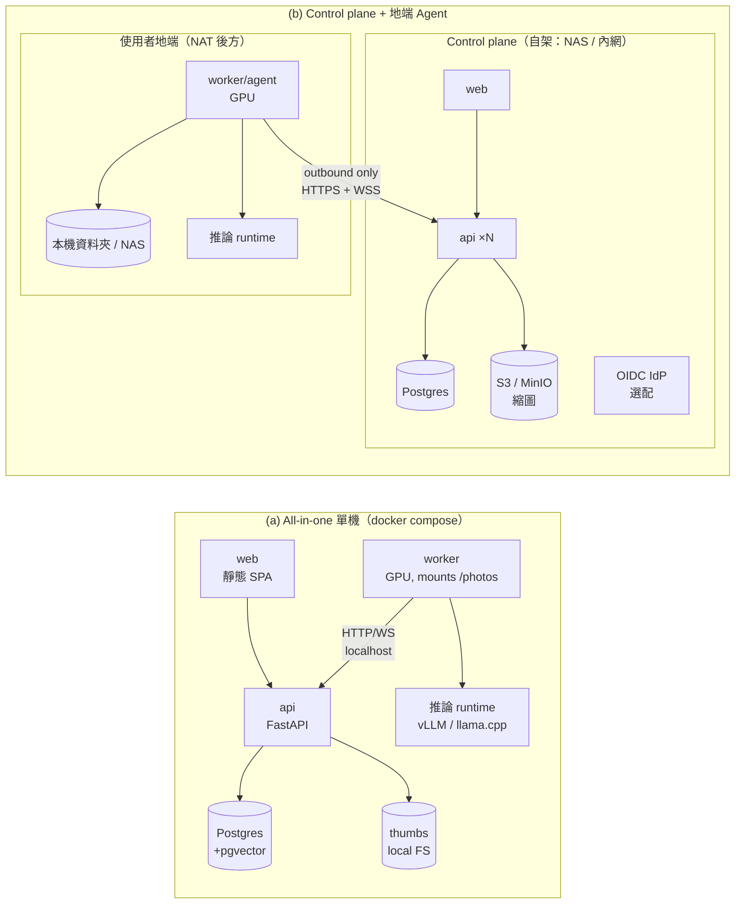
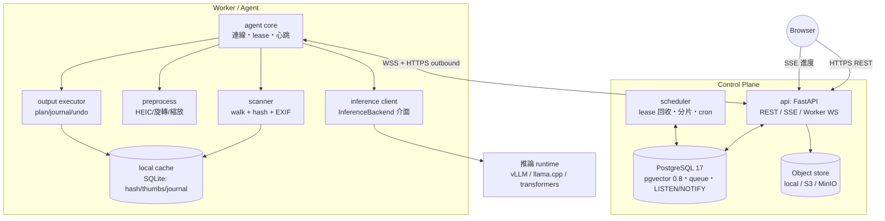
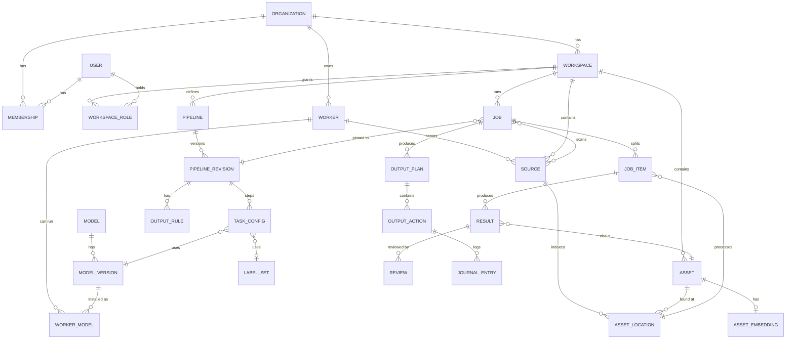
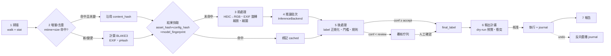
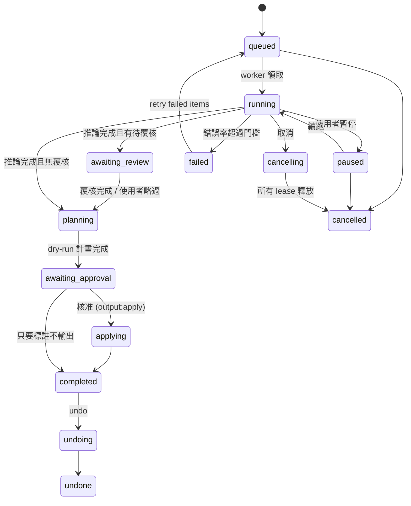
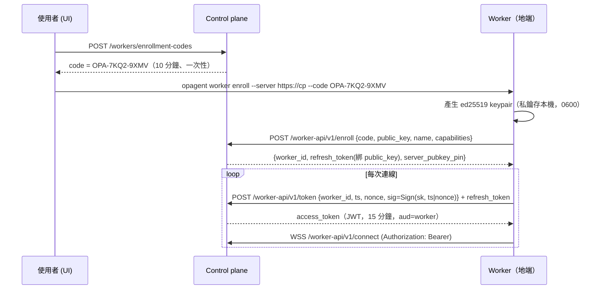

# 02 — 系統架構規格（System Architecture）

> 專案名稱：**OpenPhotoAgent**（原暫名 Open Photo Labeler；CLI：`opagent`（已定案））
> 文件狀態：Draft v0.1（2026-11）
> 範圍：部署形態、元件與技術棧、資料模型、Job 生命週期、API 與 Worker 協定、安全、可觀測性、測試、monorepo、擴充性。
> 不在範圍：模型 adapter／VRAM／prompt 細節（見推論層文件）、前端 UI 設計（見 UI 文件）。本文件只定義 **Worker ↔ 推論層** 的介面邊界。

---

## 0. 設計原則（先講結論）

| # | 原則 | 具體含意 |
|---|------|----------|
| P1 | **原檔不離開地端** | Control plane 永遠不讀、不寫使用者原始照片；所有檔案 I/O 只發生在 Worker。上傳到 control plane 的只有 metadata、縮圖（可關閉）、embedding（可關閉）與推論結果。 |
| P2 | **一套程式碼、兩種部署** | all-in-one 只是「control plane + 一個內建 Worker 跑在同一台機器」。Worker 永遠透過同一套 HTTP/WS 協定與 control plane 溝通，即使在同一個 compose 裡。 |
| P3 | **內容定址 + 結果快取** | Asset 以內容 hash 識別；Result 以 `(asset_hash, model_version, task_config_hash)` 為快取鍵，重跑不重算。 |
| P4 | **檔案操作 = 計畫 → 日誌 → 執行** | 任何 copy/move/symlink 先產生 plan（dry-run 預設開啟），執行時寫 journal，move 採「copy → 驗證 → 刪除」，全部可 undo。 |
| P5 | **少即是多的基礎設施** | 預設只需要 Postgres（+pgvector）。佇列、即時通知、排程全部建在 Postgres 上；Redis/MinIO/S3/外部 IdP 皆為可選。 |

---

## 1. 部署形態

### 1.1 兩種形態總覽



| 項目 | (a) All-in-one | (b) Control plane + Agent |
|------|----------------|---------------------------|
| 目標使用者 | 個人、單機玩家、homelab | homelab、小團隊、多台 GPU 機（家用 NAS / 公司內網自架；**沒有官方付費託管**） |
| 容器 | `web`, `api`, `worker`, `postgres`（選配 `minio`, `inference`） | 雲端：`web`, `api`, `scheduler`（同映像不同 entrypoint）, Postgres, S3；地端：`worker`（單一映像或單一 binary 安裝包） |
| 網路 | 全部在 compose 內網；只對外開 web/api 一個 port | Worker 主動 outbound 443；**地端不需開任何 port、不需公網 IP** |
| 認證 | 單一 admin（首次啟動建立），可關閉 auth（僅 localhost） | 多租戶 + RBAC + OIDC |
| 縮圖儲存 | 本地 volume | S3/MinIO；或「縮圖留地端」模式（見 1.4） |
| GPU | compose `deploy.resources.reservations.devices`（nvidia） | Worker 所在機器 |

> **（審查補充）(c) 桌面形態（v0.1 起的主要交付形態，見 [08 §1](08-desktop-packaging-and-final-review.md)）**：Tauri 2 殼（Rust）監管三個子進程：嵌入式 PostgreSQL 17 + pgvector、`opagent api`（內嵌 scheduler）、`opagent worker`；api ↔ worker 仍走 loopback 上的同一套 Worker 協定（§5.3），**不做 in-process**，所以 ADR-001 與 import-linter 規則在桌面一樣成立。桌面版預設**單人模式**（§1.3 補充）、`egress_policy` 固定 `full` 且 UI 隱藏（§1.4 補充）、API 只綁 `127.0.0.1` 並以每次啟動產生的 `launch_token` 保護（§6.3 補充）。

### 1.2 共用同一套程式碼的方式

```
同一個 Python 套件（opagent）提供多個 entrypoint：
  opagent api        → FastAPI（REST + SSE + Worker WS gateway）
  opagent scheduler  → 背景排程（Job 拆分、lease 回收、清理、報告）；小型部署可內嵌在 api 進程
  opagent worker     → 地端 Agent（掃描、前處理、呼叫推論層、輸出動作）
  opagent migrate    → Alembic migration
```

- **Worker 不直連 DB**：即使在 all-in-one，worker 也只透過 Worker Protocol（§5.3）存取 control plane。好處：(1) 兩種部署的 worker 程式碼零分支；(2) 測試只需一套；(3) 未來把 all-in-one 拆成分散式不需改程式。
- 差異只在設定檔（`OPAGENT_MODE=desktop|allinone|controlplane`、`OPAGENT_AUTH=launch_token|none|local|oidc`（`desktop`、`launch_token` 為審查補充，見 08 C-03）、`OPAGENT_THUMB_STORE=local|s3|edge`）。
- all-in-one 的 worker 在首次啟動時以 **bootstrap token**（由 api 寫入共享 volume `/run/opagent/bootstrap.token`）自動註冊，不需使用者手動配對。桌面版的 bootstrap token 由 Rust 殼產生，經 **stdin** 交給 api 與 worker，不落地（審查補充，08 C-03）。

### 1.3 多租戶與 RBAC

階層：`Organization → Workspace → (Sources, Pipelines, Jobs, Assets…)`；`User` 透過 `Membership` 屬於 Org，並在 Workspace 層有角色。

| 角色 | 範圍 | 權限 |
|------|------|------|
| `org_owner` | Org | 全部，含帳務、刪除 Org、管理成員與 Worker |
| `org_admin` | Org | 管理成員、Workspace、Worker 註冊 |
| `ws_admin` | Workspace | 管理 Source、Pipeline、輸出規則、核准「實際執行」輸出動作 |
| `ws_editor` | Workspace | 建立／執行 Job（dry-run）、覆核結果 |
| `ws_reviewer` | Workspace | 只能處理 Review 佇列 |
| `ws_viewer` | Workspace | 唯讀 |

- 權限以 **permission string** 定義（如 `job:create`, `output:apply`, `source:write`, `worker:manage`），角色 = permission 集合，存在程式碼常數中（v1 不做自訂角色）。
- 資料隔離：所有業務表帶 `org_id`（以及多數帶 `workspace_id`）；API 層用 dependency 注入 `TenantContext`，Repository 層強制加過濾。v2 可開 Postgres **Row-Level Security**（`SET app.org_id`）做縱深防禦。
- Worker 屬於 Org，可被指派給一個或多個 Workspace（`worker_workspace` 關聯表），Source 綁定在某個 Worker 上（因為路徑只對該機器有意義）。
- **（審查補充）單人模式（桌面與 all-in-one 的預設，08 D10 / C-04）**：首次啟動 seed `default` org、workspace 與 owner 使用者；API 仍走 `TenantContext`（程式碼路徑不變），UI 隱藏 Org、Workspace、成員、角色，沒有登入畫面。完整多人 RBAC 與 OIDC 在 **v0.5（自架多人 control plane）** 才開放；permission string 從 v0.1 就存在，因為 MCP scope 直接對應它（00 R7）。
- **（審查補充）人臉與問照片的 permission**（07 §6.5、10 §10.1）：`face:read`、`face:write`、`face:admin`（opt-in、purge、MCP 人臉設定）；`assistant:use`、`assistant:admin`（10 的 `assistant_settings`）。單人模式下 owner 擁有全部 permission，但人臉功能仍須另外 opt-in（07 §0）。

### 1.4 隱私模式（Data Egress Policy）

每個 Workspace 設定 `egress_policy`，Worker 在上傳前強制執行（不是靠 control plane 自律）：

| 模式 | 回傳到 control plane | 適用 |
|------|----------------------|------|
| `full`（all-in-one 預設） | metadata + EXIF + 縮圖 + embedding + 結果 | 單機 |
| `thumbs`（自架 control plane 預設） | 同上，但縮圖限 512px、EXIF GPS 可選擇剝除 | control plane 與 Worker 不在同一台機器 |
| `edge-thumbs` | metadata + 結果 + embedding；**縮圖留在 Worker 本地**，瀏覽器透過 Worker 的 relay 通道（WS 反向串流）取縮圖 | 隱私敏感，仍要 UI 預覽 |
| `results-only` | 只有路徑 hash、相對路徑（可選擇也 hash 掉）、結果；無縮圖、無 embedding、無 GPS | 最高隱私 |

> **（審查補充）桌面版**：所有元件都在本機，`egress_policy` 固定為 `full` 並在 UI 隱藏，PrivacyBadge 顯示「100% 本機」（08 C-05）。仍會造成資料離開本機、因此需要另外警示的只有三種：(1) 使用者自行設定的外部推論 API；(2) MCP `photos:media`／`faces:media` 縮圖交給第三方 AI（05 §3.5、07 §5.4，由 `mcp_media_policy`、`mcp_face_media_policy` 控制，預設不外送人臉）；(3) AI 問照片使用外部 LLM endpoint（10 §8.9，由 `assistant_media_policy` 控制）。三個 media policy 與 `egress_policy` 一律**取最嚴格者**。四級政策保留給 v0.5 的遠端 Worker。

> 原檔（full-resolution）在任何模式下都 **不會** 上傳。推論永遠在地端 GPU 跑。若使用者自行選擇雲端推論 API（例如將來的 OpenAI-compatible remote adapter），也是由 Worker 發出請求，並在 UI 明確標示「此 Pipeline 會將影像送出地端」。

---

## 2. 元件與技術棧

### 2.1 元件圖



### 2.2 技術棧選擇

| 領域 | 選定 | 備選 | 理由 |
|------|------|------|------|
| API 框架 | **FastAPI + Pydantic v2**（Python 3.12） | Litestar、Go（chi）、NestJS | Worker 與推論生態必為 Python（PyTorch/vLLM/pillow-heif），API 同語言可共用 Pydantic schema（`packages/schemas`）與 domain 邏輯；OpenAPI 自動產生 → 前端 TS client 自動生成；async 原生支援 SSE/WS。 |
| ORM / migration | SQLAlchemy 2.0（async）+ Alembic | SQLModel | 成熟、支援 pgvector type、複雜查詢 |
| DB | **PostgreSQL 17 + pgvector 0.8**（HNSW index；Docker 用 `pgvector/pgvector:pg17`；桌面版嵌入同版 PG，見 08 §2.3） | SQLite（僅 Worker 本地快取） | 一個 DB 同時扛業務資料、向量（以文搜圖/去重）、佇列、通知 |
| 任務佇列 | **Postgres-based 佇列（自寫 `job_item` lease 表 + `FOR UPDATE SKIP LOCKED`）**；control plane 內部背景任務用 **Procrastinate** | Redis + arq / Celery / Dramatiq | 見 2.3 |
| 即時進度（瀏覽器） | **SSE**（`/events` stream），由 Postgres `LISTEN/NOTIFY` 扇出 | WebSocket | 單向推播已足夠；穿透 proxy/CDN 容易；自動重連 + `Last-Event-ID` 補發 |
| Worker 通道 | **WSS（主）+ HTTPS long-poll（fallback）** | gRPC bidi stream | WSS 在企業 proxy 下相容性高於 gRPC；long-poll 作為 WS 被擋時的降級 |
| 物件儲存 | 抽象介面 `BlobStore`：`LocalFS` / `S3`（含 MinIO、R2、B2） | — | all-in-one 不強制 MinIO；S3 相容即可上雲 |
| Auth | **內建 local auth（argon2id）+ OIDC client（Authlib）**；可接 Authentik / Keycloak / Zitadel / Google | Better Auth、Ory Kratos | Better Auth 為 TS 生態，與 Python API 混用需多一個 Node 服務；內建 + 標準 OIDC 對自架最省事，企業可接自家 IdP。Session 採 HttpOnly cookie；API token / Worker token 另計（§6）。 |
| 前端 | （由 UI 文件決定）建議 React + Vite SPA，靜態檔由 `web` 容器（Caddy）提供 | Next.js | 不需 SSR，SPA 可直接由 Caddy/CDN 服務 |
| Reverse proxy | Caddy（自動 TLS） | Traefik、nginx | 自架設定最少 |
| Worker 打包 | Docker 映像（CUDA 12.8 base, PyTorch cu128，支援 sm_120）+ 可選 `uv` 安裝的 Python 套件（Windows/macOS 原生） | PyInstaller binary | Blackwell 需 cu128；Windows 使用者常不跑 Docker → 提供 `uvx opagent-worker`。**（審查補充，08 C-07）** Worker 有三種交付方式：Docker 映像、桌面 app（本機模式；v0.5 起可當 headless Worker 加入遠端伺服器）、`uvx` 給開發者 |
| 影像處理 | Pillow + pillow-heif、pyvips（大量縮圖時）、exiftool（XMP 寫入）、imagehash | OpenCV | |
| Hash | **BLAKE3**（內容 hash）+ pHash/dHash（感知 hash） | SHA-256 | BLAKE3 多執行緒極快，NAS 上掃百萬張可接受 |

### 2.3 佇列方案比較

| 方案 | 優點 | 缺點 | 結論 |
|------|------|------|------|
| Redis + arq | 輕量、async | 多一個服務；工作狀態與 DB 不在同一交易，需雙寫；Worker 在 NAT 後無法直連 Redis | ✗ |
| Celery | 生態大 | 重；同樣需要 broker 直連；對「地端 Agent 經 HTTP 領工作」模型不合 | ✗ |
| Dramatiq | 簡潔 | 同上 broker 問題 | ✗ |
| **Postgres（SKIP LOCKED）** | 0 額外服務；enqueue 與業務寫入同交易（exactly-once 語意更易做）；狀態即真相；可 SQL 查詢進度；`LISTEN/NOTIFY` 做喚醒 | 極高吞吐（>5k items/s）時需調校；需自寫 lease/retry | **✓ 選定** |

關鍵觀察：**地端 Worker 本來就不能直連 broker**，必須透過 API 領工作，因此「佇列」實質上是 control plane 上的一張 lease 表，API 代理存取。照片標註的吞吐瓶頸是 GPU（每秒數張～數十張），Postgres 綽綽有餘。
- Worker 領取以 **batch 為單位**（例如 32 個 JobItem 一次 lease），降低往返次數。
- control plane 自身的雜務（產生報告、清理過期縮圖、寄信）用 **Procrastinate**（同樣 Postgres-based），不另起 Redis。
- 若未來自架部署規模很大，`QueueBackend` 介面允許換成 Redis Streams / NATS，但 v1 不做。

---

## 3. 核心資料模型

### 3.1 ER 圖



### 3.2 主要實體與欄位

> 慣例：主鍵皆為 `uuid v7`（時間有序）；所有表帶 `created_at`, `updated_at`；業務表帶 `org_id`。JSONB 欄位以 Pydantic schema 驗證並帶 `schema_version`。

**租戶與身分**

| 表 | 主要欄位 |
|----|----------|
| `organization` | id, name, slug, plan, settings(jsonb) |
| `user` | id, email(citext unique), display_name, password_hash(nullable), oidc_sub, oidc_issuer, is_superadmin |
| `membership` | org_id, user_id, org_role(`owner/admin/member`) |
| `workspace` | id, org_id, name, egress_policy(enum §1.4), default_pipeline_id, settings |
| `workspace_role` | workspace_id, user_id, role(`ws_admin/editor/reviewer/viewer`) |
| `api_token` | id, org_id, user_id, name, prefix, hash(argon2/sha256), scopes[], workspace_ids[], expires_at, last_used_at, revoked_at |

**Worker 與來源**

| 表 | 主要欄位 |
|----|----------|
| `worker` | id, org_id, name, status(`online/offline/draining/disabled`), public_key(ed25519), version, os, capabilities(jsonb：GPU 型號、VRAM、CUDA、runtimes、已安裝模型), last_heartbeat_at, labels[] |
| `source` | id, workspace_id, worker_id, kind(`local_dir/smb/nfs/s3`), root_alias（worker 端 allowlist 的別名，如 `photos`）, sub_path（相對路徑）, include_globs[], exclude_globs[], follow_symlinks(false), watch(bool), last_scan_at |
| `output_target` | id, workspace_id, worker_id, root_alias, sub_path, kind(`dir/s3`) — 輸出／分類資料夾 |

> Source 不存絕對路徑，只存 `root_alias + 相對路徑`；絕對路徑只存在 Worker 本地設定（見 §6.1）。

**資產**

| 表 | 主要欄位 |
|----|----------|
| `asset` | id, workspace_id, content_hash(blake3, unique per workspace), size_bytes, mime, width, height, orientation, taken_at, gps(geography, nullable), camera_make/model, exif(jsonb, 依 egress 剝除), phash(bit(64)), dhash(bit(64)), thumb_key(nullable), thumb_location(`cp/edge/none`), duplicate_group_id |
| `asset_location` | id, asset_id, source_id, rel_path, rel_path_hash, mtime, size, inode/file_id（可選）, first_seen_at, last_seen_at, missing(bool) — 同一內容可能出現在多處 |
| `asset_embedding` | asset_id, model_version_id, vector(vector(1152) 或依模型), created_at；HNSW index（cosine） |

**模型與 Pipeline**

| 表 | 主要欄位 |
|----|----------|
| `model` | id, key（如 `qwen3-vl-8b`）, family, modality, task_types[]（`caption/tag/classify/embed`）, license, homepage |
| `model_version` | id, model_id, version, adapter_key（推論層 adapter 名）, runtime（`vllm/llamacpp/transformers/ollama/remote`）, quant, artifact_ref（HF repo@rev 或 GGUF 檔名 + sha256）, est_vram_mb, **fingerprint**（adapter 版本 + 權重 hash + 關鍵參數的 hash，用於快取鍵） |
| `worker_model` | worker_id, model_version_id, status(`available/downloading/failed`) |
| `label_set` | id, workspace_id, name, kind(`tags/categories`), labels(jsonb：[{key, display, aliases[], description, parent}]), version |
| `pipeline` | id, workspace_id, name, current_revision_id |
| `pipeline_revision` | id, pipeline_id, rev_no, spec(jsonb 完整快照), spec_hash, created_by — **不可變**，Job 綁 revision |
| `task_config` | id, revision_id, step_no, task_type(`caption/tag/classify/embed`), model_version_id, prompt_template_ref, generation_params(jsonb), label_set_id, thresholds(jsonb：accept/review/reject), structured_output_schema(jsonb), run_if(jsonb 條件，如「前一步 confidence < 0.6」), **config_hash** |
| `output_rule` | id, revision_id, priority, when(jsonb 條件 DSL), action(`copy/move/trash/symlink/hardlink/sidecar_xmp/sidecar_json/csv_export/none`；`trash` 為 v0.2，移到 `.opagent-trash/`、可 undo，11 D-2), target_id, path_template（如 `{category}/{taken_at:%Y}/{taken_at:%Y-%m}/{stem}{ext}`；（回寫 W-2）UI 別名 `{date:YYYY}`、`{date:YYYY-MM}`、`{date:MM}`、`{date:DD}` 等同 `{taken_at:%Y}` 等 strftime 形式；`{category}` 渲染**顯示名稱**、`{category_key}` 渲染穩定 key）, conflict_policy(`skip/rename/overwrite_if_same_hash/fail`), require_reviewed(bool) |

`task_config` 範例（片段）：

```json
{
  "task_type": "classify",
  "model_version": "qwen3-vl-8b-instruct@fp8",
  "prompt_template_ref": "builtin:classify_v1",
  "label_set": "family-photo-categories@3",
  "structured_output": {"category": {"enum": "$label_set"}, "confidence": "number", "caption": "string", "tags": "string[]"},
  "thresholds": {"accept": 0.80, "review": 0.50},
  "generation_params": {"temperature": 0.0, "max_tokens": 256},
  "run_if": null
}
```

**執行與結果**

| 表 | 主要欄位 |
|----|----------|
| `job` | id, workspace_id, pipeline_revision_id, kind(`scan/label/apply_output/undo/reindex`), status（§4.2）, mode(`dry_run/apply`), priority, requested_by, worker_id（指派/偏好）, params(jsonb), counters(jsonb：total/cached/done/failed/review/skipped), started_at, finished_at, error, parent_job_id |
| `job_item` | id, job_id, asset_location_id, asset_id(nullable 直到 hash 完成), step_no, status(`pending/leased/running/done/cached/failed/skipped/cancelled`), attempts, max_attempts, lease_owner(worker_id), lease_expires_at, next_attempt_at, error_code, error_detail, batch_key |
| `result` | id, asset_id, task_config_hash, model_version_id, model_fingerprint, job_item_id, task_type, caption, tags(jsonb：[{label, score}]), category, confidence, raw_output(jsonb, 可截斷), latency_ms, tokens_in/out, worker_id, **is_current**(bool) ; unique `(asset_id, task_config_hash, model_fingerprint)` |
| `review` | id, result_id, asset_id, status(`pending/approved/corrected/rejected`), reason(`low_confidence/conflict/rule/manual`), assignee_id, corrected(jsonb：category/tags/caption), reviewer_id, reviewed_at, note |
| `final_label`（view 或 materialized） | asset_id, pipeline_id, category, tags, caption, source(`model/review`) — 輸出規則讀這個 |

**輸出動作**

| 表 | 主要欄位 |
|----|----------|
| `output_plan` | id, job_id, status(`draft/approved/applying/applied/partially_applied/undone/failed`), summary(jsonb：各動作數量、衝突數、總容量), approved_by, approved_at |
| `output_action` | id, plan_id, asset_id, rule_id, action, src(`source_id + rel_path`), dst(`target_id + rel_path`), src_hash, conflict(`none/exists_same/exists_diff/name_collision`), resolution, status(`planned/done/skipped/failed/undone`), error |
| `journal_entry` | id, action_id, seq, op(`mkdir/copy/verify/fsync/rename/unlink/symlink/write_sidecar`), args(jsonb), pre_state(jsonb：是否存在、hash、mtime), post_state, status, at — **append-only**；Worker 端也有一份本地鏡像（SQLite），以地端為準 |

`audit_log`（id, org_id, actor, action, target, ip, at, meta）另外記錄所有管理操作。

---

## 4. Job 生命週期

### 4.1 流程



| 階段 | 執行位置 | 說明 |
|------|----------|------|
| 1 掃描 | Worker | 依 Source 的 globs 走訪；只回報 `rel_path, size, mtime, file_id`；支援 `watch`（inotify/FSEvents/ReadDirectoryChangesW）做持續增量。大量資料夾以 1000 筆分頁上報。 |
| 2 增量/去重 | Worker + CP | **Worker 本地快取** `(abs_path, size, mtime, file_id) → blake3`，未變更檔案不重讀。CP 以 content_hash upsert `asset`、建立 `asset_location`。同 hash = 完全重複；pHash Hamming ≤ 6 或 embedding cosine ≥ 0.97 = 近似重複（`duplicate_group_id`），可選擇只推論代表張。 |
| 快取查詢 | CP | 拆 JobItem 時以 `(asset_id, task_config_hash, model_fingerprint)` 查 `result`，命中直接標 `cached`，不派工。改 prompt/門檻以外的參數會改變 `config_hash`；**只改門檻或輸出規則不重算**（門檻不納入 hash，僅後處理重跑）。 |
| 3 前處理 | Worker | pillow-heif 解 HEIC/HEIF、RAW 取內嵌 JPEG 預覽、依 EXIF orientation 旋轉、縮放到推論層要求的解析度（由 adapter 宣告 `preferred_input`）、產生縮圖（256/512 webp）。CPU 執行緒池與 GPU 推論 pipelined（prefetch 2 個 batch）。 |
| 4 推論批次 | Worker → 推論層 | 依 `model_version` 分組，batch size 由 adapter 回報；見 §4.4 介面。 |
| 5 後處理 | Worker（純函式，CP 亦可重跑） | （ADR-0001：accept 是最終閘門、τ_high／m 只管路由；各路徑規則見 DECISIONS.md）label 正規化（alias 映射、未知 label 丟棄或標記）、套門檻：`≥accept` → 接受；`review ≤ x < accept` → 建 Review；`< review` → 依設定 reject 或 review；可串接下一 step（`run_if`）。 |
| 6 輸出 | CP 計畫 + Worker 執行 | CP 依 `final_label` + `output_rule` 產生 `output_plan`（純計算）；Worker 做衝突探測（dst 是否存在、hash 比對）回填；使用者在 UI 預覽 → 核准 → Worker 執行（§6.2）。 |
| 7 報告 | CP | 統計（各類別數量、平均信心、覆核數、耗時、GPU 秒數、快取命中率）、CSV/JSON 匯出、失敗清單。 |

### 4.2 Job 狀態機



### 4.3 可靠性機制

| 機制 | 設計 |
|------|------|
| **Lease** | Worker 領取一批 JobItem，得到 `lease_expires_at = now + 120s`；處理中每 30s 續租（心跳附帶 lease ids）。過期由 scheduler 回收為 `pending`，`attempts+1`。 |
| **冪等回報** | 回報結果帶 `(job_item_id, attempt, idempotency_key)`；`result` unique 約束確保重複回報不會產生重複資料。 |
| **重試** | 分類錯誤碼：`transient`（OOM、runtime timeout、網路）→ 指數退避（10s, 60s, 5m），最多 3 次；OOM 時 Worker 自動將 batch size 減半重試；`permanent`（檔案損毀、不支援格式、path 違規）→ 直接 `failed`，不重試。Job 失敗率 > 20%（可設定）且樣本 > 50 時自動 `paused` 並通知。 |
| **暫停/續跑** | 暫停 = CP 不再發新 lease；已 lease 的批次完成後停止（或 `pause_mode=immediate` 時 Worker 中止當前 batch 並歸還）。續跑只是恢復派工；所有進度在 DB，Worker/CP 重啟都可續跑。 |
| **取消** | CP 設 `cancelling` → 透過 WS 推 `job.cancel` → Worker 中止並釋放 lease → 剩餘 item 設 `cancelled`。已寫入的 result 保留（下次可命中快取）。輸出階段的取消：當前 action 完成後停止，計畫變 `partially_applied`，可 undo。 |
| **GPU 單卡排程** | 每個 Worker 有 **GPU slot 管理器**：同時只載入一個（或 VRAM 允許時多個）模型；排程優先順序 = Job priority → 同模型批次優先（避免反覆 load/unload，模型切換成本可達數十秒）→ FIFO。Worker 向 CP 領工作時帶 `loaded_models` 與 `free_vram_mb`，CP 優先派發與已載入模型相符的 item（**model affinity**）。互動式請求（例如 UI「試跑一張」）走高優先 lane，可插隊但不搶斷當前 batch。 |
| **背壓** | Worker 本地佇列上限（例如 4 個 batch）；前處理比 GPU 快時暫停領取。 |
| **離線容忍** | Worker 與 CP 斷線時，已 lease 的 batch 繼續做，結果暫存在本地 SQLite outbox，恢復連線後補傳（lease 過期者 CP 會以 idempotency key 去重接受或拒絕）。 |

### 4.4 Worker ↔ 推論層介面邊界

推論層（adapter、runtime 管理、prompt、VRAM）由另一份文件定義；Worker 只依賴下列 Python Protocol（`packages/inference-sdk`）：

```python
class InferenceBackend(Protocol):
    """由推論層實作；Worker 只透過此介面呼叫。"""

    def describe(self) -> BackendInfo: ...
        # adapter_key, model_fingerprint, task_types, preferred_input(max_side, format),
        # max_batch, est_vram_mb, supports_structured_output

    async def load(self, opts: LoadOptions) -> None: ...      # 可重入；Worker 決定何時呼叫
    async def unload(self) -> None: ...
    async def health(self) -> HealthStatus: ...               # 含 vram_used_mb

    async def run_batch(self, req: BatchRequest) -> list[ItemOutput]: ...
        # 錯誤必須以 InferenceError(code=OOM|TIMEOUT|BAD_INPUT|RUNTIME, retryable=bool) 拋出

@dataclass
class BatchRequest:
    task_type: Literal["caption", "tag", "classify", "embed"]
    items: list[ImageInput]            # 已前處理的 RGB（numpy/bytes）+ item_id；不含路徑
    prompt_template_ref: str
    variables: dict[str, Any]          # 如 label_set、EXIF 摘要（日期/GPS 文字化，依 egress 政策）
    output_schema: dict | None         # JSON Schema；category enum 由 label set 帶入
    generation_params: dict
    deadline_s: float

@dataclass
class ItemOutput:
    item_id: str
    caption: str | None
    tags: list[tuple[str, float]] | None
    category: str | None
    confidence: float | None           # 推論層負責校準/定義，Worker 只用它比門檻
    embedding: list[float] | None
    raw: dict                          # 原始輸出（截斷）
    usage: dict                        # latency_ms, tokens_in, tokens_out
```

邊界約定：
- 推論層 **不接觸檔案系統路徑**，只收記憶體中的影像 → 路徑沙箱只需在 Worker 一處實作。
- `model_fingerprint` 由推論層計算並保證「相同 fingerprint + 相同輸入 ⇒ 可視為相同結果」，是快取正確性的契約。
- 推論層可以是同進程 Python、或子進程/外部服務（vLLM OpenAI server、llama.cpp server、Ollama）；對 Worker 都是同一個 Protocol。

---

## 5. API 規格

### 5.1 REST 端點（`/api/v1`，瀏覽器與 API token 共用）

| 方法 | 路徑 | 說明 | 權限 |
|------|------|------|------|
| POST | `/auth/login` · `/auth/logout` · `GET /auth/oidc/{provider}/start` · `/callback` | 登入／OIDC | 公開 |
| GET | `/me` | 目前使用者、Org、角色 | 登入 |
| GET/POST | `/orgs` · `/orgs/{org}/members` | Org 與成員 | org_admin |
| GET/POST/PATCH/DELETE | `/workspaces` · `/workspaces/{ws}` | Workspace（含 egress_policy） | ws_admin |
| GET/POST/DELETE | `/tokens` | 個人 API token | 登入 |
| GET | `/workers` · `/workers/{id}` | Worker 列表、狀態、GPU、已裝模型 | worker:read |
| POST | `/workers/enrollment-codes` | 產生一次性配對碼 | worker:manage |
| PATCH/DELETE | `/workers/{id}` | 改名、drain、停用、撤銷 | worker:manage |
| GET | `/workers/{id}/fs/roots` · `/workers/{id}/fs/browse?root=&path=` | 瀏覽 Worker 允許根目錄（經 WS 轉送，供資料夾選擇器） | source:write |
| GET/POST/PATCH/DELETE | `/workspaces/{ws}/sources` | 來源資料夾 | source:write |
| POST | `/sources/{id}/scan` | 觸發掃描 Job | job:create |
| GET/POST/PATCH/DELETE | `/workspaces/{ws}/output-targets` | 輸出／分類資料夾 | source:write |
| GET | `/models` · `/models/{id}/versions` | 模型目錄 | 登入 |
| POST | `/workers/{id}/models/{mv}/install` | 要求 Worker 下載模型 | worker:manage |
| GET/POST/PATCH | `/workspaces/{ws}/label-sets` | 標籤集 | pipeline:write |
| GET/POST/PATCH | `/workspaces/{ws}/pipelines` · `/pipelines/{id}/revisions` | Pipeline 與不可變版本 | pipeline:write |
| POST | `/pipelines/{id}/preview` | 試跑 1–N 張（高優先 lane），同步回傳或回 job id | job:create |
| GET/POST | `/workspaces/{ws}/jobs` | 列表／建立 Job（`mode=dry_run` 預設） | job:create |
| GET | `/jobs/{id}` · `/jobs/{id}/items?status=` · `/jobs/{id}/report` | 詳情、明細、報告（json/csv） | job:read |
| POST | `/jobs/{id}/pause` · `/resume` · `/cancel` · `/retry-failed` | 控制 | job:create |
| GET | `/workspaces/{ws}/assets?q=&category=&tag=&min_conf=&dup=` | 資產瀏覽、過濾 | asset:read |
| POST | `/workspaces/{ws}/assets/search` | 以文搜圖 / 以圖搜圖（pgvector） | asset:read |
| GET | `/assets/{id}` · `/assets/{id}/results` · `/assets/{id}/thumb?size=` | 資產詳情、歷次結果、縮圖（CP 存或經 edge relay） | asset:read |
| GET | `/workspaces/{ws}/reviews?status=pending` | 覆核佇列 | review:write |
| POST | `/reviews/{id}` · `/reviews/bulk` | 核准／修正／拒絕（支援批次） | review:write |
| GET | `/jobs/{id}/output-plan` · `/output-plans/{id}/actions?conflict=` | dry-run 預覽 | job:read |
| POST | `/output-plans/{id}/approve` | 核准並執行 | output:apply |
| POST | `/output-plans/{id}/undo` | 建立 undo Job | output:apply |
| GET | `/events?workspace=` | **SSE**：job.progress, job.status, review.created, worker.status, plan.ready | 登入 |
| GET | `/audit-log` | 稽核 | org_admin |
| GET | `/healthz` · `/readyz` · `/metrics` | 健康檢查、Prometheus | 內部 |

SSE 事件格式：

```
id: 01J9Z...            # 單調遞增，支援 Last-Event-ID 補發（保留 10 分鐘於 event_outbox 表）
event: job.progress
data: {"job_id":"…","done":1240,"cached":3100,"failed":3,"review":57,"total":5000,"eta_s":410,"items_per_s":6.2}
```

### 5.2 Worker 認證與註冊



### 5.3 Worker ↔ Control plane 協定（`/worker-api/v1`）

傳輸：主通道為 WSS（JSON 訊息，`{type, id, payload}`，每則帶 `id` 供 ack）；大量資料（掃描結果、縮圖、embedding）走 HTTPS POST（可 gzip / msgpack）。WS 不可用時降級為 long-poll `GET /poll?wait=30`。

| 方向 | 訊息 / 端點 | 內容 |
|------|-------------|------|
| W→CP | `POST /enroll` | 配對（見上） |
| W→CP | `POST /token` | 簽章換 access token |
| W→CP | `WSS /connect` → `hello` | worker_version, protocol_version, capabilities（GPU、VRAM、CUDA、runtimes、installed models）, roots（alias 清單，不含絕對路徑）, loaded_models |
| CP→W | `welcome` | 指派的 workspaces、egress policies、設定、最低 protocol 版本 |
| W→CP | `heartbeat`（15s） | status, gpu_util, vram_used/free, loaded_models, queue_depth, active_lease_ids（同時續租） |
| W→CP | `POST /leases` `{max_items, models_loaded, free_vram_mb, lanes}` | 領取工作；回 `{lease_id, expires_at, items:[{job_item_id, step, source_alias, rel_path, task_config, expected_hash?}]}`，無工作時回 204（WS 上 CP 會推 `work.available` 喚醒，避免輪詢） |
| W→CP | `POST /scan-reports` | 掃描分頁：`[{source_id, rel_path, size, mtime, file_id, content_hash, exif, phash}]` |
| W→CP | `POST /results` | 批次結果：`[{job_item_id, attempt, idempotency_key, status, outputs, error}]` |
| W→CP | `PUT /assets/{hash}/thumb` · `POST /embeddings` | 依 egress 政策上傳 |
| W→CP | `POST /leases/{id}/release` | 暫停/取消時歸還 |
| CP→W | `job.cancel` / `job.pause` | 中止指定 job 的工作 |
| CP→W | `plan.probe` | 要求 Worker 對 output_plan 做衝突探測 |
| CP→W | `plan.apply` / `plan.undo` | 執行／撤銷（帶 plan_id、actions 分頁、核准者簽章資訊） |
| W→CP | `POST /journal` | journal entries 回報（地端為主、CP 為鏡像） |
| CP→W | `fs.browse` / `thumb.fetch` | RPC：資料夾瀏覽、edge-thumbs 模式下的縮圖中繼 |
| CP→W | `model.install` | 下載模型（Worker 自己從 HF 等來源拉，CP 不轉送權重） |
| 雙向 | `ping/pong`、`ack` | 連線保活、可靠傳遞 |

版本：`protocol_version` 採 semver；CP 同時支援 N 與 N-1 主版本；不相容時 `welcome` 回 `upgrade_required`。

---

## 6. 安全

### 6.1 路徑沙箱（Worker 端強制）

Worker 設定檔（`/etc/opagent/worker.toml` 或 `%APPDATA%\opagent\worker.toml`）定義 allowlist；**CP 永遠只能以 `alias + 相對路徑` 指涉檔案**：

```toml
[[roots]]
alias = "photos"
path  = "/mnt/nas/photos"
mode  = "ro"            # 來源預設唯讀

[[roots]]
alias = "sorted"
path  = "/mnt/nas/sorted"
mode  = "rw"            # 輸出目標才給寫入

[security]
allow_move_from_ro_roots = false   # move 需要來源 root 為 rw，否則 move 自動降級為 copy
follow_symlinks = false
```

解析演算法（所有檔案操作唯一入口 `SafePath.resolve(alias, rel)`）：
1. 拒絕：絕對路徑、含 `..` 元件、NUL、Windows 磁碟代號/UNC/ADS（`:`）、保留名（`CON`、`NUL`…），做 Unicode NFC 正規化。
2. `real = realpath(root / rel)`，要求 `real` 位於 `realpath(root)` 之下（`os.path.commonpath` 比對，不用字串前綴）。
3. 預設不跟隨 symlink：逐段 `lstat`，遇 symlink 拒絕；Linux 上以 `openat2(RESOLVE_BENEATH | RESOLVE_NO_SYMLINKS)` 開檔，避免 TOCTOU。
4. 寫入只允許 `mode=rw` 的 root；docker 部署時 ro root 直接以 `:ro` mount，雙重保護。
5. 違規回報 `permanent` 錯誤 `PATH_VIOLATION` 並寫 audit。

### 6.2 檔案操作安全（Output executor）

```
對每個 output_action：
  1. 預檢     src 存在且 hash == src_hash（防止計畫後檔案被改）；dst 衝突依 conflict_policy 決議
  2. journal  寫入 intent（op, src, dst, pre_state）並 fsync 本地 SQLite（WAL）
  3. copy     複製到 dst 同目錄的暫存檔 `.opagent-tmp-<uuid>`，保留 mtime/權限（copystat）
  4. verify   重新計算暫存檔 BLAKE3 == src_hash
  5. commit   fsync 檔案與目錄 → 原子 rename 到 dst（不覆蓋：Linux renameat2 RENAME_NOREPLACE）
  6. move 才做：再次確認 dst hash → unlink src（或移到 `.opagent-trash/<plan_id>/` 保留 N 天，預設開啟）
  7. journal  標記 done + post_state
```

- **Undo**：按 journal 反序重播反向操作（copy → 刪 dst（僅當 dst hash 仍等於我們寫入的 hash）；move → 從 trash 還原或 dst 搬回 src；symlink → 刪除；sidecar → 還原備份或刪除）。若檔案已被使用者另行修改，該筆 undo 標記 `conflict` 而非強制覆蓋。
- **當機恢復**：Worker 啟動時掃描 journal 中 `intent` 但未 `done` 的條目，依 pre/post state 完成或回滾；清理 `.opagent-tmp-*`。
- **Sidecar**：XMP 以 exiftool 寫入 `dc:subject`、`dc:description`、`lr:hierarchicalSubject`（相容 Lightroom/digiKam/Immich）；預設寫 `.xmp` sidecar，不改原檔；「寫入原檔 EXIF」需明確開啟並先備份。
- **核准閘門**：`mode=apply` 必須有 `output:apply` 權限的使用者對特定 plan 核准；move 動作在 UI 需二次確認；單一 plan 超過設定數量（如 10,000 個 move）需輸入確認字串。
- 跨檔案系統 move 一律走 copy+verify+delete；同檔案系統也預設這麼做（可設定 `fast_rename=true` 改為 rename，仍寫 journal）。

### 6.3 Token 與認證

| 類型 | 形式 | 存放 | 範圍 |
|------|------|------|------|
| 瀏覽器 session | 不透明 session id，HttpOnly + Secure + SameSite=Lax cookie；CSRF double-submit token | `session` 表 | 使用者 |
| API token | `opagent_pat_<prefix>_<secret>`；DB 只存 SHA-256(secret)；可設 scopes、workspace 限制、到期 | `api_token` | 自動化、CLI |
| Worker | ed25519 keypair + 綁定公鑰的 refresh token → 15 分鐘 JWT（aud=`worker`，含 worker_id/org_id） | Worker 本機 0600 / OS keychain | 只能呼叫 `/worker-api`，只能存取指派 workspace 的工作 |
| Enrollment code | 一次性、10 分鐘、限速 | — | 配對 |
| **Launch token**（審查補充，桌面） | 256-bit，Rust 殼每次啟動產生，經 stdin 交給 api；前端以 Tauri command `backend_info()` 取得 | 只在記憶體，不落地，每次啟動輪替 | 桌面 SPA 呼叫 `/api/v1`（Bearer） |
| **Handoff code**（審查補充，桌面） | 一次性、30 秒 | — | 系統匣「在瀏覽器開啟」換成 HttpOnly session cookie |
| **本機 PAT**（審查補充，桌面 MCP） | 同 API token 格式，由「連接 AI 助手」精靈建立，scope 預設 `photos:read`（不含 `photos:media`、`faces:*`） | OS keyring（Linux 無 Secret Service 時降級 0600 檔並警示） | `opagent mcp`（stdio）呼叫本機 API |

其他：
- **（審查補充，08 C-10）所有 API**（不只 `/mcp`）都驗證 `Host` 為 `127.0.0.1`／`localhost`（或設定的對外網域）並驗證 `Origin`，防 DNS rebinding。桌面版只綁 `127.0.0.1`；「允許區網存取」是進階開關，開啟時強制啟用帳號登入。
- **（審查補充，08 C-09）新增或刪除 Worker 允許根目錄**只能經由桌面殼 IPC（使用者手勢）或本機 CLI；REST 與 MCP 一律不提供。
- Worker 只接受 TLS；可選 **certificate pinning**（enroll 時取得 CP 公鑰 pin）。Worker **永遠不接受 inbound 連線**；CP 下發的 RPC 白名單固定（不存在「執行任意指令」類訊息）。
- CP 送來的 `path_template` 在 Worker 端渲染並再經 SafePath 檢查；template 變數值（如 category）做檔名清理（移除 `/ \ : * ? " < > |`、控制字元，長度限制）。
- 速率限制（登入、enroll、token）、密碼 argon2id、OIDC 使用 PKCE。
- 多租戶（自架多人 control plane，v0.5）：縮圖 S3 key 前綴 `org/{org_id}/`，以短效 presigned URL 提供；可選每 Org 的 SSE-KMS。
- 供應鏈：映像以 cosign 簽章、SBOM（syft）；模型下載驗證 sha256（`artifact_ref`）。

---

## 7. 可觀測性、測試、Monorepo

### 7.1 可觀測性

| 面向 | 做法 |
|------|------|
| Logs | structlog JSON；每筆帶 `org_id, workspace_id, job_id, job_item_id, worker_id, trace_id`；路徑只記 alias+rel_path，可設定遮蔽 |
| Metrics | Prometheus `/metrics`：`opagent_job_items_total{status}`, `opagent_items_per_second`, `opagent_cache_hit_ratio`, `opagent_lease_expired_total`, `opagent_inference_latency_seconds{model}`, `opagent_gpu_vram_bytes`, `opagent_model_load_seconds`, `opagent_review_queue_depth`, `opagent_worker_connected`；Worker 的 metrics 經心跳匯總到 CP（地端可另開本機 `127.0.0.1:9464`） |
| Traces | OpenTelemetry（OTLP 選配），trace context 透過 Worker 協定傳遞：API → lease → 推論 → 回報 |
| 產品內可視化 | UI 內建 Worker 儀表（GPU 使用率、VRAM、吞吐、ETA），不依賴 Grafana；提供可選的 Grafana dashboard JSON |
| 錯誤 | Sentry 相容（GlitchTip 可自架），預設關閉 |
| 診斷包 | `opagent worker doctor`：檢查 CUDA/驅動/sm_120 支援、roots 權限、CP 連線、時鐘偏差，輸出可分享的去識別報告 |

### 7.2 測試策略

| 層級 | 內容 | 工具 |
|------|------|------|
| 單元 | SafePath（含 fuzz：`..`、symlink、Unicode、Windows 路徑）、path_template 渲染、門檻/規則 DSL、config_hash 穩定性、狀態機轉移 | pytest, hypothesis |
| 契約 | Worker 協定 schema（Pydantic → JSON Schema 快照）、OpenAPI diff 守門（破壞性變更 CI 失敗）、`InferenceBackend` 一致性測試套件（每個 adapter 必須通過） | schemathesis, pytest |
| 整合 | 真 Postgres（testcontainers）：lease/SKIP LOCKED 併發、lease 過期回收、冪等回報、快取命中 | testcontainers |
| 檔案操作 | 在 tmpfs 與真實 ext4/NTFS/SMB 上跑 plan→apply→undo；**故障注入**（每個 journal 步驟後 kill -9，重啟後驗證不遺失、不重複、可 undo） | pytest + 子進程 |
| E2E | docker compose 起 all-in-one，使用 **FakeBackend**（決定性輸出、可注入 OOM/timeout）跑完整流程；Playwright 驅動 UI 關鍵路徑 | Playwright |
| GPU 煙霧 | 自架 GPU runner（RTX 5070 Ti）夜間跑真模型小資料集，記錄吞吐與 VRAM 回歸 | self-hosted runner |
| 資料集 | `fixtures/photos`：HEIC、旋轉 EXIF、RAW、損毀檔、超長檔名、Unicode 檔名、重複/近似重複 | — |

### 7.3 Monorepo 目錄結構

```
openphotoagent/
├─ apps/
│  ├─ web/                    # 前端 SPA（UI 文件負責）
│  ├─ api/                    # FastAPI app：routers、deps(auth/tenant)、SSE、worker gateway
│  ├─ scheduler/              # lease 回收、job 拆分、報告、清理（可內嵌於 api）
│  └─ worker/                 # Agent：connection、scanner、preprocess、gpu_scheduler、output_executor、cli
├─ packages/
│  ├─ core/                   # domain：實體、狀態機、規則 DSL、config_hash、path_template（純 Python，無 I/O）
│  ├─ schemas/                # Pydantic：REST DTO、Worker protocol、pipeline spec（產生 JSON Schema / TS 型別）
│  ├─ db/                     # SQLAlchemy models、repositories、Alembic migrations
│  ├─ storage/                # BlobStore：local / s3
│  ├─ fs-sandbox/             # SafePath、檔案操作原語、journal（worker 專用，最高測試覆蓋要求）
│  ├─ inference-sdk/          # InferenceBackend Protocol、FakeBackend、一致性測試套件
│  ├─ inference-adapters/     # 各模型 adapter（推論層文件負責）
│  ├─ output-actions/         # 內建輸出動作 plugin（copy/move/symlink/xmp/json/csv）
│  ├─ integrations/           # immich、label-studio
│  └─ ts-client/              # 由 OpenAPI 生成的 TS client（給 web）
├─ deploy/
│  ├─ compose/                # allinone.yml、controlplane.yml、worker.yml、.env.example
│  ├─ helm/                   # control plane Helm chart（v2）
│  └─ docker/                 # api.Dockerfile、worker.cuda128.Dockerfile、web.Dockerfile
├─ docs/
├─ fixtures/photos/
├─ tools/                     # codegen、release、dev scripts
├─ pyproject.toml             # uv workspace（Python 套件）
└─ package.json               # pnpm workspace（web、ts-client）
```

工具：Python 用 **uv workspace**、ruff、mypy（strict 於 core/fs-sandbox）；TS 用 pnpm；CI 用 GitHub Actions（矩陣：linux/windows/macos 跑 worker 單元與 fs-sandbox 測試）。

依賴方向（強制）：`apps/* → packages/*`；`core` 不依賴任何 I/O 套件；`worker` 不依賴 `db`；`api` 不依賴 `fs-sandbox` 與 `inference-*`（以 import-linter 在 CI 檢查，從結構上保證 control plane 無法碰原檔）。

---

## 8. 擴充性

### 8.1 Plugin 機制

以 Python **entry points** 註冊（`pyproject.toml` 的 `[project.entry-points."opagent.<kind>"]`），Worker 啟動時載入並在 `hello` 中回報能力。

| Plugin 種類 | entry point group | 介面 | 執行位置 |
|-------------|-------------------|------|----------|
| 模型 adapter | `opagent.inference` | `InferenceBackend`（§4.4）+ `ModelManifest`（宣告 task_types、VRAM、artifact_ref） | Worker |
| 輸出動作 | `opagent.output_actions` | 見下 | Worker（計畫在 CP 以純函式描述） |
| 來源類型 | `opagent.sources` | `SourceDriver.walk() / open() / stat()`（如 S3、SMB 直連、Google Takeout zip） | Worker |
| 前處理器 | `opagent.preprocessors` | `Preprocessor.supports(mime) / decode(bytes) -> RGB`（如 RAW via rawpy、影片抽幀） | Worker |
| 後處理規則函式 | `opagent.rule_functions` | 純函式，供規則 DSL 呼叫（如 `exif_year()`、`near(gps, home)`） | CP + Worker |
| 整合 | `opagent.integrations` | `Integration.sync(event)` | CP（API 類）或 Worker（檔案類） |

輸出動作介面：

```python
class OutputAction(Protocol):
    key: ClassVar[str]                       # "copy", "sidecar_xmp", ...
    reversible: ClassVar[bool]
    def plan(self, ctx: PlanContext, asset: AssetView, label: FinalLabel, rule: OutputRule) -> list[PlannedOp]: ...
    def probe(self, op: PlannedOp, fs: SandboxFS) -> ConflictInfo: ...
    def apply(self, op: PlannedOp, fs: SandboxFS, journal: Journal) -> OpResult: ...
    def undo(self, entry: JournalEntry, fs: SandboxFS) -> OpResult: ...
```

Plugin 只能透過傳入的 `SandboxFS`（已綁 allowlist）存取檔案，不提供原始 `open()` 路徑；不可逆動作（如寫入原檔 EXIF 且未備份）在 UI 標示為不可 undo。

### 8.2 Immich 整合

| 整合點 | 方向 | 做法 |
|--------|------|------|
| 來源 | Immich → OpenPhotoAgent | 讀取 Immich external library 的同一份資料夾（Worker mount 同路徑），或透過 Immich API 列舉資產（`SourceDriver: immich`，以 asset id 為 rel_path） |
| 結果回寫 | OpenPhotoAgent → Immich | 輸出動作 `immich_tags` / `immich_album` / `immich_description`：以 Immich API（API key 存於 Workspace secret）建立 tag、加入相簿、寫 description |
| Sidecar | OpenPhotoAgent → Immich | XMP sidecar 的 `dc:subject` 可被 Immich 讀入（metadata 重新掃描） |
| 去重 | — | 以 content hash 對應 Immich 的 checksum（SHA-1，需另存一份 sha1 欄位以對照，選配） |

### 8.3 Label Studio 整合

| 整合點 | 做法 |
|--------|------|
| 匯出到 Label Studio | `export/label-studio`：產生 tasks JSON（含縮圖 URL 或 local-files 路徑）+ predictions（以 OpenPhotoAgent 結果作 pre-annotation，帶 model_version 作 `model_version` 欄位） |
| 匯入回 OpenPhotoAgent | 從 Label Studio export/webhook 取得人工標註 → 寫成 `review(status=corrected)` → 更新 final_label |
| 用途 | 大規模人工覆核、建立評估集（ground truth）以比較不同模型/prompt 的準確率；OpenPhotoAgent 內建 `evaluation` Job 可吃此資料集算 accuracy / F1 |

### 8.4 其他預留

- **OpenAI-compatible remote backend**：作為 adapter 之一，使用者可指向自己的 vLLM/llama.cpp server 或雲端 API（後者觸發 egress 警告）。
- **Webhooks**：`job.completed`、`review.created`、`plan.applied` 外送（HMAC 簽章）。
- **CLI**：`opagent` CLI 使用 API token 操作 Job，方便 cron/腳本整合。
- **多 Worker 分散**：同一 Source 可被多台 Worker 讀（共享 NAS），以 `worker_labels` 做親和性；v1 先限制一個 Source 綁一個 Worker。

---

## 9. 關鍵設計決策摘要（ADR 索引）

| ADR | 決策 | 主要替代方案 | 理由 |
|-----|------|--------------|------|
| ADR-001 | Worker 是唯一接觸原檔與 GPU 的元件；all-in-one 也走 Worker 協定 | all-in-one 讓 API 直接讀檔 | 隱私保證可由架構（import-linter + 協定）驗證；兩種部署零分支 |
| ADR-002 | Postgres 作為唯一必要基礎設施（佇列/通知/向量） | Redis + Celery/arq | 地端 Worker 本就不能直連 broker；GPU 才是瓶頸；交易一致性 |
| ADR-003 | 內容定址 Asset + `(hash, config_hash, model_fingerprint)` 結果快取；門檻與輸出規則不入 hash | 以路徑識別 | 搬移後不重算、重跑秒級完成、調門檻免推論 |
| ADR-004 | 輸出動作 plan→approve→journal→apply，move = copy+verify+delete，預設 dry-run 與 trash | 直接 move | 照片不可遺失；可 undo；可當機恢復 |
| ADR-005 | 瀏覽器用 SSE、Worker 用 WSS + long-poll fallback | 全 WebSocket / gRPC | Proxy 相容、實作簡單 |
| ADR-006 | 內建 local auth + 標準 OIDC client | Better Auth（Node）、Keycloak 必裝 | 單一語言、自架最少服務、企業可接 IdP |
| ADR-007 | Pipeline revision 不可變，Job 綁 revision | Job 直接引用可變 pipeline | 結果可追溯、可重現 |

---

## 10. 介面整合：06 / 07 / 08 / 10 的變更（審查補充）

> 06（模型、環境醫生、Operation）、07（人臉）、08（桌面）、10（Viewer、問照片）各自列出了對本文的修改需求（06 §7.1、07 §11、08 §7、10 §C）。本節把它們集中寫回 02，作為實作時的單一依據；欄位細節以原文件為準。版本欄依 [08 §9](08-desktop-packaging-and-final-review.md) 的路線圖。

### 10.1 新增資料表

| 表 | 主要欄位（摘要） | 來源 | 版本 |
|----|------------------|------|------|
| `operation` | id, workspace_id, worker_id, parent_id, type, subject_kind/subject_id, status, phase, progress, eta(jsonb：p50/p90/state/basis), waiting_reason, started_at, elapsed_ms | 06 §5.1 | v0.1 |
| `operation_event` | id, operation_id, seq, kind, payload, actor, at（append-only） | 06 §7.1 | v0.1 |
| `doctor_check_result` | scope, worker_id, check_id, status, code, severity, observed（脫敏）, fixes, checked_at, expires_at | 06 §3.5 | v0.1 |
| `runtime_pack`、`installation` | pack 鏡像；worker 上 artifact／pack 的安裝紀錄（取代 03 §7.1 `installed.json`；`worker_model` 改為 view） | 06 §7.1、08 §4 | v0.1 |
| `license_acceptance` | user_id, model_id, license_id, license_hash, accepted_at, revoked_at | 06 §1.9 | v0.1 |
| `task_default_model` | workspace_id, task, variant | 06 §1.6 | v0.1 |
| `perf_observation`、`eta_calibration` | 吞吐、載入時間、頻寬的 EWMA；ETA 校正直方圖 | 06 §5.5 | v0.1 |
| `compat_cache` | worker_id, variant_key, inputs_hash, result | 06 §1.2 | v0.1 |
| `asset_derivative` | asset_id, kind（t256/t512/p1024/p2048/hdr/dzi）, format, bytes, location | 10 §C | v0.1（t256/t512）、v0.2+（其餘） |
| `asset_flag` | asset_id, user_id, favorite, rating, pick, trash_candidate | 10 §10.3 | v0.2 |
| `face`、`person`、`face_assignment`、`person_link`、`face_cluster_run`、`face_consent`、`bio.face_embedding`（依 workspace LIST partition）、`bio.person_prototype` | 見 07 §3.2 | 07 | v0.2 |
| `conversation`、`message`、`message_step`、`message_citation`、`assistant_settings`、`ask_eval_case` | 見 10 §10.3 | 10 | v0.3 |

**欄位變更**：`asset` 增加 `thumbhash`、`width`、`height`（00 R5，v0.1）、`duration_ms`、`is_hdr`、`color_space`、`has_embedded_preview`（10，v0.2）；`job` 增加 `operation_id`（1:1）；`job_item.error_code` 改用 06 §4.7 錯誤碼目錄；`result.task_type`、`task_config.task_type` 增加 `face`；`review` 增加 `kind`、`face_id`；`output_rule.when` 增加 `persons_*` 與 `fanout`（07，v0.2）；`worker.capabilities` 增加 `deployment`、`accels[]`、`packs[]`、`hardware_digest`；workspace settings 增加 `faces.*`、`mcp.faces_enabled`、`mcp_face_media_policy`、`assistant_media_policy`。

### 10.2 REST 新增（`/api/v1`）

| 群組 | 端點（摘要） | 來源 | 版本 |
|------|--------------|------|------|
| 部署能力 | `GET /capabilities`（deployment、auth、single_user、features、gpu_summary；UI 依此顯示功能） | 08 §1.6 | v0.1 |
| Preflight / 預估 | `POST /preflight`、`POST /estimates`；**所有 action endpoint 執行前都跑 preflight，失敗回 409 problem+json** | 06 §4.2、§5.9 | v0.1 |
| Operation | `GET /operations?active=`、`GET /operations/{id}`、`POST /operations/{id}/pause\|resume\|cancel\|reprioritize` | 06 §5.7 | v0.1 |
| Doctor | `GET /system/doctor`、`POST /system/doctor/run`、`GET /system/features`、`POST /system/fixes/{id}/apply` | 06 §3.5 | v0.1 |
| 模型 / pack | `/runtime-packs`、`/workers/{id}/installs`（取代 `/workers/{id}/models/{mv}/install`，舊路徑保留為 alias）、`/installations/*`、`/imports/*`、`/storage/move`、`/models/{v}/load\|unload\|speedtest`、`/workspaces/{ws}/task-defaults`、`/licenses/*`、`/settings/downloads` | 06 §1.11、§2.10 | v0.1 |
| Viewer | `/timeline/buckets`、`/timeline/buckets/{month}`、`/assets/{id}/media?variant=`、`/assets/{id}/labels`（PATCH，就地修正→review）、`/selections` | 10 §C | v0.1 |
| Viewer（後續） | `/assets/{id}/flags`、`/assets/{id}/dzi/...`、`/map/clusters`、`/exports` | 10 §C | v0.2–v0.4 |
| 人臉 | `/workspaces/{ws}/faces/settings`、`/faces/purge`、`/people*`（merge/split/ignore/faces/co-occurrence/photos）、`/faces/bulk-assign`、`/faces/find`、`/faces/query-image`（UI 拖一張照片找人；MCP 不提供）、`/people/merge-suggestions`、`GET /assets/{id}/faces` | 07 §8.4 | v0.2 |
| 問照片 | `POST /workspaces/{ws}/ask`（SSE）、`/ask/turns/{id}/events\|cancel\|feedback`、`/conversations*`、`/ask/suggestions`、`/assistant-settings` | 10 §10.1 | v0.3 |
| 桌面 | `GET /auth/handoff?code=`（系統匣「在瀏覽器開啟」）；`GET /trash/summary`（解除安裝前提示 `.opagent-trash/` 內的檔案，08 §5.5）；`POST /system/backup`、`/system/restore`（「設定 → 資料」，08 §2.3） | 08 | v0.1 |

**錯誤格式**：全部 API 改用 RFC 9457 `application/problem+json`，加上 `code`、`fixes[]`、`blockers[]`（06 §4.6）。UI 依 `fixes[]` 顯示修復 CTA（M2：不准只有 disabled 沒有理由）。

### 10.3 SSE 事件（`/events`）

| 事件 | 來源 | 版本 | 備註 |
|------|------|------|------|
| `operation.created\|progress\|phase\|status\|completed\|warning` | 06 §5.7 | v0.1 | **取代** 00 R5 的 `model.download.progress`、`scan.progress`、`plan.apply.progress`（三者都以 `operation.progress` 表達）；每個事件附 `server_time` |
| `doctor.check\|changed`、`model.installed\|removed\|loaded\|unloaded`、`runtime.installed` | 06 §7.1 | v0.1 | UI 收到後 invalidate preflight / models / compat 快取 |
| `preview.item`、`plan.ready`、`job.progress`、`job.status`、`review.created`、`worker.status` | 00 R5、本文 §5.1 | v0.1 | 不變；`job.progress` 另帶 `operation_id` |
| `mcp.call`、`mcp.approval` | 00 R5、05 | v0.2 | |
| `faces.cluster.progress`、`faces.suggestions.updated`、`faces.purge.progress` | 07 §8.4 | v0.2 | `faces.cluster.progress` 同時投影成 `operation.progress` |
| Ask 的 `turn.* / step.* / token / photos / citation / card / notice` | 10 §10.2 | v0.3 | 走 `POST /ask` 自己的 SSE 回應，不混入 `/events` |

### 10.4 Worker 協定（§5.3）新增

| 方向 | 訊息 | 來源 | 版本 |
|------|------|------|------|
| W→CP | `op.update`；`heartbeat` 夾帶 `active_operation_ids`、`paused_reason`（對應 06 §5.5.7 的 `PAUSED_ON_BATTERY`／`PAUSED_GPU_CONTENDED`／`PAUSED_NOT_IDLE`） | 06 §7.1、08 C-30 | v0.1 |
| CP→W | `op.control`（pause/resume/cancel/reprioritize）、`doctor.run` / `doctor.result`、`install.start`（**取代** `model.install`，payload 加入 pack 與 mirror）、`import.scan`、`storage.move`、`config.update`（電池／遊戲模式策略） | 06 §7.1、08 §6 | v0.1 |
| CP→W | `media.preview`、`media.stream`（原圖 Range 串流，Web 版 Lightbox） | 10 §C | v0.1 |
| CP→W | `media.dzi`、`media.export` | 10 §C | v0.2–v0.4 |
| W→CP / CP→W | `POST /faces`、`PUT /faces/{id}/thumb`、`face.embed_query`、`face.knn`、`face.cluster`、`face.prototype.rebuild`、`face.purge`（全部加入 CP→W RPC 白名單） | 07 §8.3 | v0.2（edge vault 相關在 v0.5） |
| CP→W | `chat`（tool-calling／structured 生成，interactive lane）、`verify`（批次 yes/no + 短理由） | 10 §C | v0.3 |

### 10.5 Job 流程與 scanner

- scanner 略過原因增加 `cloud_placeholder`（OneDrive／iCloud 佔位檔）與 `photos_library_package`（macOS Photos Library 封裝），UI 顯示原因而不是錯誤（08 C-31）。
- scan 時一併算 ThumbHash、讀 ICC／HDR gain map、抽 RAW 內嵌預覽（10 §C）。
- **Source 離線**（外接硬碟拔掉、NAS 斷線）：`source.status=offline`，相關 Operation 進入 `waiting_reason=SOURCE_OFFLINE`（06 §5.5.7）而不是失敗；UI 顯示「離線」，重新接上後自動繼續（08 §8.1）。已索引的照片仍可瀏覽與搜尋（使用縮圖快取）。
- 後處理新增人臉「線上指派」，Job 完成後觸發 `face.cluster` Operation；asset 消失 30 天後清理人臉資料（07 §11）。
- GPU 排程增加 `pause_on_battery`、`pause_on_contention`、`only_when_idle` 策略（08 §6、C-30）；暫停中的 Operation 帶 `waiting_reason`，ETA 顯示「暫停中」。

### 10.6 安全與資料

- 備份預設排除 `bio` schema；人臉資料使用獨立 DB role `opagent_bio`；log 禁止記錄向量（07 §6.3）。
- 「刪除所有人臉資料」必須可驗證（`DROP PARTITION` + 縮圖刪除 + 刪除報告），列入 v1.0 安全審查（07、08 §10）。
- MCP 與 Ask 的寫入類動作一律只產生計畫，套用只能在 UI（桌面為 `openphotoagent://approvals/{id}` deep link）人工核准；`organize:apply` 不發給任何 token（00 R7）。

### 10.7 Monorepo 新增（§7.3）

```
apps/desktop/          # Tauri 2：src-tauri/（supervisor、tray、launch token、updater）、packs 管理（08 C-11）
apps/api/assistant/    # 問照片 Assistant 服務：意圖路由 + 有界 tool loop，呼叫 packages/mcp-tools 的 ToolRegistry（10 §8）
apps/worker/face_vault/  # v0.5 edge vault（07 §8.5）
packages/faces-core/   # 人臉向量數學、分群、prototype（純 Python，api 可依賴；07 §8.5）
packages/viewer/       # @opa/viewer：PhotoGrid、Lightbox（10 §5.2）
packaging/             # python-build-standalone 環境建置、簽章腳本、packs/ 配方（08 §1.2、§4）
RESPONSIBLE_USE.md     # 人臉功能的負責任使用說明（07 §6.6）
```

依賴規則不變：`api` 仍不得依賴 `fs-sandbox` 與 `inference-*`；`faces-core` 不依賴 I/O 與 ORT。

### 10.8 ADR 補充

| ADR | 決策 | 理由 |
|-----|------|------|
| ADR-008 | 桌面版嵌入 PostgreSQL 17 + pgvector，**單一 DB 後端**，不做 SQLite 雙後端 | SKIP LOCKED、LISTEN/NOTIFY、tsvector、HNSW 原樣保留；測試矩陣不加倍（08 D4） |
| ADR-009 | 桌面版 api 與 worker 分兩個進程，走 loopback Worker 協定 | 保住 ADR-001；runtime 崩潰不拖垮 UI（08 D2） |
| ADR-010 | 單人模式為預設，多人 RBAC／OIDC 延到 v0.5 | 新手零設定；schema 保留 `org_id` 可無痛升級（08 D10） |
| ADR-011 | 所有長操作都是 Operation（含開始前預估、執行中 ETA、經過時間、等待原因），所有 action 先 preflight，錯誤附 fix | 「時間永遠看得見」「不讓使用者卡住」（06 M1–M3、08 U9） |
