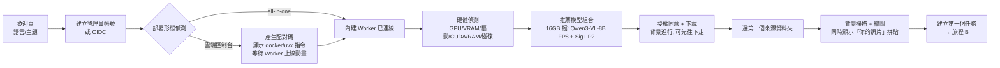
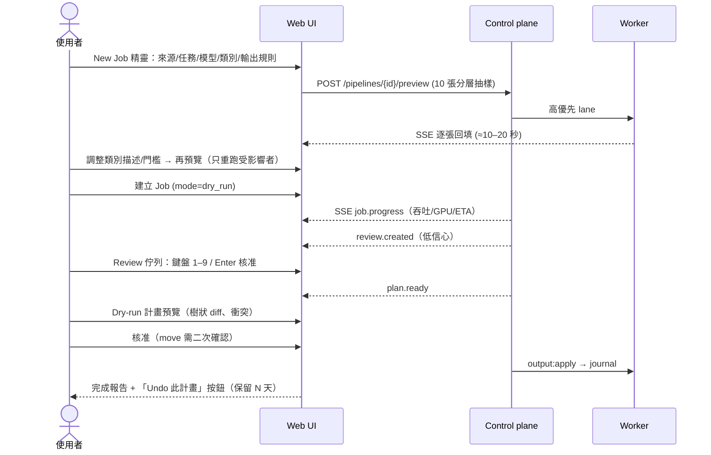

# 04 — 控制介面 UX/UI 與前端規格（Control Panel）

> 專案：**OpenPhotoAgent**（簡稱 OPA；程式碼/CLI 名稱：`opagent`（已定案））
> 文件狀態：Draft v0.1（2026-11）
> 範圍：使用者旅程、資訊架構、頁面 wireframe、視覺設計系統、前端技術棧、互動亮點。
> 依賴：API／SSE／Job 狀態機／權限見 [02-system-architecture.md](02-system-architecture.md)；模型目錄、VRAM、benchmark 見 [03-inference-layer.md](03-inference-layer.md)；搜尋與 MCP 行為規格見 05-search-and-mcp.md（本文只定義其 UI）。

---

## 0. 設計原則（先講結論）

| # | 原則 | 具體含意 |
|---|------|----------|
| U1 | **照片是主角，介面退後** | 中性灰階 chrome、單一強調色；圖片網格滿版、無多餘邊框；暗色模式為預設（看圖不刺眼、色彩判斷不被干擾）。 |
| U2 | **先預覽、再執行、永遠可 undo** | 每個會動檔案的操作都有「10 張樣本 → dry-run 計畫 → 核准 → journal → undo」的視覺化路徑（對應 02 §4 / §6.2 P4）。UI 上沒有「直接 move」的按鈕。 |
| U3 | **硬體誠實** | 每個模型、每個任務都標示「在你這台 Worker 上」的 VRAM 適配（綠/黃/紅徽章）、預估吞吐與 ETA；從估算值自動切換為實測值並標註來源。 |
| U4 | **漸進揭露** | 預設路徑 3 步完成（來源 → 我要做什麼 → 預覽）；進階參數（門檻、cascade、解析度、prompt）收在「進階」抽屜，任何時候都能看到等價的 Pipeline YAML。 |
| U5 | **鍵盤優先、批次優先** | 覆核、搜尋、Gallery 全部有鍵盤操作與 command palette（⌘K）；任何清單都支援框選/Shift 範圍選取 → 批次動作。 |
| U6 | **隱私可見** | 目前 Workspace 的 `egress_policy` 以徽章常駐頂列；任何會讓影像離開地端的設定（雲端推論 API、MCP 可讀縮圖）都有明確警示與二次確認。 |
| U7 | **人與 agent 同一套權限語言** | MCP/第三方 agent 的操作在 UI 中與人的操作同樣出現在 Audit、同樣受 dry-run/核准閘門控制；agent 的寫入請求會變成「待核准」卡片。 |
| U8 | **一條推薦路徑，選項往後藏**（審查補充，08 §8.2） | onboarding 最多問 2 個問題（資料夾、怎麼整理）；任何選擇題都有「推薦」預選；「其他選項」連結取代並列的多張卡。 |
| U9 | **永遠不讓使用者卡住**（審查補充，08 §8.2、06 M2） | 每個阻擋（驅動、VRAM、磁碟、下載失敗）都要有修復 CTA 與「先用較慢的方式繼續」的退路（CUDA → Vulkan → CPU、VLM → SigLIP 快速模式）；停用的控制項一律附理由與 fix（`GatedButton`）。 |
| U10 | **術語分兩層**（審查補充，08 §8.3） | 單人模式用日常語言（整理方式、圖庫、本機引擎、預覽變更、待確認）；「進階模式」才顯示 Pipeline、門檻、cascade、fingerprint。 |
| U11 | **時間永遠看得見**（審查補充，06 M3） | 每個長操作都有開始前預估、執行中經過時間與 ETA（附可信度與依據）、暫停或等待的原因；統一由 `OperationProgress` 呈現。 |

---

## 1. 使用者角色與核心旅程

### 1.1 Persona

| Persona | 對應 RBAC | 情境 | 最在乎 |
|---------|-----------|------|--------|
| **小林：家庭攝影/自架玩家** | org_owner（單人 all-in-one） | 一台 RTX 5070 Ti 桌機 + NAS，8 萬張家庭照片、HEIC/RAW 混雜 | 一次上手、不要弄壞原檔、繁中描述可搜尋 |
| **Mia：AI 繪圖/資料集整理者** | ws_admin | 需要大量 caption（JoyCaption 英文長描述）與 booru tag，輸出 `.txt`/JSONL sidecar | 吞吐、模型比較、prompt 可調、輸出格式 |
| **工作室 PM：小型攝影工作室** | org_admin + 多位 ws_editor/ws_reviewer | 雲端控制台 + 工作室地端 GPU Worker；客戶案件分類到 `{client}/{date:YYYY-MM}` | 權限、覆核分工、稽核、進度透明 |
| **覆核員** | ws_reviewer | 只處理低信心佇列 | 速度（每張 < 1 秒決策）、鍵盤 |
| **第三方 agent（Claude Desktop / Claude Code）** | MCP token（唯讀或可寫 scope） | 「幫我找去年在京都拍的楓葉照，整理成相簿資料夾」 | 清楚的工具與權限、寫入需人核准 |

### 1.2 旅程 A：首次 Onboarding（目標：≤ 5 分鐘到第一張預覽結果）

> **（審查補充）** 桌面版與單人模式的 onboarding 已依 08 §8 簡化（刪除 W1、W2，一個推薦組合，下載與選資料夾並行），以 §8.2 為準；下表保留給自架多人 control plane（v0.5）。



每一步的 UX 細節：

| 步驟 | 畫面重點 | 失敗/邊界處理 |
|------|----------|---------------|
| W4 硬體偵測 | 卡片逐項打勾動畫：`GPU NVIDIA RTX 5070 Ti · 16 GB · sm_120 ✓`、`Driver 575.x ✓`、`CUDA 12.8 ✓`、`RAM 32 GB`、`模型磁碟可用 412 GB`；下方一句人話：「你的 GPU 屬於 **16GB 檔**，可以跑批次主力 VLM + embedding 常駐。」 | 偵測到 sm_120 但 PyTorch 非 cu128 → 紅色卡片 + 「一鍵複製修正指令」；無 GPU → 推薦 CPU 輕量組合（Florence-2 + SigLIP2）並明示預估吞吐；多 GPU → 讓使用者指定。 |
| W5 推薦組合 | 3 張方案卡：**推薦（平衡）**／**最快**（SigLIP2 + Florence-2 + WD tagger）／**最高品質**（加 Qwen3.6-35B-A3B 複核，需 ≥32GB RAM）。每卡顯示：總下載量、VRAM 堆疊條（模型 A 色塊 + 模型 B 色塊 / 16GB 刻度）、1 萬張 ETA（來自 03 §5.3 估算表，標「估算」） | RAM 不足時「最高品質」卡灰掉並說明；gated 模型（Gemma 4）顯示「需 HF token」。 |
| W6 下載 | 授權摘要 + 勾選；下載進度以頂列「下載中 2/3 · 6.1 GB/10.6 GB · 85 MB/s」常駐，不阻擋後續步驟；完成後自動 smoke test（顯示那張內建測試圖與輸出 JSON）。 | 斷線續傳、磁碟不足預檢（02/03 §7.1）、sha256 失敗 → 重試按鈕 + 詳細 log。 |
| W7 選來源 | 遠端資料夾瀏覽器（見 §3.3）；顯示 Worker 允許根目錄。 | 路徑不在 allowlist → 說明如何在 Worker 設定 `allowed_roots`。 |
| W8 掃描 | 掃描時就以實際縮圖做「拼貼牆」逐漸填滿（給使用者「它看到我的照片了」的安心感）；顯示格式分佈（JPEG/HEIC/RAW/影片略過）、重複數。 | HEIC 解碼失敗 → 提示 pillow-heif；權限不足檔案列入「略過」清單。 |

### 1.3 旅程 B：第一個任務 → 預覽 → 執行 → 覆核 → 輸出



關鍵時刻設計：

1. **預覽不是 modal，而是精靈右半部常駐的「即時樣本面板」**——改任何設定，樣本卡片就以 shimmer 狀態重算（debounce 600ms）。
2. **建立 Job 時預設 `dry_run`**，主要按鈕文案是「開始分析（不會移動任何檔案）」。
3. **執行中可直接覆核**：覆核佇列在 Job 執行時即開始累積，不必等推論結束。
4. **輸出核准頁**呈現「之前 → 之後」資料夾樹 diff，衝突與 move 數量以醒目色塊標示；核准按鈕上寫具體數字：「核准：複製 4,812 張、寫入 4,812 個 XMP」。
5. **完成報告**含類別分佈 donut、平均信心、覆核數、耗時、GPU 秒數、快取命中率，以及「把這次設定存成 Preset」「對新增照片持續監看（watch）」兩個 CTA。

### 1.4 旅程 C：搜尋 → 規則 → 資料夾（日常使用）

`Gallery 輸入「海邊夕陽 有狗」` → hybrid 結果 → facet 篩 `年份=2025` → 框選微調 → 「存成…」三選一：**智慧相簿（動態查詢）**／**分類規則（加入某 Pipeline 的 rules 層）**／**輸出到資料夾（建立 dry-run 計畫）**。

### 1.5 旅程 D：第三方 agent 透過 MCP

使用者在 Integrations 開啟 MCP → 選曝露範圍（Workspace、唯讀/可寫）→ 一鍵複製 Claude Desktop 設定 → 在 Claude 中下指令 → agent 呼叫 `search_photos`（自動允許）與 `propose_output_plan`（產生待核准）→ UI 右上角鈴鐺出現「Claude Desktop 想要複製 37 張照片到 `相簿/京都楓葉`」→ 使用者在卡片上檢視樣本縮圖與計畫 → 核准/拒絕。

---

## 2. 資訊架構與頁面清單

### 2.1 導覽結構

```
┌ 頂列：Workspace 切換 ▾ │ ⌘K 搜尋/指令 │ 隱私徽章 [thumbs] │ Worker 狀態點 ●2 │ 下載/任務托盤 │ 🔔核准待辦 │ 頭像
├ 左側欄（可收合成 icon rail）
│   ● 主要
│     Dashboard            /
│     Gallery / Search     /gallery
│     Review  (57)         /review
│     Jobs                 /jobs           ── /jobs/new（精靈）· /jobs/:id · /jobs/:id/plan
│   ● 設定資源
│     Sources              /sources
│     Presets              /presets        （Pipeline 範本 + 類別集 + 輸出規則）
│     Models               /models         ── /models/:id · /models/benchmark/:id
│     Workers              /workers
│   ● 系統
│     Integrations / MCP   /integrations
│     Audit & Undo         /audit
│     Settings             /settings       （個人 / Workspace / Org / Tokens）
└ 底部：版本、文件連結、回報問題
```

- 路由採 workspace 前綴：`/w/:ws/...`（Org 層頁面如 Workers、Audit 在 `/org/...`）。
- 所有清單頁的篩選/排序寫入 URL query（可分享、可返回）。
- ⌘K command palette：跳頁、搜尋照片、執行動作（「暫停所有 Job」「新增來源」「切換深色」）、自然語言（「把 2024 年的螢幕截圖移到 screenshots」→ 轉成精靈預填，見 §6）。

### 2.2 頁面清單與職責

| 頁面 | 目的 | 主要元件 | 主要 API / 事件 | 權限 |
|------|------|----------|------------------|------|
| Onboarding | 首次設定（§1.2） | Stepper、HardwareCard、PlanCard、DownloadTray | `/workers`、`/models`、`/workers/{id}/models/{mv}/install` | org_owner |
| **Dashboard** | 一眼看狀態與下一步 | KPI tiles、進行中 Job 卡、Review 數、Worker/GPU 迷你圖、最近輸出、「繼續上次」 | `/jobs`、`/workers`、SSE | viewer+ |
| **Sources** | 管理來源與輸出/分類資料夾 | SourceCard（Worker 綁定、照片數、最後掃描、watch 開關）、RemoteFolderPicker、OutputTargetList | `/sources`、`/workers/{id}/fs/*`、`/output-targets` | source:write |
| **New Job 精靈** | 建立任務（§3.2） | WizardShell、TaskTypeTiles、ModelPicker、LabelSetEditor、OutputRuleBuilder、LivePreviewPanel、PlanDiffTree | `/pipelines/{id}/preview`、`/jobs` | job:create |
| **Jobs / Job 監控** | 列表 + 即時監控（§3.4） | JobTable、StatusPill、ProgressRing、ThroughputChart、GpuGauge、LogStream、ItemTable | `/jobs/{id}`、`/items`、SSE `job.*` | job:read |
| **Output Plan** | dry-run 計畫審閱與核准（§3.5） | PlanSummary、FolderDiffTree、ConflictList、ApproveBar | `/jobs/{id}/output-plan`、`/approve` | output:apply |
| **Gallery / Search** | hybrid 搜尋、以圖搜圖、facet、存成規則（§3.6） | SearchBar（NL + chips）、FacetSidebar、VirtualGrid、Lightbox、SelectionBar、SaveAsDialog | `/assets`、`/assets/search` | asset:read |
| **Review** | 覆核佇列（§3.7） | ReviewStage、CandidateBar、Filmstrip、KeymapHUD、BulkGrid | `/reviews`、`/reviews/bulk` | review:write |
| **Models** | 模型卡、下載、benchmark（§3.8） | ModelCard、VramBadge、VariantTable、DownloadButton、BenchmarkWizard、ResultsMatrix | `/models`、install、benchmark | 登入 / worker:manage |
| **Presets** | Pipeline 範本、類別集、輸出規則、詞彙表 | PresetCard、YAML/表單雙視圖、版本歷史（pipeline revision）、匯入/匯出 | `/pipelines`、`/label-sets` | pipeline:write |
| **Workers** | 配對、狀態、GPU、模型（§3.9） | WorkerCard、EnrollDialog（配對碼 + 指令）、GpuTimeline、AllowedRoots、Drain | `/workers`、enrollment-codes | worker:manage |
| **Integrations / MCP** | MCP server 與外部整合（§3.10） | McpToggle、ScopeMatrix、TokenTable、ClientConfigSnippet、CallLog、ApprovalInbox、Immich/Label Studio 卡 | `/integrations/mcp/*`（05 定義） | ws_admin |
| **Audit & Undo** | 稽核時間軸與還原（§3.11） | AuditTimeline、ActorAvatar（人/agent/系統）、PlanUndoCard、UndoProgress | `/audit-log`、`/output-plans/{id}/undo` | org_admin / output:apply |
| **Settings** | 個人、Workspace（egress_policy）、Org、Tokens、外觀、語言 | Form sections、DangerZone | `/me`、`/workspaces/{ws}`、`/tokens` | 依區塊 |

### 2.3 全域元件與狀態

- **TaskTray（右下）**：下載、掃描、Job、Undo 等長任務的統一托盤，可展開；以 SSE 驅動。**（審查補充）由 06 §6.1 的 Activity Center 取代**（頂列指示器 + 抽屜，資料來自 `operation.*` SSE）。
- **ApprovalInbox（🔔）**：output plan 待核准、MCP agent 寫入請求、moves 超量確認。
- **PrivacyBadge**：（審查補充）桌面版與單人 all-in-one 固定顯示「🔒 100% 本機」，只在外部推論 API、MCP 縮圖外送、問照片使用外部 LLM 時出現警示（08 C-05）；自架多人 control plane 才顯示四級 `full / thumbs / edge-thumbs / results-only`，點擊看說明；在 `results-only` 下 Gallery 顯示「縮圖已停用」佔位圖（以類別色塊 + 檔名），不是壞圖。
- **WorkerStatusDot**：綠（閒置）/藍脈動（推論中）/黃（drain 或高溫）/灰（離線）。Worker 離線時，依賴它的按鈕禁用並 tooltip 說明。

---

## 3. 關鍵頁面 wireframe、元件與狀態

> Wireframe 以桌面 1440px 為基準；≤ 1024px 左側欄收成 icon rail，≤ 768px 改底部 tab bar（Dashboard / Gallery / Review / Jobs / 更多），Review 支援手機滑動手勢（左滑拒絕、右滑核准、上滑改類別）。

### 3.1 Dashboard

```
┌──────────────────────────────────────────────────────────────────────────────────────┐
│ ◧ OpenPhotoAgent  [家庭照片 ▾]   ⌘K 搜尋照片或輸入指令…        [thumbs] ●2  ⬇1  🔔3  (KL)│
├────────┬─────────────────────────────────────────────────────────────────────────────┤
│ ⌂ 總覽  │  早安，小林。 82,413 張照片 · 已標註 61%                    [＋ 新任務]      │
│ ▦ 圖庫  │ ┌───────────┐┌───────────┐┌───────────┐┌───────────┐                       │
│ ✓ 覆核57│ │ 已標註     ││ 待覆核     ││ 本週輸出   ││ GPU 時數   │                       │
│ ▶ 任務  │ │ 50,212    ││ 57  →     ││ 4,812 張  ││ 3.4 h     │                       │
│ ─────  │ │ ▁▂▄▆█ +3k ││ 平均 0.61 ││ 可 undo 7d││ ▂▃▅▃▂     │                       │
│ 🗀 來源  │ └───────────┘└───────────┘└───────────┘└───────────┘                       │
│ ☰ 範本  │  進行中                                                                      │
│ ◈ 模型  │ ┌─────────────────────────────────────────────────────────────────────────┐ │
│ ⚙ Worker│ │ ◔ 2025 手機照片分類      ███████████░░░░ 68%  3.8 張/s  ETA 12 分  [⏸] │ │
│ ─────  │ │   Qwen3-VL-8B FP8 + SigLIP2 · desktop-5070ti · GPU 92% · 14.1/16 GB      │ │
│ ⇄ 整合  │ └─────────────────────────────────────────────────────────────────────────┘ │
│ ⟲ 稽核  │  需要你處理                          │  Workers                              │
│ ⚙ 設定  │  • 計畫待核准：複製 4,812 / XMP 4,812 │  ● desktop-5070ti  推論中  62°C       │
│        │  • Claude Desktop 請求移動 37 張      │  ○ nas-cpu         離線 3 小時         │
│        │  • 57 張低信心待覆核 [開始覆核 ⏎]     │                                       │
│        │  最近照片（拼貼）  ▢▢▢▢▢▢▢▢▢▢▢▢ →    │                                       │
└────────┴─────────────────────────────────────────────────────────────────────────────┘
```

元件：`KpiTile`（數字 + sparkline）、`JobCard`、`ActionList`（需要你處理）、`WorkerMini`、`RecentMosaic`。
空狀態：無來源 → 大插圖 + 「新增第一個資料夾」；無 Worker → 「連接你的 GPU 電腦」配對流程卡；全部處理完 → 「全部整理好了 ✓」+ 最近成果拼貼。

### 3.2 New Job 精靈（核心頁面）

左側為步驟、中間為設定、右側為 **即時樣本面板**（常駐，≥1280px；窄螢幕變成底部抽屜）。

```
┌──────────────────────────────────────────────────────────────────────────────────────────┐
│ 新任務  ①來源 ─ ②任務 ─ ③模型 ─ ④類別/標籤 ─ ⑤輸出規則 ─ ⑥預覽計畫          [存成範本] [✕] │
├───────────────────────────────────────────────┬──────────────────────────────────────────┤
│ ② 你想讓 AI 做什麼？（可複選，會合併成一次推論） │ 即時樣本 10 張（分層抽樣）   [↻ 換一批] │
│ ┌──────────────┐┌──────────────┐┌──────────────┐│ ┌────┐┌────┐┌────┐┌────┐┌────┐          │
│ │ ✎ Caption     ││ # Tagging     ││ ▤ 分類        ││ │img ││img ││img ││img ││img │          │
│ │ 一句話描述     ││ 關鍵字標籤     ││ 放進資料夾     ││ │貓  ││旅行││食物││截圖││人像│          │
│ │ [✓]           ││ [✓]           ││ [✓]           ││ │.94 ││.81 ││.97 ││.99 ││.58⚠│          │
│ └──────────────┘└──────────────┘└──────────────┘│ └────┘└────┘└────┘└────┘└────┘          │
│                                               │ ┌────┐┌────┐┌────┐┌────┐┌────┐          │
│ ④ 類別（拖曳樣本到類別上可新增範例）              │ │... ││... ││... ││... ││... │          │
│ ┌───────────────────────────────────────────┐ │ └────┘└────┘└────┘└────┘└────┘          │
│ │ ● 寵物   「貓狗等家中動物」  範例 ▢▢▢ +    │ │ 選中：IMG_2041.HEIC                       │
│ │ ● 旅行   「風景、地標、戶外」 範例 ▢▢ +     │ │ caption：午後陽光下，一隻橘貓在窗台…     │
│ │ ● 食物   …                                 │ │ tags：貓 · 窗台 · 陽光 · 室內 +2           │
│ │ ● 截圖   規則：EXIF 無相機 且 解析度=螢幕    │ │ 類別：寵物 0.94（第二：家庭 0.03）         │
│ │ ○ 其他（自動）                              │ │ → 輸出：分類/寵物/2025/IMG_2041.HEIC       │
│ │ [＋ 新增類別]  [✨ 從照片自動建議類別]       │ ├──────────────────────────────────────────┤
│ └───────────────────────────────────────────┘ │ 預估：82,413 張 · 快取命中 31%            │
│ 信心門檻  自動採用 ≥0.85 ━━━●━━  覆核 ≥0.5     │ ETA ≈ 1 小時 40 分（估算） · VRAM 13/16 GB │
│ ▸ 進階（cascade、解析度、prompt、YAML）         │                                          │
│                              [上一步] [下一步]  │                                          │
└───────────────────────────────────────────────┴──────────────────────────────────────────┘
```

各步驟規格：

| 步驟 | 內容 | 驗證 / 預設 |
|------|------|-------------|
| ① 來源 | 選一或多個 Source（或臨時資料夾 → 自動建立 Source）；include/exclude glob、日期範圍、「只處理新照片／未標註」切換；顯示張數與格式分佈 | 至少一個 Source；不同 Worker 的 Source 不可混在同一 Job（提示拆成兩個） |
| ② 任務類型 | Caption / Tagging / 分類 三張 tile 可複選（fused）；Caption 子選項：長度（短/中/詳細）、語言（繁中/英/雙語）、風格模板（中性/社群/訓練資料）；Tagging：詞彙表（一般照片/動漫 booru/自訂）、上限、允許新詞數 | 至少選一；選「分類」才出現步驟 ⑤ 的 `{category}` 變數 |
| ③ 模型 | `ModelPicker`：依所選任務篩選相容模型，預設「推薦」；每列有 VramBadge、吞吐、品質星等（若有 benchmark 結果，顯示「在你的 golden set：Macro-F1 0.91」）；可選 pipeline 策略：單模型 / Cascade（embedding 粗分 + VLM 複核） | 未安裝模型 → 行內「下載並使用」；VRAM 不足 → 紅徽章且需勾「允許序列切換」才可選 |
| ④ 類別/標籤 | `LabelSetEditor`：類別名稱 + 自然語言描述 + 範例圖（拖拉）+ 可選規則（EXIF/路徑/解析度）；類別色自動指派；可從既有 label set 匯入；「✨ 自動建議類別」以 embedding 分群 + VLM 命名產出 5–12 個候選 | 類別名稱唯一；`other` 永遠存在且不可刪 |
| ⑤ 輸出規則 | 見下方 `OutputRuleBuilder` | 樣板即時解析，錯誤變數紅底 |
| ⑥ 預覽計畫 | 10 張樣本的完整輸出路徑 + 全量「預估」資料夾樹（以 preview 結果外推，標「預估」）；按鈕「開始分析（不會移動檔案）」 | 建立 `mode=dry_run` Job |

**OutputRuleBuilder**：

```
輸出位置   [🗀 /mnt/nas/Photos-Sorted ▾]（Output Target）
資料夾樣板  {category}/{date:YYYY}/{date:MM}            ← token chips，可拖曳、可打字
           可用：{category} {tags[0]} {date:YYYY-MM-DD} {camera} {gps.city} {source.rel_dir} {confidence_bucket}
檔名樣板    {original}  ▾（{date:YYYYMMDD_HHmmss}_{original} …）
動作        (•) 複製   ( ) 移動 ⚠   ( ) Symlink   ( ) 不動檔案（只寫 sidecar/DB）
Sidecar     [✓] XMP（dc:subject / dc:description / lr:hierarchicalSubject）
            [ ] JSON（每張一檔）  [ ] CSV（整批一檔）  [ ] .txt caption（訓練資料用）
衝突處理    [略過 ▾]  略過 / 自動加序號 / 若 hash 相同則略過 / 覆蓋（需 ws_admin）
低信心      [保留原位，進覆核 ▾] / 放進 _needs_review/ / 放進 other/
預覽       ✓ 分類/寵物/2025/11/IMG_2041.HEIC
           ✓ 分類/旅行/2024/07/DSC_0007.ARW   ＋ DSC_0007.xmp
           ⚠ 分類/食物/2025/03/IMG_1.jpg  與既有檔案衝突 → 將略過
```

- 選「移動」時：橘色警示條「原檔會被移到新位置；系統會先複製並驗證 hash，再把原檔移入 `.opagent-trash/` 保留 7 天」。
- 樣板 token 採 combobox 自動完成；`{gps.city}` 需反向地理編碼（離線資料集），未啟用時 chip 為灰色並說明。

狀態：Worker 離線 → 樣本面板顯示「Worker 離線，無法預覽」+ 重新連線；模型下載中 → 樣本卡顯示下載進度；preview 失敗（JSON 解析錯誤）→ 卡片紅框 + 「看原始輸出」。

### 3.3 Sources 與遠端資料夾選擇器

```
┌ 選擇資料夾 ── Worker：[desktop-5070ti ●▾]  ────────────────────────────────────┐
│ 允許根目錄： [D:\Photos] [\\NAS\family] [＋如何新增?]                            │
│ 路徑：\\NAS\family › 2025 › 手機                       [🔍 篩選資料夾名稱]        │
├───────────────────────────────┬──────────────────────────────────────────────────┤
│ ▸ 2023          12,410 張     │  預覽（前 12 張縮圖，經 Worker relay）            │
│ ▸ 2024          18,022 張     │  ▢▢▢▢▢▢                                            │
│ ▾ 2025                        │  ▢▢▢▢▢▢                                            │
│   ▸ 手機   ✓     6,301 張     │  JPEG 41% · HEIC 52% · RAW 7% · 影片 312（略過）    │
│   ▸ 相機         2,118 張     │  [✓] 包含子資料夾   排除：*/.thumbnails/*           │
│   ▸ .thumbnails  （已排除）    │  [ ] 持續監看新照片（watch）                        │
├───────────────────────────────┴──────────────────────────────────────────────────┤
│                                                  [取消]  [使用此資料夾（6,301 張）] │
└──────────────────────────────────────────────────────────────────────────────────┘
```

- 透過 `GET /workers/{id}/fs/browse` 懶載入；張數為 Worker 端快速估算（只 stat，背景補齊），顯示 skeleton。
- 延遲處理：遠端瀏覽 RTT 高時先顯示快取的上次結果（淡色）+ 「更新中」。
- 錯誤：權限不足（🔒 圖示 + 說明）、路徑不在 allowlist、Worker 離線（整個面板灰化）。
- Sources 列表頁：`SourceCard` 顯示 Worker、張數、已標註比例環、最後掃描、watch 狀態；Output Targets 同頁第二個 tab，並提示「輸出位置不可位於來源內」（避免遞迴）。

### 3.4 Job 監控

```
┌ ◔ 2025 手機照片分類   running · dry-run      [⏸ 暫停] [✕ 取消] [⋯]                    ┐
│ ┌ 進度 ───────────────────────────────────────────────────────────────────────────┐ │
│ │ ██████████████████████░░░░░░░░  68%  4,284 / 6,301                                │ │
│ │ ■ 完成 3,102  ■ 快取 1,129  ■ 待覆核 57  ■ 失敗 3  □ 待處理 2,010   ETA 12 分 (實測) │ │
│ └──────────────────────────────────────────────────────────────────────────────────┘ │
│ ┌ 吞吐（張/秒，近 10 分）──────────┐┌ GPU ────────────────┐┌ 類別分佈（即時）──────┐ │
│ │      ╭─╮  ╭──────               ││ 使用率   92% ◕       ││ 寵物 ███████ 31%     │ │
│ │ ╭────╯ ╰──╯     3.8/s           ││ VRAM 14.1/16 GB ▓▓▓▓▓░││ 旅行 █████ 22%       │ │
│ │ ╯                               ││ 溫度 62°C  功耗 240W  ││ 食物 ███ 12% …       │ │
│ └─────────────────────────────────┘└──────────────────────┘└──────────────────────┘ │
│ [最新結果] [項目清單] [Log] [設定快照]                                                 │
│ 最新結果：▢▢▢▢▢▢▢▢（新結果從左側滑入，hover 看 caption）                               │
│ Log ▾ level:[info▾]  [⏸ 跟隨]                                                        │
│ 12:04:11 INFO batch#212 16 imgs 4.1s (vllm)                                          │
│ 12:04:12 WARN IMG_8812.HEIC decode retry (pillow-heif)                               │
└──────────────────────────────────────────────────────────────────────────────────────┘
```

- 進度條為**分段堆疊**（完成/快取/覆核/失敗/待處理），每段可點擊 → 過濾項目清單。
- 吞吐/GPU 由 SSE `job.progress` 與 `worker.status`（NVML 取樣，1–2 秒）驅動；圖表保留最近 10 分鐘 ring buffer。
- ETA 來源標籤：「估算（03 §5.3）」→ 處理 50 張後「實測移動平均」。
- 狀態機對應（02 §4.2）：`awaiting_review` 顯示「前往覆核」大按鈕；`awaiting_approval` 顯示「檢視輸出計畫」；`failed` 顯示錯誤摘要 + 「重試失敗項目」；`paused` 進度條條紋化。
- 失敗項目表可匯出 CSV；每列可「在 Worker 上開啟所在資料夾」（all-in-one 時）。

### 3.5 Output Plan（dry-run 審閱與核准）

```
┌ 輸出計畫 #P-0193 · 來自「2025 手機照片分類」 · 產生於 12:31 ──────────────────────┐
│ 複製 4,812 · 移動 0 · Symlink 0 · XMP 4,812 · 略過 23（衝突）· 留在原位 57（低信心）  │
├───────────────────────────────────────┬────────────────────────────────────────────┤
│ 結果資料夾樹（之後）                     │ 選中：分類/寵物/2025/11（412 張）           │
│ ▾ Photos-Sorted/ (+4,812)               │ ▢▢▢▢▢▢▢▢  （縮圖抽樣 24 張）                  │
│   ▾ 寵物/ (+1,490)                       │ 來源：手機/2025/11 (398)、相機/... (14)      │
│     ▾ 2025/ ▸ 11 (+412) ▸ 10 (+388)     │ 平均信心 0.91                               │
│   ▸ 旅行/ (+1,061)                       │ ⚠ 3 張與既有檔案衝突（hash 不同）→ 略過      │
│   ▸ _needs_review/ (0)                   │   [改為自動加序號]                          │
│ 篩選：[全部][衝突 23][低信心][move]       │                                            │
├───────────────────────────────────────┴────────────────────────────────────────────┤
│ 原檔不會被修改 · 可於 7 天內一鍵 undo       [下載計畫 CSV]  [核准：複製 4,812 張 ⏎]  │
└──────────────────────────────────────────────────────────────────────────────────────┘
```

- 有 move 時：核准按鈕變橘色並需二次確認對話框；超過門檻（如 10,000 move）需輸入確認字串（02 §6.2）。
- 無 `output:apply` 權限者：按鈕變成「請求核准」→ 送到 ws_admin 的 ApprovalInbox。
- 執行中：樹節點逐一由灰轉實心（journal 回報），可暫停；完成後頁面轉為「已套用」並顯示 Undo 按鈕。

### 3.6 Gallery / Search

```
┌──────────────────────────────────────────────────────────────────────────────────────┐
│ 🔍 [海邊夕陽 有狗                         ] [📷以圖搜圖] [模式: 混合▾]   排序:[相關度▾] │
│    已解析：  ⟨語意: 海邊 夕陽⟩ ⟨tag: 狗⟩ ⟨年份: 2025⟩ ✕          找到 214 張 · 82ms   │
├──────────────┬───────────────────────────────────────────────────────────────────────┤
│ 類別          │ ▢▢▢▢▢▢▢▢▢▢   ← 虛擬化 justified grid（保持原比例）                     │
│  ☑ 旅行 120   │ ▢▢▢▢▢▢▢▢▢▢      hover：信心、類別色點、⭐、「找相似」                     │
│  ☐ 寵物  61   │ ▢▢▢▢▢▢▢▢▢▢      Shift/拖曳框選                                         │
│ 標籤          │ ▢▢▢▢▢▢▢▢▢▢                                                            │
│  狗 · 海灘 …  │ ──────── 2025 年 7 月 ────────  （時間分段標頭，可切換）                  │
│ 日期 ▁▃█▅▂    │ ▢▢▢▢▢▢▢▢▢▢                                                            │
│ 相機 / 地點   │                                                                       │
│ 信心 ━━●━━    │                                                                       │
│ 狀態 已覆核…  │                                                                       │
│ 重複 [只看代表]│                                                                       │
├──────────────┴───────────────────────────────────────────────────────────────────────┤
│ 已選 37 張   [設定類別▾] [加標籤] [找相似] [存成… ▾ 智慧相簿 / 分類規則 / 輸出到資料夾] ✕ │
└──────────────────────────────────────────────────────────────────────────────────────┘
```

- **搜尋列**：自然語言 → 後端解析成結構化 chips（語意子句、tag、日期、類別、相機），使用者可刪/改 chip；模式：混合（預設）/ 純語意 / 純關鍵字。以圖搜圖：拖入圖片、貼上剪貼簿、或任一縮圖「找相似」。正負向回饋：在結果上按 `+`/`-` 微調（Rocchio 式重排）。
- **Facets**：類別、tag（top-N + 搜尋）、日期直方圖（可刷選）、相機/鏡頭、地點（若有 GPS）、信心區間、覆核狀態、模型版本、重複群組。
- **Lightbox**：大圖 + 側欄（caption、tags 可編輯、類別、各模型歷次結果、EXIF、所在路徑/各 Worker 位置）；←/→ 切換、`E` 編輯、`S` 找相似。
- **存成…**：
  - 智慧相簿：保存查詢（動態）。
  - 分類規則：產生「若語意相似於查詢 ≥ τ 且 tag 含 狗 → 類別 X」規則，顯示此規則在全庫會命中幾張與 10 張樣本，再加入指定 Pipeline/Preset。
  - 輸出到資料夾：直接建立一個 output plan（copy/symlink），走 §3.5 審閱。
- 狀態：無 embedding（模型未裝或 `results-only`）→ 搜尋列提示「僅關鍵字搜尋可用」；零結果 → 建議放寬（移除某 chip）與「改用以圖搜圖」。

### 3.7 Review 覆核佇列

```
┌ 覆核 57 張 · 來源：2025 手機照片分類  排序:[信心低→高▾]  篩選:[全部▾]   [⊞ 批次模式]  ┐
├──────────────────────────────────────────────────────────┬───────────────────────────┤
│                                                          │ AI 建議                    │
│                                                          │ ① 人像   0.58              │
│                    [ 大圖 ]                               │ ② 家庭   0.31              │
│                                                          │ ③ 旅行   0.06              │
│                                                          │ caption：兩人在餐廳合照…    │
│                                                          │ tags：人物 餐廳 室內 ✎      │
│                                                          │ 相似已覆核：▢▢▢（都選家庭） │
├──────────────────────────────────────────────────────────┴───────────────────────────┤
│ 1 寵物  2 旅行  3 食物  4 人像  5 家庭  6 截圖  0 其他   ⏎ 採用建議  X 拒絕  ␣ 略過  Z 復原 │
│ ◂ ▢▢▢▣▢▢▢▢▢ ▸   12/57   ⏱ 平均 1.4 秒/張                                              │
└──────────────────────────────────────────────────────────────────────────────────────┘
```

鍵盤對照（可在 Settings 自訂；`?` 顯示 HUD）：

| 鍵 | 動作 | 鍵 | 動作 |
|----|------|----|------|
| `1`–`9`, `0` | 指定類別（依類別順序；0 = other） | `Enter` | 採用 AI 第一建議 |
| `X` | 拒絕（不輸出） | `Space` | 略過（稍後） |
| `Z` / `⌘Z` | 復原上一個決策 | `T` | 編輯 tags（輸入即自動完成） |
| `C` | 編輯 caption | `J`/`K` 或 `←`/`→` | 上一張/下一張 |
| `G` | 切換批次網格 | `Shift+數字` | 批次模式下套用到選取 |

- **批次模式**：網格依「AI 第一建議」分群顯示，例如「AI 認為是『家庭』的 22 張」，一鍵全部採用，或框選反選後改類別；也可拖曳縮圖到右側類別欄。
- **學習回饋**：使用者修正的樣本可勾選「加入此類別範例」（成為 prototype / few-shot），面板提示「已新增 3 個範例；重跑剩餘 34 張低信心預估可自動解決 ~40%」→ 一鍵「以新範例重新評估剩餘」。
- 決策採 optimistic update，每 20 筆或 2 秒批次 `POST /reviews/bulk`；離線時佇列暫存並顯示「同步中」。
- 空狀態：「沒有需要覆核的照片 🎉」+ 「調高自動採用門檻？」建議連結；多人同時覆核時以 lease 鎖定，顯示「Mia 正在覆核此批」避免重工。

### 3.8 Models

```
┌ 模型   Worker：[desktop-5070ti · 16 GB ▾]   篩選：[任務▾][Runtime▾][已安裝][適合我的 GPU]  ┐
│ ┌──────────────────────────────┐ ┌──────────────────────────────┐ ┌───────────────────┐│
│ │ Qwen3-VL-8B-Instruct  推薦    │ │ SigLIP2 so400m   常駐          │ │ Qwen3.6-35B-A3B    ││
│ │ Caption · Tag · 分類          │ │ Embedding · 搜尋 · 去重        │ │ 高品質 · 慢         ││
│ │ [FP8 · vLLM] 🟢 11.5/16 GB     │ │ [fp16] 🟢 1.5 GB               │ │ [Q4] 🟡 GPU 13 + RAM 12││
│ │ ~3.1 張/s（實測）              │ │ ~220 張/s（估算）              │ │ ~0.3 張/s（估算）    ││
│ │ Apache-2.0   ✓ 已安裝 10.6 GB │ │ Apache-2.0  ✓ 已安裝           │ │ [⬇ 下載 20.4 GB]     ││
│ └──────────────────────────────┘ └──────────────────────────────┘ └───────────────────┘│
│ VRAM 規劃：▓▓▓▓▓▓▓▓▓▓▓ Qwen3-VL 11.5 ▓▓ SigLIP2 1.5 ░░░ 餘 3.0 GB  ┆16GB                  │
│ [⚖ 用我的照片比較模型（Benchmark）]                                                     │
└──────────────────────────────────────────────────────────────────────────────────────┘
```

- **VramBadge**：🟢 可與預設 embedding 並載（`fits_with_embedding`）／🟡 可跑但需序列切換或 CPU offload／🔴 不可行。tooltip 列出算式（權重 + mmproj + KV）與資料來源（估算/實測）。
- **模型詳情頁**：variants 表（量化、runtime、大小、VRAM、吞吐）、授權與同意紀錄、能力、已知限制（如 JoyCaption 英文為主）、smoke test 結果、在各 Worker 的安裝狀態。
- **Benchmark 精靈**（對應 03 §6）：① 建立/選擇 golden set（快速標註 UI 與 Review 相同鍵盤）→ ② 勾選候選（含 cascade、外部 endpoint）→ ③ 約束（「1 萬張 ≤ 1 小時」「VRAM ≤ 16GB」）→ ④ 執行（每候選一條進度）→ ⑤ 結果：
  - 散佈圖：X = 吞吐（對數）、Y = Macro-F1，點大小 = VRAM，約束區域外淡化，推薦點加光環。
  - 覆蓋率–準確率曲線（選門檻：「自動採用 78% 時準確率 95%」，拖曳點即設定 τ_high）。
  - 混淆矩陣（點格子看誤判圖片）、Caption A/B 盲評介面。
  - 「套用為此類別集預設」按鈕。

### 3.9 Workers

> **（審查補充）** 單人模式隱藏本頁，內容併入「設定 → 本機引擎」（08 C-17）；自架多人（v0.5）才顯示完整頁面。

- WorkerCard：名稱、OS、GPU（型號/VRAM/驅動/CUDA）、狀態、目前 lease、已裝模型、允許根目錄、版本（過舊提示升級）。
- **配對對話框**：產生一次性配對碼（10 分鐘倒數）+ 分頁指令（Docker / Windows `uvx` / macOS），每段一鍵複製；Worker 連上時對話框即時切換為「✓ desktop-5070ti 已連線」並帶入硬體偵測結果（重用 Onboarding W4 卡片）。
- GPU 時間軸：24 小時 GPU 使用率與正在跑的 Job 色帶。
- 動作：改名、指派 Workspace、drain（完成手上工作後停止接新工作）、撤銷 token（危險區）。

### 3.10 Integrations / MCP

```
┌ 整合 › MCP Server ──────────────────────────────────────────────────────────────────┐
│ [●━━] 啟用 MCP Server     端點：https://opa.local/mcp  (Streamable HTTP) · stdio 亦可  │
│ ┌ 曝露範圍 ───────────────────────────────────────────────────────────────────────┐ │
│ │ Workspace：[☑ 家庭照片] [☐ 工作室案件]                                           │ │
│ │ 能力                      唯讀   可寫（需核准）   自動允許                         │ │
│ │ 搜尋照片 search_photos     ●        —                ☑                             │ │
│ │ 取得縮圖 get_thumbnail     ●        —                ☐ ⚠ 影像會傳給 agent 模型供應商 │ │
│ │ 讀取標註/統計              ●        —                ☑                             │ │
│ │ 修改標籤/類別              —        ●                ☐                             │ │
│ │ 建立任務（dry-run）        —        ●                ☑                             │ │
│ │ 提出輸出計畫               —        ●                ☐（永遠需人核准才會執行）      │ │
│ └──────────────────────────────────────────────────────────────────────────────────┘ │
│ Token  ┌ 名稱              Scope         最後使用     到期                       ┐   │
│        │ claude-desktop    read+propose  2 分鐘前     90 天    [撤銷]            │   │
│        └ [＋ 建立 token]（建立後只顯示一次）                                     ┘   │
│ 連線設定  [Claude Desktop] [Claude Code] [Cursor] [通用 JSON]                         │
│ ┌──────────────────────────────────────────────────────────────── [⧉ 複製] ┐        │
│ │ { "mcpServers": { "openphotoagent": { "type": "http",                     │        │
│ │     "url": "https://opa.local/mcp",                                       │        │
│ │     "headers": { "Authorization": "Bearer opa_mcp_••••" } } } }          │        │
│ └───────────────────────────────────────────────────────────────────────────┘        │
│   Claude Code：`claude mcp add --transport http openphotoagent https://opa.local/mcp \ │
│                 --header "Authorization: Bearer opa_mcp_…"`          [⧉]              │
│ [呼叫紀錄] [核准待辦 2]                                                               │
│ 12:40 claude-desktop  search_photos("京都 楓葉 2025")   → 37 筆   38ms   ✓             │
│ 12:41 claude-desktop  propose_output_plan(37 → 相簿/京都楓葉)  ⏳ 待核准 [檢視]        │
└──────────────────────────────────────────────────────────────────────────────────────┘
```

- 複製設定時若尚未建立 token，先引導建立並把 token 直接嵌入片段（只此一次可見）；也提供「本機 stdio 模式」片段（`command: "opa", args: ["mcp","--workspace","family"]`），適合 all-in-one。實際 transport 與工具名稱以 05 文件為準，UI 由 server 回傳的 tool manifest 動態渲染此表。
- **核准待辦卡**：顯示 agent 名稱、原始自然語言意圖（若 client 提供）、工具呼叫參數、樣本縮圖、影響數量、對應 output plan 連結；動作：核准 / 拒絕（可附理由回傳給 agent）/ 修改後核准。
- 呼叫紀錄：可依 token、工具、結果篩選；每列可展開看 request/response（大型結果截斷）；異常（短時間大量呼叫）顯示速率警示並可一鍵暫停該 token。
- 其他整合卡：Immich（同步標籤/相簿）、Label Studio（匯出覆核任務）、Webhook。

### 3.11 Audit & Undo

- 時間軸：每筆含 actor（人頭像 / 🤖 agent+token 名 / ⚙ 系統）、動作、對象、結果；可依類型篩（輸出、權限、模型、MCP）。
- **PlanUndoCard**：已套用的 output plan 列表，顯示剩餘可 undo 天數（trash 保留期）、影響檔數；Undo 前先顯示 dry-run（「將刪除 4,812 個複本、還原 0 個移動；3 個檔案已被你修改 → 將略過」），執行時同樣進 TaskTray。
- 匯出 CSV/JSON；org_admin 才能看跨 Workspace。

### 3.12 Settings

| 區塊 | 內容 |
|------|------|
| 個人 | 語言（zh-TW / en / 跟隨系統）、主題（深/淺/系統）、網格密度、快捷鍵自訂、通知 |
| Workspace | 名稱、`egress_policy`（四選一卡片，含對 UI 的影響說明）、預設門檻、trash 保留天數、預設 Output Target |
| Org | 成員與角色、OIDC、Worker 預設、配額 |
| Tokens | 個人 API token（與 MCP token 分開列） |
| 危險區 | 刪除 Workspace（輸入名稱確認）、清除縮圖快取、重建 embedding |

### 3.13 全域空狀態 / 錯誤狀態規範

| 類型 | 呈現 | 範例文案 |
|------|------|----------|
| 首次空狀態 | 插圖 + 一句價值 + 一個主要 CTA | 「還沒有照片。選一個資料夾，OpenPhotoAgent 會在你的電腦上分析它，原檔不會上傳。」 |
| 篩選後無結果 | 不用插圖；列出可移除的條件 chips | 「沒有符合的照片。移除『信心 ≥ 0.9』？」 |
| Worker 離線 | 頁內黃色橫幅（非 toast），列出受影響功能 | 「desktop-5070ti 已離線 3 分鐘，預覽與新任務暫停；進行中任務會在重新連線後續跑。」 |
| SSE 中斷 | 頂列細條「重新連線中…」，自動以 `Last-Event-ID` 補發；超過 30 秒改顯示手動重試 | — |
| 權限不足 | 按鈕保持可見但 disabled + tooltip「需要 ws_admin（output:apply）」，並提供「請求核准」 | — |
| 部分失敗 | 不用紅色全頁錯誤；以「3 張失敗」可點擊 chip 呈現 | — |
| 致命錯誤 | 錯誤邊界頁：簡述 + 複製診斷資訊（版本、request id）+ 回到 Dashboard | — |
| 縮圖不可用 | `results-only`：類別色塊 + 檔名；`edge-thumbs` relay 失敗：模糊佔位（BlurHash）+ ⟳ | — |
## 4. 視覺設計系統

### 4.1 調性

**「暗房裡的燈箱」**：介面像攝影師的燈箱桌——深灰中性底、照片發光、控制項安靜。關鍵字：沉靜、精準、溫暖的專業感（不是冷冰冰的 DevOps 面板，也不是花俏的消費 App）。

- 中性灰帶極微暖調（避免偏藍灰污染照片色感判斷）；照片周圍不加陰影/邊框，以 2px 間隙分隔。
- 唯一品牌強調色「顯影琥珀」（amber，聯想暗房安全燈）用於主要 CTA、焦點、進度；狀態色另行定義。
- **類別色**：自動指派自 12 色分類調色盤，用於 Gallery 小色點、資料夾樹、圖表，色盤經色盲模擬檢查並永遠搭配文字/圖示（不單靠顏色）。
- 資訊密度：清單/表格中等密度（行高 40px），圖片網格可調三段（舒適/標準/緊密）。

### 4.2 色彩 token

以 CSS 變數定義語意 token（Tailwind v4 `@theme` 讀取），數值用 OKLCH 以便兩種主題調整明度時色相一致。下表為初版（實作時以對比檢查工具驗證 AA）。

| Token | 用途 | Dark（預設） | Light |
|-------|------|--------------|-------|
| `--bg` | 頁面底 | `oklch(0.17 0.005 60)` ≈ #1a1918 | `oklch(0.985 0.003 60)` ≈ #fbfaf9 |
| `--surface` | 卡片/側欄 | `oklch(0.21 0.005 60)` ≈ #232120 | `#ffffff` |
| `--surface-2` | 浮層/選取 | `oklch(0.26 0.006 60)` | `oklch(0.96 0.004 60)` |
| `--canvas` | 圖片網格/大圖底 | `oklch(0.13 0 0)` ≈ #111 | `oklch(0.93 0.003 60)`（淺灰燈箱，不用純白） |
| `--border` | 分隔線 | `oklch(0.32 0.006 60)` | `oklch(0.89 0.004 60)` |
| `--text` | 主文字 | `oklch(0.95 0.004 60)` | `oklch(0.22 0.006 60)` |
| `--text-muted` | 次要（≥4.5:1） | `oklch(0.72 0.006 60)` | `oklch(0.48 0.008 60)` |
| `--accent` | 品牌琥珀 / 主要 CTA | `oklch(0.80 0.15 75)` ≈ #f2b13c（深字於其上） | `oklch(0.62 0.15 60)` ≈ #c27a12（白字於其上需 ≥4.5:1 驗證，不足則改深字） |
| `--accent-fg` | CTA 文字 | `#1a1200` | `#ffffff` |
| `--focus-ring` | 焦點框 | `--accent` 2px + 2px offset | 同 |
| `--success` | 完成/已套用 | `oklch(0.75 0.14 155)` | `oklch(0.52 0.13 155)` |
| `--warning` | move、VRAM 緊、低信心 | `oklch(0.80 0.15 85)`（與 accent 區隔：加圖示 ⚠） | `oklch(0.58 0.14 70)` |
| `--danger` | 失敗/刪除/覆蓋 | `oklch(0.68 0.19 25)` | `oklch(0.55 0.20 25)` |
| `--info` | 執行中/AI 建議 | `oklch(0.72 0.12 245)` | `oklch(0.52 0.14 250)` |
| `--agent` | MCP / agent 動作標記 | `oklch(0.72 0.13 300)`（紫） | `oklch(0.50 0.15 300)` |
| `--cat-1..12` | 類別色盤 | 12 色 L=0.72 等明度 | 12 色 L=0.58 |

- 信心值視覺：不用紅→綠漸層（色盲不友善），改「實心度」：≥accept 實心點、覆核區間半實心、低於 review 空心，並附數字。
- 選取狀態：網格選取以 3px `--accent` 內框 + 右上角勾選圓，非僅色調變化。

### 4.3 字體

| 用途 | 字體 | 備註 |
|------|------|------|
| UI 拉丁 | **Inter**（variable，含 `tnum` tabular 數字） | 數字欄、進度、ETA 一律 tabular-nums |
| UI 繁中 | **Noto Sans TC**（思源黑體）variable；系統 fallback：`"PingFang TC", "Microsoft JhengHei"` | 自架離線：字體隨 web 靜態檔打包（按 unicode-range 子集切片，僅載入用到的字） |
| 等寬 | **JetBrains Mono** | log、YAML、路徑樣板、token |
| 字級 | 12 / 13 / 14（內文）/ 16 / 20 / 24 / 32 | 中文內文 14px、行高 1.6；英文 1.5；標題字重 600，不用 700 以上避免中文糊 |

`font-family: Inter, "Noto Sans TC", "PingFang TC", "Microsoft JhengHei", system-ui, sans-serif;`（Inter 不含 CJK，中文自動落到 Noto Sans TC，避免中文字被拉丁字體的全形標點覆蓋時需設 `font-feature-settings` 與 `text-spacing-trim`/`text-autospace`（支援的瀏覽器）處理中英間距）。

### 4.4 間距、圓角、陰影、版面

- 間距：4px 基準，scale `0.5/1/1.5/2/3/4/6/8/12/16`（×4px）。
- 圓角：`--radius-sm 6px`（chip、input）、`--radius-md 10px`（卡片、按鈕）、`--radius-lg 16px`（對話框、浮層）；**照片縮圖 4px**（保留照片感，不做大圓角）。
- 陰影：深色模式幾乎不用陰影，改用 `--surface-2` 明度與 1px border 分層；淺色模式 2 級柔陰影。
- 版面：12 欄 grid，內容最大寬 1600px（Gallery 例外：滿版）；側欄 240px / rail 64px；右側詳情面板 360–420px 可拖曳。

### 4.5 動效

| 原則 | 規格 |
|------|------|
| 時長 | micro 120ms、元件 200ms、頁面/浮層 280ms；easing `cubic-bezier(0.2, 0, 0, 1)`（emphasized decel） |
| 有意義的動態 | 預覽結果「顯影」效果：卡片從灰階 + 模糊 → 彩色清晰（呼應暗房），320ms；分類完成時縮圖以 FLIP 動畫飛入類別欄 |
| 進度 | 進度條平滑插值（SSE 每 1s 更新，前端 tween）；執行中狀態以極慢的 2s 呼吸脈動 |
| 版面 | 共享元素轉場（View Transitions API，縮圖 → Lightbox），不支援時降級為淡入 |
| 減少動態 | `prefers-reduced-motion: reduce` → 停用顯影/飛入/視差，只保留不透明度變化 ≤100ms |

### 4.6 可近用性（目標 WCAG 2.2 AA）

- 對比：文字 ≥4.5:1、大字與 UI 元件 ≥3:1；CI 以 axe-core（Playwright）+ token 對比單元測試把關。
- 鍵盤：所有功能可鍵盤完成；可見焦點框（`:focus-visible`）；skip link；Gallery 網格用 roving tabindex + 方向鍵移動、`Space` 選取、`Shift+方向` 範圍選取；對話框 focus trap 並歸還焦點。
- 快捷鍵不攔截輸入框中的文字輸入；單鍵快捷鍵可在設定中關閉（WCAG 2.1.4）。
- 螢幕閱讀器：縮圖 `alt` = AI caption（標「AI 產生」）或檔名；進度以 `aria-live="polite"` 每 10% 播報而非每秒；拖拉操作皆有等價按鈕/選單（WCAG 2.5.7）。
- 點擊目標 ≥24×24px（2.5.8）；觸控裝置 ≥44px。
- 色彩不為唯一資訊來源（類別、狀態、信心皆附文字/圖示）。

### 4.7 i18n（zh-TW / en）

- 函式庫：**i18next + react-i18next**，ICU MessageFormat（複數、select）；字串以 namespace 分檔（`common`、`jobs`、`review`…），key 為語意 id，不用中文當 key。
- 預設語言：依瀏覽器 `Accept-Language`，zh-Hant 系（zh-TW/zh-HK）→ zh-TW；可在 Settings 覆寫並存 `/me`。
- 數字/日期：`Intl.NumberFormat` / `Intl.DateTimeFormat`；相對時間 `Intl.RelativeTimeFormat`（「3 分鐘前」）。
- 用語表（glossary）固定：Job=任務、Pipeline=流程、Preset=範本、Source=來源、Output Target=輸出位置、Review=覆核、Dry-run=試算/預覽、Worker=Worker（不譯）、Caption=描述、Tag=標籤、Category=類別。
- **內容語言與介面語言分離**：Caption 輸出語言是任務設定（繁中/英/雙語），不隨 UI 語言切換；Gallery 對雙語 caption 可切換顯示。
- 版面容忍：英文字串通常比中文長 1.5–2 倍，按鈕不寫死寬度；CI 以 pseudo-locale（加長 + 重音字）截圖檢查截斷。
- 類別名稱與 tag 支援多語別名（label set 的 alias），搜尋時兩語皆可命中。

---

## 5. 前端技術棧

### 5.1 框架比較與選定

| 候選 | 優點 | 缺點 | 結論 |
|------|------|------|------|
| **React 19 + Vite SPA** | 生態最大（虛擬化、拖拉、圖表、shadcn）；SPA 由 Caddy 靜態服務，與 02 建議一致；Tauri 包裝零摩擦 | 需自己組 router/資料層 | **選定** |
| Next.js (App Router) | 檔案路由、RSC | 需 Node server；SSR 對內網控制台無益；Tauri/離線靜態化麻煩 | 不採用 |
| SvelteKit | 輕量、動畫佳 | 元件/虛擬化生態較小，貢獻者池較小 | 備選 |
| Vue 3 + Nuxt | 中文社群大 | 與 shadcn 生態不同、TanStack 部分功能較晚 | 不採用 |
| SolidJS | 效能極佳 | 生態小 | 不採用 |

### 5.2 選定技術棧

| 層 | 選定 | 理由 / 備註 |
|----|------|-------------|
| 語言 / 建置 | TypeScript 5（strict）+ **Vite 6**、pnpm workspace | 與 02 §7.3 monorepo 一致 |
| 路由 | **TanStack Router** | 型別安全路由 + **search params schema（zod）**——篩選狀態存 URL；內建 loader 與 Query 整合；備選 React Router 7 |
| 伺服器狀態 | **TanStack Query v5** | 快取、失效、optimistic update（覆核）、infinite query（Gallery）；SSE 事件直接 `setQueryData` / `invalidateQueries` |
| 即時 | **SSE**（`EventSource` 包裝；需帶 header 時用 `@microsoft/fetch-event-source`） | 對應 02 `/events`；`Last-Event-ID` 補發；單一連線多工（event type 分派到 Query cache）；分頁隱藏時降頻 |
| 用戶端狀態 | **Zustand**（選取集、覆核 session、UI 偏好） | 輕量；選取集可能 10 萬筆 → 用 `Set<id>` + 範圍表示（「全選除了…」） |
| 元件庫 | **shadcn/ui（Radix primitives）+ Tailwind CSS v4** | 原始碼進 repo 可完全客製成本設計系統；Radix 提供可近用的 dialog/menu/combobox |
| 指令面板 | `cmdk` | ⌘K |
| 表單 / 驗證 | **react-hook-form + zod**；zod schema 由 OpenAPI 生成 | 精靈多步驟共用一個 form state；前後端同一份約束 |
| API client | **OpenAPI → `@hey-api/openapi-ts`**（產生 TS 型別 + fetch client + zod schema + TanStack Query hooks）放 `packages/ts-client` | FastAPI 自動 OpenAPI（02 §2.2）；CI 檢查 codegen 無 diff；備選 orval |
| 虛擬化網格 | **TanStack Virtual** + 自寫 justified-row layout（以縮圖長寬比預先排版，Worker 中計算） | 10 萬張流暢；固定 row 高度近似可 O(1) 跳轉到日期；備選 `react-photo-album` 的 layout 演算法 |
| 拖拉 | **dnd-kit** | 鍵盤可操作的拖拉（a11y）；拖樣本到類別、樣板 token 排序 |
| 圖表 | **visx**（或 Recharts） | 吞吐折線、VRAM 堆疊條、benchmark 散佈圖、覆蓋率曲線；自訂度高 |
| 程式碼/YAML 編輯 | **CodeMirror 6**（YAML + JSON schema 驗證） | Pipeline 進階檢視；比 Monaco 輕 |
| 動畫 | **Motion**（Framer Motion）+ View Transitions API | FLIP、顯影效果 |
| i18n | i18next + react-i18next + ICU | §4.7 |
| 圖示 | Lucide | 與 shadcn 一致 |
| 測試 | Vitest + Testing Library；**Playwright**（E2E + axe a11y + 視覺回歸）；MSW（以 OpenAPI 產生 mock） | 前端可完全脫離後端開發 |
| 元件文件 | Storybook 10（`@storybook/react-vite`，版本釘選；含深淺主題、zh-TW/en、pseudo-locale 切換；ADR-0003） | 設計系統對外文件 |

### 5.3 SSE 事件 → 快取映射

```ts
// apps/web/src/lib/events.ts（示意）
const handlers: Record<string, (d: any) => void> = {
  'job.progress':   d => qc.setQueryData(['job', d.job_id, 'progress'], d),
  'job.status':     d => { qc.invalidateQueries({ queryKey: ['job', d.job_id] }); qc.invalidateQueries({ queryKey: ['jobs'] }) },
  'review.created': d => qc.setQueryData(['reviews', 'count'], (n = 0) => n + d.count),
  'worker.status':  d => qc.setQueryData(['worker', d.worker_id, 'telemetry'], d),
  'plan.ready':     d => notify.approval(d),
  'preview.item':   d => qc.setQueryData(['preview', d.preview_id], merge(d)),   // 預覽逐張回填（需 02 SSE 增列此事件）
  'mcp.approval':   d => notify.approval(d),                                      // 需 05 定義
};
```

- 高頻事件（progress、telemetry）以 `requestAnimationFrame` 合併後才寫入 cache，避免每秒數十次 re-render。
- 需要 02 補充的事件：`preview.item`、`model.download.progress`、`plan.apply.progress`、`mcp.call`、`mcp.approval`（已列入 §7.3 待協調）。

### 5.4 縮圖策略

| 層 | 做法 |
|----|------|
| 尺寸 | Worker 產生 256 / 512 webp（02 §4.1）；UI 網格依 `devicePixelRatio × 欄寬` 選 256 或 512；Lightbox 請求 `size=1600`（Worker 即時產生並快取，經 relay；`results-only` 不提供） |
| 佔位 | 每資產存 **BlurHash/ThumbHash**（~30 bytes，隨 asset 清單一起回傳）→ 網格先畫模糊色塊，再淡入真圖，無空白閃爍 |
| 載入 | `loading="lazy"` + `decoding="async"`；虛擬化 overscan 2 列；捲動速度過快時暫停發請求（只畫 ThumbHash），停下後才載入 |
| 快取 | 縮圖 URL 含內容 hash（`/assets/{id}/thumb?size=256&h=<blake3前8>`）→ `Cache-Control: immutable, max-age=1y`；Service Worker 以 Cache Storage 保留最近 5,000 張（LRU） |
| 並行 | 瀏覽器端同時請求上限 ~12（HTTP/2 下可放寬）；`edge-thumbs` 模式走 Worker relay，前端限制 6 並發並按可視區優先序排列 |
| 批次 | 網格可選用「sprite 批次端點」`/thumbs:batch?ids=…`（multipart 或拼接 webp）減少請求數（v2 優化） |
| 解碼 | 大圖使用 `createImageBitmap` 於 Web Worker 解碼；HEIC/RAW 一律由 Worker 轉 webp，前端不處理原格式 |

### 5.5 效能預算

- 首次載入 JS ≤ 250 KB gzip（路由層 code-split；圖表、CodeMirror、benchmark 延遲載入）。
- Gallery 10 萬張：捲動 60fps、首屏 < 300ms（已快取時）；Review 切換下一張 < 50ms（預先載入後 3 張大圖）。
- SSE 單連線；分頁不可見時伺服器端可降頻（client 送 `visibility` 參數）。

### 5.6 桌面包裝：Tauri 2（審查補充：已改為主要交付形態，v0.1 起）

| 選項 | 說明 | 建議 |
|------|------|------|
| 純 Web（預設） | 瀏覽器開 `https://opa.local` | 所有部署形態 |
| **Tauri 2 桌面 App** | 同一份 SPA 包進 WebView；Rust 側負責：啟動/監管本機 all-in-one（或僅 Worker）sidecar、系統匣圖示（Job 進度、完成通知）、原生資料夾對話框（本機 Worker 時取代遠端瀏覽器）、OS keyring 存 token、自動更新、開機自啟 | ~~v1.x 提供~~ → **主要交付形態，v0.1 起提供 Windows x64／macOS arm64／Linux x64**（08 D1、C-18）；殼與進程模型見 08 §1 |
| Electron | 生態成熟 | 體積大（~150MB），不採用 |

- 前端以 `platform` 抽象層（`isTauri()`）切換：資料夾選擇、通知、開啟檔案總管、剪貼簿；Web 版以對應的 Web API/降級方案實作。
- Tauri 的 WebView 差異（Windows WebView2 / macOS WKWebView / Linux WebKitGTK）納入 Playwright 之外的手動測試矩陣；View Transitions 在 WebKitGTK 未支援時降級。

---

## 6. 讓人驚豔的細節

| # | 亮點 | 體驗 | 實作要點 |
|---|------|------|----------|
| W1 | **即時 10 張樣本預覽（顯影）** | 精靈中改任何一個設定（類別描述、門檻、模型、樣板），右側 10 張樣本以「暗房顯影」效果重算，並顯示 diff：「3 張類別改變」以箭頭標出前後 | `POST /pipelines/{id}/preview` 高優先 lane + SSE `preview.item`；只改門檻/樣板時純前端重算（後處理是純函式，可將 `packages/core` 的門檻/樣板邏輯以 TS 鏡像或 WASM 共用），零 GPU 成本 |
| W2 | **拖拉建立類別** | 在樣本或 Gallery 中把幾張照片拖到「＋ 新類別」區 → 自動命名建議（VLM 看這幾張給名稱與描述）→ 立即顯示「全庫約 1,240 張相似」 | 拖入圖片成為 prototype（03 §3.3.1）；以 embedding 質心做 pgvector 估算命中數；dnd-kit 鍵盤可替代 |
| W3 | **自然語言建立規則/任務** | ⌘K 輸入「把 2024 年的螢幕截圖移到 screenshots，其餘按年份分」→ 精靈被預填（來源、類別、規則、樣板、move ⚠）並高亮每個被推斷的欄位讓使用者確認 | 本地 VLM/LLM 以 JSON schema（= 精靈 form 的 zod schema 轉 JSON Schema）structured output 產生草稿；**只預填、不執行**；無 LLM 時降級為關鍵字解析 |
| W4 | **搜尋結果一鍵變規則** | 搜尋「收據 發票」→ 「存成分類規則」→ 顯示規則在全庫的命中數與邊界案例（相似度剛好在門檻附近的 6 張）讓你決定門檻 | 規則 = 查詢 embedding + 門檻 + facet；邊界案例取 τ±0.02 |
| W5 | **VRAM 俄羅斯方塊** | 選模型時，一條 16GB 刻度條上堆疊各模型色塊；放不下的模型色塊會「撞到頂」抖動並提示「改用 Q4 或序列切換」 | 資料來自 03 §7.3 `vram_need_gb` / `fits_with_embedding` / `observed` |
| W6 | **計畫的「之前/之後」資料夾 diff** | 像 git diff 一樣的資料夾樹：綠色新增、橘色移動、灰色略過；hover 節點看該資料夾縮圖拼貼 | output_plan 依目錄聚合（後端提供 `group_by=dir` 摘要），前端樹虛擬化 |
| W7 | **時光機 Undo** | Audit 頁拖動時間軸，資料夾樹回放到那個時間點的樣子；選某個計畫 → Undo 之前一樣先 dry-run | 由 journal 重建；Undo 走 02 §6.2 |
| W8 | **覆核會學習** | 修正 3 張後提示「用這些範例重新評估剩下 34 張？預估自動解決 14 張」 | prototype 更新後只對 pending review 重跑 embedding 階段（便宜） |
| W9 | **Agent 透明窗** | MCP agent 的每個動作在 UI 以紫色 🤖 標記；待核准卡片附 agent 的原始意圖與樣本縮圖，人可以「修改後核准」 | §3.10；與人類操作共用 output plan 閘門 |
| W10 | **掃描拼貼牆** | 第一次掃描時，Dashboard 以真實縮圖逐格填滿成拼貼，計數器跳動——「它真的看到我的照片了」 | 掃描 SSE + ThumbHash 先行；`prefers-reduced-motion` 時直接顯示 |
| W11 | **完成時的「整理成果」卡** | 任務完成顯示每個類別的代表封面（最高信心 + 最美學分數的一張）組成的封面牆，可分享（不含原圖時以統計卡呈現） | 封面選擇用 embedding 中心度 |
| W12 | **一鍵貼上 MCP 設定**（審查補充：擴大為「連接 AI 助手」精靈，08 C-19，v0.2） | 複製的 JSON 已含 token 與正確 URL；桌面版偵測 Claude Desktop、Claude Code、Cursor 的設定檔 → 顯示 diff → 寫入 `opagent mcp` 的**絕對路徑**；本機 PAT 自動建立並存入 keyring | Tauri fs 權限僅限這幾個已知設定檔路徑 |

---

## 7. 前端目錄結構、里程碑與待協調事項

### 7.1 `apps/web` 目錄

```
apps/web/
├─ src/
│  ├─ app/                 # router（TanStack Router 檔案路由）、providers、layout shell
│  ├─ routes/              # dashboard/ gallery/ review/ jobs/ sources/ presets/ models/ workers/ integrations/ audit/ settings/ onboarding/
│  ├─ features/            # 依領域：job-wizard/ output-plan/ search/ review/ benchmark/ mcp/ …（hooks + components + logic）
│  ├─ components/ui/       # shadcn 元件（已客製化 token）
│  ├─ components/photo/    # VirtualGrid、JustifiedLayout、Thumb（ThumbHash→img）、Lightbox、SelectionBar
│  ├─ lib/                 # api（包 ts-client）、events（SSE）、query-client、platform（web/tauri）、i18n、keymap
│  ├─ styles/              # tokens.css（深/淺）、tailwind.css
│  └─ locales/{zh-TW,en}/  # i18n JSON
├─ src-tauri/              # 選用：Tauri 2 殼
├─ e2e/                    # Playwright（含 axe、視覺回歸）
└─ .storybook/
```

### 7.2 里程碑

| 階段 | 範圍 |
|------|------|
| （審查補充）對照 | M1 = v0.1、M2 ≈ v0.2–v0.3、M3 ≈ v0.3–v1.x；版本範圍以 08 §9 為準。Tauri 桌面版從 M3 移到 **M1**；人物頁在 v0.2、問照片頁在 v0.3；見 §8 |
| M1（MVP） | Onboarding、Sources（遠端選擇器）、New Job 精靈（含 10 張預覽）、Job 監控、Output Plan 核准/Undo、基本 Gallery（facet + 關鍵字）、Review（鍵盤）、Models（列表 + 下載 + VRAM 徽章）、深/淺主題、zh-TW/en |
| M2 | Hybrid 搜尋 + 以圖搜圖 + 存成規則、Benchmark 精靈、Presets 版本、Workers 完整頁、Integrations/MCP（token、設定片段、呼叫紀錄、核准待辦）、Audit 時間軸 |
| M3 | 自然語言建立任務/規則、拖拉建立類別 + 自動建議類別、覆核學習、Tauri 桌面版、時光機 Undo、手機 Review 手勢 |

### 7.3 需與其他文件協調的介面

| 項目 | 對象 | 需求 |
|------|------|------|
| SSE 新事件 | 02 | `preview.item`、`model.download.progress`、`plan.apply.progress`、`scan.progress`、`mcp.call`、`mcp.approval`（審查補充：後三個長任務事件已由 06 的 `operation.*` 取代，見 02 §10.3） |
| Output plan 聚合 | 02 | `GET /output-plans/{id}/tree?depth=` 依目錄聚合計數，供 diff 樹 |
| 資產清單附 ThumbHash 與長寬比 | 02 | `asset` 增欄 `thumbhash`、`width`、`height`，供 justified layout 預先排版 |
| 後處理純函式共用 | 02 `packages/core` | 門檻判定與 path template 需有 TS 鏡像（或 WASM），以 golden test 保證與 Python 一致 |
| 自然語言 → 查詢 chips | 05 | 搜尋 API 回傳解析後的結構化查詢，UI 才能以 chips 呈現與編輯 |
| MCP tool manifest / scope / 核准 API | 05 | UI 動態渲染能力表與核准卡；token scope 命名需與 RBAC permission string 對齊 |
| Benchmark 結果格式 | 03 §6.4 | 散佈圖/覆蓋率曲線所需欄位（每門檻 coverage/accuracy 陣列） |

---

## 8. 介面整合：06 / 07 / 08 / 10 的變更（審查補充）

> 集中整理 06 §7.3、07 §11、08 §7（C-16–C-19、C-22、C-32）、10 §C 對本文的修改。細節以原文件為準；版本依 08 §9。

### 8.1 導覽重排（單人模式）

```
┌ 頂列：⌘K 搜尋/指令 │ 🔒 100% 本機 │ Activity Center（進行中 2 · ETA 12 分）│ 🔔待確認/待核准 │ ⚙
├ 左側欄
│   ● 照片（預設首頁，10 §2.1）   時間軸 / 地圖 / 資料夾 / 相簿 / 收藏
│   ● 人物（v0.2，opt-in 後才出現，07 §4）
│   ● 問照片（v0.3，⌘J 全域面板，10 §9）
│   ● 整理（原 New Job + Jobs + Output Plan；「整理方式」= Presets）
│   ● 待確認 (57)（原 Review）
│   ─────────
│   ● 模型（06 §6.5）  ● 系統（環境醫生，06 §6.6）  ● 連接 AI 助手（原 Integrations/MCP，v0.2）
│   ● 歷史與復原（原 Audit & Undo）  ● 設定（本機引擎 = 原 Workers）
```

- 單人模式隱藏 Workspace 切換、Org 設定、Workers 頁（併入「設定 → 本機引擎」）；是否隱藏由 `GET /capabilities` 決定，不靠 build flag（08 §1.6）。

### 8.2 Onboarding（取代 §1.2 旅程 A，08 §8.1、06 §6.6）

| 步驟 | 內容 |
|------|------|
| ~~W1 建立管理員~~、~~W2 偵測部署形態~~ | **刪除**（單人模式沒有帳號） |
| W3–W4 硬體偵測 | 環境醫生快速檢查，只顯示一句結論「你的電腦可以跑標準模式（RTX 4060 · 8 GB）」；問題一律附修復 CTA（驅動下載頁、改用 Vulkan 繼續） |
| W4.5 人物辨識同意 | 掃描開始後的卡片：「開啟／稍後」，可略過（07 §4.2；v0.2 起） |
| W5 選模型 | **一個推薦組合**（「需要下載 5.2 GB，約 10 分鐘」）+「其他選項」連結；授權免勾選（預設組合都是 Apache-2.0） |
| W6 下載 ∥ W7 選資料夾 ∥ W8 掃描 | **並行**：下載在背景（可暫停、續傳、顯示速度與 ETA），同時用原生選擇器選資料夾並開始掃描與產縮圖；SigLIP2 先下載，以文搜圖最早可用 |
| 第一次整理 | 兩個問題：「想怎麼整理？」（依日期／依內容 12 類／自訂類別）、「要放到哪裡？」（預設 `圖片/OpenPhotoAgent 整理結果`，預設複製） |

### 8.3 新頁面與元件

| 頁面 / 元件 | 規格 | 版本 |
|-------------|------|------|
| Activity Center、`OperationProgress`（4 變體）、`EstimateSummary`、`GatedButton`、`ReadinessChecklist`、`ProblemCard`、`CompatBadge`（取代 `VramBadge`）、`DoctorSummary`、`ImportDialog`、`StorageLocations` | 06 §6、§7.3 | v0.1 |
| 系統 › 環境醫生頁 `/system/doctor` | 06 §6.6 | v0.1 |
| Models 頁：「執行套件」分段、「使用中模型」、匯入、儲存位置 | 06 §6.5 | v0.1 |
| New Job 精靈：③ ModelPicker 每列 CompatBadge + prep chip；⑥ 預覽加入 EstimateSummary 與 ReadinessChecklist | 06 §6.3 | v0.1 |
| Job 監控改用 `OperationProgress full`（stepper、ETA 依據、stalled 狀態） | 06 §7.3 | v0.1 |
| Gallery 重構為共用 `<PhotoGrid>`（justified、時間軸 scrubber）+ `@opa/viewer` Lightbox；Lightbox 規格以 10 §3 取代本文 §3.6 | 10 §2–3 | v0.1 |
| 人物牆、人物詳情、找這個人（含**拖一張照片找人**，07 §2.5／§4.5）、合併建議、Review 人臉模式（Y／N）、Lightbox `F` 臉框、Gallery 人物 facet、OutputRuleBuilder `{person}`／`{persons}`／`{person_count}` + fan-out | 07 §4 | v0.2 |
| 「連接 AI 助手」精靈（W12 擴大版）；MCP 能力表加入 faces 列；核准卡 deep link `openphotoagent://approvals/{id}` + OS 通知 | 08 C-19、C-22、07 §4 | v0.2 |
| 設定 › 人臉辨識卡（opt-in、Source 範圍、模型、MCP 人臉開關）與危險區「刪除所有人臉資料」 | 07 §4.2 | v0.2 |
| 問照片頁 / ⌘J 面板：步驟可視化（每步預估與經過時間）、引用照片卡、結果網格聯動、計畫卡（人工核准） | 10 §9 | v0.3 |

### 8.4 前端技術棧與規範補充

- 新增依賴：MapLibre GL JS + pmtiles（v0.4 地圖）、OpenSeadragon（lazy，DZI）、thumbhash；`packages/viewer`（10 §5.2）。
- 縮圖金字塔擴充為 t256／t512／p1024／p2048／HDR／DZI；桌面版經 Tauri asset protocol 直接讀快取（scope = 快取目錄 + 已註冊 root，10 §5.4）。
- SSE 映射新增 `operation.*` → `qc.setQueryData(['operation', id])` 並維護 `['operations','active']`；`model.installed` 等事件 invalidate `['preflight', …]`、`['models']`、`['compat']`（06 §7.3）。
- Lint：`opa/no-bare-disabled`（停用必附理由）；Storybook 為每個錯誤碼自動產生 ProblemCard story 並做視覺回歸。
- 文案：單人模式術語對照見 08 §8.3，兩套文案都放 i18n key。
