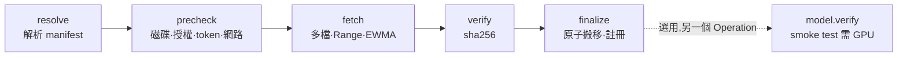
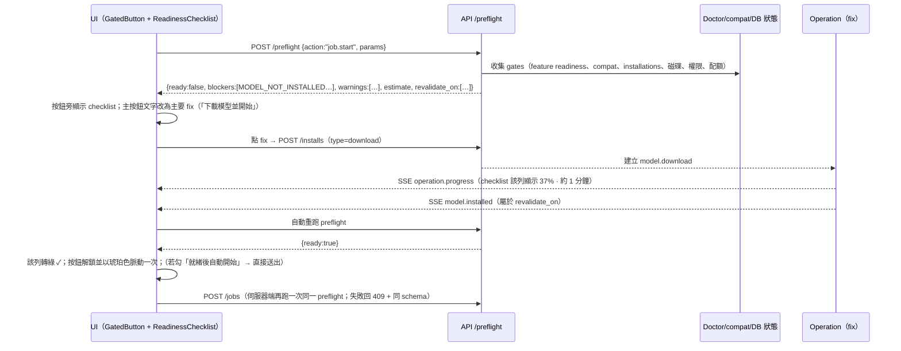

# 06 — 模型管理、環境相容性與長任務體驗（Models · Environment · Operations）

> 專案：**OpenPhotoAgent**（OPA；程式碼／CLI 名稱：`opagent`（已定案））｜Apache-2.0，純開源、不收費
> 文件狀態：Draft v0.1（2026-11）
> 範圍：Model Manager、Download Manager、Environment Doctor、Preflight 與修復 CTA、統一長任務模型（Operation）、相關 UI。
> 依賴與邊界：
> - Registry、VRAM 預算、吞吐估算、下載原則見 [03](03-inference-layer.md) §1／§4／§5.3／§7；本文件**擴充**而不推翻它們。
> - Job 狀態機、REST、SSE、Worker 協定見 [02](02-system-architecture.md) §4／§5；本文件新增的 API 與資料表列在 §7。
> - 設計系統（暗房燈箱、琥珀強調色、token、動效、a11y）沿用 [04](04-control-panel-ux.md) §4；本文件取代 04 §2.3 的 TaskTray（改為 Activity Center）並細化 04 §3.8 Models、§1.2 Onboarding W4–W6。
> - 人臉模型的內容與管線由 `07-face-recognition.md` 定義；各 OS 的推論 runtime 矩陣與打包由 `08` 定義。本文件只定義**它們如何被模型管理、Doctor、Preflight 與 Operation 接住**。
> - 參考研究：[research/voicebox-study.md](research/voicebox-study.md)（下文以「VB §n」引用）。
>
> 標示慣例：**【估算】**＝推算值，未在參考硬體實測；**【未驗證】**＝需在實作時對照上游確認；**【待 07】【待 08】**＝由對應文件最終決定。

---

## 0. 設計原則與名詞

### 0.1 原則（先講結論）

| # | 原則 | 具體含意 |
|---|------|----------|
| M1 | **送出前就知道會不會成功** | 任何可能失敗的操作先跑 preflight（§4）。UI 在按下按鈕「之前」就顯示缺什麼、怎麼修；後端在執行時再跑一次同樣的檢查，防止檢查與執行之間狀態改變（TOCTOU）。 |
| M2 | **不准只有 disabled 沒有理由** | 每個停用的控制項都必須附上原因與至少一個修復動作。這條由元件 API 強制（`GatedButton` 沒有 `reason` 就不能停用），並有 ESLint 規則把關（§4.5）。 |
| M3 | **時間永遠看得見** | 所有長操作都使用同一個 Operation 物件（§5）：經過時間、剩餘時間、速度、階段、佇列位置。開始前先給「預估」，執行中給「實測」，並且一律標出數字的來源（估算／實測）。 |
| M4 | **硬體誠實，且說得出原因** | 相容性分為「可用／不建議／不可用」三級，每一級都附上機器可讀的原因碼（與錯誤碼目錄共用）和替代方案，不只顯示一個顏色。 |
| M5 | **下載不等於載入** | 下載絕不佔用 VRAM，也絕不打斷正在執行的 Job（VB §2 的主要缺陷）。載入是另一個 Operation，交由 ResourceManager 排程。 |
| M6 | **取消就是真的取消** | 按下取消後，網路連線與子行程會在 ≤ 2 秒內真正停止（VB §2 的取消只是隱藏任務）。暫停的實作方式是「停止並保留斷點」。 |
| M7 | **狀態只有一個真相** | Operation 與 Doctor 結果都存在 DB，經單一 SSE 流推給前端；重新整理、重啟或當機後都能恢復顯示（VB §6 全部存在記憶體，重啟就消失）。 |
| M8 | **一套程式碼，三種部署** | 桌面版（Tauri + sidecar）、Docker all-in-one、Control plane + 地端 Worker 共用同一組 check、fix、error code；fix 依部署形態過濾（例如桌面版是 `auto_fix`，Docker 版則換成 `copy_command`）。 |

### 0.2 名詞

| 名詞 | 定義 |
|------|------|
| **Model** | Registry 中一個邏輯模型（03 §1.1 的一個 YAML），例如 `qwen3-vl-8b-instruct`。 |
| **Variant** | 同一模型的量化與 runtime 組合，例如 `fp8@vllm`、`q4_k_m@llama.cpp`、`onnx-gpu`。相容性以 variant 為單位判定。 |
| **Artifact** | Variant 實際需要的檔案集合（權重、mmproj、tokenizer、processor、aux repo），每個檔案都有大小與 sha256。 |
| **Runtime Pack** | 按需下載的推論執行套件，例如 `llama.cpp` 的 CUDA／Metal／Vulkan／CPU build、`onnxruntime` 的 CUDA／CoreML／DirectML EP、PyTorch cu128、vLLM（只限 Linux／WSL2）、ffmpeg、LibRaw。Pack 有自己的版本、平台與 sha256。 |
| **Installation** | 某個 Worker 上某個 artifact 或 pack 的安裝紀錄（路徑、來源、是否為外部參照、驗證狀態）。 |
| **Compat** | `(variant, worker)` 的相容性判定結果：`ok`／`degraded`／`blocked`，加上 `prep[]`（需要準備的步驟）與 `reasons[]`。 |
| **Check** | Environment Doctor 的一個檢查項（§3），會產生 `CheckResult`。 |
| **Feature** | 使用者看得懂的功能單位，例如 `caption.vlm`、`decode.heic`、`search.semantic`、`face.cluster`。Check 會宣告它影響哪些 feature。 |
| **Preflight** | 對某個 action 與參數組合做的就緒判定，回傳 `{ready, blockers[], warnings[], estimate}`（§4）。 |
| **Blocker / Warning** | 帶 `code` 的問題物件；blocker 會阻止執行，warning 只提示。兩者都附上有序的 `fixes[]`。 |
| **Fix** | 一個可執行的修復動作，共 7 種類型（§4.3）。 |
| **Operation** | 任何長操作的統一外殼（§5），含階段、進度、ETA、子操作。Job 也會投影成 Operation。 |

### 0.3 對 voicebox：借鏡與超越

| 面向 | voicebox 做法（VB） | OPA 做法 |
|------|----------------------|----------|
| 模型資訊 | 描述寫死在前端；未下載的模型不顯示大小；沒有 VRAM 資訊 | 全部由 Registry 和 API 提供；顯示大小、VRAM／RAM、授權、能力、實測或估算速度、相容性原因 |
| 相容性 | 只算出 `gpu_compatibility_warning`，前端沒有顯示 | 每個 variant 有三級徽章與原因碼；在選擇器、卡片、精靈、preflight 四處一致 |
| 下載 | 下載等於載入（會佔 VRAM）；取消是假的；沒有速度、ETA、磁碟檢查 | 純下載；可真取消、暫停、續傳；EWMA 速度與 ETA；sha256 驗證；磁碟預檢與執行中監控；鏡像 |
| 阻擋與 CTA | 只有 Dictation checklist 做得好；其他地方是字串錯誤 | Preflight 套用到所有 action，結構化錯誤碼（62 個）配 i18n CTA；修好後自動解鎖 |
| 長任務時間 | 只有文字「Generating...」；沒有 ETA；狀態存在記憶體 | Operation 物件、多階段加權、冷啟動先驗、信心區間、持久化與恢復、Activity Center、OS 通知 |
| 進度通道 | 每個任務各開一條 EventSource 加輪詢 | 單一多工 SSE（02 `/events`）加 `Last-Event-ID` 補發；輪詢只作為備援 |

---

## 1. Model Manager

### 1.1 Registry 擴充（相對於 03 §1.1）

03 的 YAML 結構不變，只新增下列欄位。所有新欄位都是選填，舊檔案仍可載入。

```yaml
# models/builtin/qwen3-vl-8b-instruct.yaml（只列新增欄位）
kind: vlm                         # 新增 kind：face_detector | face_embedder | face_quality（人臉，依 07 §8.1；審查補充：07 ADR-707 不做年齡／性別等屬性推論，故無 face_attr）、ocr、reranker
tasks_default_rank:               # 在各 task 的推薦順位（給「使用中模型」預設與 ModelPicker 排序）
  caption: 1
  classify: 1
variants:
  - id: q4_k_m
    runtime: llama.cpp
    requires:                     # 相容性判定的硬條件（§1.2）
      runtime_pack: ["llamacpp-*"]  # 任一符合即可；實際挑選依平台（cuda/metal/vulkan/cpu）
      os: [windows, macos, linux]
      min_ram_gb: 8               # 系統 RAM（MoE offload 等）
      min_compute_capability: null
      accel_any: [cuda, metal, vulkan, rocm, cpu]
    files:                        # Artifact 清單：catalog 只寫 repo 與 path；size／sha256 不得寫在這裡（schema 拒絕）
      - { repo: Qwen/Qwen3-VL-8B-Instruct-GGUF, path: "Qwen3-VL-8B-Instruct-Q4_K_M.gguf" }
      - { repo: Qwen/Qwen3-VL-8B-Instruct-GGUF, path: "mmproj-F16.gguf" }
    revision: main                # 人寫的 ref；實際釘選的 40-hex commit 在 registry/pins.lock（ADR-0002）
    # registry/pins.lock（CI 的 registry-pin.yml 產生）：{model, variant, revision: <commit>, files: [{path, size, sha256, lfs_oid}]}
    # 載入時合併，variant 得到 pin_state ∈ {pinned, unpinned}；部分釘選＝載入錯誤；unpinned 不會被推薦，下載時 MODEL_NOT_PINNED
    perf_prior:                   # 冷啟動 ETA 用的先驗（03 §5.3），以參考 GPU 表示
      ref_gpu: rtx-5070-ti
      items_per_s: { classify: [1.5, 3.0], fused: [0.7, 1.5] }    # [p10, p90]【估算】
      load_s: [8, 20]             # 冷載入秒數【估算】
      bound: memory_bw            # memory_bw | compute | io：GPU 換算時用哪一個係數（§1.4）
```

**Runtime pack 描述檔**（新增 `runtimes/*.yaml`，由 08 維護平台矩陣【待 08】）：

```yaml
# runtimes/llamacpp-cuda12.yaml
schema_version: 1
id: llamacpp-cuda12
provides: { runtime: llama.cpp, accel: cuda }
version: "b6xxx"                  # 跟隨我們 CI 編譯的 llama.cpp release【未驗證】
platforms:
  - { os: windows, arch: x86_64, url: "…/llamacpp-cuda12-win-x64.zip",   size: 412000000, sha256: "…" }
  - { os: linux,   arch: x86_64, url: "…/llamacpp-cuda12-linux-x64.tar.zst", size: 398000000, sha256: "…" }
requires:
  nvidia_driver_min: "570.00"     # CUDA 12.8；sm_120 需要（03 §4.5）
  compute_capability_min: "6.1"
  cuda_architectures: ["61","70","75","80","86","89","90","100","120"]   # 編譯時含的 arch，給 GPU_ARCH_UNSUPPORTED 判定
self_test: { cmd: ["llama-server", "--version"], expect_regex: "version" }
license: { spdx: MIT, notice_file: LICENSE-llama.cpp }
install_dir: "{packs_root}/llamacpp-cuda12/{version}"
---
# runtimes/vllm.yaml
id: vllm
provides: { runtime: vllm, accel: cuda }
platforms:
  - { os: linux, arch: x86_64, kind: python_env, spec: "vllm==0.x.y", torch: cu128, size_est: 6.5e9 }  # 以 uv 建獨立 venv【未驗證】
  - { os: windows, arch: x86_64, kind: wsl2_env, distro: "opagent-wsl", size_est: 9e9 }                    # 只在 WSL2 中提供；原生 Windows 不支援
notes: "macOS 不提供；Windows 需要 WSL2 + GPU passthrough（§3.3 check wsl.gpu）"
```

Pack 種類（初版；審查補充：**以 08 §4.2 的 Pack 目錄為準**）：`llamacpp-{cuda13,cuda12,vulkan,rocm}`、`ort-cuda`、`vllm-cu128`（僅 Linux）、`torch-{cu128,mps,cpu}`、`mlx`（僅 Mac，v0.4）、`exiftool`、`pg-prev`。桌面版**內建**（不需下載）：llama.cpp CPU（macOS 為 Metal）、ORT CPU + DirectML（Windows）／CoreML（macOS）、pillow-heif、嵌入式 PG（`pg` pack）；其他 pack 一律按需下載，讓安裝檔保持 ≤ 200 MB（08 §4.1）。

### 1.2 相容性判定（`compat`）

對每個 `(variant, worker)` 依下列順序判定，**遇到第一個硬性失敗就停**，但會繼續收集所有軟性問題：

```
1. 平台   variant.requires.os / runtime pack 有沒有此 OS+arch 的 build        → 否: blocked  RUNTIME_UNSUPPORTED_PLATFORM
2. 加速器  accel_any ∩ worker.accels；compute capability ≥ min；pack 的 cuda_architectures 含此 GPU sm
                                                                          → 否: blocked  GPU_ARCH_UNSUPPORTED / GPU_NOT_FOUND
3. 驅動   driver ≥ pack.requires.nvidia_driver_min                          → 否: blocked（可修）GPU_DRIVER_TOO_OLD
4. 記憶體  need = 03 §4.1 的 need(model)；budget = 03 §4.1 的 budget（用「總量」判定，不是當下 free）
          need + resident_small_slot ≤ budget                → ok
          need ≤ budget（需序列切換）或需 CPU offload 且 RAM 足夠  → degraded  VRAM_SEQUENTIAL / VRAM_OFFLOAD
          need > budget 且無 offload 路徑；或 RAM < min_ram_gb      → blocked   VRAM_INSUFFICIENT / RAM_INSUFFICIENT
5. 速度   只有 CPU 可跑，且估算 1 萬張 > 24 小時                   → degraded  PERF_CPU_ONLY_SLOW
6. 準備項（不影響等級，列入 prep[]）：
          pack 未安裝 → RUNTIME_PACK_MISSING；artifact 未下載 → MODEL_NOT_INSTALLED；
          授權未同意 → LICENSE_CONSENT_REQUIRED；gated 且無 token → HF_AUTH_REQUIRED
```

- Model 層級的徽章取**最佳 variant** 的等級，並標示用哪一個 variant 算出（例：「可用 · Q4_K_M」）。
- 每個 reason 與 prep 都使用 §4.7 的錯誤碼，因此可以直接接上同一套 fix（例如 `VRAM_INSUFFICIENT` → `choose_alternative{variant: q4_k_m}`）。
- 結果快取到 `compat_cache(worker_id, variant_key, inputs_hash)`。`inputs_hash` 由 Doctor 的硬體摘要、已裝 packs 與 registry 版本組成，任何一項改變就失效。

```json
{
  "variant": "qwen3-vl-8b-instruct@fp8",
  "worker_id": "wk_01J…",
  "level": "ok",                       // ok | degraded | blocked
  "label_key": "compat.ok",            // 可用 / 不建議 / 不可用
  "reasons": [],
  "prep": [
    { "code": "RUNTIME_PACK_MISSING", "params": { "pack": "vllm", "size_bytes": 6500000000 } },
    { "code": "MODEL_NOT_INSTALLED",  "params": { "size_bytes": 10600000000 } }
  ],
  "vram": { "need_gb": 11.5, "budget_gb": 14.7, "with_resident_gb": 13.0, "source": "observed" },  // observed | estimated
  "fits_now": false, "fits_now_reason": "GPU_BUSY_EXTERNAL",  // 當下 free 不足（例如遊戲正在佔用），不影響等級
  "evaluated_at": "2026-11-01T12:00:00Z"
}
```

| 等級 | 徽章（色＋圖示＋文字，不只靠顏色） | 意義 | 範例原因 |
|------|------------------------------------|------|----------|
| `ok` | 🟢 ● **可用** | 能與常駐 embedding 並載，速度合理 | — |
| `degraded` | 🟡 ◐ **不建議** | 能跑，但需要序列切換、CPU offload、CPU only，或速度極慢 | 「需與 SigLIP2 輪流載入，總時間約 +15%」「只能用 CPU，1 萬張約 3 天」 |
| `blocked` | 🔴 ○ **不可用** | 這台機器目前跑不動，附上替代方案 | 「需要 18 GB VRAM，你有 16 GB → 改用 Q4_K_M（6.5 GB）」 |
| prep 修飾 | 徽章旁的 chip「需下載 10.6 GB」「需安裝 vLLM 套件」「需同意授權」 | 等級不變，但開始前需要準備 | — |

### 1.3 模型卡資訊

| 欄位 | 內容 | 來源 |
|------|------|------|
| 名稱、family、kind | `Qwen3-VL 8B Instruct · VLM` | registry |
| 能力 chips | Caption · Tag · 分類 · OCR · Embed · 人臉偵測／特徵 | `capabilities` |
| 語言 | 繁中 ✓ 英 ✓ 日 ✓（caption 可用語言） | `languages` |
| 相容性徽章 | §1.2，加上最佳 variant 與原因（hover／點擊看算式） | compat |
| 大小 | 未安裝：「下載 10.6 GB」（精確值，來自 files manifest）；已安裝：「磁碟 10.6 GB」 | manifest／installation |
| VRAM／RAM | 「VRAM 11.5 GB（實測 11.2）· RAM 2 GB」；MoE：「GPU 13 + RAM 12」 | 03 §4.1、`vram_observed` |
| 速度 | 「3.1 張/秒 · 實測（你的 RTX 5070 Ti，近 7 天 1,240 張）」或「約 2–4 張/秒 · 估算」；附「⏱ 30 秒測速」 | §1.4 |
| 授權 | SPDX、可否商用、是否需要同意；非商用（例如部分人臉模型權重）顯示橘色「非商用」標籤 | `license` |
| 已安裝 variants | 每個 variant 一列：量化、runtime、大小、狀態（已安裝／下載中 37%／未安裝／外部參照🔗／損毀⚠） | installation |
| 使用中 | 「Caption、分類的預設模型」「目前已載入（large slot）」 | task defaults、ResourceManager |
| 來源與版本 | HF repo@revision（釘選／未釘選）、匯入來源（Ollama／LM Studio／資料夾） | registry／import |
| 已知限制 | 例：「英文為主」「寫實照片效果差（動漫 tagger）」 | `notes` |

### 1.4 速度：實測 vs 估算

速度資料的優先順序（也用於 §5.5 ETA 的冷啟動）：

1. **本機實測**：`perf_observation(worker_id, variant, task_sig, pixels_bucket)`，以 Job 和 speedtest 的實際吞吐累積（EWMA 與樣本數）。超過 30 天或 runtime pack 版本改變時，權重降為一半。
2. **同類 GPU 換算**：用 registry 的 `perf_prior`（參考 GPU 為 RTX 5070 Ti），乘上 GPU 係數：
   `rate = prior × (bw_user / bw_ref)^a × (tflops_user / tflops_ref)^(1−a)`。其中 `bound=memory_bw` 時 a=0.8（VLM decode），`compute` 時 a=0.2（embedding、tagger）。GPU 規格表 `gpu_classes.yaml` 只記錄頻寬與 FP16 算力，例如 5070 Ti 896 GB/s、4060 272 GB/s、4090 1008 GB/s、5090 1792 GB/s、M4 Pro 273 GB/s【公式與指數皆為估算，需 benchmark 校正】。
3. **沒有任何資料**：顯示「速度未知 · ⏱ 測速」，ETA 進入「估算中」。

**⏱ 30 秒測速**（Operation `model.speedtest`）：用內建 20 張測試圖跑一次 fused 任務，結果寫入 `perf_observation`。它需要載入模型，所以會走 preflight（VRAM、GPU 忙碌），並在 GPU 有 Job 時排在後面，不插隊。

### 1.5 篩選、排序、分組

- **篩選**：任務（caption／tag／classify／embed／face／ocr）、相容性（可用／含不建議／全部）、狀態（已安裝／未安裝／下載中／外部參照）、runtime（vLLM／llama.cpp／ONNX／transformers／Ollama／外部 endpoint）、授權（可商用／需同意／非商用）、語言（支援繁中 caption）、大小（< 2 GB／2–8／> 8）。
- **預設篩選**：「適合我的 GPU」＝ `level ∈ {ok, degraded}`。被濾掉的數量會以 chip 顯示：「另有 6 個模型在此 GPU 不可用 · 顯示」。
- **排序**：推薦（`tasks_default_rank` × compat）／速度（實測優先）／大小／名稱／最近使用。
- **分組**：依 kind（VLM、Embedding、Tagger、Caption 專用、人臉、OCR）分段，再加一段「執行套件（Runtime Packs）」。分段由 API 的 `kind` 決定，不由前端寫死（修正 VB §1 用 `startsWith` 分段的問題）。
- 篩選條件寫入 URL query（04 §2.1 慣例）。

### 1.6 使用中模型（per task 的預設）

```
┌ 使用中模型   Workspace：家庭照片        Worker：desktop-5070ti ▾ ─────────────────────────┐
│ 任務        預設模型                         variant        狀態                   後備       │
│ Caption     Qwen3-VL-8B Instruct ▾          自動（FP8）    🟢 已安裝 · 未載入      Q4_K_M ▾  │
│ Tagging     （與 Caption 合併 fused）       —              —                      —         │
│ 分類        Cascade：SigLIP2 → Qwen3-VL ▾   自動           🟢 SigLIP2 已載入       —         │
│ Embedding   SigLIP2 so400m ▾                fp16           🟢 已載入（常駐）       PE-Core B │
│ 人臉偵測    （07 決定）▾                     onnx-gpu       🟡 需下載 18 MB         onnx-cpu  │
│ 人臉特徵    （07 決定）▾                     onnx-gpu       🔴 授權需同意           —         │
└──────────────────────────────────────────────────────────────────────────────────────────────┘
```

- 資料表 `task_default_model(workspace_id, task, model_id, variant_policy, fallback_chain[], worker_overrides jsonb)`。`variant_policy=auto` 時，依目前 Worker 挑出 compat 最佳且已安裝的 variant。
- **切換不會立刻載入**：只更新預設，並提示「下次任務會載入（約 45 秒）」。若想立刻載入，可按「預先載入」，這會建立一個低優先的 `model.load` Operation。
- **進行中的 Job 不受影響**：Job 綁定 pipeline revision（02 §3.2 不可變），UI 會說明「進行中的 2 個任務仍使用舊模型」。
- **Embedding 預設模型改變**會讓既有向量索引失效，必須 reindex。切換前會跑 preflight，顯示 warning `SEARCH_MODEL_MISMATCH` 與 reindex 預估時間，使用者確認後才套用。
- 新 Job 精靈的 ③ 模型步驟預設帶入這裡的設定。

### 1.7 刪除與移動模型目錄

**刪除**（`DELETE /api/v1/workers/{id}/installations/{inst}`，同時刪除 aux 檔案）：

| 情境 | 行為 |
|------|------|
| 模型已載入 | 主按鈕改為「卸載並刪除」（VB 只做到停用，並用 tooltip 說明） |
| 是某 task 的預設 | 對話框列出受影響的任務，並要求選擇替代模型（下拉選單預選後備模型） |
| 有排隊或執行中的 Job 依賴它 | blocker `MODEL_IN_USE`，fix：「等任務完成後刪除」（排程刪除）或「取消這些任務」 |
| 外部參照（Ollama／LM Studio／唯讀 HF cache） | 預設只「從清單移除」；另有明確選項「也從 Ollama 刪除」（呼叫 Ollama API，並二次確認） |
| 一般 | 確認框顯示「會釋放 10.6 GB」（借鏡 VB）；共用的 blob（例如兩個 variant 共用的 mmproj）會以參考計數保留，並說明「1.2 GB 被其他 variant 共用，將保留」 |

**移動模型目錄**（Operation `model.move`，借鏡 VB `POST /models/migrate`，但不需要重啟 server）：

1. Preflight：目標可寫（`FS_NOT_WRITABLE`）、不在來源目錄底下、可用空間 ≥ 總量 × 1.05、不是網路磁碟（是的話顯示 warning：「從 NAS 載入模型會慢 3–10 倍」）。
2. 暫停進行中的下載，並請 ResourceManager 卸載所有引用這些檔案的模型。若 Job 正在使用，會等它完成或讓使用者選擇暫停 Job。
3. 同一個檔案系統直接 `rename`（數秒）；跨檔案系統則逐檔 copy，接著 verify sha256（使用已知 hash，不需要重算來源），最後原子切換設定中的 `models_root` 指標。
4. 完成後詢問是否刪除舊目錄，預設保留 24 小時後才刪，方便回復。外部參照的模型不會被移動。
5. 階段為 `prepare 2% → copy 85% → verify 10% → switch 3%`，以 bytes 計算 ETA。

目錄結構：`{models_root}/hf/`（HF cache layout：blobs/snapshots，能和既有 HF cache 互通）、`{models_root}/gguf/`、`{models_root}/onnx/`、`{packs_root}/`（預設 `{models_root}/../packs`）。Doctor 會分別檢查模型目錄、pack 目錄與縮圖目錄的空間（§3.3）。

### 1.8 匯入既有模型

`POST /api/v1/workers/{id}/imports/scan` 會建立 Operation `model.import.scan`，在 Worker 上掃描下列來源：

| 來源 | 偵測方式 | 匯入方式 | 備註 |
|------|----------|----------|------|
| HF cache | `HF_HUB_CACHE`／`HF_HOME`，預設 `~/.cache/huggingface/hub`；`huggingface_hub.scan_cache_dir()` | **參照**（唯讀，不刪除、不移動）或「採用為模型目錄」 | 依 `repo_id@revision` 對應到 registry；用 VB 的 `.incomplete` 孤兒判定來排除未完成的下載 |
| Ollama | `GET http://localhost:11434/api/tags`；離線時讀 `~/.ollama/models/manifests` | 以 runtime `ollama` 參照（推論交給 Ollama），或把 GGUF blob **硬連結／參照**給 llama.cpp 使用【未驗證：mmproj 層的可用性】 | 依 tag 對應 registry 的 `ollama_tag` |
| LM Studio | `~/.lmstudio/models`、舊版 `~/.cache/lm-studio/models`，或 `lms ls`【路徑未驗證】 | 參照 GGUF 檔案；mmproj 依同目錄命名規則配對 | 也可改走 openai-compatible endpoint（`localhost:1234`） |
| 任意資料夾 | 使用者選擇資料夾；掃描 `*.gguf`、`*.onnx`、`*.safetensors`（含 `config.json`） | 參照或複製 | 只接受 safetensors／gguf／onnx（03 §7.1 的安全原則） |

- **辨識**：先比對檔案 sha256 和 registry 的 `files[].sha256`，命中就自動辨識為內建 variant（「這是 Qwen3-VL-8B Q4_K_M ✓ 已驗證」）。未命中時，從 GGUF metadata（`general.architecture`、`general.name`）或 `config.json` 猜測 family，並建立使用者自訂的 YAML（`~/.opagent/models/imported-*.yaml`），標示為「未驗證模型」。
- 大檔的 hash 很花時間（10 GB 約 10–30 秒）。所以掃描先用 `size + 檔名 + mtime` 快速配對，sha256 在背景以子 Operation 計算，UI 顯示「驗證中 43%」。
- 參照型 installation 標記 `managed=false`：OPA 不會刪除或移動這些檔案，若來源檔案消失，Doctor 會報告 `MODEL_FILES_MISSING`。

### 1.9 授權同意流程

```
下載／匯入／首次使用 一個 license.requires_acceptance=true 的模型
 → 對話框：授權名稱 + 摘要重點（可否商用、署名、禁止用途）+ 全文連結 + 版本 hash
 → [ ] 我已閱讀並同意 {license}（勾選後才可按「同意並下載」）
 → 寫入 license_acceptance(user_id, org_id, model_id, license_id, license_hash, accepted_at, ip?, client)
 → gated repo：另需 HF token 與「在 Hugging Face 網站上申請存取」——兩者不同：
     HF_AUTH_REQUIRED          → fix: open_settings(#hf-token)（存 OS keyring／secret store）
     HF_GATED_ACCESS_PENDING   → fix: open_docs(HF 模型頁「Agree and access」) + retry
```

- 同意紀錄以 workspace／org 為範圍。授權文字的 hash 改變時（模型更新授權）必須重新同意。
- 非商用授權不會阻擋使用（使用者自用是合法的），但會在模型卡、ModelPicker 和 Job 報告中標示「非商用授權」，並提醒「若你將輸出用於商業用途，請改用 …」。
- 已同意的授權可以在模型詳情的「授權」分頁查看與撤回；撤回後模型改為 blocked `LICENSE_CONSENT_REQUIRED`，但不會刪除檔案。

### 1.10 人臉模型與 Runtime Pack 在模型管理中的位置

- **人臉模型**（偵測、特徵、屬性）在 registry 中是 `kind: face_*` 的 ONNX 模型，和其他模型共用 Model Manager、Download Manager、compat 與授權流程。具體模型、閾值與分群演算法【待 07】。這裡先約定幾件事：(1) 人臉特徵模型變更 ⇒ 既有 face embedding 失效，需要 `face.reembed`（同 §1.6 的 reindex 規則）；(2) 人臉功能預設關閉，啟用時有獨立的隱私同意（與授權同意分開），文案由 07 決定；(3) 許多人臉權重是非商用授權，§1.9 的標示必須出現【待 07 確認具體模型授權】。
- **Runtime pack** 出現在 Models 頁的「執行套件」分段，與模型同樣顯示大小、狀態、版本、相容性。它也可以從任何 preflight fix（`download` 類型）一鍵安裝。卡片上會顯示依賴它的模型數（「3 個模型使用此套件」），刪除時檢查參考計數。
- Pack 的更新（例如 llama.cpp 新 release）以「可更新」chip 呈現，不會自動更新（避免破壞實測速度與 fingerprint）。更新後，相關 `perf_observation` 降權，`model_fingerprint` 也隨之改變（02 §3.2 快取鍵）。

### 1.11 API（Model Manager）

| 方法 | 路徑 | 說明 |
|------|------|------|
| GET | `/api/v1/models?worker_id=&task=&compat=&installed=&kind=` | 模型清單，每個 variant 附 compat、installation、perf（取代 03 §7.3 的形狀，向下相容） |
| GET | `/api/v1/models/{id}?worker_id=` | 詳情：variants、files、授權與同意紀錄、使用中狀態、各 Worker 安裝狀態 |
| GET | `/api/v1/runtime-packs?worker_id=` | Pack 清單與狀態 |
| POST | `/api/v1/workers/{id}/installs` | `{variant \| pack, mirror?, priority?}` → preflight 後建立 `model.download`／`runtime.install` Operation（取代 02 的 `/workers/{id}/models/{mv}/install`，舊路徑保留為 alias） |
| DELETE | `/api/v1/workers/{id}/installations/{inst}?also_external=false` | 刪除（§1.7） |
| POST | `/api/v1/workers/{id}/models/{variant}/load` · `/unload` | 手動載入／卸載（Operation `model.load`） |
| POST | `/api/v1/workers/{id}/models/{variant}/speedtest` | 30 秒測速 |
| POST | `/api/v1/workers/{id}/storage/move` | `{target: models_root \| packs_root \| thumbs_root, path}` → `model.move` |
| POST | `/api/v1/workers/{id}/imports/scan` · `POST /imports/{scan_id}/commit` | 掃描既有模型 → 勾選後匯入 |
| GET/PUT | `/api/v1/workspaces/{ws}/task-defaults` | 使用中模型 |
| POST | `/api/v1/licenses/{model_id}/accept` · `DELETE …/accept` | 授權同意／撤回 |

---

## 2. Download Manager

### 2.1 流程與階段



| 階段 | 權重（預設，§5.4 會依位元數動態調整） | 內容 |
|------|------|------|
| `resolve` | 1% | 內建模型一律使用 `registry/pins.lock` 的釘選值（未釘選 → preflight blocker `MODEL_NOT_PINNED`，ADR-0002）；使用者自訂 YAML 使用其自帶的 sha256，大小可呼叫 `HfApi().model_info(repo, revision, files_metadata=True)` 補齊。只挑 variant 需要的檔案（03 §7.1 的 allow_patterns）。**一開始就知道精確總量**，因此不需要 VB 的 indeterminate／1 MB 門檻 hack。 |
| `precheck` | 1% | §2.5 磁碟、§1.9 授權、HF token、網路／鏡像連通。任何失敗都轉為 blocker 並附上 fix。 |
| `fetch` | 88%（依 bytes） | §2.2 引擎。 |
| `verify` | 8% | 逐檔 sha256（續傳的檔案需要重算整檔；未中斷的檔案邊下載邊 hash，所以這階段幾乎是 0）。 |
| `finalize` | 2% | `.part` → HF cache layout 的 blob，`os.replace` 原子搬移、建立 snapshot symlink（Windows 無 symlink 權限時改用 copy 或 hardlink）、寫入 installation、發出 `model.installed` 事件、讓 compat 失效。 |

`model.verify`（smoke test，1 張內建圖）**不屬於下載的一部分**，觸發方式有三種：(a) 使用者按「驗證」；(b) GPU 閒置時自動排入（預設開啟，最低優先）；(c) 第一次被 Job 使用時，由 Job 的 `model_load` 階段順便完成。

### 2.2 下載引擎：真取消、暫停、斷點續傳

- **自寫 HTTP Range 下載器**（httpx async，HTTP/2），對 `{endpoint}/{repo}/resolve/{revision}/{path}` 發請求並跟隨 302 到 CDN。不依賴 `snapshot_download` 的黑盒，原因是需要可中斷、需要逐 chunk 回報、需要控制鏡像切換。
- 每檔寫入 `{models_root}/.downloads/{op_id}/{sha256}.part`，旁邊放 `.part.json`：`{url, etag, size, written, segments[], started_at}`。
- **大檔分段並行**：≥ 512 MB 的檔案切成 4 段（可設定 1–8），每段各自用 Range 下載並寫入同一個檔案的不同 offset（`pwrite`），`.part.json` 記錄每段的 `written`。同時下載的連線數上限是全域 8 條。
- **取消**：每個 chunk（1 MiB）寫入後檢查 `CancelToken`。取消時立即關閉 HTTP stream，這不需要等 chunk 讀完，因為 `aclose()` 會中斷 socket。目標是 **≤ 2 秒內沒有任何網路流量**。若使用外部加速器（`hf_xet`／`hf_transfer`，選用），它們會在獨立子行程中執行，取消時直接 kill process group。`.part` 檔是否刪除依使用者選擇：「取消並刪除已下載 3.2 GB」（預設）／「取消但保留，以後可續傳」。
- **暫停**：等同取消並保留 `.part`。Operation 狀態變成 `paused`，續傳時用 `Range: bytes={written}-`，加上 `If-Range: {etag}`。伺服器若回 200（etag 改變），代表遠端檔案已變更，這時捨棄該檔並從頭下載，同時發出 warning `DL_REMOTE_CHANGED`；釘選 revision 時理論上不會發生。
- **斷點續傳也適用於當機或重啟**：sidecar／Worker 啟動時，如果發現 `.downloads/` 中有 `status=running` 的 Operation，會轉為 `interrupted`，並依設定 `downloads.auto_resume`（預設開啟）自動續傳（§5.8）。
- **Ollama 下載**：呼叫 `POST /api/pull`（stream）並解析 `{status, digest, total, completed}` 來回報 bytes。取消方式是關閉串流【未驗證：Ollama 是否保留已下載 layer，據社群經驗會保留】。
- **頻寬限制**：設定「下載限速」（預設不限），以及「Job 執行中自動限速至 50%」（避免 NAS 掃描與下載搶頻寬，選用）。

### 2.3 進度、速度與 ETA

- Worker 每 250 ms 取樣一次累計 bytes，計算瞬時速度 `v = Δbytes / Δt`。
- **EWMA（時間常數版）**：`α = 1 − exp(−Δt / τ)`，`speed ← speed + α (v − speed)`，τ = 5 秒。採樣間隔不固定也不會失真；暫停期間不採樣。
- 另外維護一個 τ = 30 秒的慢速 EWMA。ETA 使用 `remaining / blend(fast, slow)`：前 10 秒用 fast，之後用 0.3·fast + 0.7·slow，避免 CDN 抖動讓 ETA 跳來跳去。
- 信心區間取自速度的 EWMA 變異數（§5.5.5）。開始 3 秒內或樣本數少於 4 時，狀態為「估算中」。
- 推送節流（借鏡 VB `ProgressManager`）：每 1 秒一則 `operation.progress`，或進度變化 ≥ 1% 時推送；狀態變化、錯誤、完成則立即推送。
- 呈現：`6.1 / 10.6 GB · 85.3 MB/s · 約 1 分鐘` ＋ 每檔明細（展開時顯示）：`model-00002-of-00004.safetensors  ███▌ 71% · 4 段`。

### 2.4 佇列與排程

- 每台 Worker 有一個下載佇列：**同時進行 1 個 Operation**（可設 1–3），其餘顯示 `queued`，並附 `queue_position` 與「前面約 2 分鐘」（用前方剩餘 bytes ÷ 目前速度估算）。
- 優先序：使用者正在等的（preflight fix 觸發的、Onboarding 中的）> 手動下載 > 背景預取（例如 registry 推薦的後備 variant）。可以在 Activity Center 拖曳排序，或用「優先下載」把項目移到最前面，目前正在下載的項目會被暫停（保留斷點）。
- 一個 Operation 內的多個檔案依「小檔先下」（tokenizer、config 先完成，讓 resolve 錯誤儘早浮現），大檔則分段並行。
- 下載不會占用 GPU slot，因此永遠可以和 Job 並行（M5）。
- （回寫 ADR-0007）Worker 的常駐迴圈把每個下載放在**子進程**執行（各 OS 一律 `spawn`）：進度與暫停／取消經兩條單向 pipe 傳遞；Worker 消失時子進程讀到 EOF，保留 `.part` 後結束（續傳見 DL-014）；取消送出 1 s 後仍未結束就 `terminate()`，維持 ≤ 2 s（DL-005）。續傳狀態每 8 MB、停止時與分段完成時寫入。目的：下載不與標註、掃描爭用同一個 GIL（DL-019）。

### 2.5 磁碟預檢與執行中監控

```
required = Σ(未完成檔案剩餘 bytes) × 1.05 + (跨檔案系統 finalize 需要的暫存) 
free     = shutil.disk_usage(models_root 所在檔案系統).free − reserve_floor（預設 max(2 GB, 2%)）
```

- `required > free` → blocker `DISK_INSUFFICIENT_MODELS`，`details: {required_bytes, free_bytes, path, fs}`，fixes：
  1. `choose_alternative`：改用更小的 variant（「Q4_K_M 只需 5.0 GB」）。
  2. `open_settings`：管理已安裝模型（依「最久未使用」排序，並顯示可釋放的空間）。
  3. `auto_fix`：清除下載暫存與孤兒 `.part`（顯示可釋放的大小）。
  4. `open_settings`：更改模型目錄（→ §1.7 移動）。
- **執行中**：每 10 秒重新檢查一次。如果其他程式吃掉空間、導致可用空間 < 剩餘需求 + 1 GB，就自動暫停（`paused_auto`，`waiting_reason=DISK_INSUFFICIENT_MODELS`）。空間恢復後顯示「繼續」，若使用者勾選了「空間足夠時自動繼續」，就自動繼續。
- 多個下載同時排隊時，預檢會把佇列中前方項目的需求也算進去（「排隊的 2 個下載共需 31 GB，可用 24 GB」）。

### 2.6 鏡像與來源

- 設定 `download.sources`：有序清單，預設 `[huggingface.co]`；可加入 `HF_ENDPOINT` 相容鏡像（例如社群鏡像或企業內部的 HF 代理）、自訂 HTTP base、`file://` 或 SMB 路徑（離線環境中預先放好的模型包，對應 03 §7.2 的 `opagent models import`）。
- **自動切換**：連線失敗或 5xx 連續 3 次，或速度低於 1 MB/s 持續 60 秒（可設定）時，換下一個來源，並以 Range 續傳同一個 `.part`（只要大小相同；hash 最後仍會驗證）。UI 顯示「已切換到鏡像 hf-mirror（原來源逾時）」。
- **信任錨點**：sha256 一律以 registry 中的釘選值為準（內建：`pins.lock`；自訂：YAML 自帶）。**內建模型不再退回「當下官方 HF API 的值」**（ADR-0002）。只有使用者自訂、且 YAML 未附 sha256 的來源（例如 `file://` 離線包）才會用鏡像 metadata，並標示 warning `DL_UNVERIFIED_SOURCE`（「此模型未經官方雜湊驗證」），使用者確認後才繼續。鏡像因此無法竄改內容。
- 速度觀測寫入 `perf_observation(kind=bandwidth, key=source)`，供開始前預估使用（§5.9）。

### 2.7 驗證與安全

- sha256 不符 → 該檔刪除並自動重下 1 次；仍然不符 → `DL_CHECKSUM_MISMATCH`（permanent）。fix：「換一個來源重試」「回報問題（附上 hash）」。
- 只接受 03 §7.1 的格式白名單。Pack 解壓時防止路徑穿越（`tarfile` 的 `filter="data"`，以及 zip 的 entry 名稱檢查，借鏡 VB `cuda.py`），解壓到暫存目錄後再原子搬移。
- Pack 的 self-test 失敗 → `RUNTIME_PACK_BROKEN`，fix：「重新安裝」「改用 CPU 套件」。

### 2.8 下載與載入分離

| | 下載（`model.download`） | 載入（`model.load`） |
|---|---|---|
| 資源 | 網路、磁碟 | VRAM／RAM、GPU slot |
| 誰排程 | Download queue（§2.4） | ResourceManager（03 §4.2）＋ Job 排程 model affinity（02 §4.3） |
| 觸發 | 使用者、preflight fix、Onboarding | Job 開始、預先載入、speedtest、smoke test |
| 對 Job 的影響 | 無（M5） | 可能需要等 large slot；在 Job 中顯示為 `model_load` 階段 |
| 完成後 | `model.installed` 事件 → compat 失效 → preflight 重算 → 被擋住的按鈕自動解鎖 | `model.loaded` 事件 → ActivityIndicator 顯示「已載入」 |

**模型載入的進度**：transformers 透過 `tqdm_class` 攔截「Loading checkpoint shards」（借鏡 VB `hf_progress.py`，屬於 determinate 進度）；vLLM 與 llama-server 子行程在無法取得內部進度時，解析 log 中的已知里程碑（`loading weights` → `profiling` → `KV cache` → `ready`）作為子階段。若都取不到，就用 `perf_observation(kind=load_time)` 的歷史中位數做「時間型 determinate」進度（進度 = elapsed / 預估，最多到 95% 後停住，等 ready 才跳到 100%），並標示「依過去載入時間估算」。

### 2.9 重試與錯誤碼

| 錯誤 | 類別 | 策略 |
|------|------|------|
| 連線失敗、逾時、5xx、連線重設 | transient | 逐檔指數退避 2s → 8s → 30s → 2m → 5m（±20% 抖動），最多 5 次；每次從斷點續傳；UI 顯示「重試中（2/5），12 秒後」並附「立即重試」 |
| 429 | transient | 遵守 `Retry-After`；連續發生時減少分段數；`DL_RATE_LIMITED` 提示「登入 HF token 可提高額度」 |
| 401／403 gated | permanent | `HF_AUTH_REQUIRED`／`HF_GATED_ACCESS_PENDING` |
| 404 | permanent | `DL_NOT_FOUND`（revision 或檔名錯誤：registry 過期）→ 「更新模型目錄」「回報問題」 |
| 磁碟滿（ENOSPC） | paused_auto | `DISK_INSUFFICIENT_MODELS` |
| 權限（EACCES） | permanent | `FS_NOT_WRITABLE` |
| sha 不符 | 重試 1 次後 permanent | `DL_CHECKSUM_MISMATCH` |
| 所有來源皆失敗 | permanent | `NET_UNREACHABLE` 或 `DL_MIRROR_FAILED` |

### 2.10 API（Download）

下載就是 Operation，所以控制 API 與其他長操作共用（§5.7）：`POST /api/v1/operations/{id}/pause|resume|cancel|retry|prioritize`。下載專屬的端點只有：

| 方法 | 路徑 | 說明 |
|------|------|------|
| GET | `/api/v1/operations/{id}/files` | 每檔明細（大小、已下載、分段、來源、sha 狀態） |
| GET/PUT | `/api/v1/settings/downloads` | 來源與鏡像、並行數、限速、自動續傳 |
| POST | `/api/v1/workers/{id}/downloads/cleanup` | 清除孤兒 `.part`（`auto_fix` 用） |

---
## 3. Environment Doctor

### 3.1 架構

```
┌ Check Registry（opagent/doctor/checks/*.py，以 decorator 註冊）
│   每個 check：id、scope、platforms、depends_on、severity、affects[]、ttl、run()、fixes()
├ DoctorRunner
│   - 依 depends_on 做拓樸排序；同層並行（asyncio，單 check 逾時 10s → status=unknown）
│   - 依 scope 分派：host（Worker 所在機器）／cp（Control plane）／client（瀏覽器或桌面殼）
│   - 每個 check 產生 CheckResult → 寫 doctor_check_result → SSE doctor.check
├ Triggers：啟動時（快速組）、Onboarding W4、使用者按「重新檢查」、
│           事件驅動（pack 安裝完成、GPU 熱插拔、磁碟掛載變動、Worker 重連）、
│           ttl 到期時懶惰重跑（preflight 讀取時發現過期就重跑該 check）
└ Feature Readiness：feature → 依賴的 checks 聚合（§3.4），供 preflight 與 UI 使用
```

- **兩種速度**：`quick` 組（不載入 torch、不打網路，< 1 秒，用於啟動與 preflight）和 `full` 組（import torch、試編譯 CUDA kernel、1 張圖的 smoke test、網路測速，數秒到數十秒，屬於 Operation `doctor.run`）。
- **逃生門**（借鏡 VB `VOICEBOX_FORCE_CPU`）：`OPAGENT_FORCE_CPU=1` 在 import torch 之前生效；`OPAGENT_DOCTOR_SKIP=gpu.cuda_runtime,…` 可跳過會讓程式崩潰的 check（例如壞掉的驅動讓 NVML 段錯誤）。DoctorRunner 會把 GPU 相關 check 放在子行程中執行，就算子行程崩潰也只會讓那個 check 記成 `fail: CHECK_CRASHED`，主程式不受影響。

### 3.2 Check 定義介面

```python
# opagent/doctor/registry.py
@dataclass(frozen=True)
class FixSpec:                          # 與 §4.3 Fix 同形；由 check 動態產生
    type: Literal["auto_fix","download","open_settings","copy_command",
                  "choose_alternative","open_docs","retry"]
    label_key: str                      # i18n key
    payload: dict
    primary: bool = False
    deployments: tuple[str, ...] = ("desktop","docker","agent")   # 依部署形態過濾
    requires_permission: str | None = None    # 例如 "worker:manage"
    destructive: bool = False
    est: dict | None = None             # {"bytes": 4.1e8, "seconds": [20, 60]}

@dataclass
class CheckResult:
    check_id: str
    status: Literal["ok","warn","fail","skip","unknown"]
    code: str | None                    # 失敗時對應 §4.7 錯誤碼
    observed: dict                      # 偵測到的原始值（脫敏後）
    message_key: str; params: dict      # 人話（i18n）
    fixes: list[FixSpec]
    duration_ms: int; checked_at: datetime; expires_at: datetime

def check(id: str, *, scope: Literal["host","cp","client"], severity: Literal["blocker","warning","info"],
          affects: list[str], depends_on: list[str] = (), platforms: list[str] = ("*",),
          ttl_s: int = 600, group: Literal["quick","full"] = "quick"): ...

@check("gpu.torch_arch", scope="host", severity="blocker",
       affects=["caption.vlm.transformers","embed.gpu","face.gpu"],
       depends_on=["gpu.nvidia","runtime.torch"], ttl_s=86400)
async def torch_arch(ctx) -> CheckResult:
    cc = ctx.gpu.compute_capability          # 例如 (12, 0)
    archs = ctx.torch.arch_list               # torch.cuda.get_arch_list()（子行程）
    if f"sm_{cc[0]}{cc[1]}" not in archs and not ctx.torch.has_ptx_for(cc):
        return fail("GPU_ARCH_UNSUPPORTED", observed={"cc": cc, "archs": archs, "torch": ctx.torch.version},
                    fixes=[download_pack("torch-cu128", primary=True),
                           copy_command({"linux": "uv pip install torch --index-url https://download.pytorch.org/whl/cu128", "…": "…"},
                                        deployments=("agent",)),
                           choose_alternative({"runtime": "llama.cpp"}, label_key="fix.use_llamacpp"),
                           open_docs("gpu/blackwell")])
    return ok(observed={"cc": cc})
```

### 3.3 Check 目錄

嚴重度只表示「這個 check 失敗時的最高嚴重度」。實際上會不會擋住某個操作，要看 preflight 時該 action 是否依賴受影響的 feature（§4.4）。

| id | 偵測方法 | 嚴重度 | 影響 feature | 失敗時的修復（依序） |
|----|----------|--------|--------------|----------------------|
| `os.platform` | `platform.system/machine/release`、`sys.getwindowsversion()`、macOS `sw_vers`；容器偵測（`/.dockerenv`、cgroup） | info | 決定 pack 的平台選擇 | — |
| `os.arch_support` | x86_64／arm64 白名單；Windows on ARM、Intel Mac、32-bit 標示為受限 | warning | 多數 GPU pack | `open_docs(platform-support)` |
| `gpu.enumerate` | NVML（`pynvml`）、`nvidia-smi -q -x` 備援；AMD：Linux 看 `/dev/kfd` 加 `rocminfo`，Windows 用 WMI（借鏡 VB）；Apple：`system_profiler SPDisplaysDataType` 與 `MTLCreateSystemDefaultDevice` | warning | 所有 `*.gpu` | 無 GPU → `choose_alternative(cpu 組合)`、`open_docs(gpu-setup)` |
| `gpu.vram` | NVML 的 `total/used/free`，並列出其他行程的佔用（VB 用 `memory_allocated` 是錯的）；Apple 用 unified memory × 建議比例 | warning | compat、ResourceManager | `GPU_BUSY_EXTERNAL` → 「列出佔用的程式」加 `retry`；`choose_alternative(較小 variant)` |
| `gpu.driver` | NVML `nvmlSystemGetDriverVersion`；與各 pack 的 `nvidia_driver_min` 比較 | blocker | `*.cuda` | `open_docs(driver-update)`（附官方下載頁）、Windows 可 `copy_command(winget upgrade …)`【未驗證 winget id】、`choose_alternative(vulkan/cpu)` |
| `gpu.cuda_runtime` | pack 內 `cudart` 版本與驅動支援的最高 CUDA 版本（`nvmlSystemGetCudaDriverVersion`）比較 | blocker | `*.cuda` | `download(對應 pack)`、`GPU_DRIVER_TOO_OLD` |
| `gpu.blackwell_torch` | cc == (12,0) 且 torch build ≠ cu128+ → `GPU_ARCH_UNSUPPORTED`；並以子行程試跑一個 matmul，捕捉 `no kernel image` | blocker | transformers 系、embed.gpu | §3.2 範例：`download(torch-cu128)` 為主要修復 |
| `gpu.rocm` | `/dev/kfd` 權限、`HSA_OVERRIDE_GFX_VERSION` 是否需要（依 gfx 對照表，借鏡 VB rocm compose） | warning | `*.rocm` | `copy_command(usermod -aG render,video)`、`open_docs(rocm)` |
| `gpu.metal` | Apple Silicon 世代、macOS 版本 ≥ 最低需求、MPS 可用（`torch.backends.mps.is_available()`） | warning | `*.metal` | `open_docs(macos-version)` |
| `gpu.docker_passthrough` | 在容器內但看不到 `/dev/nvidia*` 或 NVML 失敗，而 compose 宣告了 GPU | blocker | 所有 `*.gpu` | `copy_command(docker compose -f compose.yml -f compose.cuda.yml up -d)`、`open_docs(nvidia-container-toolkit)` |
| `wsl.gpu` | Windows：`wsl.exe --status`、WSL2 內的 `/usr/lib/wsl/lib/libcuda.so`；只在使用者選擇 vLLM 時檢查 | warning | `caption.vlm.vllm` | `copy_command(wsl --install)`、`choose_alternative(llama.cpp)`、`open_docs(wsl-vllm)` |
| `sys.ram` | `psutil.virtual_memory()`；與各 variant 的 `min_ram_gb`、MoE offload 需求比較 | warning | MoE 模型、CPU 推論 | `choose_alternative(較小模型)` |
| `sys.power` | 筆電使用電池（`psutil.sensors_battery()`）；macOS 低電量模式 | info | 長操作 | 提示「接上電源可避免降頻」；`open_settings(#keep-awake)` |
| `disk.models` | 對 `models_root` 執行 `disk_usage`、寫入探測檔（借鏡 VB `/health/filesystem`）、偵測檔案系統類型（網路磁碟、exFAT 沒有 symlink） | blocker（< 下一個下載的需求）／warning（< 20 GB） | download、model.move | `open_settings(#models-storage)`、`auto_fix(cleanup .part)` |
| `disk.thumbs` | 對 `thumbs_root`（CP 或 edge）執行 `disk_usage`；以「照片數 × 每張約 60 KB（256+512 webp）」【估算】預估需求 | blocker／warning | scan、thumbnail | `open_settings(#thumbs-storage)`、`choose_alternative(只產 256)` |
| `disk.db` | DB 與 WAL 所在磁碟 | blocker（< 1 GB） | 全部 | `open_docs(storage)` |
| `runtime.packs` | 讀取 installation 紀錄，並對每個 pack 執行 self-test（版本、能否 import 或執行） | blocker（依賴時） | 依 pack | `download(pack)`、`auto_fix(reinstall)` |
| `runtime.vllm` | 只在 Linux 或 WSL2 檢查：可否 import、版本是否支援此 GPU 的 sm | blocker（依賴時） | `caption.vlm.vllm` | Windows 原生／macOS → `RUNTIME_UNSUPPORTED_PLATFORM` → `choose_alternative(llama.cpp)` |
| `runtime.llamacpp` | `llama-server --version`；用 `--list-devices` 確認看得到 GPU【未驗證旗標】 | blocker（依賴時） | `*.llamacpp` | `download(llamacpp-{accel})` |
| `runtime.ort_ep` | `onnxruntime.get_available_providers()`；期望的 EP（CUDA／CoreML／DirectML／OpenVINO）是否在清單中，並以 1 個小模型 session 實際建立 | warning（可退 CPU） | `face.*`、`tag.onnx`、`embed.onnx` | `download(ort-cuda)`；`choose_alternative(CPUExecutionProvider)`（附速度差異） |
| `runtime.ollama` | `GET localhost:11434/api/version`（只在有 ollama variant 或匯入時） | warning | `*.ollama` | `copy_command(ollama serve)`、`open_docs(ollama)` |
| `decode.heic` | `pillow_heif` 可否 import，加上解碼內建的 1 張 HEIC 樣本 | warning | `decode.heic` | 桌面與 Docker 已內建，失敗時 `auto_fix(reinstall core)`；agent 用 `copy_command(uv pip install pillow-heif)` |
| `decode.raw` | rawpy／LibRaw 可否 import，並解出樣本 DNG 的內嵌預覽 | warning | `decode.raw` | `download(libraw)` |
| `tool.ffmpeg` | `which ffmpeg` 加 macOS GUI 的常見路徑（借鏡 VB：Homebrew 不在 GUI PATH）、`ffmpeg -version` | info | `video.thumbs`（沒有時影片一律略過，不算錯誤） | `download(ffmpeg pack)`、`copy_command(brew/winget/apt)`、「影片略過」說明 |
| `tool.exiftool` | `exiftool -ver` | warning | `output.sidecar_xmp` | 內建；agent 用 `copy_command` |
| `fs.roots` | 對每個 allowed root：存在、可讀（`os.access`，並實際 `scandir` 前 10 筆）、輸出目標可寫（建立與刪除探測檔）；macOS TCC（讀取受保護目錄時捕捉 `EPERM`）；NAS 掛載點是否存在 | blocker（依賴時） | scan、apply_output | macOS：`auto_fix(open_tcc_settings)`（Tauri 開啟「完整磁碟取用權」面板）；Linux Docker：`copy_command(volume mount / chown)`；`open_settings(#allowed-roots)` |
| `fs.long_paths` | Windows `LongPathsEnabled` | info | apply_output（深層路徑） | `copy_command(reg add …)`、`open_docs` |
| `net.hf` | `HEAD https://huggingface.co/api/models/{small}`、DNS 解析、proxy 環境變數、TLS 錯誤分類（企業 MITM CA） | warning | download | `open_settings(#mirrors)`、`open_settings(#proxy)`、`open_docs(offline-install)` |
| `net.hf_token` | 有 token 時呼叫 `whoami-v2`，確認有效性與 scope；無 token 時 skip | warning | gated 下載 | `open_settings(#hf-token)` |
| `net.ports` | 試綁定 API port 與 MCP port；被佔用時以 `psutil.net_connections` 找出佔用的行程，並探測 `/healthz` 簽章，判斷是不是另一個 OPA 實例（借鏡 VB `isVoiceboxHealthResponse`） | blocker（啟動時） | api、mcp | 是 OPA：「切換到正在執行的實例」；不是：`auto_fix(換到可用 port)`（桌面版）或 `copy_command(OPAGENT_PORT=…)` |
| `worker.link` | 最後心跳時間、`protocol_version` 相容性、RTT、lease 健康 | blocker（依賴時） | 所有需要 Worker 的操作 | `retry`、`open_settings(/workers)`、`copy_command(opagent worker run …)` |
| `worker.version` | Worker 與 CP 的 semver 相容性（02 §5.3） | blocker | 同上 | `open_docs(upgrade)`、桌面版 `auto_fix(update)` |
| `time.skew` | CP 在 `welcome` 與 heartbeat ack 中帶入 `server_time`；單機時與 HF 回應的 `Date` header 比較；> 60 秒 warn，> 5 分鐘 fail（JWT 15 分鐘有效期與 TLS 會出問題） | warning／blocker | worker auth、download、EXIF 時區推斷 | `open_docs(time-sync)`、`copy_command(w32tm /resync / timedatectl set-ntp true)` |
| `client.notifications` | 桌面版：tauri-plugin-notification 的權限；Web 版：`Notification.permission` | info | 完成通知 | `auto_fix(request_permission)` |
| `db.health` | 連線、migration 版本、pgvector 擴充 | blocker | 全部 | `open_docs`、`copy_command(opagent db upgrade)` |
| `search.index` | 目前 embedding 模型的向量覆蓋率（已有向量的資產 ÷ 資產總數）、與預設模型是否一致 | warning | `search.semantic` | `download/auto_fix(reindex)` |
| `mcp.server` | MCP 是否啟用、endpoint 可否連、OAuth metadata 可否取得（05） | warning | `mcp` | `open_settings(/integrations)` |

> 檢查項共 37 個。新增 check 時必須同時提供：i18n 文案、至少一個 fix、一份 fixture 測試（用 mock 環境模擬 ok 與 fail）。

### 3.4 Feature → Check 對應（節錄）

| Feature | 必要 checks（任一 fail ⇒ feature 不可用） | 降級 checks（fail ⇒ warning） |
|---------|---------------------------------------------|--------------------------------|
| `caption.vlm.vllm` | `runtime.vllm`、`gpu.driver`、`gpu.cuda_runtime`、`wsl.gpu`（Windows） | `gpu.vram` |
| `caption.vlm.llamacpp` | `runtime.llamacpp` | `gpu.driver`（會退到 CPU build） |
| `embed.gpu` | `gpu.blackwell_torch` 或 `runtime.ort_ep` | — |
| `decode.heic` / `decode.raw` | `decode.heic` / `decode.raw` | — |
| `video.thumbs` | — | `tool.ffmpeg`（沒有時略過影片） |
| `scan` | `worker.link`、`fs.roots` | `disk.thumbs`、`decode.*` |
| `download` | `disk.models` | `net.hf`、`net.hf_token`、`time.skew` |
| `apply_output` | `worker.link`、`fs.roots`（輸出目標可寫） | `fs.long_paths`、`tool.exiftool` |
| `search.semantic` | `db.health` | `search.index`、`worker.link`（離線時降級為純文字搜尋，05 ADR-504） |
| `mcp` | `net.ports`、`mcp.server` | `search.index` |
| `face.*` | `runtime.ort_ep`（含 CPU EP 一定可用）、`face.consent`（workspace 已 opt-in，未同意時 fix = 開啟同意精靈） | `disk.models`（AuraFace 約 250 MB）；組合 B 另需 `license_acceptance`（審查補充，依 07 §1.4、§4.2） |

### 3.5 API 與 JSON schema

| 方法 | 路徑 | 說明 |
|------|------|------|
| GET | `/api/v1/system/doctor?worker_id=&group=quick\|full&max_age_s=600` | 回傳快取結果；`max_age_s` 內沒有結果時，quick 組會同步重跑（< 1 秒），full 組則回 `202 + operation_id` |
| POST | `/api/v1/system/doctor/run` | `{worker_id?, checks?: [], group}` → Operation `doctor.run`；每個 check 完成時發出 SSE `doctor.check` |
| GET | `/api/v1/system/doctor/checks` | Check registry 的中繼資料（id、affects、severity、說明），給文件與 UI 使用 |
| GET | `/api/v1/system/features?worker_id=` | Feature readiness 聚合 |
| POST | `/api/v1/system/fixes/{fix_id}/apply` | 執行 `auto_fix`。`fix_id` 是伺服器簽發、5 分鐘內有效且綁定 check 結果的 token（防止前端拼湊任意動作，§3.6）→ 同步結果或 `operation_id` |
| GET | `/api/v1/system/doctor/report?format=md\|json` | 脫敏的診斷報告（§3.7） |

```json
// GET /api/v1/system/doctor 回應（JSON Schema 摘要以 TypeScript 型別表示，正式 schema 由 Pydantic 匯出）
{
  "schema_version": 1,
  "worker_id": "wk_01J…",                   // scope=cp 的 check 放在 "cp" 區塊
  "deployment": "desktop",                  // desktop | docker | agent | saas
  "summary": { "ok": 29, "warn": 3, "fail": 1, "skip": 4, "unknown": 0,
               "overall": "fail", "hardware_tier": "16gb",
               "headline_key": "doctor.headline.tier16" },      // 「你的 GPU 屬於 16GB 檔…」
  "hardware": { "os": "windows-11-24h2", "arch": "x86_64",
                "gpus": [{ "index": 0, "vendor": "nvidia", "name": "GeForce RTX 5070 Ti",
                           "vram_total_mb": 16303, "vram_free_mb": 14980, "cc": "12.0",
                           "driver": "576.02", "cuda_driver_max": "12.9" }],
                "ram_total_mb": 32768, "cpu": "…", "accels": ["cuda", "vulkan", "cpu"] },
  "checks": [
    {
      "check_id": "gpu.blackwell_torch",
      "status": "fail",
      "severity": "blocker",
      "code": "GPU_ARCH_UNSUPPORTED",
      "message": "你的 RTX 5070 Ti（sm_120）需要 CUDA 12.8 版的 PyTorch，目前安裝的是 cu124。",
      "message_key": "check.gpu.blackwell_torch.fail",
      "params": { "gpu": "RTX 5070 Ti", "sm": "sm_120", "torch_cuda": "cu124" },
      "affects": ["embed.gpu", "caption.vlm.transformers", "face.gpu"],
      "observed": { "torch": "2.8.0+cu124", "arch_list": ["sm_50", "…", "sm_90"] },
      "fixes": [
        { "fix_id": "fx_9a1…", "type": "download", "primary": true,
          "label": "安裝 PyTorch CUDA 12.8 套件（2.4 GB）",
          "payload": { "pack": "torch-cu128" }, "est": { "bytes": 2.4e9, "seconds": [60, 240] } },
        { "fix_id": "fx_9a2…", "type": "choose_alternative",
          "label": "改用 llama.cpp 與 ONNX 執行（不需要 PyTorch GPU）",
          "payload": { "set": { "runtime_preference": ["llama.cpp", "onnx"] } },
          "consequence": "Embedding 改用 ONNX GPU 版，速度相近；JoyCaption 無法使用" },
        { "fix_id": "fx_9a3…", "type": "open_docs", "label": "了解 Blackwell 相容性",
          "payload": { "doc": "gpu/blackwell" } }
      ],
      "duration_ms": 1840,
      "checked_at": "2026-11-01T12:00:03Z",
      "expires_at": "2026-11-02T12:00:03Z"
    }
  ],
  "features": { "embed.gpu": { "state": "unavailable", "blocked_by": ["gpu.blackwell_torch"] },
                "decode.heic": { "state": "ready" },
                "video.thumbs": { "state": "degraded", "warned_by": ["tool.ffmpeg"] } }
}
```

### 3.6 自動修復的安全邊界

- `auto_fix` 只能執行**伺服器端白名單**中的動作：`install_pack`、`cleanup_downloads`、`reinstall_core_dep`、`switch_port`、`request_os_permission`、`open_os_settings`（Tauri）、`restart_runtime`、`reindex`、`resync_worker`。前端只能傳回 `fix_id`，不能傳入任意命令。
- 任何需要提權的動作（sudo、修改登錄檔、安裝驅動）**不做 auto_fix**，一律以 `copy_command` 呈現，並附上「我已執行，重新檢查」按鈕。OPA 不會代替使用者執行 root 或系統管理員命令。
- `copy_command` 的內容以 OS 分頁呈現（Windows PowerShell／macOS／Linux／Docker），每段都附上說明「這個指令會做什麼」，有破壞性的指令以紅框標示。
- 每次執行 fix 都寫入 `audit_log`（actor、fix 類型、結果）。

### 3.7 診斷報告

「複製診斷報告」產生 Markdown 文字，內容包括版本、部署形態、硬體摘要、所有非 ok 的 check、最近 20 個失敗 Operation 的錯誤碼。**自動脫敏**：路徑中的使用者名稱改為 `~`、主機名改為 hash、token 與 IP 移除、不含照片路徑。可直接貼到 GitHub issue，也可以下載含 log tail 的 zip（同樣脫敏）。

---

## 4. Preflight 與修復 CTA（核心模式）

### 4.1 流程



### 4.2 Preflight API 與 schema

`POST /api/v1/preflight`

```json
// request
{ "action": "job.start",
  "params": { "workspace_id": "ws_…", "pipeline_revision_id": "pr_…", "source_ids": ["src_…"], "worker_id": "wk_…" },
  "include_estimate": true }

// response
{
  "action": "job.start",
  "ready": false,
  "checked_at": "2026-11-01T12:05:00Z",
  "fingerprint": "pf_3c9…",              // 參數與狀態的 hash；送出時一起帶上，伺服器可略過重算
  "gates": [                              // 給 ReadinessChecklist 的完整清單（含已通過的），依顯示順序
    { "id": "worker",  "status": "ok",      "label": "Worker desktop-5070ti 在線" },
    { "id": "source",  "status": "ok",      "label": "可讀取 6,301 張照片" },
    { "id": "model",   "status": "blocked", "label": "Qwen3-VL-8B FP8 尚未下載", "blocker_ref": 0 },
    { "id": "runtime", "status": "blocked", "label": "需要 vLLM 執行套件",          "blocker_ref": 1 },
    { "id": "vram",    "status": "ok",      "label": "VRAM 13.0 / 14.7 GB" },
    { "id": "disk",    "status": "warn",    "label": "縮圖約需 380 MB，剩 12 GB", "warning_ref": 0 }
  ],
  "blockers": [
    {
      "code": "MODEL_NOT_INSTALLED",
      "severity": "blocker",
      "title": "模型尚未下載",
      "message": "這個任務需要 Qwen3-VL-8B FP8（10.6 GB）。",
      "impact": "Caption、Tagging、分類都無法開始。",
      "subject": { "kind": "variant", "id": "qwen3-vl-8b-instruct@fp8" },
      "details": { "size_bytes": 10600000000 },
      "fixes": [
        { "fix_id": "fx_…", "type": "download", "primary": true,
          "label": "下載（10.6 GB · 約 3 分鐘）",
          "payload": { "variant": "qwen3-vl-8b-instruct@fp8" },
          "est": { "bytes": 1.06e10, "seconds": [150, 260], "basis": "bandwidth_history" } },
        { "fix_id": "fx_…", "type": "choose_alternative",
          "label": "改用已安裝的 Q4_K_M（llama.cpp）",
          "payload": { "patch": { "task_configs[*].model_version": "qwen3-vl-8b-instruct@q4_k_m" } },
          "consequence": { "eta_delta": "+1 小時 40 分", "quality": "略低（golden set 無資料）" } }
      ],
      "docs_url": "/docs/models/downloading"
    }
  ],
  "warnings": [ { "code": "DISK_LOW_THUMBS", "severity": "warning", "...": "..." } ],
  "estimate": { "...": "見 §5.9" },
  "revalidate_on": ["model.installed:qwen3-vl-8b-instruct@fp8", "runtime.installed:vllm",
                    "worker.status:wk_…", "doctor.changed"],
  "ttl_s": 60
}
```

規則：

- **Blocker 的排序**：先列「修了才看得到下一個」的根因（例如 Worker 離線排在模型未下載前面，因為 Worker 離線時其他 gate 都是 `unknown`）。gate 之間以 `depends_on` 表示依賴；上游失敗時下游顯示為「等待上一步」而不是錯誤。
- **Fix 的排序**：`primary` 永遠排在第一個，並且是「最少使用者決策、最可能成功」的選項。`choose_alternative` 一定附上 `consequence`（速度、品質、功能的變化），讓使用者知道代價。
- **合併 fix**：多個 blocker 都可以用下載解決時，提供一個合併的「全部準備好（下載 2 項 · 11.0 GB · 約 3 分鐘）」按鈕。
- **伺服器端強制**：每個 action endpoint（`POST /jobs`、`/installs`、`/output-plans/{id}/approve`…）在執行前都會再跑同一個 preflight。不通過時回 `409 Conflict`，body 為 `application/problem+json`，帶有相同的 `blockers` 擴充欄位（§4.6）。
- **效能**：preflight 只讀快取狀態（compat cache、doctor 結果、installations），目標 p95 < 50 ms；需要即時資料的 gate（例如 Worker 端的資料夾可讀性）以 Worker RPC 執行，逾時 2 秒後回 `unknown`，並附 `retry`。

### 4.3 Fix 類型

| type | 用途 | payload | UI 呈現 | 完成判定 |
|------|------|---------|---------|----------|
| `auto_fix` | 系統可以安全代為完成的動作（§3.6 白名單） | `{fix_id}` | 琥珀主按鈕「一鍵修復」；執行中顯示 spinner 或 Operation 進度 | 回應結果，或 Operation 完成 → preflight 重算 |
| `download` | 模型、runtime pack、解碼器 | `{variant \| pack}` | 按鈕顯示大小與預估時間；按下後該列變成內嵌進度條（可暫停或取消） | `model.installed` / `runtime.installed` |
| `open_settings` | 需要使用者在設定頁輸入或選擇（token、目錄、port、權限） | `{route, anchor, prefill?}` | 次要按鈕「前往設定 →」；在抽屜中開啟設定，**不離開目前頁面**，關閉後自動重算 | 設定儲存事件 |
| `copy_command` | 需要使用者在系統上自己執行的指令（提權、驅動、Docker） | `{commands: {os: text}, explain_key, danger?}` | 程式碼區塊加複製鈕，以 OS 分頁（自動選目前 OS）；下方有「我已執行，重新檢查」 | 使用者按重新檢查 → 重跑相關 check |
| `choose_alternative` | 繞過問題的替代方案（CPU、較小模型、略過某功能、降低解析度） | `{patch \| set, consequence}` | 單選卡片：「改用 CPU · 約慢 30 倍」；選擇後套用到目前表單，不更改全域設定（除非勾選「設為預設」） | 套用後立即重算 |
| `open_docs` | 說明文件（內建離線文件優先，其次是線上） | `{doc, anchor}` | 文字連結「了解原因」 | — |
| `retry` | 暫時性問題（網路、Worker 重連中、檔案被鎖） | `{after_s?}` | 「重試」，或自動倒數「12 秒後自動重試 · 立即重試」 | 重算 |

Fix 共有欄位：`fix_id`、`type`、`label`、`primary`、`requires_permission`（沒有權限時改顯示「請管理員處理」與「複製請求連結」，不會只灰掉按鈕）、`destructive`、`est`、`deployments`。

### 4.4 Action 目錄（哪些操作要 preflight）

| action | 主要 gates |
|--------|-----------|
| `job.start`（含 dry-run） | Worker、來源可讀、模型已裝、runtime pack、compat、VRAM（若不足，提示序列模式）、縮圖磁碟、授權、egress 政策（雲端 endpoint）、權限 `job:create`、同來源沒有衝突的 Job |
| `job.preview`（10 張樣本） | 同上，但不檢查磁碟；模型未安裝時 fix 為「下載後預覽」 |
| `model.download` / `runtime.install` | 模型磁碟、網路或鏡像、授權同意、HF token、gated access、Worker 權限 |
| `model.load` / `speedtest` | 已安裝、compat、目前 free VRAM（`GPU_BUSY_EXTERNAL`）、沒有 Job 佔用 large slot（否則排隊） |
| `model.delete` / `model.move` | 不在使用中、目標可寫且空間足夠 |
| `scan` | Worker、root 可讀、縮圖磁碟、HEIC／RAW 解碼器（warning） |
| `search` | DB、embedding 索引覆蓋率（< 95% 時 warning「1,203 張尚未建立向量」）、查詢 encoder（Worker 離線 → 降級為文字搜尋，屬於 warning） |
| `output.apply` | Worker、輸出目標可寫、plan 未過期（`PLAN_STALE`）、空間（複製模式）、權限 `output:apply` |
| `output.undo` | journal 完整、目標檔案未被外部修改（`UNDO_TARGET_MODIFIED`，列出衝突） |
| `reindex` / `face.cluster` | 模型已裝、索引鎖、預估時間 |
| `mcp.connect`（Integrations 頁「測試連線」與 client 設定產生） | MCP 啟用、port、token 有效、搜尋索引就緒（warning） |
| `benchmark.run` | golden set 已標註數量 ≥ 下限、候選模型都已安裝（可一次下載多個） |

### 4.5 UI 呈現規範

**GatedButton**：

```tsx
<GatedButton
  action="job.start" params={params}          // 內部使用 usePreflight(action, params)
  onRun={startJob}
  primaryFixAsLabel                           // 有 blocker 時，按鈕文字變成主要 fix：「下載模型並開始」
  autoRunWhenReady={autoStart}                // opt-in：「就緒後自動開始」核取方塊
/>
```

- `disabled` **不是公開 prop**。按鈕只有在「preflight 未就緒」或「傳入 `blockedReason`（含 code）」時才能停用。ESLint 規則 `opa/no-bare-disabled` 會禁止在 `Button` 上直接使用 `disabled={…}` 而不附 `disabledReason`，Storybook 的互動測試也會檢查每個停用狀態都有 `aria-describedby` 指向原因。
- 停用時：滑鼠懸停或鍵盤聚焦時顯示原因 popover（不是原生 title tooltip，因為要能鍵盤操作）；行動裝置點擊停用的按鈕也會開啟 popover。按鈕旁邊會常駐 ReadinessChecklist，或顯示一行摘要「還差 2 項 ▸」。
- 權限不足（04 §3.13）：同樣顯示原因，並提供「請求核准」。

**ReadinessChecklist**（借鏡 VB Dictation checklist，擴充為通用元件）：

```
┌ 開始前檢查 ──────────────────────────────────── 還差 2 項 ┐
│ ✓  Worker desktop-5070ti 在線                               │
│ ✓  可讀取 6,301 張照片（JPEG 41% · HEIC 52% · RAW 7%）       │
│ ◔  Qwen3-VL-8B FP8 下載中  ████████░░░ 72% · 約 50 秒  [⏸][✕] │
│ ●  需要 vLLM 執行套件（6.5 GB）           [下載]  [改用 llama.cpp ▾] │
│ ✓  VRAM 13.0 / 14.7 GB                                        │
│ ⚠  縮圖約需 380 MB，剩 12 GB              [管理儲存空間]       │
│ ────────────────────────────────────────────────────────── │
│ [ 全部準備好（17.1 GB · 約 5 分鐘） ]   ☐ 就緒後自動開始      │
└─────────────────────────────────────────────────────────────┘
```

| 列狀態 | 圖示 | 樣式 | 行內 CTA |
|--------|------|------|----------|
| `ok` | ✓ | `--success` 圖示，文字 `--text-muted` | 無（可展開看細節） |
| `checking` | ◌ 旋轉（reduced-motion 時改為靜態 ◌ 加「檢查中」） | muted | 無 |
| `blocked` | ● | `--danger` 圖示，文字 `--text` | 主要 fix（琥珀）＋ 次要 fix（ghost）＋ 「⋯ 其他方式」 |
| `fixing` | ◔（進度環） | `--info` | 內嵌 OperationProgress `inline` 變體（§6.2），附暫停與取消 |
| `warn` | ⚠ | `--warning` | 次要 fix；不阻擋 |
| `waiting` | ⋯ | muted 加文字「等待上一步」 | 無 |
| `unknown` | ? | muted | 「重試」 |

- **自動解鎖**：preflight 回應的 `revalidate_on` 列出相關 SSE 事件，前端收到任一事件時就重算（debounce 300 ms）。視窗重新取得焦點時重算（使用者可能剛在系統設定中改了權限）。沒有 SSE 時，若有 blocker 則每 5 秒輪詢，全綠就停止（借鏡 VB）。
- **解鎖的回饋**：該列轉綠並出現 ✓ 動畫（200 ms）。按鈕以琥珀色脈動一次（reduced-motion 時只改變不透明度），並透過 `aria-live="polite"` 播報「已就緒，可以開始」。
- **錯誤也走同一套**：Operation 失敗、API 4xx／5xx 的 toast 與錯誤卡片，一律依 `code` 渲染同一組 fix（`<ProblemCard problem={…}/>`），不再有「只有錯誤文字」的 toast。超長的錯誤原文使用 `condenseError`（借鏡 VB）截斷，並提供「複製完整錯誤」。

### 4.6 錯誤回應格式

所有 4xx／5xx 都使用 RFC 9457 `application/problem+json`，加上擴充欄位：

```json
{
  "type": "https://openphotoagent.dev/errors/VRAM_INSUFFICIENT",
  "title": "VRAM 不足",
  "status": 409,
  "detail": "Qwen3.6-35B-A3B Q4 需要約 14 GB VRAM，目前可用 9.2 GB（另一個程式佔用 5.5 GB）。",
  "code": "VRAM_INSUFFICIENT",
  "retryable": false,
  "subject": { "kind": "variant", "id": "qwen3.6-35b-a3b@q4" },
  "details": { "need_gb": 14.0, "free_gb": 9.2, "external_gb": 5.5, "processes": [{ "name": "game.exe", "gb": 5.5 }] },
  "fixes": [ "…同 §4.2…" ],
  "blockers": [],
  "request_id": "req_…"
}
```

- 推論層與 Worker 的 `InferenceError(code=OOM|TIMEOUT|BAD_INPUT|RUNTIME)`（02 §4.4）對應如下：`OOM → MODEL_OOM`、`TIMEOUT → RUNTIME_TIMEOUT`、`BAD_INPUT → DECODE_FAILED`、`RUNTIME → MODEL_LOAD_FAILED` 或 `RUNTIME_CRASHED`。`job_item.error_code` 使用同一套碼。
- MCP tool 錯誤（05）在 tool result 中帶入 `code` 與 `fixes[].label`，讓 agent 能轉告使用者，但 agent 不會取得 `fix_id`，不能代替使用者執行修復。

### 4.7 錯誤碼目錄

> 欄位：嚴重度 B = blocker、W = warning；`T` 表示 transient（可自動重試）。CTA 為主要 fix 的按鈕文案（中／英），次要 fix 寫在括號內。文案存放在 `packages/i18n/errors.{zh-TW,en}.json`，以 `code` 為 key。

| # | code | 嚴重度 | 人話說明（zh-TW） | 主要 CTA（zh-TW） | 主要 CTA（en） |
|---|------|--------|-------------------|-------------------|----------------|
| 1 | `WORKER_OFFLINE` | B／T | Worker「{name}」已離線 {duration}，需要它的功能暫停 | 重新連線（看啟動指令） | Reconnect (show start command) |
| 2 | `WORKER_VERSION_MISMATCH` | B | Worker 版本 {w} 與伺服器 {s} 不相容 | 更新 Worker | Update worker |
| 3 | `GPU_NOT_FOUND` | W | 沒有偵測到可用的 GPU，將使用 CPU（較慢） | 改用 CPU 輕量組合（GPU 設定說明） | Use CPU-friendly models (GPU setup guide) |
| 4 | `GPU_DRIVER_TOO_OLD` | B | 顯示卡驅動 {v} 太舊，需要 ≥ {min} | 開啟驅動下載頁（改用 Vulkan／CPU） | Open driver download (use Vulkan/CPU) |
| 5 | `GPU_ARCH_UNSUPPORTED` | B | 你的 {gpu}（{sm}）需要較新的執行套件 | 安裝 CUDA 12.8 套件（改用 llama.cpp） | Install CUDA 12.8 pack (use llama.cpp) |
| 6 | `GPU_BUSY_EXTERNAL` | W／T | 其他程式正在佔用 {gb} GB VRAM（{process}） | 關閉後重試（改用較小模型） | Retry after closing it (use smaller model) |
| 7 | `GPU_DOCKER_NO_PASSTHROUGH` | B | 容器看不到 GPU，可能沒有啟用 NVIDIA runtime | 複製 GPU compose 指令 | Copy GPU compose command |
| 8 | `VRAM_INSUFFICIENT` | B | {model} 需要約 {need} GB VRAM，你的 GPU 有 {total} GB | 改用 {alt}（{alt_gb} GB） | Use {alt} ({alt_gb} GB) |
| 9 | `VRAM_SEQUENTIAL` | W | 無法與 Embedding 同時載入，將輪流執行（約多 {pct}% 時間） | 了解序列模式 | Learn about sequential mode |
| 10 | `RAM_INSUFFICIENT` | B | 需要 {need} GB 系統記憶體，目前 {total} GB | 改用較小模型 | Use a smaller model |
| 11 | `PERF_CPU_ONLY_SLOW` | W | 只能用 CPU 執行，{n} 張約需 {eta} | 改用外部 endpoint（仍要繼續） | Use external endpoint (continue anyway) |
| 12 | `RUNTIME_PACK_MISSING` | B | 需要「{pack}」執行套件（{size}） | 下載套件 | Download pack |
| 13 | `RUNTIME_PACK_BROKEN` | B | 「{pack}」無法啟動：{reason} | 重新安裝套件（改用 CPU 版） | Reinstall pack (use CPU build) |
| 14 | `RUNTIME_UNSUPPORTED_PLATFORM` | B | {runtime} 不支援 {os}（vLLM 只支援 Linux／WSL2） | 改用 llama.cpp | Switch to llama.cpp |
| 15 | `RUNTIME_CRASHED` | B／T | 推論程式意外結束（已自動重啟 {n} 次） | 重試（看 log） | Retry (view logs) |
| 16 | `RUNTIME_TIMEOUT` | W／T | 模型回應逾時，已降低並行數重試 | 重試失敗項目 | Retry failed items |
| 17 | `ORT_EP_UNAVAILABLE` | W | {ep} 加速不可用，人臉與 tagger 將用 CPU | 下載 GPU 版 ONNX Runtime（繼續用 CPU） | Download GPU ONNX Runtime (keep CPU) |
| 18 | `WSL_GPU_UNAVAILABLE` | B | WSL2 內看不到 GPU，vLLM 無法執行 | 複製 WSL 設定指令（改用 llama.cpp） | Copy WSL setup (use llama.cpp) |
| 19 | `OLLAMA_NOT_RUNNING` | B／T | 連不到 Ollama（{url}） | 複製「ollama serve」並重試 | Copy "ollama serve" & retry |
| 20 | `EXTERNAL_ENDPOINT_UNREACHABLE` | B／T | 連不到外部模型服務 {url} | 檢查 endpoint 設定 | Check endpoint settings |
| 21 | `DECODE_HEIC_MISSING` | W | 無法解碼 HEIC，{n} 張 iPhone 照片會被略過 | 一鍵修復解碼器 | Fix HEIC decoder |
| 22 | `DECODE_RAW_MISSING` | W | 無法讀取 RAW，{n} 張會被略過 | 下載 RAW 解碼套件 | Download RAW decoder |
| 23 | `DECODE_FAILED` | W | {n} 張檔案損毀或格式不支援，已略過 | 查看清單 | View list |
| 24 | `FFMPEG_MISSING` | W | 沒有 ffmpeg，{n} 部影片將略過（不產生縮圖） | 下載 ffmpeg（保持略過） | Download ffmpeg (keep skipping) |
| 25 | `DISK_INSUFFICIENT_MODELS` | B | 模型目錄空間不足：需要 {req}，剩 {free} | 管理已安裝模型（更改目錄／改用較小版本） | Manage models (change folder / smaller variant) |
| 26 | `DISK_INSUFFICIENT_THUMBS` | B | 縮圖目錄空間不足：約需 {req}，剩 {free} | 更改縮圖位置（只產生小縮圖） | Change thumbnail location (small only) |
| 27 | `DISK_LOW_THUMBS` | W | 縮圖目錄剩 {free}，處理完後會低於 {pct}% | 管理儲存空間 | Manage storage |
| 28 | `FS_PERMISSION_DENIED` | B | 沒有權限讀取「{path}」 | 授予資料夾權限（macOS：完整磁碟取用權） | Grant folder access |
| 29 | `FS_ROOT_NOT_ALLOWED` | B | 「{path}」不在 Worker 允許的資料夾內 | 新增允許資料夾 | Add allowed folder |
| 30 | `FS_ROOT_UNAVAILABLE` | B／T | 「{root}」目前無法存取（NAS 未掛載？） | 重試（掛載說明） | Retry (mount guide) |
| 31 | `FS_NOT_WRITABLE` | B | 無法寫入「{path}」 | 選擇其他位置 | Choose another location |
| 32 | `NET_UNREACHABLE` | B／T | 無法連線到 {host} | 重試（設定鏡像／代理） | Retry (set mirror / proxy) |
| 33 | `NET_TLS_INTERCEPTED` | B | 連線憑證不受信任（公司網路代理？） | 設定自訂 CA | Configure custom CA |
| 34 | `HF_AUTH_REQUIRED` | B | 這個模型需要 Hugging Face 登入 token | 設定 HF token | Set HF token |
| 35 | `HF_GATED_ACCESS_PENDING` | B | 需要先在 Hugging Face 網站上同意 {model} 的使用條款 | 前往模型頁申請，再重試 | Request access on HF, then retry |
| 36 | `LICENSE_CONSENT_REQUIRED` | B | 使用 {model} 前需要同意 {license} | 閱讀並同意授權 | Review & accept license |
| 37 | `MODEL_NOT_INSTALLED` | B | 需要 {model}（{size}），尚未下載 | 下載（{size} · {eta}） | Download ({size} · {eta}) |
| 38 | `MODEL_DOWNLOADING` | B／T | {model} 下載中（{pct}%），完成後自動解鎖 | 查看下載進度 | View download |
| 39 | `MODEL_FILES_MISSING` | B | {model} 的檔案不見了（外部資料夾被移動？） | 重新下載（重新指定位置） | Re-download (relocate) |
| 40 | `MODEL_CORRUPT` | B | {model} 檔案驗證失敗 | 重新下載損毀檔案 | Re-download corrupt files |
| 41 | `MODEL_LOAD_FAILED` | B | 無法載入 {model}：{reason} | 重試（改用其他 variant） | Retry (use another variant) |
| 42 | `MODEL_OOM` | W／T | 顯示記憶體不足，已自動降低批次重試 | 改用較小模型（降低解析度） | Use smaller model (lower resolution) |
| 43 | `MODEL_CAPABILITY_MISMATCH` | B | {model} 不支援 {task} | 換一個模型 | Pick another model |
| 44 | `MODEL_IN_USE` | B | {model} 正被 {n} 個任務使用 | 任務完成後再執行 | Do it after jobs finish |
| 45 | `DL_CHECKSUM_MISMATCH` | B | 下載的檔案與預期不符（已重試） | 換來源重試 | Retry from another source |
| 46 | `DL_RATE_LIMITED` | W／T | 下載來源限流，{s} 秒後自動重試 | 設定 HF token 提高額度 | Add HF token for higher limits |
| 47 | `DL_NOT_FOUND` | B | 遠端找不到檔案（模型目錄可能過期） | 更新模型目錄 | Update model catalog |
| 48 | `DL_UNVERIFIED_SOURCE` | W | 只能從鏡像取得 metadata，無法用官方雜湊驗證 | 仍要繼續（取消） | Continue anyway (cancel) |
| 49 | `NET_PORT_IN_USE` | B | 連接埠 {port} 已被 {process} 使用 | 自動改用其他連接埠 | Switch to a free port |
| 50 | `TIME_SKEW` | W／B | 系統時間與伺服器相差 {s} 秒 | 複製時間同步指令 | Copy time-sync command |
| 51 | `JOB_NOTHING_TO_DO` | W | 所有照片都已處理過（快取命中 100%） | 只重套門檻／規則（強制重跑） | Re-apply thresholds (force rerun) |
| 52 | `JOB_CONFLICT_RUNNING` | B | 同一個來源已有任務「{job}」在執行 | 查看該任務（排在它後面） | View job (queue after it) |
| 53 | `SEARCH_INDEX_INCOMPLETE` | W | {n} 張照片尚未建立搜尋向量，結果可能不完整 | 建立索引（{eta}） | Build index ({eta}) |
| 54 | `SEARCH_MODEL_MISMATCH` | W | 搜尋索引是用 {old} 建立的，與目前預設 {new} 不同 | 重建索引（{eta}） | Reindex ({eta}) |
| 55 | `PLAN_STALE` | B | 計畫建立後有 {n} 個檔案被變更 | 重新探測衝突 | Re-check conflicts |
| 56 | `OUTPUT_TARGET_INSIDE_SOURCE` | B | 輸出位置位於來源資料夾內，會造成重複處理 | 選擇其他輸出位置 | Choose another output |
| 57 | `UNDO_TARGET_MODIFIED` | B | {n} 個已整理的檔案之後被修改，無法安全還原 | 檢視衝突（略過這些檔案） | Review conflicts (skip them) |
| 58 | `EGRESS_POLICY_BLOCKS` | B | 此 Workspace 的隱私設定不允許把影像送到外部服務 | 改用本機模型（調整隱私設定） | Use local model (change policy) |
| 59 | `PERMISSION_DENIED_ROLE` | B | 需要 {permission} 權限 | 請求管理員核准 | Request approval |
| 60 | `MCP_DISABLED` | B | MCP 伺服器尚未啟用 | 啟用 MCP | Enable MCP |
| 61 | `MCP_TOKEN_INVALID` | B | MCP token 無效或已過期 | 重新產生 token | Regenerate token |
| 62 | `CHECK_CRASHED` | W | 環境檢查「{check}」本身失敗 | 重新檢查（複製診斷報告） | Re-run (copy diagnostics) |
| 63 | `PACK_SIGNATURE_INVALID` | B | 「{pack}」執行套件的簽章驗證失敗，已拒絕安裝 | 從其他鏡像重試（回報問題） | Retry from another mirror (report issue) |
| 64 | `PACK_INCOMPATIBLE` | B | 「{pack}」版本 {v} 與此 app 不相容（需要 pack_api {range}） | 安裝相容版本 {locked} | Install compatible version {locked} |
| 65 | `FS_FILE_LOCKED` | W／T | 「{path}」正被其他程式使用，已重試 {n} 次 | 關閉該程式後重試 | Retry after closing the other app |
| 66 | `DL_REMOTE_CHANGED` | W | 遠端檔案在續傳期間被更新，已從頭重新下載 | 查看下載 | View download |
| 67 | `DL_MIRROR_FAILED` | B／T | 鏡像 {mirror} 無法下載，已改回官方來源 | 重試（更換鏡像） | Retry (change mirror) |
| 68 | `VRAM_OFFLOAD` | W | VRAM 不足以全部放進 GPU，{model} 部分層改在 CPU 執行（約慢 {pct}%） | 改用較小模型（仍要繼續） | Use smaller model (continue anyway) |
| 69 | `MODEL_NOT_PINNED` | B | 這個 variant 尚未完成雜湊釘選，為了安全暫不提供下載 | 更新模型目錄／改用其他 variant | Update model catalog / Use another variant |
| 70 | `PACK_CHECKSUM_MISMATCH` | B | 「{pack}」執行套件檔案的雜湊與簽章索引不符，已拒絕並清除暫存 | 重試（換來源） | Retry (other source) |
| 71 | `PACK_UNSAFE_ARCHIVE` | B | 「{pack}」執行套件內容不安全（{reason}），已拒絕安裝 | 回報問題 | Report the problem |
| 72 | `DISK_INSUFFICIENT_DB` | B | 資料庫所在磁碟空間不足（剩 {free}），已停止啟動；資料不會被刪除 | 釋放空間後重試 | Free up space and retry |
| 73 | `DB_SCHEMA_TOO_NEW` | B | 資料庫由較新版本的 app 建立（{found}），此版本無法降級使用；資料未被更動 | 用備份還原 · 安裝新版 | Restore from a backup · Install the newer version |

> （回寫 W-1，09 §9）#63–#68 由 09 的 PF-063～PF-066 與 OUT-EXE-016 提出；08 §10 的 `PACK_MISSING`、`DRIVER_TOO_OLD` 分別對應本表的 `RUNTIME_PACK_MISSING`、`GPU_DRIVER_TOO_OLD`。

---
## 5. Operation 模型（統一長任務）

### 5.1 物件

```ts
type Operation = {
  id: string;                     // uuid v7
  type: OperationType;            // §5.2
  title_key: string; title_params: Record<string, unknown>;   // 「下載 Qwen3-VL-8B FP8」
  subject?: { kind: "job" | "variant" | "pack" | "source" | "plan" | "index" | "worker"; id: string };
  workspace_id?: string; worker_id?: string; parent_id?: string;     // 子操作樹
  owner: { kind: "worker" | "cp" | "desktop"; id: string };          // 誰在執行（心跳與孤兒判定用）
  status: "queued" | "waiting" | "running" | "pausing" | "paused" | "cancelling"
        | "succeeded" | "failed" | "cancelled" | "interrupted";
  waiting_reason?: WaitingReason;           // §5.5.7；status=waiting 或 paused(auto) 時必填
  phases: Phase[];                          // 有序
  current_phase?: string;
  progress: {
    mode: "determinate" | "indeterminate";
    fraction?: number;                      // 0..1，已加權（§5.4），單調不減
    done?: number; total?: number; unit?: "bytes" | "items" | "files" | "steps";
    counters?: Record<string, number>;      // job：done/cached/review/failed/skipped
  };
  started_at?: string; finished_at?: string;
  active_ms: number;                        // 不含暫停與等待的累計執行時間
  paused_ms: number;
  eta?: {
    state: "estimating" | "rough" | "precise" | "unknown" | "stalled";
    seconds_p50?: number; seconds_p10?: number; seconds_p90?: number;
    finish_at_p50?: string;
    basis: "observed" | "history" | "registry_prior" | "time_model" | "none";
    computed_at: string;
  };
  throughput?: { value: number; unit: "B/s" | "items/s"; window_s: number; basis: "observed" | "prior" };
  queue?: { position: number; ahead_seconds_p50?: number; lane: "interactive" | "normal" | "background" };
  controls: { cancellable: boolean; pausable: boolean; cancel_modes: ("graceful" | "immediate")[];
              resumable_after_restart: boolean; reorderable: boolean };
  result?: { summary_key: string; params: object; links: { label_key: string; route: string }[] };
  error?: Problem;                          // §4.6，含 fixes
  warnings_count: number;
  seq: number;                              // 每次更新 +1；SSE 排序與去重
  updated_at: string;
};

type Phase = {
  id: string; label_key: string;
  weight: number;                           // 預設權重（§5.2）；執行時依估算時間正規化
  status: "pending" | "running" | "done" | "skipped" | "failed";
  progress?: { fraction?: number; done?: number; total?: number; unit?: string };
  started_at?: string; finished_at?: string;
  est_seconds?: [number, number];           // 尚未開始的階段：預估 [p10, p90]
};
```

**與 Job 的關係**：Job（02 §3.2）仍然是業務實體，負責狀態機、items 與結果。每個 Job 會自動投影成一個 Operation（`subject.kind="job"`，`id` 與 `job.id` 一對一），Operation 負責「進度與時間」這一面。Job 狀態變化時同步更新對應的 Operation 狀態，例如 `awaiting_review` → Operation `succeeded`（推論階段完成），結果連結指向「前往覆核」；之後的 `applying` 則是另一個 `output.apply` Operation。這樣一來，下載、模型載入這些不是 Job 的長操作，也能用同一套 UI 呈現。

### 5.2 類型與階段

| type | 階段（預設權重 %） | 進度單位 | 可暫停 | 可取消 | 重啟後 |
|------|--------------------|----------|--------|--------|--------|
| `scan` | enumerate 20 → hash/exif 60 → upsert 20 | items（enumerate 階段先 indeterminate，數完後變 determinate） | ✓ | ✓ | 從游標續跑 |
| `thumbnail` | generate 100 | items | ✓ | ✓ | 續跑 |
| `model.download` | resolve 1 → precheck 1 → fetch 88 → verify 8 → finalize 2 | bytes | ✓ | ✓（真中止） | 自動續傳 |
| `runtime.install` | download 70 → extract 20 → self_test 10 | bytes／steps | ✓（只在 download 階段） | ✓ | 從下載斷點續傳 |
| `model.load` | wait_slot → read_weights 70 → warmup 30 | bytes 或時間模型 | ✗ | ✓ | 不續跑（重新載入） |
| `model.verify` / `model.speedtest` | load → run 20 張 → report | items | ✗ | ✓ | 重跑 |
| `model.move` | prepare 2 → copy 85 → verify 10 → switch 3 | bytes | ✓ | ✓（回滾） | 從檔案清單續跑 |
| `model.import.scan` | discover 30 → identify 20 → hash 50 | files／bytes | ✓ | ✓ | 重掃 |
| `job.label` | plan 2 → cache_lookup 3 → [model_download 子操作] → model_load 5 → embed 10 → infer 75 → postprocess 5 | items（依階段） | ✓ | ✓（graceful／immediate，02 §4.3） | 依 lease 續跑 |
| `reindex` / `face.reembed` | load 5 → embed 90 → build_index 5 | items | ✓ | ✓ | 續跑 |
| `output.plan` | compute 40 → probe 60 | items | ✗ | ✓ | 重算 |
| `output.apply` | apply 95 → report 5 | items（以 bytes 加權） | ✓（在 action 之間） | ✓（變成 `partially_applied`） | 依 journal 續跑 |
| `output.undo` | verify 20 → revert 80 | items | ✓ | ✓ | 依 journal 續跑 |
| `benchmark.run` | 每個候選一個子操作 | 子操作數 | ✓ | ✓ | 從下一個候選續跑 |
| `face.cluster` | detect 50 → embed 30 → assign/cluster 15 → prototype 5（審查補充：依 07 §2.1；07 沒有自動命名，故不是 name_suggest） | items | ✓ | ✓ | 續跑 |
| `doctor.run` | 每個 check 一步 | steps | ✗ | ✓ | 重跑 |

- **子操作**：父操作的進度 = Σ(子操作權重 × 子進度)。在 `job.label` 中，模型下載是子操作（使用者可能在精靈中選擇「下載並開始」），其權重以預估時間計算，而不是固定百分比。
- **跳過的階段**（例如模型已載入時的 `model_load`、快取 100% 時的 `infer`）標記為 `skipped`，權重重新分配給其他階段，並在 stepper 上顯示為灰色虛線。

### 5.3 狀態機

```mermaid
stateDiagram-v2
  [*] --> queued
  queued --> waiting: 依賴未滿足（GPU slot、下載、Worker 離線）
  waiting --> running
  queued --> running
  running --> waiting: 執行中失去依賴（Worker 斷線、磁碟滿 auto-pause）
  waiting --> pausing: 使用者暫停，Worker 仍持有 lease（ADR-0004）
  waiting --> cancelling: 使用者取消，Worker 仍持有 lease（ADR-0004）
  waiting --> paused: 使用者暫停，沒有 lease（ADR-0004）
  waiting --> cancelled: 使用者取消，沒有 lease（ADR-0004）
  running --> pausing --> paused
  paused --> queued: 繼續
  running --> cancelling --> cancelled
  queued --> cancelled
  paused --> cancelled
  running --> succeeded
  running --> failed
  failed --> queued: 重試（重試失敗項目／從斷點）
  running --> interrupted: owner 心跳逾時／行程重啟
  interrupted --> queued: 使用者按繼續，或 auto_resume
  interrupted --> cancelled: 捨棄
```

- **等待中也能暫停／取消（ADR-0004）**：Worker 持有 lease 時（例如下載退避重試中）走 `pausing`／`cancelling`，由 Worker 確認後才到 `paused`／`cancelled`，確保「已取消」代表工作真的停了（下載的 `.part` 由 Worker 刪除）；沒有 lease 時（例如 WORKER_OFFLINE、尚未被 lease）直接到 `paused`／`cancelled`。從 `waiting` 暫停時，`waiting_reason` 改為 `PAUSED_BY_USER`。下載退避期間 Operation 顯示 `waiting: NET_UNREACHABLE`，並每秒回報一次，讓控制通道在 2 秒內送達。
- `pausing`／`cancelling` 是可見的狀態，附上預估：「取消中…等目前批次完成（約 4 秒）· 立即中止」。immediate 模式會中止當前 batch 並歸還 lease（02 §4.3）。
- 暫停時，如果要丟棄的進度超過 1 分鐘，會先確認：「立即中止會丟掉目前這批 16 張的結果（約 5 秒工作量）」。

### 5.4 進度計算

```
phase_weight_i(runtime) = est_seconds_i / Σ est_seconds      # 有估算時，以時間為權重
                        = static_weight_i                   # 沒有估算時，用 §5.2 的預設值
fraction = Σ_{done} w_i + w_current × p_current
display_fraction = max(prev_display, fraction)              # 單調不減；只在重試或回滾時允許下降，並以動畫標示
```

- 權重每 30 秒重算一次（估算更新後）。為了避免進度條跳動，新權重以 10 秒的線性插值過渡，不會一次跳到位。
- Job 的 `infer` 階段：`p = (done + failed + skipped + cached_processed) / to_infer_total`。快取命中的 item 在 `cache_lookup` 階段就已計入，所以不會讓 infer 階段的進度條在開頭「瞬間跳到 31%」。

### 5.5 ETA 估算

#### 5.5.1 bytes-based（下載、移動、pack 安裝）

如 §2.3：雙時間常數 EWMA（τ=5 秒／30 秒），`remaining_bytes / rate`；移動時把 copy 與 verify 分開估算，因為 verify 的速度是磁碟讀取速度，而不是寫入速度。

#### 5.5.2 items-based（推論、掃描、縮圖、reindex、apply）

- 推論是以 batch 為單位完成的，所以速度樣本 = `batch_items / batch_wall_time`，在 batch 完成時更新（不是固定週期）。
- 用時間加權 EWMA（τ = 60 秒）計算 `rate_obs` 與變異數 `var_obs`（EW 變異數：`var ← (1−α)(var + α(x−μ)²)`）。
- 冷啟動混合（貝氏收縮，不在第 50 張時硬切換）：
  `rate = (n0 · rate_prior + n · rate_obs) / (n0 + n)`，n = 已處理的 item 數（不含快取）。先驗強度 n0：本機歷史 = 30、registry 換算 = 10、時間模型 = 5。
- 混合工作量：fused 任務中，有些圖會走 cascade 的第二段 VLM（03 §3.3）。剩餘工作量以「預估送 VLM 的比例 × VLM 單價 + 其餘 × embedding 單價」計算，比例本身也以已處理樣本做 EWMA。
- 掃描：enumerate 階段不知道總數（indeterminate），只顯示「已找到 12,410 張 · 1,200 張/秒」。若有上次掃描的總數，就用它作為先驗，進入 rough 狀態。

#### 5.5.3 冷啟動先驗的來源（依序）

1. `perf_observation`：同一個 Worker、同一個 variant、相同 `task_sig`（任務組合、輸出長度等級、`max_pixels` 桶）的歷史紀錄。
2. 同一個 Worker、同一個 variant、不同 `task_sig`：依輸出 token 數比例換算（例如 classify ~40 tokens 對 fused ~150 tokens）。
3. registry 的 `perf_prior` × GPU 係數（§1.4）。
4. 都沒有 → `estimating`。開始執行後，最遲在第一個 batch 完成時（通常 < 10 秒）進入 rough。

模型載入、下載、掃描各自有自己的先驗（`load_time`、`bandwidth`、`scan_rate` per source）。

#### 5.5.4 多階段加總

```
ETA = remaining(current_phase) + Σ_{future phases} est(phase)
est(model_load)   = perf_observation(load_time, variant) 的中位數，否則 registry load_s
est(model_download) = remaining_bytes / bandwidth_estimate（下載子操作）
est(embed / infer)  = items_remaining / rate（§5.5.2）
est(queue wait)     = 前方 Operation 的 ETA 總和（同一 Worker 的 GPU lane）
```

當前階段的不確定度與未來各階段的不確定度以變異數相加，假設各階段獨立。

#### 5.5.5 信心區間

- 相對標準差 `cv = sqrt(var_obs) / rate`。每個 item 的時間大致獨立，所以剩餘 N 個 item 的總時間相對誤差約為 `cv / sqrt(N_batches_remaining)`，再加上一項「漂移」項 δ（rate 在長時間內的變化，取 0.1）。先驗來源再加上其本身的寬度（registry 的 p10–p90 約 ±50%）。
- `p10 / p90 = p50 × (1 ∓ 1.28 · σ_rel)`，σ_rel 的上限為 0.9。
- 以上公式是工程近似，不追求統計嚴格；目標是「顯示的區間在事後回看時有 80% 涵蓋真值」。實作時以 `eta_calibration` 統計（完成時記錄 `actual / predicted_p50` 的分佈）持續校正 δ 與 n0【需實測調整】。

#### 5.5.6 顯示規則

| `eta.state` | 進入條件 | 顯示（zh-TW） | 顯示（en） |
|-------------|----------|---------------|------------|
| `estimating` | 沒有任何先驗且樣本 < 2 個 batch，或開始 < 3 秒 | 「估算中…」＋ 小型 indeterminate 點點 | "Estimating…" |
| `rough` | 只有先驗，或 `(p90−p10)/p50 > 0.4` | 「約 3 分鐘」「約 1 小時 20 分」；> 15 分鐘時加上「· 預計 14:30 完成」 | "About 3 min" |
| `precise` | 有實測、`(p90−p10)/p50 ≤ 0.2`、p50 < 10 分鐘、且已持續 rough 至少 10 秒 | 「剩 2:41」，前端每秒倒數，每次收到更新時以 ≤ 2 秒的平滑動畫對齊伺服器值（避免數字跳回去） | "2:41 left" |
| `unknown` | 本質上無法估算（掃描中且沒有先驗、外部 endpoint 沒有速度資料） | 不顯示剩餘時間，只顯示經過時間與已完成量 | — |
| `stalled` | 超過 `max(30 秒, 5 × 預期單個 batch 間隔)` 沒有任何進度 | 「沒有進展 1 分 20 秒」＋原因（若已知）＋ CTA「查看 log」「重試」 | "No progress for 1:20" |

- **四捨五入等級**（rough）：< 1 分鐘 →「不到 1 分鐘」；1–10 分鐘 → 取整分鐘；10–60 分鐘 → 取 5 分鐘；1–6 小時 → 取 10 分鐘（「約 1 小時 40 分」）；> 6 小時 → 取 30 分鐘並加上完成時刻（「約 7 小時 · 明天 02:30 完成」）。
- **遲滯**：狀態升級（rough → precise）需要持續滿足條件 10 秒；降級則立即發生。數字變動 < 10%（rough）或 < 3 秒（precise）時不更新顯示，避免抖動。
- **ETA 只會「說老實話」**：當實測明顯比先驗慢時（例如 > 2 倍），會在一行小字中說明原因，例如「比預估慢：GPU 同時被其他程式使用」（`GPU_BUSY_EXTERNAL` 由 Worker 遙測偵測）或「HEIC 解碼是瓶頸（CPU 100%）」。這行資訊來自 Worker 遙測的瓶頸判定：GPU 使用率低且 CPU 滿載 → 前處理瓶頸；NAS 讀取等待高 → IO 瓶頸。

#### 5.5.7 等待原因（`waiting_reason`）

| code | 顯示 | CTA |
|------|------|-----|
| `QUEUED_BEHIND` | 「排隊第 2 位 · 前面約 12 分鐘」 | 「移到最前」（需權限）、「查看前面的任務」 |
| `WAITING_GPU_SLOT` | 「等待 GPU：正在執行『2025 手機照片分類』」 | 「暫停那個任務，先跑這個」 |
| `WAITING_MODEL_DOWNLOAD` | 「等待模型下載 72% · 約 50 秒」 | 跳到該下載 |
| `WAITING_MODEL_LOAD` | 「載入模型中（約 40 秒，vLLM 冷啟動）」 | — |
| `WORKER_OFFLINE` | 「Worker 離線，重新連線後自動繼續」 | §4.7 #1 |
| `DISK_INSUFFICIENT_*` | 「磁碟空間不足，已自動暫停」 | §4.7 #25／26 |
| `NET_UNREACHABLE` | 「網路中斷，30 秒後重試」 | 「立即重試」 |
| `PAUSED_BY_USER` | 「已暫停（{who}，{when}）」 | 「繼續」 |
| `PAUSED_ERROR_RATE` | 「失敗率 23%，已自動暫停」（02 §4.3） | 「查看失敗原因」「繼續」 |
| `PAUSED_ON_BATTERY` | 「使用電池中，已依設定暫停」（審查補充：桌面筆電**預設開啟**，08 §6） | 「仍要繼續」「低功耗繼續」 |
| `PAUSED_GPU_CONTENDED`（審查補充，08 §6） | 「偵測到其他程式（如遊戲）正在使用 GPU，已暫停；GPU 空出後自動繼續」 | 「仍要繼續（較慢）」「改用 CPU」 |
| `PAUSED_NOT_IDLE`（審查補充，08 §6） | 「設定為只在電腦閒置時處理」 | 「現在就處理」 |
| `SOURCE_OFFLINE`（審查補充，08 §8.1） | 「照片資料夾『外接硬碟』目前離線，接上後自動繼續」 | 「重新檢查」「略過這個資料夾」 |

### 5.6 經過時間

- 伺服器提供 `started_at`、`active_ms`、`paused_ms`，以及 `updated_at` 時的快照；前端以 `active_ms + (now − updated_at)`（只在 running 時）每秒在本地累加。時鐘偏差由伺服器在 SSE 中附帶的 `server_time` 校正（`offset = server_time − Date.now()`）。
- 顯示格式：< 1 小時 `12:04`，≥ 1 小時 `1:12:04`，使用 tabular-nums。完成後顯示總耗時「花了 52 分 13 秒（暫停 4 分鐘未計入）」。

### 5.7 API 與 SSE

| 方法 | 路徑 | 說明 |
|------|------|------|
| GET | `/api/v1/operations?status=active\|recent\|failed&type=&workspace=&worker=&limit=` | Activity Center 清單 |
| GET | `/api/v1/operations/{id}` · `/operations/{id}/events?after_seq=` | 詳情與事件歷程 |
| POST | `/api/v1/operations/{id}/pause` · `/resume` · `/cancel {mode}` · `/retry` · `/prioritize` · `/dismiss` | 控制；每個控制都先跑 preflight（例如 resume 時磁碟仍然不足就回 blocker） |
| POST | `/api/v1/operations/reorder` | `{worker_id, lane, ordered_ids[]}` |

SSE 沿用 02 的 `/events` 單一多工流（不另開連線），新增以下事件：

```
id: 01JB…                          # 全域單調遞增（event_outbox），支援 Last-Event-ID
event: operation.progress
data: {"v":1,"id":"op_…","seq":812,"type":"model.download","status":"running",
       "phase":"fetch","fraction":0.575,"done":6100000000,"total":10600000000,"unit":"bytes",
       "throughput":{"value":89400000,"unit":"B/s"},
       "eta":{"state":"rough","p50":52,"p10":44,"p90":63,"basis":"observed"},
       "active_ms":71200,"server_time":"2026-11-01T12:06:11.120Z"}
```

| event | 時機 | 頻率 |
|-------|------|------|
| `operation.created` | 建立 | 立即 |
| `operation.progress` | 進度與速度更新 | ≤ 1 Hz／operation，或 fraction 變化 ≥ 1%（高頻事件由伺服器端合併，只保留最新值） |
| `operation.phase` | 階段開始、結束、跳過 | 立即 |
| `operation.status` | 狀態變化（含 waiting_reason） | 立即 |
| `operation.completed` | succeeded／failed／cancelled（含 result 或 error） | 立即 |
| `operation.warning` | 新的 warning（例如鏡像切換、比預估慢的原因） | 立即，同類事件 1 分鐘內合併 |
| `doctor.check` / `doctor.changed` | Check 結果與 feature readiness 改變 | 立即 |
| `model.installed` / `model.removed` / `model.loaded` / `model.unloaded` / `runtime.installed` | 讓 preflight 與 compat 失效 | 立即 |

- 02 現有的 `job.progress` 繼續保留，以維持相容與 MCP `get_job_status`（05）的需求，同時也會發出對應的 `operation.progress`。前端改以 `operation.*` 為主。
- **重連**：先以 `Last-Event-ID` 補發；若超出 event_outbox 的保留期（10 分鐘），前端就重新抓 `GET /operations?status=active` 取得快照。前端依 `seq` 丟棄比已知狀態舊的事件。
- 頁面不可見時，前端送 `visibility=hidden`，伺服器把 `operation.progress` 降到 0.2 Hz，狀態事件不受影響（04 §5.5）。
- Worker → CP：WS 新增 `op.update` 訊息（payload 同上，由 Worker 先節流），CP 寫入 DB 並透過 `LISTEN/NOTIFY` 扇出（02 §2.2）。

### 5.8 持久化與恢復

| 項目 | 設計 |
|------|------|
| `operation` 表 | 每個 Operation 一列，存放最新快照（§5.1 的欄位，phases 為 jsonb）。進度快照最多每 2 秒寫一次（checkpoint），狀態變化則立即寫入。 |
| `operation_event` 表 | append-only：建立、階段變化、狀態變化、警告、錯誤、重試、控制動作（誰在何時暫停）。**不存每一筆 progress tick**，只每分鐘存一個取樣點，供完成後畫「速度曲線」。 |
| Worker 本地 | Worker 的 SQLite（02 §2.1 local cache）存放下載的 `.part` 狀態與 Operation outbox。斷線時繼續記錄，重連後補傳（與 02 §4.3「離線容忍」同機制）。 |
| 孤兒偵測 | `owner` 每 15 秒更新一次心跳（Worker heartbeat 夾帶 active op ids）。CP sweeper 發現心跳超過 60 秒未更新、且狀態為 running 時，改為 `interrupted`；`operation_event` 記錄原因 `OWNER_LOST`（借鏡 VB `_force_fail_if_active`，但改成可恢復的 interrupted，而不是直接標 failed）。 |
| 重啟後 | 桌面版啟動時，Activity Center 顯示提示卡片「上次有 2 個操作被中斷：下載 Qwen3-VL（3.2/10.6 GB）、任務『2025 手機』（68%）」，附「全部繼續」與個別按鈕。`resumable_after_restart=true` 且設定為自動續跑的（下載預設開啟）會直接繼續，並在卡片中說明「已自動繼續」。 |
| 保留 | 成功完成的 Operation 保留 30 天或最近 500 筆（可設定）；失敗的保留 90 天；`operation_event` 隨母表一起刪除。Job 投影的 Operation 跟隨 Job 保留。 |
| 觀測回寫 | Operation 完成時寫入 `perf_observation`（吞吐、載入時間、頻寬）與 `eta_calibration`。 |

### 5.9 開始前預估（`estimate`）

Preflight 回應的 `estimate` 欄位（也可以單獨呼叫 `POST /api/v1/estimates`，body 與 preflight 相同）：

```json
"estimate": {
  "items": { "total": 10234, "cached": 3150, "to_process": 7084, "skipped_unsupported": 312 },
  "duration_s": { "p10": 2760, "p50": 3120, "p90": 3900 },
  "basis": "history",                    // history | registry_prior | mixed | none
  "basis_note_key": "estimate.basis.history",   // 「依你這台 GPU 過去 1,240 張的速度」
  "breakdown": [
    { "phase": "model_download", "bytes": 10600000000, "duration_s": { "p50": 190 }, "basis": "bandwidth_history" },
    { "phase": "model_load",     "duration_s": { "p50": 45 } },
    { "phase": "embed",          "duration_s": { "p50": 40 } },
    { "phase": "infer",          "duration_s": { "p50": 2780 }, "rate_items_s": 2.55 },
    { "phase": "postprocess",    "duration_s": { "p50": 65 } }
  ],
  "resources": { "download_bytes": 10600000000, "disk_bytes": { "models": 10600000000, "thumbs": 398000000 },
                 "vram_gb": 13.0, "gpu_exclusive": true },
  "queue": { "ahead": 1, "ahead_s_p50": 600 },
  "finish_at_p50": "2026-11-01T13:17:00+08:00"
}
```

- 沒有頻寬歷史時，下載時間顯示為「10.6 GB（100 Mbps 約 15 分鐘 · 1 Gbps 約 1.5 分鐘）」作為參考，不假裝知道使用者的網速。
- 整段文字由前端依 `basis` 組成句子，例如「約 1 萬張 · 預估 52 分鐘（依你的 GPU 過去速度）· 需下載 10.6 GB 約 3 分鐘」。

---

## 6. UI

> 視覺沿用 04 §4：深灰暖調底、琥珀 `--accent` 只用於主要 CTA、焦點與**進行中的進度**；狀態色用 `--success/--warning/--danger/--info`，一律附圖示與文字。數字使用 Inter `tnum`。動效遵守 04 §4.5，並支援 `prefers-reduced-motion`。

### 6.1 Activity Center（取代 04 §2.3 TaskTray）

**頂列指示器**（放在 04 §2.1 頂列「下載/任務托盤」的位置）：

```
… │ Worker ●2 │ ◔ 3 · 約 12 分 │ 🔔 │ 頭像
              └ 環形進度＝所有 determinate 進行中操作的時間加權總進度；數字＝進行中數量
```

| 狀態 | 指示器 |
|------|--------|
| 沒有進行中的操作 | 灰色 ◯（點擊可看最近完成的操作） |
| 進行中 | 琥珀色環形進度加數量；hover 顯示「下載 1 · 任務 1 · 縮圖 1」 |
| 有等待或暫停 | 環形加上 ⏸ 小角標 |
| 有失敗（未讀） | 紅色小圓點；抽屜中「失敗」分頁顯示數字 |
| 有被中斷的操作 | 黃色 ⚠ 角標，開啟後首先顯示恢復卡片 |

**抽屜**（右側，寬 420 px；窄螢幕改為全螢幕 sheet；快捷鍵 `⌘J`／`Ctrl+J`）：

```
┌ 活動 ─────────────────────────────── [⏸ 全部暫停] [✕] ┐
│ ┌ ⚠ 上次有 2 個操作被中斷 ─────────────────────────┐ │
│ │ 下載 Qwen3-VL-8B（3.2/10.6 GB）· 任務「2025 手機」  │ │
│ │                          [全部繼續]  [逐一檢視]     │ │
│ └──────────────────────────────────────────────────┘ │
│ [進行中 3] [排隊 2] [已完成] [失敗 1]     篩選：全部 ▾  │
│ ─ desktop-5070ti · GPU ─────────────────────────────── │
│ ◔ 2025 手機照片分類                     68% · 剩約 12 分│
│   ①規劃 ✓ ②快取 ✓ ③載入 ✓ ④Embed ✓ ⑤推論 ● ⑥後處理 ○ │
│   ███████████████████▌░░░░░░░░  4,284 / 6,301          │
│   3.8 張/秒 · 已執行 26:12                    [⏸] [✕]   │
│ ─ desktop-5070ti · 下載 ───────────────────────────── │
│ ◔ 下載 Qwen3.6-35B-A3B Q4                 約 1 分鐘     │
│   ███████████▌░░░░░  12.1 / 20.4 GB · 88 MB/s  [⏸] [✕]   │
│ ⋯ 排隊第 1 位：vLLM 執行套件 6.5 GB · 前面約 1 分鐘       │
│ ─ Control plane ──────────────────────────────────── │
│ ◔ 產生縮圖                                估算中…       │
│   ███▌░░░░░░░░░░░░  1,203 張 · 已執行 0:41        [✕]   │
│ ─ 最近完成 ───────────────────────────────────────── │
│ ✓ 掃描「家庭 NAS」 82,413 張 · 花了 6:02 · 14:01        │
│ ✕ 下載 Gemma 4 26B — 需要 HF token  [設定 token] [重試] │
└────────────────────────────────────────────────────────┘
```

- 依「Worker × 資源 lane」（GPU、下載、CPU、Control plane）分組，讓使用者一眼看出誰在排誰的隊。
- 每一列可以展開成完整的 OperationProgress（§6.2），並提供「前往」連結（Job 頁、模型頁）。
- 失敗列一律渲染 ProblemCard 的 fix（§4.5），不只是一個「重試」。
- 拖曳排序只在同一個 lane 內有效，並以鍵盤替代（`Alt+↑/↓`）。

### 6.2 OperationProgress 元件規格

變體：`full`（Job 頁、模型詳情）、`row`（Activity Center、清單）、`inline`（ReadinessChecklist、按鈕內）、`mini`（頂列、卡片角落的環形）。

```
full：
┌ 下載 Qwen3-VL-8B FP8 ──────────────────────────────────────────── running ┐
│ ① 解析 ✓ ─ ② 預檢 ✓ ─ ③ 下載 ● ─ ④ 驗證 ○ ─ ⑤ 完成 ○                        │
│ ██████████████████████████▌░░░░░░░░░░░░░░░░░  57%                            │
│ 6.1 / 10.6 GB · 89.4 MB/s · 剩約 1 分鐘（44–63 秒）· 已執行 1:11            │
│ ▸ 4 個檔案（2 完成 · 2 下載中 · 分段 4）    來源：huggingface.co              │
│                                              [⏸ 暫停]  [✕ 取消 ▾]            │
└──────────────────────────────────────────────────────────────────────────────┘
inline：  ◔ 下載中 ████████░░░ 72% · 約 50 秒 [⏸][✕]
mini：    ◔（環形；hover 顯示 row 內容）
```

| 元素 | 規格 |
|------|------|
| 進度條 | 高度：full 8 px、row 4 px、inline 3 px。determinate 時用 `--accent` 填色，背景 `--surface-2`。indeterminate 時是 1.5 秒來回移動的光帶（reduced-motion 時改為靜態斜紋）。paused 時斜紋化並使用 `--text-muted`。failed 時在停止的位置變成 `--danger`。Job 沿用 04 §3.4 的分段堆疊進度條 |
| 階段 stepper | ✓ 完成、● 進行中（琥珀，呼吸脈動 2 秒）、○ 未開始、⊘ 跳過（虛線）、✕ 失敗。窄寬度時只顯示「階段 3/5：下載」 |
| 數字列 | `done / total unit · 速度 · ETA · 經過時間`；ETA 依 §5.5.6；hover ETA 顯示依據（「依實測 70 秒的平均速度」「依你的 GPU 過去速度」「依參考硬體估算」） |
| 控制 | 暫停／繼續、取消（下拉選單：取消並刪除已下載／取消但保留；Job：完成本批後停止／立即中止）。不支援的控制不顯示（而不是 disabled）。cancelling 時按鈕變成「取消中…」 |
| 速度 sparkline | full 變體右側可選，顯示最近 2 分鐘的速度（從 SSE ring buffer 取得） |
| a11y | `role="progressbar"`，加上 `aria-valuenow` 與 `aria-valuetext="57%，剩約 1 分鐘"`。`aria-live="polite"` 只播報階段變化與每 25% 的進度（04 §4.6 規定 10%；長操作改為 25%，並可在設定中調整） |

**狀態表**：

| status | 進度條 | 主文案 | 控制 |
|--------|--------|--------|------|
| queued | 空條 | 「排隊第 n 位 · 前面約 x」 | 取消、移到最前 |
| waiting | 斜紋（muted） | waiting_reason 文案（§5.5.7） | 依原因提供 CTA、取消 |
| running（estimating） | determinate 或 indeterminate | 「估算中…」 | 暫停、取消 |
| running（rough／precise） | determinate | 「約 3 分鐘」／「剩 2:41」 | 暫停、取消 |
| running（stalled） | 停住，琥珀改為 `--warning` | 「沒有進展 1:20 · 原因」 | 查看 log、重試、取消 |
| pausing／cancelling | 原樣加上 spinner | 「暫停中…」「取消中…（約 4 秒）」 | 立即中止 |
| paused | 斜紋 | 「已暫停 · 已完成 57%」 | 繼續、取消 |
| succeeded | 滿條 `--success`，1 秒後收合 | 結果摘要（「已安裝 · 10.6 GB · 花了 2:12」）加結果連結 | 關閉 |
| failed | 停在失敗點，`--danger` | ProblemCard（code、說明、fixes） | 依 fixes |
| cancelled | muted | 「已取消（保留 3.2 GB，可續傳）」 | 續傳、刪除暫存 |
| interrupted | 斜紋，`--warning` | 「程式重啟時中斷」 | 繼續、捨棄 |

### 6.3 開始前預估（New Job 精靈 ⑥ 預覽計畫）

```
┌ ⑥ 預覽計畫 ────────────────────────────────────────────────────────────────────────┐
│ （10 張樣本輸出路徑與預估資料夾樹，見 04 §3.2）                                      │
│ ┌ 預估 ─────────────────────────────────────────────────────────────────────────┐ │
│ │ 約 1 萬張（快取命中 3,150 · 實際處理 7,084 · 影片 312 張略過）                  │ │
│ │ 預估 52 分鐘（46 分 – 1 小時 5 分）· 依你的 RTX 5070 Ti 過去速度 · 預計 13:17 完成 │ │
│ │ ▓▓ 下載 3 分 ▓ 載入 1 分 ▓ Embed 1 分 ▓▓▓▓▓▓▓▓▓▓▓▓▓▓▓▓▓▓▓ 推論 46 分 ▓ 後處理 1 分 │ │
│ │ 需下載 10.6 GB（約 3 分鐘）· 縮圖約 380 MB · VRAM 13.0/16 GB · 會獨佔 GPU          │ │
│ │ 排隊：前面有 1 個任務（約 10 分鐘）                                              │ │
│ └───────────────────────────────────────────────────────────────────────────────┘ │
│ ┌ 開始前檢查 ─────────────────────────────── 還差 1 項 ┐                          │
│ │ ✓ Worker 在線  ✓ 照片可讀  ✓ VRAM  ⚠ 縮圖空間偏低     │                          │
│ │ ● Qwen3-VL-8B FP8 未下載 [下載 10.6 GB · 約 3 分] [改用 Q4_K_M ▾] │              │
│ └───────────────────────────────────────────────────────┘                          │
│ ☐ 就緒後自動開始   ☐ 完成時通知我（OS 通知）   ☐ 執行期間防止電腦睡眠（桌面版）       │
│                         [上一步]   [ 下載模型並開始分析（不會移動檔案） ]            │
└────────────────────────────────────────────────────────────────────────────────────┘
```

- 預估條是各階段的比例長條，hover 顯示該階段的依據。
- 使用者改變模型或來源時，預估以 300 ms debounce 重算，數字改變時以淡入呈現（不跳動）。
- 同一套 `EstimateSummary` 元件也用在：下載確認對話框（「10.6 GB · 約 3 分鐘 · 完成後不會自動載入」）、Output Plan 核准列（「複製 6,301 個檔案 · 48 GB · 約 9 分鐘」）、reindex 確認、Benchmark 精靈第 ③ 步（每個候選的預估時間，加上總時間是否超過約束的提示）、Undo 確認。

**防止睡眠**（桌面版）：在 Operation 執行期間取得 OS 的 power assertion（macOS `IOPMAssertionCreateWithName`、Windows `SetThreadExecutionState(ES_SYSTEM_REQUIRED)`、Linux `systemd-inhibit`），由 Tauri 端實作【待 08 確認 crate】。預設在「預估超過 10 分鐘的 Job 與下載」時開啟，並在頂列指示器上顯示 ☕ 圖示。

### 6.4 完成通知

| 規則 | 說明 |
|------|------|
| 觸發 | 操作總耗時 ≥ 30 秒才通知（短操作不打擾）；失敗、需要人處理（awaiting_review、awaiting_approval）的情況一律通知；使用者可以針對單一操作勾選「完成時通知我」 |
| 桌面版 | `tauri-plugin-notification` 發出 OS 通知：「✓ 2025 手機照片分類完成 · 6,301 張 · 52 分鐘 · 57 張待覆核」，點擊後開啟對應頁面。系統匣圖示顯示總進度（Windows taskbar progress／macOS Dock badge）【平台 API 待 08】 |
| Web 版 | 使用者 opt-in 後使用 Notification API；否則只在分頁標題前加上「✓」或「(1)」，並更新 favicon 角標 |
| 視窗在前景時 | 不發 OS 通知，改用 in-app toast（5 秒；失敗類 toast 不自動消失，直到使用者處理） |
| 合併 | 1 分鐘內完成多個操作時合併為一則：「3 個操作完成（2 成功 · 1 失敗）」 |
| 勿擾 | 設定「安靜時段」；尊重 OS 的專注模式（由 OS 負責） |

### 6.5 Models 頁（細化 04 §3.8）

```
┌ 模型   Worker：[desktop-5070ti · RTX 5070 Ti 16 GB ▾]                  [⇪ 匯入既有模型] [⚙ 儲存位置] ┐
│ 任務[全部▾] 相容[適合我的 GPU▾] 狀態[全部▾] Runtime[全部▾] 授權[全部▾] 🔍           排序：推薦 ▾ │
│ 另有 6 個模型在此 GPU 不可用 · 顯示                                                              │
│ ┌ 使用中模型 ─────────────────────────────────────────────────────────── [編輯] ┐                │
│ │ Caption/Tag：Qwen3-VL-8B FP8 · 分類：Cascade · Embedding：SigLIP2（已載入）      │                │
│ └──────────────────────────────────────────────────────────────────────────────┘                │
│ VRAM 規劃：▓▓▓▓▓▓▓▓▓▓▓ Qwen3-VL 11.5 ▓▓ SigLIP2 1.5 ░░ 外部程式 0.6 ░ 餘 1.1  ┆16 GB（04 W5）   │
│ ── VLM ───────────────────────────────────────────────────────────────────────────────────────── │
│ ┌──────────────────────────────┐ ┌──────────────────────────────┐ ┌──────────────────────────────┐ │
│ │ Qwen3-VL-8B Instruct    推薦  │ │ Qwen3.6-35B-A3B      高品質   │ │ Gemma 4 26B-A4B               │ │
│ │ Caption · Tag · 分類 · 繁中✓ │ │ Caption · Tag · 分類 · 繁中✓ │ │ Caption · Tag · 分類           │ │
│ │ ● 可用 · FP8/vLLM            │ │ ◐ 不建議 · 需 RAM 12 GB 卸載  │ │ ● 可用 · Q4/llama.cpp          │ │
│ │ VRAM 11.5（實測 11.2）        │ │ GPU 13 + RAM 12              │ │ VRAM ~15（很緊）               │ │
│ │ 3.1 張/s · 實測               │ │ ~0.3 張/s · 估算  ⏱測速      │ │ 速度未知 · ⏱測速               │ │
│ │ Apache-2.0                    │ │ Apache-2.0                   │ │ Gemma 授權 · 需同意 · 需 token │ │
│ │ ✓ FP8 10.6 GB  ✓ Q4 6.2 GB    │ │ [⬇ 下載 20.4 GB · 約 4 分]   │ │ [⬇ 同意並下載 15.1 GB]         │ │
│ │ 已載入 · Caption 預設         │ │                              │ │                                │ │
│ └──────────────────────────────┘ └──────────────────────────────┘ └──────────────────────────────┘ │
│ ── Embedding ── … ── 人臉（07） ── … ── 執行套件 ─────────────────────────────────────────────── │
│ ┌ vLLM ● 已安裝 0.x.y · 3 個模型使用 ┐ ┌ llama.cpp CUDA 12 ● 已安裝 ┐ ┌ ONNX Runtime CUDA ○ 未安裝 ┐   │
│ │ 6.5 GB · Linux/WSL2 only          │ │ 412 MB · 可更新 b6yyy        │ │ 380 MB [⬇ 安裝 · 約 10 秒] │   │
│ └───────────────────────────────────┘ └─────────────────────────────┘ └───────────────────────────┘   │
└────────────────────────────────────────────────────────────────────────────────────────────────────┘
```

**模型詳情抽屜**（分頁：概覽／Variants／效能／授權／安裝位置）：

```
┌ Qwen3-VL-8B Instruct ─────────────────────────────────────────────── [✕] ┐
│ ● 可用（FP8/vLLM） · Caption · Tag · 分類 · 繁中/英/日                     │
│ [概覽] [Variants] [效能] [授權] [安裝位置]                                  │
│ Variant     Runtime    大小     VRAM       相容          狀態               │
│ FP8         vLLM       10.6 GB  11.5(11.2) ● 可用        ✓ 已安裝 · 已載入 [卸載] [⋯] │
│ Q4_K_M      llama.cpp   6.2 GB   6.5       ● 可用        ✓ 已安裝          [載入] [⋯] │
│ Q5_K_M      llama.cpp   7.1 GB   7.6       ● 可用        ○                 [⬇ 7.1 GB] │
│ ollama      Ollama       —        6.5      ◐ Ollama 未執行 [複製 ollama serve] │
│ BF16        vLLM       17.5 GB  19.0       ○ 不可用：需要 19 GB > 16 GB → 用 FP8 │
│ ─ 效能（你的 RTX 5070 Ti）──────────────────────────────────────────────── │
│ fused JSON   3.1 張/s 實測（1,240 張 · 近 7 天）  ▁▂▃▅▅▆▆  [⏱ 再測一次]       │
│ classify     ~5.8 張/s 換算自 fused                                           │
│ 冷載入       42 秒（實測中位數，5 次）                                         │
└──────────────────────────────────────────────────────────────────────────────┘
```

**ModelCard 狀態表**：

| 狀態 | 主要 CTA | 次要 | 徽章／角標 |
|------|----------|------|------------|
| 未安裝・可用 | `⬇ 下載 {size} · 約 {eta}` | 詳情 | ● 可用 |
| 未安裝・需同意或 token | `⬇ 同意並下載`／`設定 token 後下載` | 了解授權 | ● 加「需同意」chip |
| 未安裝・需要 pack | `⬇ 下載（含 {pack} {size}）` | 改用其他 variant | ● 加「需安裝套件」chip |
| 下載中 | 內嵌 progress（`inline`）＋ ⏸ ✕ | — | ◔ |
| 已暫停、已中斷 | `▶ 繼續（已 3.2/10.6 GB）` | 刪除暫存 | ⏸ |
| 已安裝 | `載入`（或「設為預設」） | 測速、刪除、移動 | ✓ |
| 已載入 | `卸載` | 測速 | ✓ 加「已載入」琥珀點 |
| 驗證中（匯入或續傳後） | 進度 | — | ◌ |
| 損毀、檔案遺失 | `修復（重新下載 {n} 個檔案）` | 從清單移除 | ⚠ |
| 不建議 | 照常下載，但附原因 | 「改用 {alt}」 | ◐ 不建議 |
| 不可用 | 不提供下載按鈕；顯示原因與 `改用 {alt}` | 「仍要下載（給其他 Worker 用）」（多 Worker 時才出現） | ○ 不可用 |

**匯入對話框**：

```
┌ 匯入既有模型 ─────────────────────────────────────────────── [✕] ┐
│ 掃描位置：☑ Hugging Face cache  ☑ Ollama  ☑ LM Studio  ☐ 自訂資料夾 [選擇…] │
│ 掃描中 ███████░░░ 3 個位置 · 找到 7 個 · 驗證雜湊 2/7（約 20 秒）          │
│ ☑ Qwen3-VL-8B Q4_K_M  LM Studio  6.2 GB  ✓ 已辨識（sha256 相符）  [參照 ▾]  │
│ ☑ siglip2-so400m      HF cache   1.6 GB  ✓ 已辨識                 [參照 ▾]  │
│ ☐ llava-v1.6 (gguf)   資料夾     4.1 GB  ? 未知模型 → 建立自訂設定  [複製 ▾] │
│ 參照＝不移動也不刪除原檔；複製＝複製到 OPA 模型目錄                         │
│                                       [取消]  [匯入 2 個（不佔額外空間）] │
└──────────────────────────────────────────────────────────────────────────┘
```

**儲存位置**：模型目錄、套件目錄、縮圖目錄三列，每列顯示路徑、檔案系統、已用空間與可用空間的長條，以及［開啟］［更改…］（→ `model.move` 預估：「複製 48 GB · 約 6 分鐘 · 會暫停 1 個下載並卸載 2 個模型」）。

### 6.6 Environment Doctor 頁與 Onboarding 整合

路由 `/system/doctor`（側欄「系統」群組新增「環境檢查」；Workers 頁每張 WorkerCard 新增「環境檢查」連結）。

```
┌ 環境檢查   Worker：[desktop-5070ti ▾]   上次檢查 2 分鐘前   [↻ 重新檢查（完整）] [⧉ 複製診斷報告] ┐
│ ┌ 摘要 ──────────────────────────────────────────────────────────────────────────────────────┐ │
│ │ 你的 GPU 屬於 16GB 檔：可以跑批次主力 VLM 與常駐 Embedding。  ● 29 正常  ⚠ 3 注意  ● 1 需處理 │ │
│ │ 功能：Caption ● · 分類 ● · 搜尋 ● · HEIC ● · RAW ● · 影片縮圖 ◐ · 人臉 ◐ · MCP ●            │ │
│ └────────────────────────────────────────────────────────────────────────────────────────────┘ │
│ ● 需處理                                                                                       │
│ ┌ PyTorch 與 GPU 不相容                                                         gpu.blackwell_torch ┐ │
│ │ 你的 RTX 5070 Ti（sm_120）需要 CUDA 12.8 版的 PyTorch，目前是 cu124。                       │ │
│ │ 影響：Embedding（GPU）、JoyCaption、人臉（GPU）                                             │ │
│ │ [⬇ 安裝 PyTorch CUDA 12.8 套件（2.4 GB · 約 2 分鐘）]  [改用 llama.cpp + ONNX]  了解原因 ↗  │ │
│ └────────────────────────────────────────────────────────────────────────────────────────────┘ │
│ ⚠ 注意                                                                                         │
│   ffmpeg 未安裝 · 312 部影片將略過           [⬇ 下載 ffmpeg 80 MB] [保持略過]                   │
│   使用電池中 · 長任務可能降頻                  [執行期間防止睡眠設定]                              │
│   HF token 未設定 · Gemma 4 需要              [設定 token]                                        │
│ ● 正常（29）▸                                                                                   │
│   硬體  OS Windows 11 24H2 x64 · GPU RTX 5070 Ti 16 GB · sm_120 · Driver 576.02 · CUDA ≤12.9 · RAM 32 GB │
│   儲存  模型目錄 D:\opagent\models 412 GB 可用 · 縮圖 C:\…\thumbs 88 GB 可用 · DB 正常                  │
│   套件  llama.cpp CUDA ✓ · ONNX Runtime CUDA ✓ · vLLM —（Windows 不提供，可用 WSL2）               │
│   解碼  HEIC ✓ · RAW ✓ · exiftool ✓                                                              │
│   連線  Worker 心跳 1s 前 · HF 連線 ✓ 42 ms · 時間誤差 0.3s · Port 8765 ✓                           │
└────────────────────────────────────────────────────────────────────────────────────────────────┘
```

- 依「需處理 → 注意 → 正常」排序，正常的項目預設收合，讓注意力集中在要處理的地方。
- 完整檢查是一個 `doctor.run` Operation，畫面上每個 check 會依序從 ◌ 變成結果（Onboarding W4 的「逐項打勾動畫」使用同一個元件）。

**Onboarding 整合（取代與細化 04 §1.2）**：

| 步驟 | 06 的元件 | 說明 |
|------|-----------|------|
| W4 硬體偵測 | `DoctorSummary`（quick 組 → 背景再跑 full 組） | 卡片逐項打勾。若有 blocker，下方直接顯示 ProblemCard 的 fix，例如 sm_120 加 cu124 → 主要 CTA「安裝 CUDA 12.8 套件」，**不再是只有「複製修正指令」**。在 Docker 部署時才改用 `copy_command` |
| W5 推薦組合 | `PlanCard` 加上 compat 與 `EstimateSummary` | 每張方案卡顯示：總下載量與預估下載時間、VRAM 堆疊條、1 萬張 ETA（標示依據）、需要的 runtime pack。不可行的方案卡顯示 ○ 與原因，並附「這張卡需要什麼」 |
| W6 授權與下載 | 授權對話框（§1.9）加 Download Manager | 下載在背景進行，頂列 Activity 指示器常駐顯示。下載完成後的 smoke test 是獨立的 `model.verify`，不阻擋 W7 |
| W7–W8 | `fs.roots` check 加 `scan` Operation | 權限錯誤直接給 macOS 完整磁碟取用權的 auto_fix |
| W9 建立任務 | GatedButton | 模型還在下載時，按鈕顯示「下載完成後自動開始預覽」（opt-in） |

### 6.7 其他元件狀態表

**CompatBadge**：

| level | 圖示 | 文字 | 色 token | Tooltip／popover 內容 |
|-------|------|------|----------|------------------------|
| ok | ● | 可用 | `--success` | VRAM 算式（權重 + mmproj + KV + overhead = need，budget = …）、資料來源（實測／估算）、variant |
| degraded | ◐ | 不建議 | `--warning` | 原因列表（code → 人話）加替代方案 |
| blocked | ○ | 不可用 | `--danger` | 原因加替代方案（choose_alternative 按鈕） |
| unknown | ? | 未檢查 | muted | 「Worker 離線，無法判斷」與重新檢查 |

**ProblemCard**（錯誤、blocker 的通用呈現）：

| 密度 | 用途 | 內容 |
|------|------|------|
| `banner` | 頁內橫幅（04 §3.13 的 Worker 離線） | 圖示、標題、影響、主要 fix、「⋯」 |
| `card` | Doctor、Activity 失敗列、對話框 | 標題、說明、影響、全部 fixes（主要 + 次要）、「了解原因」、可展開的原始錯誤（condenseError 加複製） |
| `inline` | ReadinessChecklist 列、表單欄位下方 | 一行說明加主要 fix |
| `toast` | 非同步失敗 | 標題加主要 fix；點擊 toast 開啟 card |

### 6.8 文案與格式規則

- **時間**：使用 `Intl.DurationFormat`（不支援時 fallback 到自寫 formatter）。zh-TW 例：「約 3 分鐘」「剩 2:41」「1 小時 12 分」「不到 1 分鐘」；en：「About 3 min」「2:41 left」「1 h 12 min」「Under a minute」。
- **大小**：二進位或十進位單位統一使用十進位 GB（與 HF、作業系統檔案總管的顯示一致；Windows 檔案總管實際上用 GiB 但顯示 GB，詳情頁 hover 顯示精確 bytes）。速度用 MB/s（不用 Mbps），設定頁的頻寬參考值才用 Mbps。
- **依據標註**：凡是預估都標示依據（「估算」「依你的 GPU 過去速度」「依參考硬體」），與 04 U3 一致。
- **語氣**：說明「發生什麼 → 影響什麼 → 怎麼修」，不責怪使用者，不使用「錯誤：」開頭；技術細節收在「詳細資訊」中。
- 所有文案走 i18n（VB §6 的 toast 寫死英文是反例），錯誤碼文案由 CI 檢查 zh-TW 與 en 都存在。

### 6.9 可近用性補充

- Activity Center 抽屜是 `role="dialog"`（非 modal，focus 不鎖定），標題列含進行中數量；`⌘J` 切換時歸還焦點。
- ReadinessChecklist 是 `role="list"`，每列的狀態以文字表達（「已完成」「需處理」），不只用圖示；修好後的解鎖以 `aria-live` 播報一次。
- 倒數計時（precise ETA）不以 `aria-live` 播報每秒的變化；螢幕閱讀器使用者聚焦時才讀出目前的 `aria-valuetext`。

---

## 7. 與 02 / 03 / 04 的介面變更清單

### 7.1 對 02（系統架構）

| 類別 | 變更 |
|------|------|
| 新表 | `operation`（§5.1 欄位；index：`(workspace_id, status)`、`(worker_id, status)`、`(parent_id)`、`(subject_kind, subject_id)`） |
| 新表 | `operation_event`（id, operation_id, seq, kind, payload jsonb, actor, at；append-only） |
| 新表 | `doctor_check_result`（id, scope, worker_id nullable, check_id, status, code, severity, observed jsonb（脫敏後）, params, fixes jsonb, duration_ms, checked_at, expires_at；唯一鍵 `(scope, worker_id, check_id)` 只保留最新，歷史則寫入 `operation_event`） |
| 新表 | `runtime_pack`（registry 鏡像）與 `installation`（id, worker_id, kind `artifact\|pack`, ref（variant 或 pack@version）, path_alias, managed bool, source `download\|import_hf\|import_ollama\|import_lmstudio\|import_dir`, size_bytes, sha_state `verified\|pending\|mismatch\|unverified`, installed_at, last_used_at）。取代 03 §7.1 的 `installed.json`，並擴充 02 的 `worker_model`（保留 `worker_model` 為 view 以維持相容） |
| 新表 | `license_acceptance`（user_id, org_id, workspace_id, model_id, license_id, license_hash, accepted_at, revoked_at） |
| 新表 | `task_default_model`（§1.6） |
| 新表 | `perf_observation`（id, worker_id, kind `throughput\|load_time\|bandwidth\|scan_rate`, key（variant@task_sig／source）, ewma, ewvar, n, last_at, pack_version）與 `eta_calibration`（operation_type, basis, ratio_histogram jsonb） |
| 新表 | `compat_cache`（worker_id, variant_key, inputs_hash, result jsonb, evaluated_at） |
| 欄位 | `job` 新增 `operation_id`（1:1）；`job_item.error_code` 改用 §4.7 的錯誤碼目錄 |
| `worker.capabilities` | 加入 `deployment`、`accels[]`、`packs[]`、`hardware_digest`（作為 compat inputs_hash 的一部分） |
| REST | 新增：`/preflight`、`/estimates`、`/operations/*`、`/system/doctor*`、`/system/features`、`/system/fixes/{id}/apply`、`/runtime-packs`、`/workers/{id}/installs`、`/installations/*`、`/imports/*`、`/storage/move`、`/models/{v}/load\|unload\|speedtest`、`/workspaces/{ws}/task-defaults`、`/licenses/*`、`/settings/downloads`（§1.11、§2.10、§3.5、§5.7） |
| REST | 修改：`/workers/{id}/models/{mv}/install` 改為 `/workers/{id}/installs` 的 alias；所有 action endpoint 在執行前呼叫 preflight，失敗時回 409 problem+json |
| 錯誤格式 | 全部 API 改用 RFC 9457 problem+json 加上 `code/fixes/blockers`（§4.6） |
| SSE | 新增 `operation.created\|progress\|phase\|status\|completed\|warning`、`doctor.check\|changed`、`model.installed\|removed\|loaded\|unloaded`、`runtime.installed`。這些取代 04 §7.3 要求的 `model.download.progress`、`scan.progress`、`plan.apply.progress`（三者都改由 `operation.progress` 表達）。每個事件附 `server_time` |
| Worker 協定 | WS 新增 `op.update`（W→CP）、`op.control`（CP→W：pause/resume/cancel/reprioritize）、`doctor.run`／`doctor.result`、`install.start`（取代 `model.install`，payload 加入 pack 與 mirror）、`import.scan`、`storage.move`；`heartbeat` 夾帶 `active_operation_ids` |
| 背景任務 | CP sweeper：Operation 孤兒偵測（§5.8）、Operation 與 doctor 結果的保留清理 |

### 7.2 對 03（推論層）

| 變更 | 說明 |
|------|------|
| Registry 欄位 | `variants[].requires`、`variants[].files[]`（size 與 sha256 釘選）、`perf_prior`、`tasks_default_rank`、`kind: face_*`（§1.1） |
| 新 registry | `runtimes/*.yaml`（runtime pack）、`gpu_classes.yaml`（GPU 係數） |
| `list_models()` 回傳 | 擴充為 §1.2 的 compat 物件（`level/reasons/prep`），取代 `fits_now/fits_with_embedding` 的布林值（舊欄位保留） |
| 下載 | 03 §7.1 的 `snapshot_download` 改為 §2.2 的自寫 Range 下載器；`on_progress` callback 改為 Operation reporter（`OperationReporter.phase()/advance(bytes)/warn()`） |
| 載入進度 | `InferenceBackend.load(opts)` 新增 `reporter` 參數，用來回報載入的子階段（§2.8） |
| 錯誤 | `InferenceError.code` 對應 §4.6 |
| Doctor | 03 §4.5 的 `opagent doctor` 由本文件的 Check registry 實作，CLI `opagent doctor [--full] [--json]` 與 API 共用 |
| 觀測 | ResourceManager 的 `vram_observed.json` 移到 `perf_observation`／`installation`（含多 Worker） |

### 7.3 對 04（控制介面）

| 變更 | 說明 |
|------|------|
| 全域元件 | 04 §2.3 的 TaskTray → **Activity Center**（頂列指示器加抽屜，§6.1）；WorkerStatusDot 的 tooltip 改用 ProblemCard |
| 新元件 | `GatedButton`、`ReadinessChecklist`、`ProblemCard`、`OperationProgress`（4 個變體）、`EstimateSummary`、`CompatBadge`（取代 `VramBadge`，並保留 VRAM 堆疊條）、`DoctorSummary`、`ImportDialog`、`StorageLocations` |
| 新頁面 | `/system/doctor`（側欄「系統」群組）；Models 頁新增「執行套件」分段、「使用中模型」區塊、匯入、儲存位置 |
| Onboarding | W4–W9 依 §6.6 細化 |
| New Job 精靈 | ③ 模型：ModelPicker 每列顯示 CompatBadge 與 prep chip；⑥ 預覽：加入 EstimateSummary 與 ReadinessChecklist（§6.3） |
| Job 監控 | 04 §3.4 的進度區塊改用 `OperationProgress full`（保留分段堆疊進度條），加入 stepper、ETA 依據與 stalled 狀態 |
| 錯誤規範 | 04 §3.13 增列：「停用必附理由與 fix」（M2）、ProblemCard 密度規範 |
| SSE 映射 | 04 §5.3 新增 `operation.*` → `qc.setQueryData(['operation', id])`，並維護一份 `['operations','active']` 清單；`model.installed` 等事件 → invalidate `['preflight', …]`、`['models']`、`['compat']` |
| Lint／測試 | `opa/no-bare-disabled` ESLint 規則；Storybook 為每個錯誤碼產生 ProblemCard story（由 i18n 檔自動產生），並做視覺回歸 |

### 7.4 對 05／07／08

- **05**：MCP `get_job_status` 可附上 `eta.state/p50` 與 `waiting_reason`；MCP 錯誤帶入 §4.7 的 code。Integrations 頁的「測試連線」使用 `mcp.connect` preflight。
- **07**：人臉模型以 `kind: face_*` 進入 registry；`face.cluster`／`face.reembed` 使用 Operation；人臉隱私同意與授權同意分開；需提供 `perf_prior`。
- **08**：提供 runtime pack 平台矩陣、`runtimes/*.yaml` 的 URL 與簽章、桌面版內建 pack 清單、Tauri 通知／防睡眠／系統匣進度的平台實作、各 OS 的 `copy_command` 文案驗證。

---

## 8. 從 voicebox 借用的程式（MIT）與 NOTICE

voicebox 根目錄 `LICENSE` 為 MIT，Copyright (c) 2026 Voicebox Contributors（VB §7）。MIT 程式碼可以併入 Apache-2.0 專案，義務是**保留著作權聲明與 MIT 授權全文**。

### 8.1 借用清單

| voicebox 來源（commit `8af7efe`） | OPA 目的地 | 借用方式 | 必要改造 |
|----------------------------------|-----------|----------|----------|
| `backend/utils/progress.py`（ProgressManager：節流、heartbeat、快照回放、終態關閉） | `apps/api/opagent/ops/progress_bus.py` | **改寫移植**（保留演算法與結構） | in-memory dict → DB 加 `LISTEN/NOTIFY`；key 從 `model_name` 改為 `operation_id`；改為多工 `/events` |
| `backend/utils/hf_progress.py`（tqdm 攔截、non-byte 與 < 1 MB 過濾） | `packages/inference/opagent/inference/load_progress.py` | 移植 | 只用於**模型載入**的 shard 進度（下載改用自寫下載器）；優先使用 `tqdm_class` 參數 |
| `backend/backends/base.py`：`has_in_progress_download`（`.incomplete` 孤兒判定） | `opagent/models/hf_cache.py` | 移植 | 用於匯入 HF cache（§1.8） |
| `backend/backends/base.py`：`check_cuda_compatibility`、`get_torch_device`（含 FORCE_CPU 早期判斷） | `opagent/doctor/checks/gpu.py` | 移植 | 包裝成 check（§3.2），在子行程中執行，輸出結構化 code 與 fixes |
| `backend/utils/platform_detect.py`（ROCm `/dev/kfd`、Windows WMI、MLX 判定） | `opagent/doctor/probes/platform.py` | 移植 | 輸出併入 `hardware` |
| `backend/utils/hf_offline_patch.py`（已快取時強制 offline） | `opagent/models/offline.py` | 移植 | 與 03 §7.2 的 `OPAGENT_OFFLINE` 整合 |
| `backend/utils/ffmpeg.py`（macOS GUI PATH 搜尋與三平台提示） | `opagent/doctor/checks/tools.py` | 移植 | 文案改為 i18n key，並加上 `download(ffmpeg pack)` fix |
| `backend/services/cuda.py` 的 sha256、`.tmp`、`tar extractall(filter="data")` 與分階段標示 | `opagent/packs/installer.py` | 參考改寫 | 套用到所有 runtime pack；加入 zip 路徑檢查 |
| `app/src/lib/utils/errorText.ts`（`condenseError`） | `apps/web/src/lib/errors/condense.ts` | 直接移植（TS） | 無 |
| `app/src/components/CapturesTab/DictationReadinessChecklist.tsx`、`useDictationReadiness.ts`（gate 列 + 行內 CTA + 自動解鎖） | `apps/web/src/components/readiness/*` | **參考改寫**（模式相同，資料來源改為 preflight API） | 通用化為 ReadinessChecklist；由 SSE 驅動，輪詢只作為備援 |
| `docker-compose.rocm.yml`、`scripts/rocm-entrypoint.sh`（GID 群組與 uid 處理） | `deploy/compose.rocm.yml`、`deploy/entrypoint.sh` | 移植 | 新增 `compose.cuda.yml`（VB 沒有） |
| `backend/routes/models.py` 的 migrate（同檔案系統 move／跨檔案系統 copy 加防呆） | `opagent/models/storage_move.py` | 參考改寫 | 不重啟 server；加入 verify 與回滾（§1.7） |
| `App.tsx` 的 health 簽章驗證（`isVoiceboxHealthResponse`） | `net.ports` check、桌面版啟動流程 | 參考改寫 | — |

> 「參考改寫」指只借用設計模式、自行重寫程式碼。這種情況法律上不一定需要 NOTICE，但為了透明，**一律列入致謝**。「移植」或「直接移植」（保留了實質程式碼）則**必須**依下列方式處理。

### 8.2 NOTICE 與標頭處理

1. **檔案標頭**（每個含有 voicebox 實質程式碼的檔案，採用 REUSE／SPDX 慣例）：
   ```python
   # SPDX-License-Identifier: Apache-2.0 AND MIT
   # SPDX-FileCopyrightText: 2026 OpenPhotoAgent contributors
   # SPDX-FileCopyrightText: 2026 Voicebox Contributors
   # Portions adapted from voicebox (https://github.com/jamiepine/voicebox, commit 8af7efe),
   # licensed under the MIT License. See LICENSES/MIT.txt and THIRD_PARTY_NOTICES.md.
   ```
2. **`LICENSES/MIT.txt`**：放入 voicebox 的 MIT 全文，包含原著作權行。
3. **`THIRD_PARTY_NOTICES.md`**：列出 voicebox（版本、commit、授權、借用檔案清單）。之後的 llama.cpp（MIT）、onnxruntime（MIT）、ffmpeg（LGPL／GPL：pack 須使用 LGPL build 並以動態連結發佈，【待 08 確認】）等 runtime pack 的授權也記錄在這裡。桌面安裝檔的「關於 → 開源授權」頁面由此檔產生。
4. **`NOTICE`**（Apache-2.0 §4(d) 的檔案）：只需加一行「This product includes software adapted from voicebox (MIT License), see THIRD_PARTY_NOTICES.md」。Apache 的 NOTICE 應保持精簡，不要貼上 MIT 全文。
5. **CI**：`reuse lint` 檢查 SPDX 標頭；新增依賴或 pack 時，`THIRD_PARTY_NOTICES.md` 必須同步更新（以 license-checker／pip-licenses 比對）。
6. **不借用的部分**：`backend/vendor/higgs_audio_v2_tokenizer/`（Apache-2.0，與我們無關），以及 voicebox 支援的任何模型權重。

---

## 9. 待驗證與開放問題

| # | 項目 | 驗證方式 |
|---|------|----------|
| 1 | HF Xet 後端的 `resolve` 302 目標是否完整支援 Range 與 `If-Range`（自寫下載器的前提） | spike：對 Xet-backed 大檔做中斷與續傳測試 |
| 2 | Ollama `/api/pull` 取消後已下載的 layer 是否保留；GGUF blob 能否直接給 llama.cpp 使用（含 mmproj 層） | spike |
| 3 | LM Studio 的模型目錄路徑（新版 `~/.lmstudio/models`）與 mmproj 配對規則 | 在各 OS 安裝實測 |
| 4 | vLLM 與 llama-server 載入里程碑 log 的穩定性（用於載入進度） | 釘選版本後寫 golden log 測試 |
| 5 | GPU 係數公式（§1.4）與 ETA 信心區間參數（n0、δ）的校準 | 以 benchmark 加 `eta_calibration` 資料迭代 |
| 6 | 桌面版內建 pack 與按需 pack 的切分、各 OS 的 pack 平台矩陣 | （審查補充）已由 08 §3.2、§4.2 決定；實際大小待 M0 S2 實測 |
| 7 | 人臉模型的授權與 `perf_prior` | （審查補充）授權已由 07 §1.4 決定（預設 YuNet + AuraFace，Apache-2.0／MIT；InsightFace 只能同意後自行下載）；`perf_prior` 待 07 §7.2 的估算實測 |
| 8 | `Intl.DurationFormat` 在 Tauri 各 WebView（WebKitGTK）的支援 | 測試矩陣；fallback formatter |
| 9 | Preflight p95 < 50 ms 的可行性（需要 Worker RPC 的 gate 是否要預先快取） | 壓測 |

**里程碑對應**（併入 04 §7.2）：

> **（審查補充）依 08 §9.3 重新對應版本**：v0.1 = 下列 M1 **加上** M2 的「移動目錄、OS 通知、ETA 信心區間」與 M3 的「Runtime pack 三平台（`llamacpp-cuda13`／`cuda12`／`vulkan`）、防止睡眠、電池與 GPU 占用暫停（`waiting_reason`）」——因為桌面是 v0.1 的主要交付形態，08 的 v0.1 範圍明列這些項目。v0.2 = M2 其餘（Doctor full + auto_fix、匯入既有模型、鏡像、speedtest）與人臉 Operation；v0.3 = Benchmark 整合與 ETA 校準迴路。
- **M1**：Operation 物件、SSE 與持久化；Activity Center；Download Manager（暫停、續傳、取消、sha、磁碟預檢）；Doctor quick 組（約 20 項）；Preflight 用於 `job.start`／`model.download`／`scan`；錯誤碼 #1–40；Models 頁（CompatBadge、使用中模型）；Onboarding W4–W6。
- **M2**：Doctor full 組加 auto_fix；匯入既有模型；移動目錄；鏡像；speedtest 與 perf_observation 冷啟動先驗；ETA 信心區間與 precise 倒數；OS 通知；其餘錯誤碼。
- **M3**：Runtime pack 全平台（配合 08）；防止睡眠；ETA 校準迴路；Benchmark 與人臉 Operation 整合（配合 07）。
