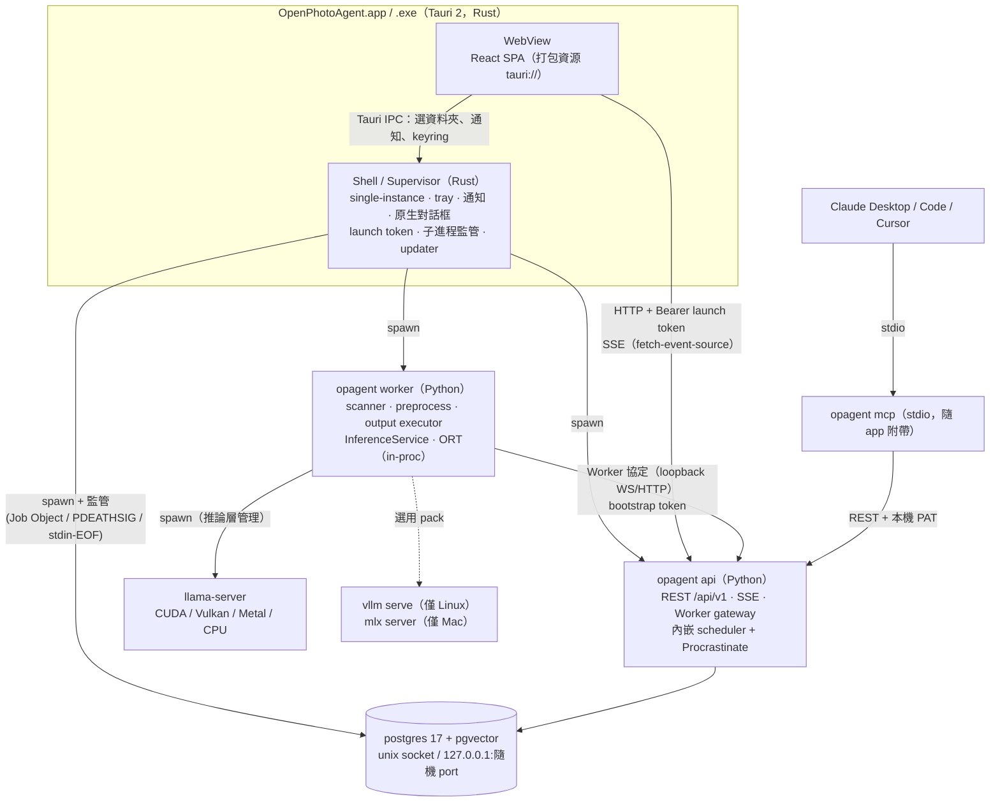
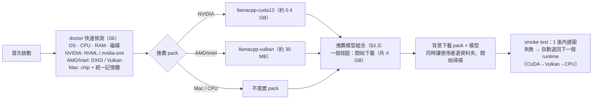

# 08 — 跨平台桌面交付與最終審查（Desktop Packaging & Final Review）

> 狀態：Draft v0.1（2026-11-01）｜負責：首席架構審查 + 跨平台交付
> 範圍：(A) 桌面執行檔的殼與進程模型、資料庫、推論 runtime 矩陣、runtime pack、安裝與更新、桌面專屬 UX；(B) 對 00–05 的最終審查、新手「好用」審查、更新後的路線圖與 v0.1 MVP 範圍。
> **產品方向（以此為準，覆蓋 00–05 的舊假設）**：純開源社群專案（Apache-2.0）。不收費，沒有付費託管，也沒有 open-core。舊文件中的「SaaS」一律改指「**自架 control plane**」，也就是家用 NAS 或公司內網，讓多台 GPU Worker 連入。主要交付形態是**跨平台桌面執行檔**（Windows x64 / macOS Apple Silicon / Linux x64），其次是 Docker 自架（all-in-one，或 control plane + Worker）。
> 標示慣例：**【估算】**表示推算值或經驗值，未實測；**【未驗證】**表示需要在實作或 spike 時對照上游確認；**【決定】**是本文件的裁決。
> 相關文件：06（模型管理 / 環境醫生 / ETA）、07（人臉辨識）、09（TDD 測試策略）、10（照片 viewer 與 AI 問照片）。撰寫時 06、07、10 都還沒有檔案，本文對它們的需求集中在 §10。（審查補充：06、07、10 現已完成，§10 的需求已核對；07 與 10 的版本已改為依本文 §9。）

---

## 0. TL;DR：決策總表

| # | 題目 | 決定 | 一句話理由 |
|---|------|------|-----------|
| D1 | 桌面殼 | **Tauri 2 + 同一份 React SPA**。前端資源打包進 app（`tauri://`），後端是本機 Python sidecar | 安裝包小（用系統 WebView），Rust 端適合做進程監管和 OS 整合。voicebox 已驗證這套組合 |
| D2 | 進程模型 | Rust 殼負責監管 **postgres、`opagent api`（內嵌 scheduler）、`opagent worker`** 三個子進程；worker 再啟動 `llama-server` 等 runtime 子進程。api ↔ worker **走 loopback 上的同一套 Worker 協定**，不做 in-process | 保住 02 的 P2 和 ADR-001（零分支、import-linter 可驗證）；GPU 或 runtime 崩潰不會拖垮 UI 和 DB |
| D3 | Python 打包 | **python-build-standalone + uv 建出的可重定位環境**（onedir），以 Tauri resource 形式隨 app 發佈；不用 PyInstaller onefile，也不用 Nuitka | runtime pack 要能事後追加 Python wheel（例如 ORT-CUDA）；凍結式打包做不到。onedir 啟動快、防毒誤判少、可以逐檔簽章 |
| D4 | 資料庫 | **桌面版嵌入真正的 PostgreSQL 17 + pgvector**（官方原始碼或 theseus-rs 預編二進位，pgvector 在 CI 逐平台編譯），**單一 DB 後端**。**不做** SQLite 雙後端，也不用 PGlite | 02/05 依賴的 SKIP LOCKED、LISTEN/NOTIFY、tsvector、pgvector HNSW 全部原樣保留。pgserver、embedded-postgres、pg0 三個專案都已證明「Win/macOS/Linux 都能嵌入並附帶 pgvector」。雙後端會讓測試矩陣與 repository 層成本加倍 |
| D5 | 推論主軸 | **llama.cpp `llama-server`（VLM、LLM）+ ONNX Runtime（SigLIP2、人臉、tagger）** 是跨平台主軸。vLLM 只當 **Linux / Docker 進階選項**，MLX 是 Mac 進階 pack，transformers/torch 降級成選用的「torch pack」 | llama.cpp 有官方 Win CUDA/Vulkan、macOS arm64、Ubuntu Vulkan 預編版。ORT 有 CUDA、DirectML、CoreML EP。這個組合**不需要 torch**，安裝包能壓到 200 MB 以下。vLLM 至今沒有官方原生 Windows 支援 |
| D6 | 安裝包大小 | **硬上限 200 MB，目標約 150 MB**。內含 CPU、Metal 推論能力與 DirectML/CoreML 版 ORT。CUDA、ROCm、vLLM、torch 一律做成 **runtime pack**，依偵測結果按需下載；模型另外下載 | 首次下載快、更新快；NVIDIA 使用者第一次啟動時才下載約 0.3–0.6 GB 的 CUDA pack【估算】 |
| D7 | 安裝格式 | Windows **NSIS（per-user，不需要管理員）**，MSI 選配；macOS **dmg（僅 arm64）**；Linux **AppImage + deb + rpm**。Flatpak 延後 | NSIS 支援 updater，也不需要 UAC。Flatpak sandbox 和 GPU、sidecar、任意資料夾存取衝突，成本高 |
| D8 | 簽章 | macOS：Developer ID + notarization（每年 99 美元，社群贊助）。Windows：**申請 SignPath Foundation 免費 OSS 簽章**，備案是 Azure Artifact Signing。Tauri updater 與 runtime pack 都用 ed25519（minisign）簽章 | 純開源也能免費取得 Windows 簽章。SmartScreen 信譽要靠累積，第一版仍可能出現警告 |
| D9 | 更新通道 | `stable`（GitHub Releases `latest` 的 `latest.json`）與 `beta`（gh-pages 上的 `beta.json`），app 在執行期切換 endpoint | Tauri 官方做法；不需要自建更新伺服器 |
| D10 | 單人模式 | 桌面版與 all-in-one **預設單人模式**：沒有登入畫面、沒有 Org/Workspace UI。桌面版改用「**每次啟動產生的 launch token**」保護 loopback API | 多租戶 RBAC 對桌面版太重；schema 保留 `org_id`，之後可以無痛升級成自架多人 |
| D11 | MCP 在桌面 | **stdio `opagent mcp`**（隨 app 附帶 CLI）是唯一預設通道，「一鍵連接 Claude Desktop/Code」會寫入設定檔。OAuth 2.1 AS **延到 v0.5（自架多人 control plane）** | 桌面單機只需要 PAT；OAuth AS 是大型安全元件，沒有多人情境時投資報酬率很低 |
| D12 | 路線圖 | v0.1 **自動分類歸檔**（killer ①）→ v0.2 **人臉找照片** + 混合搜尋 + MCP（killer ②）→ v0.3 **AI 問照片**（killer ③）→ v0.4 生態 → v0.5 自架 control plane → v1.0 穩定 | 三個 killer 功能都在 v1.0 前交付；每一版只引入一個新的大型風險（§9） |

---

## A. 跨平台桌面執行檔設計

## 1. 殼與進程模型

### 1.1 進程樹



| 設計點 | 決定 | 說明 |
|--------|------|------|
| 誰是 supervisor | **Rust 殼** | 殼本來就是常駐進程；Rust 生態有 Windows Job Object、`tauri-plugin-single-instance`、系統匣、updater。不另外加一層 Python supervisor，避免「supervisor 死掉、孫進程變成孤兒」 |
| api 與 worker 分開 | **分成兩個進程，走 loopback Worker 協定** | (1) 02 P2：兩種部署零分支。(2) import-linter 的「api 不碰原檔、不碰 GPU」在桌面一樣成立，07 的人臉生物特徵也受這條保護。(3) ORT-CUDA、llama.cpp 崩潰或 OOM 不會影響 API 和 UI。(4) loopback 的成本可以忽略：每秒數十張的批次，每批只有一次 RPC |
| 為何不 in-process | 不採用 | 省下約 100 MB RAM 和一點延遲，代價是多一條程式碼分支、測試加倍，而且崩潰會連帶拖垮 UI。不值得 |
| DB 由誰啟動 | Rust 殼直接執行 `postgres -D <data>`（不透過 `pg_ctl`） | 直接持有 PID，方便監管與關閉。Windows 上 `pg_ctl` 經 `cmd.exe` 轉手時有 PID 與狀態判斷問題【未驗證：PG 17 是否已修】，直接執行比較單純 |
| 關閉順序 | UI 關窗 → 縮到系統匣（有任務時）；真正退出時依序：worker（等目前 batch 完成，最多 10 秒，之後交還 lease）→ api → postgres（`SIGINT` fast shutdown；Windows 用 `pg_ctl stop -m fast` 或送 CTRL_BREAK）| 所有進度都在 DB，強制中止也能續跑（02 §4.3）|
| 孤兒防護 | Windows：所有子進程放進同一個 Job Object（`JOB_OBJECT_LIMIT_KILL_ON_JOB_CLOSE`）。Linux：`prctl(PR_SET_PDEATHSIG)`。macOS：子進程監看 stdin pipe EOF，父進程消失就自我結束 | 殼崩潰或被工作管理員結束時不會留下 GPU 佔用。**Tauri 的 `std::process::exit` 會跳過清理**，一律改走 `RunEvent::ExitRequested` |

### 1.2 Python 打包方案比較

| 方案 | 啟動速度 | 大小 | 事後加裝 wheel（runtime pack） | 防毒誤判 | 簽章 / notarization | CI 成本 | 結論 |
|------|----------|------|-------------------------------|----------|---------------------|---------|------|
| PyInstaller onefile（voicebox 的做法） | 慢：每次啟動都要解壓到暫存目錄（數百 MB 時要數秒）【估算】 | 中 | ✗ 凍結後很難追加套件 | **高**（onefile bootloader 常被誤判） | 單一檔案好簽，但內部解壓出的 .so 在 macOS 要另外處理 | 低 | ✗ |
| PyInstaller onedir | 快 | 中 | △ 可以用 `sys.path` hack，但脆弱 | 中 | 要逐檔簽 | 低 | 備案 |
| Nuitka（standalone） | 快 | 中到小 | ✗ | 中到高 | 要逐檔簽 | **高**（編譯耗時，大型依賴如 numpy、ORT 的相容性要逐一處理） | ✗ |
| **python-build-standalone + uv 可重定位環境**（`py-app-standalone` 一類做法） | 快（就是普通的 CPython） | 中（stripped 版 CPython 約 25–35 MB【估算】） | **✓** 每個 pack 是獨立的 `site-packages` 層，以 `uv pip install --target packs/<id>` 離線安裝，啟動時加入 `sys.path` | 低（官方 CPython 二進位） | 逐檔簽（CI 腳本統一處理） | 中 | **✓ 選定** |
| PyApp（首次啟動才下載 Python） | 首次啟動很慢 | 最小 | ✓ | 低 | 簡單 | 低 | ✗：首次啟動需要網路，也不能離線安裝 |

**【決定】D3**：
- 建置流程：`uv python install 3.12`（python-build-standalone，`install_only_stripped`）→ `uv venv --relocatable` → `uv sync --frozen --no-dev --package opagent-desktop` → 刪掉 `__pycache__`、tests 和標頭檔 → 整個目錄以 Tauri `bundle.resources` 打包進 app。
- 啟動指令一律是 `<res>/python/bin/python -I -m opagent.desktop.api|worker|mcp`（`-I` 隔離模式，不讀使用者的 `PYTHONPATH` 和 site-packages）。
- Python 由 Rust 用 `std::process::Command` 直接啟動，不用 Tauri `externalBin`。`externalBin` 要求每個 target triple 一個單檔，不適合 onedir；它在 NSIS 同版重裝時也有替換問題（tauri#15134）。
- `opagent` CLI（`opagent mcp`、`opagent doctor`）同樣從這份 Python 執行。macOS 和 Linux 另外提供一個小 shim（`<app>/bin/opagent`），Windows 提供 `opagent.cmd`。安裝程式**不修改 PATH**，MCP 設定一律寫絕對路徑。

### 1.3 Port、認證與單一實例

| 項目 | 決定 |
|------|------|
| API port | 先試偏好 port（設定項，預設 `47800`【未驗證：是否常見衝突】）。被佔用時，先檢查那是不是另一個 OpenPhotoAgent（`/healthz` 回傳簽名與 data dir 指紋，voicebox `isVoiceboxHealthResponse` 的模式）；不是就改用 `127.0.0.1:0` 隨機 port。實際 port 與 PID 寫入 `run/api.json`（0600），`opagent mcp` 和瀏覽器開啟功能都讀這個檔 |
| 綁定位址 | 只綁 `127.0.0.1`。「允許區網存取」是進階開關：改綁 `0.0.0.0`，**並強制啟用帳號登入**（02 的 local auth） |
| 前端載入方式 | **SPA 打包在 app 內（`tauri://localhost`，Windows 是 `http://tauri.localhost`）**，不從 API 載入 | (1) localStorage 依 origin 分隔，若 API port 改變，從 API 載入的 SPA 會遺失所有偏好；(2) Tauri IPC 不必開放給遠端 origin；(3) 後端還沒啟動時就能顯示啟動畫面 |
| 桌面 API 認證 | Rust 每次啟動產生 256-bit **launch token**，經 **stdin** 傳給 api（不放環境變數，避免被同使用者的其他工具讀到）；前端用 Tauri command `backend_info()` 取得 `{base_url, token}`。所有 `/api/v1` 都要求 `Authorization: Bearer`；SSE 改用 `@microsoft/fetch-event-source`（04 已列為選項）。CORS 只允許 Tauri origin |
| 在瀏覽器開啟 | 系統匣選單「在瀏覽器開啟」：殼向 api 要一次性 handoff code（30 秒）→ 開啟 `http://127.0.0.1:<port>/auth/handoff?code=…`，api 設定 HttpOnly session cookie 後轉址到 SPA（api 也提供一份 web build 給這個用途）|
| DNS rebinding | api 一律驗證 `Host` 為 `127.0.0.1` / `localhost`，並驗證 `Origin`（05 §3.1 已要求 `/mcp` 這樣做，這裡擴大到全部 API）|
| Postgres 連線 | macOS / Linux：`listen_addresses=''`，**只開 Unix socket**（放在 data dir 底下的 `run/`，0700）。Windows：`127.0.0.1` 加隨機 port，SCRAM 密碼隨機產生並以 0600 存放【未驗證：PG 在 Windows 上的 AF_UNIX 搭配 asyncpg/psycopg 是否可靠，可靠的話 Windows 也改用 socket】 |
| 單一實例 | `tauri-plugin-single-instance`：第二次啟動只會把既有視窗帶到前景，並轉交參數或 deep link。另外在 data dir 放 `opagent.lock`（OS 檔案鎖），防止 AppImage 與 deb 兩種安裝同時開同一份資料；`postmaster.pid` 殘留時，確認該 PID 不存在才清除 |
| Deep link | 註冊 `openphotoagent://`：`openphotoagent://approvals/{id}`（MCP 核准，取代 05 的瀏覽器 `approval_url`）、`openphotoagent://open?asset=…` |

### 1.4 啟動序列與崩潰重啟

```
t=0      殼啟動，立即顯示啟動畫面（< 300 ms）
t≈0.3s   啟動 postgres（首次：initdb --locale-provider=builtin --builtin-locale=C.UTF-8 --locale=C -E UTF8，約 3–5 s【估算】）
t≈1–2s   postgres ready（pg_isready 或連線輪詢）→ 啟動 opagent api → alembic upgrade（升級前自動 pg_dump 備份）
t≈2–4s   /readyz OK → UI 開始載入資料；同時啟動 opagent worker（以 bootstrap token 自動註冊）
t≈4–5s   worker hello → UI 的 WorkerStatusDot 變綠；doctor 快速檢查在背景執行
目標：暖啟動 < 5 s 可操作【目標，需實測】。Python 端一律 lazy import（onnxruntime、numpy、jieba 字典只在需要時載入）
```

| 子進程 | 健康檢查 | 崩潰策略 |
|--------|----------|----------|
| postgres | 連線探測，每 5 s | 立即重啟；連續 3 次失敗 → 全螢幕錯誤頁（附 log 與「複製診斷資訊」）。**不自動刪 data dir**。啟動失敗時常見的原因（磁碟滿、權限、防毒鎖檔）各自有錯誤碼與修復提示 |
| opagent api | `/readyz`，每 5 s | 退避重啟 1 s → 2 s → 4 s …，5 分鐘內最多 5 次，超過就顯示錯誤頁。UI 在重啟期間顯示「重新連線中」橫幅，不清空畫面狀態 |
| opagent worker | 心跳（02 §4.3，15 s） | 退避重啟。lease 過期後由 scheduler 回收，工作會自動續跑。UI 顯示「本機引擎重新啟動中」 |
| llama-server 等 runtime | 由推論層負責（03 §4.3） | 依 03：重啟一次 → 並發減半 → 改用下一個 variant。若 GPU pack 崩潰兩次，doctor 建議「改用 Vulkan / CPU」 |

### 1.5 日誌與目錄位置

| 用途 | Windows | macOS | Linux（XDG） |
|------|---------|-------|--------------|
| 資料（DB、縮圖、journal 鏡像、run/） | `%LOCALAPPDATA%\OpenPhotoAgent\` | `~/Library/Application Support/OpenPhotoAgent/` | `$XDG_DATA_HOME/openphotoagent/`（`~/.local/share/…`） |
| 設定（`worker.toml`、`settings.toml`） | `%APPDATA%\OpenPhotoAgent\` | 同上 `config/` | `$XDG_CONFIG_HOME/openphotoagent/` |
| 模型（大檔，可搬移） | `%LOCALAPPDATA%\OpenPhotoAgent\models\` | `…/Application Support/OpenPhotoAgent/models/` | `$XDG_DATA_HOME/openphotoagent/models/` |
| Runtime packs | `…\packs\<id>\<version>\` | 同左 | 同左 |
| 快取（可刪：probe、HF 暫存、預覽） | `%LOCALAPPDATA%\OpenPhotoAgent\cache\` | `~/Library/Caches/OpenPhotoAgent/` | `$XDG_CACHE_HOME/openphotoagent/` |
| 日誌 | `%LOCALAPPDATA%\OpenPhotoAgent\logs\` | `~/Library/Logs/OpenPhotoAgent/` | `$XDG_STATE_HOME/openphotoagent/logs/` |
| 備份（pg_dump） | `…\backups\`（保留 7 份每日備份，加上每次 migration 前一份） | 同左 | 同左 |

- 一律透過 Tauri path API 取得（`app_local_data_dir`、`app_config_dir`、`app_log_dir`、`app_cache_dir`），Python 端由殼以參數傳入，**不再使用 03 的 `~/.opagent/`**。`OPAGENT_HOME` 可以整包覆寫（可攜模式）。
- **資料不放在 Roaming 或 Documents**：Windows Roaming 會跟著網域漫遊；Documents 常被 OneDrive 同步，而 Postgres data dir 放在同步資料夾裡會損毀。
- Bundle identifier：`org.openphotoagent.desktop`（不能以 `.app` 結尾，否則和 macOS bundle 副檔名衝突）。網域所有權待確認（00 Q1）。
- 日誌：每個進程各一個檔案（`shell.log`、`api.log`、`worker.log`、`postgres.log`、`runtime-<name>.log`），JSON lines 格式，10 MB × 5 輪替。路徑只記 alias + 相對路徑（02 §7.1）。UI 的「設定 → 日誌」用 SSE 即時 tail（voicebox Logs 頁的做法）；「匯出診斷包」會把去識別化的 log 加上 doctor 報告打包成 zip。

### 1.6 同一份前端服務 Web 與桌面

```
apps/web（同一份原始碼）
 ├─ vite build --mode web      → Docker：Caddy 提供靜態檔，同源 cookie session
 └─ vite build --mode desktop  → Tauri：bundle 進 app，Bearer launch token
共用：platform 抽象（04 §5.6 的 isTauri()）＋ 伺服器能力宣告
```

| 機制 | 說明 |
|------|------|
| `GET /api/v1/capabilities` | `{deployment: "desktop"\|"allinone"\|"controlplane", auth: "launch_token"\|"local"\|"oidc", single_user: bool, features: {faces, ask_ai, mcp_http, multi_worker, ...}, gpu_summary}`。**UI 依伺服器宣告隱藏或顯示功能**（例如 Org/Workspace/Workers 頁），不靠 build flag 硬切。這樣「桌面殼連到自架 NAS」這種組合也能用同一份 bundle |
| `platform` 模組 | `pickFolder()`：桌面用原生對話框，Web 用遠端資料夾瀏覽器（04 §3.3）；`notify()`：OS 通知或 Web Notification；`revealInFileManager()`：桌面才有；`openExternal()`；`secureStore`：keyring 或不提供。`@tauri-apps/api` 以 dynamic import 載入，Web build 會 tree-shake 掉 |
| API base | 桌面由 `backend_info()` 取得；Web 是同源的 `/api/v1` |
| WebView 差異 | WebView2（Chromium）、WKWebView、WebKitGTK。View Transitions、`fetch` streaming、`createImageBitmap` 在 WebKitGTK 上要降級（04 §5.6 已列）；Linux 的 WebKitGTK 版本以 Ubuntu 22.04 為基準【未驗證：各 API 的可用度】 |

---

## 2. 資料庫：嵌入 Postgres vs SQLite vs PGlite

### 2.1 02/05 實際用到的 Postgres 能力

| 能力 | 用在哪裡 | SQLite 替代品 | 替代難度 |
|------|----------|----------------|----------|
| `FOR UPDATE SKIP LOCKED` lease 佇列 | 02 §2.3、§4.3 | 單一寫入者 + `BEGIN IMMEDIATE`，搭配 lease 欄位 | 中：語意可以模擬，但 Procrastinate 不支援 SQLite，得自己寫 |
| `LISTEN/NOTIFY`（SSE 扇出、`work.available`、index_outbox 喚醒） | 02 §2.2、05 §1.1 | 進程內 event bus 加輪詢 | 中：桌面雖然只有一個 api 進程，但 worker 是另一個進程 |
| `tsvector` + GIN + `ts_rank_cd` + `setweight` | 05 §1.3 | FTS5（bm25 與權重語法不同），tokenizer 要自訂或預先斷詞 | 中到高：查詢 builder 要寫兩份，排序結果不同，RRF 的 golden test 要兩套 |
| pgvector `halfvec` + partial expression HNSW + `iterative_scan` | 05 §1.5–1.6 | sqlite-vec `vec0`（**暴力精確搜尋**；README 寫 ANN 是未來工作）或 sqliteai-vector | 高：沒有 HNSW；10 萬張 × 1152 維暴力掃描約數百 ms【估算，依 sqlite-vec 公開測試外推】；人臉向量（07）數量是照片的 1–3 倍 |
| JSONB、`text[]` + GIN（tags、scope_keys）、`citext`、`geography` | 02 §3、05 §1.2 | JSON1 + 關聯表 | 中：scope_keys 的 GIN 查詢要改寫成 join |
| `CREATE INDEX CONCURRENTLY`、藍綠 space | 05 §1.6 | 不存在 | 中 |
| Alembic migration | 02 | 支援，但 SQLite 的 ALTER 限制很多（batch mode） | 中 |

結論：如果換成 SQLite，**02/05 大約一半的資料層設計要重寫，而且要長期維護兩份**。

### 2.2 方案比較（2026-11 查證）

| 方案 | 跨平台可行性（查證結果） | 優點 | 缺點 / 風險 | 評估 |
|------|--------------------------|------|-------------|------|
| **A. 嵌入真 Postgres + pgvector（自建 pack）** | PostgreSQL 官方支援三個平台。pgvector 在 Windows 可用 `nmake /f Makefile.win` 編譯。現成證據：**pgserver**（PyPI，宣稱在 manylinux、macOS、Windows 上建置與測試，內含 pgvector）、**embedded-postgres**（PyPI，有 macOS arm64/x64 與 Windows x64 wheel，內含 pgvector，最新 18.x）、**pg0**（Rust，從 theseus-rs 下載 PG 並附預編 pgvector，支援 Windows x64；Python 套件 `pg0-embedded` 暫無 macOS arm64 wheel） | 02/05 **零修改**；單一後端；測試只要一套；效能和行為與 Docker 版完全相同 | 多一個常駐進程（約 30–80 MB RAM【估算】）；Windows 上以管理員身分執行時，PG 會以 restricted token 重新執行自己（歷史上有 bug）；防毒軟體可能鎖住 data dir 的檔案；PG 大版本升級要 `pg_upgrade` | **✓ 選定** |
| B. 直接依賴 pgserver / embedded-postgres Python 套件 | 同上 | 開發最快 | 第三方小專案的維護風險（pgserver 0.1.x；已有人 fork 成 pgembed、pgserver-extend）；PG 與 pgvector 版本不能自己控制 | **M0 spike 和開發測試用**；正式版改用 A |
| C. SQLite + sqlite-vec + FTS5（雙後端 repository 抽象） | sqlite-vec 0.1.9 有 Win x64、manylinux x64/arm64、macOS arm64/x64 wheel；有些平台的 SQLite 預設關閉 extension loading | 零進程、單檔、最容易備份 | 見 §2.1：佇列、通知、全文、向量四項都要重寫，而且**一直維護兩份**；暴力向量搜尋在人臉加照片的規模下撐不住；TDD 測試矩陣加倍（09） | ✗ |
| D. PGlite（WASM Postgres） | 要在 Node 或瀏覽器執行；`pglite-socket` **同時只允許一個連線**；py-pglite 定位是測試函式庫；pgvector 可以當 extension 載入 | 零原生二進位 | api、worker、scheduler、Procrastinate 需要多條連線，單連線直接出局；多一個 Node runtime；WASM 效能未知 | ✗ |
| E. 桌面版不跑 DB，api 用記憶體加檔案 | — | — | 等於重寫 | ✗ |

### 2.3 【決定】D4 的具體規格

| 項目 | 規格 |
|------|------|
| 版本 | **PostgreSQL 17.x + pgvector 0.8.x**（Docker 版同步改用 `pgvector/pgvector:pg17`，桌面與 Docker 同一個大版本）【未驗證：發佈時的最新 minor 版】。PG 大版本**最多每年升級一次**，並寫在 release notes |
| 二進位來源 | CI 從官方原始碼建置（macOS arm64、Linux x64 用 glibc 2.35 基準），或改用 theseus-rs 預編版（PostgreSQL License）；**pgvector 一律由我們在 CI 逐平台編譯**並跑 smoke test（`CREATE EXTENSION vector`、建 HNSW、查詢）。打包成 `pg` pack（內建在安裝包裡），只保留 `bin/postgres`、`initdb`、`pg_ctl`、`pg_dump`、`pg_restore`、`pg_upgrade`、`lib/`、`share/`（只留 `contrib` 的 `pg_trgm`、`citext`、`btree_gin`；刪掉 docs、i18n 以外的語系檔）【估算：壓縮後 25–40 MB】 |
| initdb | `--locale-provider=builtin --builtin-locale=C.UTF-8 --locale=C -E UTF8`（PG 17 的內建 provider；OS 層的 lc_* 用每個 OS 都有的 `C`，`C.UTF-8` 只有 Linux 有，PG-016）。**不依賴 OS 或 ICU 的 collation**，避免 OS 更新後 collation 版本改變、索引失效。中文排序在應用層處理 |
| 資源設定（`desktop` profile） | `shared_buffers=256MB`（RAM ≤ 8 GB 時用 128MB）、`max_connections=30`、`work_mem=16MB`、`maintenance_work_mem=512MB`（建 HNSW 時臨時調高到 min(RAM×0.25, 2GB)）、`effective_cache_size=RAM×0.25`、`max_parallel_maintenance_workers=2`、`huge_pages=off`、`fsync=on`、`synchronous_commit=on`（照片 journal 不能丟）、`autovacuum=on`、`log_destination=stderr` 由殼收集 |
| 連線 | 見 §1.3。api 連線池 10，worker 不連 DB（02 原則不變），scheduler 與 Procrastinate 共用 api 進程 |
| 備份 | 每日一次加上每次 migration 前執行 `pg_dump -Fc`，保留 7 份；「設定 → 資料」提供「立即備份 / 還原 / 匯出到資料夾」 |
| 大版本升級 | app 新版若升級 PG 大版本，會同時附帶舊版 `bin/`（`pg-prev` pack），首次啟動執行 `pg_upgrade --link`；失敗就退回 `pg_dump` / `pg_restore`；整個過程前先做完整備份 |
| Windows 特例 | 一律以一般使用者權限執行（NSIS per-user 安裝，不需要提升權限）。若使用者以系統管理員身分執行，殼會偵測並提示，由 PG 自行降權【未驗證：PG 17 在 Windows 管理員帳號下的 restricted-token 行為】。文件說明如何把 data dir 加入 Defender 排除清單（**不**自動修改防毒設定） |
| 測試 | **同一份 `pg` pack 也用於 CI 的 Windows 與 macOS runner**（GitHub 的 macOS runner 沒有 Docker，testcontainers 不能用）。`pytest` 的 fixture `embedded_pg` 會在 session 層級 initdb 一次，每個測試用 template DB 複製。Linux 上仍可以用 testcontainers 跑 Docker 映像版本，作為一致性測試 |
| 退路 | 若 M0 spike 在 Windows 上未達標（冷啟動 > 5 s、防毒鎖檔重現率 > 1%、管理員帳號無法啟動），**先用 B（embedded-postgres 套件）補洞**；SQLite 雙後端仍然不做。repository 層只保留 02 原本就有的 `QueueBackend` 介面，不為 SQLite 預留更多抽象（YAGNI） |

### 2.4 對 02 / 05 的修改

| 文件 | 原設計 | 桌面版的修改 |
|------|--------|-------------|
| 02 §2.2 DB | Postgres 16+ with pgvector | 改為 **PostgreSQL 17 + pgvector 0.8**；新增一行「桌面版：嵌入式 PG（`pg` pack），資源 profile 為 `desktop`」 |
| 02 §2.3 佇列 | SKIP LOCKED + Procrastinate | **不變**。補一句：桌面版的 api 與 scheduler 同進程，Procrastinate worker 併發數設為 2 |
| 02 §2.2 即時（LISTEN/NOTIFY → SSE） | 不變 | **不變**。桌面版只有一個 api 進程，NOTIFY 仍然用來喚醒 Procrastinate 與 outbox |
| 05 §1.3 全文 | 應用層 jieba + `simple` tsvector | **不變**。jieba `dict.txt.big`（約 8 MB）放在安裝包內，首次使用時才載入（lazy） |
| 05 §1.5 向量 | halfvec + partial HNSW | **不變**。補充：桌面版建 HNSW 時臨時調高 `maintenance_work_mem`；10 萬張以下（大多數個人圖庫）在 HNSW 建好之前改用精確掃描。07 的人臉向量使用獨立的 `embedding_space`（modality=`face`） |
| 02 §2.1 Worker 本地快取 SQLite | hash 快取、縮圖、journal 鏡像 | **不變**（Worker 本地的 SQLite 與主 DB 角色不同，這不算雙後端） |
| 02 §7.2 整合測試 | testcontainers | 加上「Windows / macOS 用 embedded `pg` pack」 |

---

## 3. 推論 runtime 矩陣

### 3.1 Runtime 能力查證（2026-11）

| Runtime | Windows | macOS (Apple Silicon) | Linux | 查證摘要 |
|---------|---------|------------------------|-------|----------|
| **llama.cpp `llama-server`** | 官方 release 有 x64 **CUDA 12（附 12.4 DLL）**、**CUDA 13**、**Vulkan**、CPU、arm64 CPU；HIP 只有舊 tag 或 fork 才有 | 官方 arm64 build（Metal 預設啟用） | 官方 Ubuntu x64/arm64 **Vulkan**、CPU；ROCm 在最新 tag 標示為停用（不穩定）；**Linux CUDA 官方預編版沒有查到**【未驗證】→ 我們自己建置 | 多模態透過 libmtmd（`--mmproj`）；Qwen3-VL 支援已在 2025-10 合併（#16780）。**Blackwell sm_120**：CUDA 12.4 build 沒有 sm_120 kernel，要用 CUDA 13 build 或自建 12.8+（`-DCMAKE_CUDA_ARCHITECTURES=…;120`）【未驗證：PTX JIT 能否補上】 |
| **ONNX Runtime** | CPU、**CUDA EP**（需要 cuDNN，體積大）、**DirectML EP**（官方狀態是「sustained engineering」，仍受支援，但新功能轉往 **Windows ML**）、WinML（自動選 EP） | CPU、**CoreML EP** | CPU、CUDA EP、ROCm/MIGraphX EP（進階）、OpenVINO EP | SigLIP2 so400m 已有社群 ONNX 匯出（onnx-community 有 patch16-256/512；patch16-384 為自動轉換版）；**03 預設的 patch14-384 需要自己匯出並驗證**【未驗證】 |
| **vLLM** | **沒有官方原生支援**，官方路線仍是 WSL2 或 Docker；只有社群 fork（例如 vllm-windows-build 0.19）| ✗（有社群的 vllm-mlx，但那是另一個專案） | ✓ 主場（CUDA 12.8+ 支援 Blackwell） | 只當 Linux 進階選項 |
| **MLX / mlx-vlm** | ✗ | ✓（社群伺服器如 vllm-mlx、mlx-openai-server 已能提供 Qwen3-VL 的 OpenAI 相容 API） | ✗ | Mac 進階 pack（v0.4）；吞吐是否勝過 llama.cpp Metal【未驗證】 |
| **transformers + torch** | CUDA（cu128 wheel 約 2–3 GB【估算】） | MPS | CUDA / ROCm | 只用於只有 transformers 才能跑的模型（JoyCaption、Florence-2、InternVL）→ 選用的「torch pack」 |
| **Ollama / LM Studio / 外部 OpenAI 相容** | 使用者自己安裝 | 同左 | 同左 | 03 已設計 adapter；桌面版可以自動偵測本機的 Ollama（`127.0.0.1:11434`）並建議重用已下載的模型 |

### 3.2 OS × GPU 矩陣（【決定】D5）

| | NVIDIA（CUDA） | AMD | Intel（Arc / iGPU） | Apple Silicon | 無 GPU / 不支援 |
|---|---|---|---|---|---|
| **Windows x64** | VLM：llama.cpp **CUDA pack**（Blackwell 用 CUDA 13 build）<br/>小模型：ORT **DirectML**（內建；NVIDIA 也能用）<br/>進階：ORT-CUDA pack、torch pack；vLLM → 請用 WSL2/Docker | VLM：llama.cpp **Vulkan pack**<br/>小模型：ORT DirectML | VLM：llama.cpp Vulkan pack<br/>小模型：ORT DirectML（或 OpenVINO，進階）| — | llama.cpp CPU（內建）+ ORT CPU |
| **macOS arm64** | — | — | — | VLM：llama.cpp **Metal（內建）**<br/>小模型：ORT **CoreML EP**（內建）<br/>進階：MLX pack（v0.4）| （Intel Mac：**不正式支援**；arm64 only）|
| **Linux x64** | VLM：llama.cpp **CUDA pack**（自建，含 sm_120）<br/>小模型：ORT CPU（內建）→ 建議下載 **ORT-CUDA pack**<br/>進階：**vLLM pack 或 Docker**（批次吞吐最高）| VLM：llama.cpp Vulkan pack（預設）／ROCm pack（進階）<br/>小模型：ORT CPU（ROCm EP 進階）| llama.cpp Vulkan pack + ORT CPU/OpenVINO | — | llama.cpp CPU + ORT CPU |

原則：
1. **每個平台都有一條「零下載也能動」的路徑**：llama.cpp CPU/Metal 加上 ORT CPU/DirectML/CoreML 都內建在安裝包裡。
2. **GPU 加速只需要一個 pack**：大部分使用者只會下載「llama.cpp-CUDA」或「llama.cpp-Vulkan」其中之一。
3. **小模型預設不用 CUDA EP**：SigLIP2、人臉偵測與 embedding 都是每張數十 ms 的負擔，瓶頸在 VLM（03 §5.3）。Windows 用 DirectML（約 20–30 MB）就足夠，省下 ORT-CUDA 加 cuDNN 約 1 GB 的下載【估算】。Linux 的 NVIDIA 使用者在 onboarding 會看到「建議下載 ORT-CUDA（快 N 倍）」。
4. **vLLM 從預設降為進階**：00 §3、03 §8 的「Qwen3-VL-8B FP8 on vLLM」改成「Docker / Linux 進階的批次組合」。桌面預設改用 Qwen3-VL-8B GGUF（Q4_K_M/Q5_K_M）。結構化輸出用 llama-server 的 `response_format` json_schema 轉 GBNF；logprob 信心的介面依 03 §9-2 驗證。
5. **AI 問照片（10）需要 tool-calling**：llama-server 以 `--jinja` 套用 chat template，支援 OpenAI 格式的 `tools`【未驗證：Qwen3-VL 和 Qwen3.6 的 tool-call 解析穩定度】。低階機器（8 GB 以下，或只有 CPU）可以改用外部 OpenAI 相容 endpoint，並顯示 egress 警示。

### 3.3 各平台預設模型組合（取代 03 §8 作為桌面預設）

VRAM / 記憶體皆為**【估算】**（GGUF 權重 + mmproj + KV，8k context，單圖 ≤ 1 MP）。

| 檔位 | 判定 | 預設 VLM（llama.cpp） | 小模型（ORT） | 1 萬張 ETA 參考 |
|------|------|------------------------|----------------|------------------|
| **NVIDIA ≥ 16 GB**（參考 5070 Ti） | 可用 VRAM ≥ 14 GB | Qwen3-VL-8B **Q5_K_M**（約 8–9 GB）；加開「高品質複核」= Qwen3.6-35B-A3B Q4（`--n-cpu-moe`，需 RAM ≥ 32 GB） | SigLIP2 so400m fp16 + 人臉（07）| 由 06 依實測顯示 |
| NVIDIA / AMD / Intel 10–12 GB | 9–14 GB | Qwen3-VL-8B Q4_K_M（約 6.5 GB） | 同上（並載） | 〃 |
| 6–8 GB | 5–9 GB | Qwen3-VL-4B Q4_K_M（約 3.5 GB）；03 的 8B Q4 改為「序列模式」選項 | 同上（序列模式，03 §4.2-5） | 〃 |
| **Mac 8 GB** | 統一記憶體 | Qwen3-VL-2B 或 Gemma 4 E2B Q4（約 2–3 GB）；建議「快速模式」（只做 SigLIP 分類 + 搜尋） | SigLIP2（CoreML）| 〃 |
| **Mac 16 GB** | 〃 | Qwen3-VL-4B Q4_K_M | SigLIP2 + 人臉 | 〃 |
| **Mac 24–36 GB** | 〃 | Qwen3-VL-8B Q5_K_M | 〃 | 〃 |
| **Mac ≥ 48 GB** | 〃 | Qwen3-VL-8B Q8_0；可選 Qwen3.6-35B-A3B Q4 當主力 | 〃 | 〃 |
| CPU only | 沒有可用 GPU | **預設不跑 VLM**：「快速模式」= SigLIP2 zero-shot 分類 + 以文搜圖 + 人臉；caption 可選 Qwen3-VL-2B Q4（約 0.05–0.2 張/秒，03 §4.6） | ORT CPU int8 | 〃 |

- **Mac 統一記憶體預算**：`budget = MTLDevice.recommendedMaxWorkingSetSize − 其他 app 的保留量`（一般約為 RAM 的 65–75%【未驗證】），再保留 4 GB 給 OS 與我們自己的進程（PG、api、worker）。03 §4.1 的 NVML 預算模型增加 `UnifiedMemoryBudget` 分支，數值由 06 的 doctor 讀取。
- **AMD/Intel 沒有 NVML**：Windows 用 DXGI `QueryVideoMemoryInfo`（Budget / CurrentUsage），Linux 用 Vulkan `VK_EXT_memory_budget` 或 sysfs `mem_info_vram_*`【未驗證】，由 06 實作。
- onboarding 只顯示**一個推薦組合**（§8），其他檔位收在「其他方案」裡。

---

## 4. Runtime pack：按需下載

### 4.1 安裝包大小預算（壓縮後，【估算】）

| 組件 | Windows | macOS arm64 | Linux（AppImage） |
|------|---------|-------------|-------------------|
| Tauri 殼（用系統 WebView） | 8–12 MB | 8–12 MB | 10–15 MB（AppImage 不附 WebKitGTK，依賴系統） |
| SPA 資源 | 3–5 MB | 3–5 MB | 3–5 MB |
| CPython 3.12（stripped） | 20–30 MB | 20–30 MB | 20–30 MB |
| Python 依賴（FastAPI、pydantic-core、SQLAlchemy、asyncpg、alembic、procrastinate、Pillow、pillow-heif、numpy、blake3、jieba + 繁中字典、OpenCC、tokenizers、huggingface_hub、mcp SDK、structlog）| 35–50 MB | 35–50 MB | 35–50 MB |
| ONNX Runtime（Win：DirectML 版；Mac：含 CoreML；Linux：CPU）| 15–25 MB | 15–25 MB | 10–15 MB |
| `pg` pack（PG 17 + pgvector + 必要 contrib） | 25–40 MB | 20–35 MB | 20–35 MB |
| llama-server（Win/Linux：CPU；Mac：Metal） | 5–15 MB | 5–15 MB | 5–15 MB |
| GeoNames（cities1000 + admin1 + 過濾成 zh/en/ja 的 alternateNames） | 8–15 MB | 8–15 MB | 8–15 MB |
| **合計** | **約 120–190 MB** | **約 115–185 MB** | **約 110–180 MB** |

**【決定】D6**：CI 設 **200 MB 硬上限**（超過就讓 build 失敗），目標 150 MB。若超標，第一個移出的是 GeoNames（改成首次啟動的 data pack）。XMP「寫入原檔」需要的 exiftool 不放進安裝包：XMP **sidecar** 由我們自己的 Python writer 產生（純 XML）；只有「寫入原檔 EXIF」（02 §6.2，預設關閉）才需要下載 `exiftool` pack。

### 4.2 Pack 目錄

| Pack ID | 平台 | 內容 | 大小【估算】 | 何時建議 |
|---------|------|------|--------------|----------|
| `llamacpp-cuda13` | win-x64、linux-x64 | llama-server + ggml-cuda + cudart/cublas 可轉散布 DLL | 0.3–0.6 GB | 偵測到 NVIDIA 且驅動符合 CUDA 13 的最低需求（Blackwell 必選） |
| `llamacpp-cuda12` | win-x64、linux-x64 | 同上（CUDA 12.4/12.8） | 0.3–0.6 GB | 舊驅動、不想升級驅動的 NVIDIA 使用者 |
| `llamacpp-vulkan` | win-x64、linux-x64 | Vulkan build | 20–40 MB | AMD、Intel，或 CUDA pack 失敗時的退路 |
| `llamacpp-rocm` | linux-x64 | HIP build + rocBLAS | 1–2 GB | AMD 進階 |
| `ort-cuda` | linux-x64（win 選用）| onnxruntime-gpu + nvidia-cudnn/cublas wheel | 1–1.5 GB | Linux NVIDIA，大量人臉或 embedding |
| `vllm-cu128` | linux-x64 | vLLM + torch cu128（uv 安裝到 pack 層） | 3–5 GB | 進階批次吞吐 |
| `torch-cu128` / `torch-mps` / `torch-cpu` | 依平台 | transformers + torch | 2–3 GB / 0.5 GB / 0.3 GB | 需要 JoyCaption、Florence-2、InternVL 時 |
| `mlx` | macos-arm64 | mlx + mlx-vlm + OpenAI 相容 server | 0.1–0.3 GB | Mac 進階（v0.4） |
| `exiftool` | 全平台 | exiftool 執行檔 | 10–20 MB | 開啟「寫入原檔 EXIF」時 |
| `pg-prev` | 全平台 | 前一個 PG 大版本的 bin（升級用） | 20–40 MB | PG 大版本升級時自動下載 |

**模型不是 pack**：模型照 03 §7 與 06 從 HF 下載（sha256 驗證）。Pack 只放執行檔與函式庫。

### 4.3 版本、簽章與相容矩陣

```jsonc
// packs-index.json（隨 GitHub Release 發佈；同目錄附 packs-index.json.minisig）
{
  "schema_version": 1,
  "generated_at": "2026-11-20T00:00:00Z",
  "packs": [
    {
      "id": "llamacpp-cuda13",
      "version": "b7xxx-1",                 // 上游 tag + 我們的 build 序號【版號示意】
      "pack_api": 1,                         // pack 與 app 之間的介面版本（目錄結構、啟動參數）
      "platform": "windows-x86_64",
      "accel": "cuda",
      "requires": { "nvidia_driver": ">=580", "compute_capability": ">=7.5" },   // 【未驗證：實際下限】
      "numerics_epoch": 3,                   // 數值行為世代：變動才會讓推論快取失效（見下）
      "url": "https://github.com/romanticamaj/openphotoagent/releases/download/packs-2026.11.1/llamacpp-cuda13-b7xxx-1-windows-x86_64.tar.zst",
      "size": 412345678,
      "sha256": "…",
      "files_manifest_sha256": "…"            // 解壓後逐檔 hash，doctor 可做完整性檢查
    }
  ]
}
```

| 機制 | 設計 |
|------|------|
| 相容性 | app 內建 `packs.lock.json`：**每個 app 版本釘選每個 pack 的精確版本**和可接受的 `pack_api`。app 更新後若 lock 改變，會在背景下載新 pack，完成後在下次閒置時切換。舊 pack 保留一版，方便回退 |
| 簽章 | index 以 **ed25519（minisign 格式）**簽章，金鑰 `PACK_SIGNING_KEY`（與 Tauri updater 的金鑰**分開**），公鑰內建在 app。驗證流程：index 簽章 → 檔案 sha256 → 解壓（拒絕絕對路徑、`..` 與 symlink，等同 Python `tarfile` 的 `filter="data"`）→ 逐檔 manifest。macOS 與 Windows 上，pack 內的執行檔**另外有平台簽章**（Developer ID / SignPath），才能通過 hardened runtime 的 library validation 和 SmartScreen |
| 安裝 | 下載到 `packs/.staging/` → 驗證 → 原子 rename 成 `packs/<id>/<version>/` → 更新 `packs/active.json`。下載支援續傳（HTTP Range）、速度與 ETA（06）、磁碟預檢 |
| 快取鍵影響 | 00 R2 的 fingerprint 包含「runtime 版本」。**修改**：fingerprint 改用 `numerics_epoch`，不用 pack 版本字串，否則每次 llama.cpp 小更新都會讓整個圖庫的快取失效。只有在 pack 維護者宣告數值行為改變時（例如量化 kernel 改寫）才遞增 epoch |
| 鏡像 | `OPAGENT_PACK_MIRROR` 與 HF 的 `HF_ENDPOINT` 一樣可以覆寫，給網路受限的地區使用 |
| GitHub 限制 | Release 單一 asset 上限 2 GiB → `torch` / `vllm` 這類大 pack 切成多個 part。Pack 使用獨立的 tag 命名空間 `packs-YYYY.MM.N`，**不符合 `v*.*.*`**，所以不會觸發 `release-on-tag.yml`，也不會干擾 release-please |
| 離線 | 「設定 → 進階 → 匯入 pack 檔」接受 `.tar.zst` 加簽章（air-gapped 環境），與 03 §7.2 的 `opagent models import` 對稱 |

### 4.4 首次啟動的偵測與下載流程



---

## 5. 安裝、簽章、更新與 CI

### 5.1 安裝格式

| OS | 格式 | 決定與理由 |
|----|------|-----------|
| Windows x64 | **NSIS `-setup.exe`（per-user，`%LOCALAPPDATA%\Programs`，不需要 UAC）**為主；MSI（WiX，per-machine）供企業部署 | NSIS 支援 Tauri updater 和 per-user 安裝。**MSI 的版號只能是數字**（WiX 不接受 `-beta.1`）→ beta 版只出 NSIS，stable 才同時出 MSI。WebView2：使用 `downloadBootstrapper`（Win10/11 幾乎都已內建） |
| macOS arm64 | **`.dmg`**（加上 updater 用的 `.app.tar.gz`） | 只出 `aarch64-apple-darwin`。Intel Mac 不正式支援（沒有 Metal 效能優勢，CI 成本也高）。最低支援 macOS 13【未驗證：依 Tauri 2 與 WKWebView 功能需求】 |
| Linux x64 | **AppImage**（支援 updater）+ **`.deb`** + **`.rpm`** | 以 Ubuntu 22.04（glibc 2.35）建置。deb/rpm 由套件管理器更新（app 內 updater 只提示）。**Flatpak 延後**：sandbox 和 GPU（需要 NVIDIA 擴充）、子進程、任意資料夾存取（portal）、Unix socket 衝突，留給社群評估。AUR 交給社群 |
| 套件生態（v0.4） | winget manifest、Homebrew cask、Flathub（若社群接手） | 社群曝光與信任度 |

### 5.2 程式碼簽章

| 平台 | 方案 | 細節 |
|------|------|------|
| macOS | **Apple Developer ID Application + notarization（notarytool）**；Apple Developer Program 每年 99 美元，以 GitHub Sponsors 或 Open Collective 支付 | **hardened runtime**；`resources/python/**` 內每個 `.so`、`.dylib` 和執行檔（python、postgres、llama-server）都要逐一 `codesign --options runtime --timestamp`，之後再簽 .app 並 notarize（tauri-action 只處理主 binary 和 externalBin，**resources 要自己寫腳本**）。Entitlements：`com.apple.security.cs.allow-jit`（numpy、ORT 不一定需要，依實測決定）【未驗證】，**不開** `disable-library-validation`：所有 dylib 都用同一個 Team ID 簽，pack 也一樣 |
| Windows | **SignPath Foundation（免費 OSS 簽章，OV 等級，憑證發給 Foundation）** | 條件：專案完全開源、沒有專有元件、建置必須在 CI 全自動完成、所有成員開 MFA、README 要註明。流程：CI 產生未簽 artifact → `signpath/github-action-submit-signing-request` → 簽入內層的 `.exe`、`.dll`（python.exe、postgres.exe、llama-server.exe）→ 打包 NSIS → 再簽 installer【未驗證：SignPath 對 zip 內層逐檔深度簽章的設定方式】。**備案**：Azure Artifact Signing（舊名 Trusted Signing，個人只限美國與加拿大；組織可以在美、加、EU、UK 申請）|
| SmartScreen | — | **簽章不等於立即受信任**：信譽依檔案 hash 和憑證累積。前幾版仍可能出現「Windows 已保護您的電腦」。README 和下載頁要說明，release notes 附 sha256，提供 winget 管道 |
| Linux | AppImage 附 `.sig`（ed25519 updater 簽章）；deb/rpm 由 repo GPG 簽（v0.4 自架 apt/rpm repo 時）| — |
| 供應鏈 | 所有 artifact 產生 SBOM（syft），使用 GitHub Artifact Attestations（`actions/attest-build-provenance`）；Docker 映像沿用 02 的 cosign | 社群可以驗證「binary 確實來自這個 repo」 |

### 5.3 Tauri updater 與通道

| 項目 | 設計 |
|------|------|
| 簽章 | Tauri updater 必須簽章：`tauri signer generate` 產生的 ed25519（minisign）金鑰，私鑰放 GitHub secret `TAURI_SIGNING_PRIVATE_KEY`（加密碼），公鑰寫進 `tauri.conf.json`。**私鑰遺失就無法推送更新** → 離線備份兩份，由兩位維護者分別保管 |
| stable 通道 | endpoint `https://github.com/romanticamaj/openphotoagent/releases/latest/download/latest.json`（GitHub 的 `latest` 只指向非 pre-release，正好符合 stable 的語意） |
| beta 通道 | endpoint `https://romanticamaj.github.io/openphotoagent/updates/beta.json`（每次發佈 `-beta`/`-rc` 版時由 workflow 更新 gh-pages）。app 在「設定 → 更新」切換通道，並**在執行期設定 endpoint**（Tauri 2 updater 官方支援的多通道做法） |
| 更新流程 | 背景檢查（啟動時檢查一次，之後每 24 小時）→ 系統匣與設定頁出現「有新版本」→ 使用者按下「更新並重新啟動」（**有任務在跑時不自動更新**）→ 下載並驗證簽章 → 先備份 DB（§2.3）→ 安裝並重新啟動 → alembic migrate → 若 `packs.lock` 有變化就下載新 pack |
| 回退 | DB migration 只能前進（VERSIONING §4）。從 beta 切回 stable 時，若 DB 版本較新，**拒絕降級**並提供「用備份還原」 |
| 關閉更新 | 支援 `OPAGENT_DISABLE_UPDATER=1`，也可以在設定裡關閉（企業、發行版打包者需要） |

### 5.4 與 VERSIONING.md 和 workflows 整合

現況：`release-please.yml` 合併 Release PR 後會打 tag 並建立 GitHub Release；`release-on-tag.yml` 只處理**手動** tag。註解已經寫明：用 `GITHUB_TOKEN` 打的 tag **不會觸發**其他 workflow。

**【決定】**：建置與發佈寫成一個**可重用 workflow** `desktop-build.yml`（`on: workflow_call` + `workflow_dispatch`），由兩個地方呼叫：

```yaml
# release-please.yml（新增 outputs 與後續 job，示意）
jobs:
  release-please:
    runs-on: ubuntu-latest
    outputs:
      release_created: ${{ steps.rp.outputs.release_created }}
      tag_name: ${{ steps.rp.outputs.tag_name }}
    steps:
      - id: rp
        uses: googleapis/release-please-action@v4
        with: { config-file: release-please-config.json, manifest-file: .release-please-manifest.json }
  desktop:
    needs: release-please
    if: needs.release-please.outputs.release_created == 'true'
    uses: ./.github/workflows/desktop-build.yml
    with: { tag: "${{ needs.release-please.outputs.tag_name }}" }
    secrets: inherit
# release-on-tag.yml 的手動 tag 路徑在建立 Release 後同樣呼叫 desktop-build.yml
```

`desktop-build.yml` 建置矩陣：

| Runner | Target | 產物 | 簽章 |
|--------|--------|------|------|
| `windows-latest` | `x86_64-pc-windows-msvc` | `-setup.exe`（NSIS）、`.msi`（只有 stable）、`.nsis.zip` + `.sig` | SignPath（內層 → installer）、updater 簽章 |
| `macos-14`（arm64） | `aarch64-apple-darwin` | `.dmg`、`.app.tar.gz` + `.sig` | Developer ID + notarize + staple |
| `ubuntu-22.04` | `x86_64-unknown-linux-gnu` | `.AppImage` + `.sig`、`.deb`、`.rpm` | updater 簽章 |
| `ubuntu-latest`（彙整 job） | — | 產生 `latest.json`（stable）或更新 `beta.json`（pre-release）、SBOM、attestation、上傳到 Release | — |

其他整合：
- **版號同步**：`release-please-config.json` 的 `extra-files` 加入 `apps/desktop/src-tauri/tauri.conf.json`（jsonpath `$.version`）、`apps/desktop/src-tauri/Cargo.toml`、`apps/web/package.json`、各 `pyproject.toml`。啟動時檢查 app、api、worker 的版本一致（同一份 bundle，理論上一定一致；這個檢查是防止使用者手動混用）。
- **Pack 建置**另開 `packs-build.yml`（觸發條件：`packs-*` tag 或 `workflow_dispatch`），與 app 發佈解耦；app 只透過 `packs.lock.json` 引用 pack。
- **夜間 build**：`main` 每晚產生未簽章的 `edge` 桌面 artifact（Actions artifact，保留 7 天，不進 Release），供測試者使用，對應 VERSIONING §5 的 Docker `edge`。
- **VERSIONING.md 修改**：§3 改成 §9 的新里程碑；§5「Desktop app (v1.0+)」改為「**Desktop installers（v0.1+），stable 與 beta 通道**」；§4 新增兩列：`Runtime pack`（`pack_api` 整數加 `packs.lock`，同一個 minor 內不破壞）、`Desktop data dir layout`（`layout_version`，自動遷移）。

### 5.5 解除安裝與資料保留

| 平台 | 行為 |
|------|------|
| Windows NSIS | 解除安裝程式預設**保留資料**；勾選「同時刪除應用程式資料」才刪 `%LOCALAPPDATA%\OpenPhotoAgent`（Tauri NSIS 內建這個選項【未驗證：文案可否客製】）。模型與 pack 可能有數十 GB，勾選框旁邊顯示目前占用的空間 |
| macOS | 拖到垃圾桶不會刪資料。app 內「設定 → 資料 → 移除所有資料與模型」提供完整清除，文件列出各路徑 |
| Linux | deb/rpm 移除不刪使用者目錄；AppImage 刪檔即可。同樣提供 app 內清除 |
| **絕不刪除** | 使用者的照片、輸出資料夾、XMP sidecar。**`.opagent-trash/`（02 §6.2，位於照片資料夾內）**在解除安裝前會提示：「有 N 個暫存於垃圾桶的檔案（X GB），要先清空或還原嗎？」→ 對應的 API 為 `GET /trash/summary` |

---

## 6. 桌面版特有 UX

| 功能 | 設計 | 實作 |
|------|------|------|
| **原生資料夾選擇器** | 「新增來源」直接開 OS 對話框；選定的路徑**自動加入 Worker allowlist root**（alias 依資料夾名稱產生，可改名）。輸出資料夾預設為 `圖片/OpenPhotoAgent 整理結果` | `tauri-plugin-dialog`。**安全**：新增 root 只能經由殼的 IPC（使用者手勢），`/api/v1` 和 MCP 都**不能**新增 root（§7 C-09） |
| **拖放** | 把資料夾拖進視窗 → 「新增為來源？」；把照片拖到搜尋列 → 以圖搜圖；把照片拖到類別卡 → 加為範例（04 W2） | Tauri drag-drop event（拿得到絕對路徑）；檔案必須位於已授權的 root 底下，否則提示先加入來源 |
| **系統匣** | 圖示狀態：閒置、處理中（環形進度）、需要注意（待覆核或待核准）。選單：暫停或繼續全部任務、開啟、在瀏覽器開啟、結束 | `tauri` tray API |
| **關閉視窗** | 有任務在跑時，第一次關窗會詢問「縮到系統匣繼續處理，還是結束？」，並記住選擇 | — |
| **OS 通知** | 任務完成（附「查看結果」）、有 N 張待覆核、整理計畫待核准、**MCP agent 請求核准**、模型下載完成、GPU 被占用而暫停 | `tauri-plugin-notification`；點通知用 deep link 跳到對應頁；遵守 OS 的勿擾模式 |
| **開機啟動** | 預設**關閉**。開啟 watch folder（v0.3）時建議打開；開機啟動時直接進系統匣、不開視窗 | `tauri-plugin-autostart` |
| **在檔案總管顯示** | Lightbox、整理計畫的節點都有「在 Finder/檔案總管中顯示」 | `tauri-plugin-opener` 的 reveal |
| **OS keyring** | HF token、MCP 用的本機 PAT | `keyring`（Python）或 Tauri stronghold；Linux 沒有 Secret Service 時降級成 0600 檔案並警示 |
| **防止睡眠** | 有任務在跑且接著電源時，預設阻止系統睡眠（螢幕仍可關）；用電池時不阻止 | Windows `SetThreadExecutionState`；macOS IOPMAssertion；Linux `systemd-inhibit` 或 DBus |
| **GPU 被其他程式占用** | (1) 載入前讀 free VRAM（06）。放得下就照常執行；**放不下就改用較小的 variant，或直接排隊，不搶資源**（03 §4.1 的 `reserved_external`）。(2) 執行中偵測到其他進程的 VRAM 用量明顯上升或我們發生 OOM → batch 減半；仍不行 → **暫停並通知**「偵測到其他程式（如遊戲）正在使用 GPU，已暫停；GPU 空出後自動繼續」。(3) **遊戲模式**：Windows 偵測到全螢幕 D3D 應用（`SHQueryUserNotificationState` = `QUNS_RUNNING_D3D_FULL_SCREEN`）時自動暫停，並在閒置 10 分鐘後卸載 large slot（03 §4.2-4）。(4) 設定可選「只在電腦閒置時處理」（Windows `GetLastInputInfo`；macOS `CGEventSourceSecondsSinceLastEventType`）| 推論層提供 `pause_on_contention` 策略；Worker heartbeat 帶 `paused_reason` |
| **筆電電池模式** | 預設：用電池時**暫停重型任務**（VLM 批次），保留互動功能（搜尋、單張預覽）；接上電源後自動繼續。可選「低功耗繼續」：llama-server `--parallel 1`、ORT 單執行緒、batch 減半。系統進入省電模式時視同用電池 | Rust：`starship-battery` 一類 crate，或 OS API（Windows `GetSystemPowerStatus`、macOS IOKit power sources、Linux UPower）；狀態經 IPC 傳給 api，再經 Worker 協定 `config.update` 下達【未驗證：crate 的維護狀態】 |
| **macOS 權限** | 選擇 Desktop、Documents、Downloads、外接磁碟或網路磁碟時，系統會跳出 TCC 授權視窗 → 選擇器旁邊預先說明。偵測到使用者選了 `Photos Library.photoslibrary` → 提示「Apple 照片圖庫是封裝格式，請先匯出原檔，或改選匯出資料夾」（PhotoKit 整合評估放 v0.4+）| 我們不是 sandboxed app（不上 Mac App Store），所以不需要 security-scoped bookmark【未驗證：非 sandbox app 透過 NSOpenPanel 取得的 TCC 授權是否持續有效】 |
| **Windows 細節** | 長路徑：用 `\\?\` 前綴，或要求開啟 LongPathsEnabled（doctor 檢查）；OneDrive「檔案隨選」的雲端佔位檔（尚未下載的檔案）→ scanner 偵測 `FILE_ATTRIBUTE_RECALL_ON_DATA_ACCESS` 並略過，避免觸發大量下載 | 02 §4.1 scanner 增加 `cloud_placeholder` 略過原因 |

---

## B. 最終審查

## 7. 00–05 衝突與缺口：變更清單

> **（審查補充）落實狀態**：本表各項已由 11 號審查寫回對應文件（02 §10、03 §10、04 §8、05 §11、00、README、VERSIONING），逐項狀態見 [11 §2](11-feature-coverage-review.md)。C-26 的 workflows（`desktop-build.yml` 等）屬於實作，尚未建立。

優先級：**P0** = v0.1 實作前必須改的文件或設計；**P1** = 對應功能開工前要改；**P2** = 有空時順手修正。

| ID | 文件 | 章節 | 現況 | 建議修改 | 優先 |
|----|------|------|------|----------|------|
| C-01 | 00 | 全文、§2 圖、§5、§8 Q3/Q4 | 「Control Plane（雲端 SaaS 或自架）」、「v1.0 可作為 SaaS」、Q3 商業模式未定、Q4 建議 v1 才做桌面 | Q3 結案：**純社群、無付費託管**；SaaS 一律改為「自架 control plane（NAS / 內網）」。Q4 結案：**桌面優先，v0.1 就交付**。§5 路線圖改用本文 §9 | P0 |
| C-02 | 00 §3、03 §1.3-A、§8、README Models | 16GB 預設組合 | 主力是「Qwen3-VL-8B FP8 on vLLM」 | 桌面與預設路線改為 **Qwen3-VL-8B Q5_K_M/Q4_K_M on llama.cpp**（§3.3）；vLLM FP8 標註為「Linux / Docker 進階的批次組合」。新增 Mac 與 CPU 檔位 | P0 |
| C-03 | 02 | §1.1 表、§1.2 | 只有兩種形態；`OPAGENT_MODE=allinone\|controlplane`；bootstrap token 寫在共享 volume | 新增 **(c) 桌面形態**（§1.1 進程圖）；`OPAGENT_MODE` 增加 `desktop`；`OPAGENT_AUTH` 增加 `launch_token`；桌面 bootstrap token 由殼產生後經 stdin 交給 api 與 worker。刪除「官方 SaaS」字樣 | P0 |
| C-04 | 02 | §1.3 多租戶 RBAC | v1 就完整多租戶 | **單人模式為預設**（桌面與 all-in-one）：首次啟動 seed `default` org、workspace 與 owner；API 仍走 `TenantContext`（程式碼路徑不變），但 UI 隱藏 Org、Workspace、成員、角色。完整 RBAC 與 OIDC 移到 **v0.5（自架多人）**。保留 permission string，因為 MCP scope 要靠它（00 R7） | P0 |
| C-05 | 02 §1.4、04 §0 U6、§2.3 PrivacyBadge | 四級 egress 政策 | 桌面版所有元件都在本機，「回傳到 control plane」沒有意義 | 桌面版 `egress_policy` 固定為 `full` 並在 UI **隱藏**；PrivacyBadge 改成「🔒 100% 本機」。只在三種情況出現外送警示：(1) 外部推論 API，(2) MCP `photos:media` 縮圖給第三方 LLM（05 ADR-507），(3) AI 問照片（10）使用外部 LLM。四級政策保留給 v0.5 的遠端 Worker | P1 |
| C-06 | 02 §2.2 DB 列、§2.3、05 §1.3–1.5 | Postgres 16+ | — | PG 17 + pgvector 0.8；桌面嵌入式 PG（§2.3）；資源 profile、備份、`builtin` locale | P0 |
| C-07 | 02 §2.2「Worker 打包」 | Docker + `uvx opagent-worker`（Windows/macOS 原生） | 桌面 app 本身就附帶 worker | 改為：「Worker 有三種交付方式：Docker 映像、桌面 app（本機模式，或 v0.5 的『加入遠端伺服器』headless 模式）、`uvx` 給開發者」 | P2 |
| C-08 | 02 §5.3 Worker 協定 | 一律 WSS | 桌面同機 | **不變**，同機也走 loopback WS（D2）。補一句：桌面版 `protocol_version` 一定相同（同一個 bundle），握手時檢查是否一致即可 | P2 |
| C-09 | 02 §6.1 roots allowlist | 在 `worker.toml` 由人工編輯 | 桌面版用原生選擇器新增 | 「新增或刪除 root」**只能經由殼的 IPC（使用者手勢）或本機 CLI**；REST 與 MCP 一律不提供（避免 prompt injection 讓 agent 擴大可讀範圍）。這條要加進 05 §3.2.3 的「刻意沒有的能力」 | P0 |
| C-10 | 02 §6.3 Token | session、PAT、worker token、enrollment code | 缺少桌面 launch token；只有 `/mcp` 檢查 Host/Origin | 新增 `launch_token`（每次啟動輪替，不落地）與 `handoff_code`；**所有 API 都檢查 Host 與 Origin** 以防 DNS rebinding | P0 |
| C-11 | 02 §7.2、§7.3 | 測試與 monorepo | 沒有桌面相關項目 | 新增 `apps/desktop/`（`src-tauri/`、supervisor、packs 管理）、`packaging/`（python env 建置、簽章腳本、`packs/` 配方）。測試：嵌入式 PG 三平台整合測試、殼的監管測試（kill -9 子進程後恢復）、tauri-driver E2E（Windows、Linux；**macOS WKWebView 沒有 WebDriver**【未驗證】→ macOS 只做煙霧測試加手動清單）。TDD 細節交給 09 | P1 |
| C-12 | 03 §2.4、§0 | in-process 小模型走 transformers | 桌面不帶 torch | 小模型（SigLIP2、tagger、人臉）**改以 ONNX Runtime 為主路徑**，transformers 退為 torch pack。新增工作項：SigLIP2 patch14-384 的 ONNX 匯出與數值對齊測試（fp16 與 PyTorch 的 cosine ≥ 0.999）【未驗證】 | P0 |
| C-13 | 03 §4.1 VRAM 預算 | 只有 NVML | 缺 AMD、Intel、Apple | 增加 `DxgiBudget`、`VulkanBudget`、`UnifiedMemoryBudget` provider（06 doctor 共用） | P1 |
| C-14 | 03 §4.5、§7、00 R2 | `~/.opagent/...` 路徑；fingerprint 含 runtime 版本 | 跨 OS 路徑不一致；pack 更新會讓快取失效 | 路徑改用 §1.5 的平台慣例（`OPAGENT_HOME` 可覆寫）；fingerprint 的 runtime 部分改用 `numerics_epoch`（§4.3） | P1 |
| C-15 | 03 §4.5 | 只講 Blackwell 的 CUDA 12.8 | llama.cpp 官方 Windows CUDA 12 build 附的是 12.4 | Blackwell 預設使用 `llamacpp-cuda13` pack，或自建 12.8+；doctor 依 compute capability 選 pack | P1 |
| C-16 | 04 | §1.2 旅程 A | W1 建立管理員帳號；W2 偵測部署形態；W5 三張方案卡；W7 遠端資料夾瀏覽器 | 桌面與單人模式：**刪除 W1、W2**；W5 改成**一個推薦組合**加「其他方案」連結；W6 下載與 W7 選資料夾、W8 掃描**並行**；W7 改用原生選擇器；新增 W4.5「人物辨識同意」（07，可略過）。詳見 §8 | P0 |
| C-17 | 04 | §2.1 導覽、§2.2 頁面 | 14 個頁面，含 Workers、Org、Audit | 單人模式隱藏 Workers（併入「設定 → 本機引擎」）、Workspace 切換、Org 設定；Audit 改名「歷史與復原」。**新增「人物」（07）與「問照片」（10）頁**，以及照片 viewer（10）。導覽重排：照片、人物、問照片、整理、待確認；設定類收在底部 | P0 |
| C-18 | 04 §5.6、§7.2 M3 | Tauri 是選用、放在 M3 | — | Tauri 改為**主要交付形態**、放在 M1（v0.1）；`platform` 抽象和 `/capabilities` 驅動的 UI（§1.6）放進 M1 | P0 |
| C-19 | 04 §6 W12 | 「偵測到 Tauri 版時直接寫入 Claude Desktop 設定」 | 方向正確 | 擴大成「連接 AI 助手」精靈：偵測 Claude Desktop、Claude Code、Cursor 的設定檔 → 顯示 diff → 寫入 `opagent mcp` 的**絕對路徑**；PAT 自動建立並存入 keyring。只能寫入這幾個已知設定檔路徑 | P1 |
| C-20 | 05 | §3.1、§3.10 | `opagent mcp` 假設在 PATH；all-in-one 連 `127.0.0.1:8080` | 桌面版：`opagent mcp` 從 `run/api.json` 自動找到 port；設定檔寫 app 內 CLI 的絕對路徑；`/mcp` HTTP 在桌面版**預設關閉**（port 可能變動，stdio 比較穩），進階時才開並強制 PAT | P0 |
| C-21 | 05 | §3.2.2 OAuth 2.1 AS、§6 v1 | v1 要內建完整的 Authorization Server | **延到 v0.5（自架多人 control plane）**。v0.5 開工前重新評估：是否改成「委託外部 IdP（Authentik、Keycloak）當 AS，CP 只當 RS」，以降低自寫 AS 的安全風險。桌面與單人 Docker 只用 PAT | P1。**定案（ADR-0015，使用者 2026-11-02）**：v0.5 內建精簡 AS（Authlib，code＋PKCE），外部 IdP 之後以進階模式提供 |
| C-22 | 05 §3.6、04 §1.5 | 套用核准走瀏覽器 `approval_url` | 桌面沒有固定 URL | 桌面版的 `approval_url` 改為 `openphotoagent://approvals/{id}`（deep link），同時發 OS 通知；Web 版維持 https URL | P1 |
| C-23 | 05 §1.4、§6 v2；00 §5 v2 | 人臉群組放 v2；內建 chat 助手放 v2 | 方向改變 | 人臉 → **v0.2**（07）；「AI 問照片」→ **v0.3**（10），重用 `packages/mcp-tools` 的 ToolRegistry 與 agent loop | P0 |
| C-24 | 05 §1.2 | `embedding_space.modality` 只有 image、text | 人臉向量 | 增加 `face`；`search_doc` 增加 `person_ids int[]`（GIN），讓 facet 與 MCP 可以用人物過濾。07 細節另外定義 | P0 |
| C-25 | 05 §3.2.3 scope | 沒有人臉相關 scope | 生物特徵屬高敏感資料 | ~~新增 `people:read`~~ → **（審查補充）統一採 07 §5.1 的 `faces:read`**（以人物搜尋、列出已命名的人物，**預設不授予**，且 workspace 需 `mcp.faces_enabled=true`）；人臉 crop 影像改用獨立的 **`faces:media`**（受 `mcp_face_media_policy`，預設 `none`），不併入 `photos:media`；「未命名的臉群」不暴露給 MCP。已寫回 05 §3.2.3 | P1 ✅ |
| C-26 | VERSIONING | §3、§4、§5 | 桌面 v1.0+；里程碑舊 | 照 §5.4 修改；新增 Runtime pack 與 data dir layout 的版本規則 | P0 |
| C-27 | `.github/workflows` | release-please、release-on-tag | 沒有建置 job；GITHUB_TOKEN 打的 tag 不會觸發 workflow | 新增 `desktop-build.yml`（workflow_call）、`packs-build.yml`、`nightly-desktop.yml`；（回寫 W-4，09 §5.1）另加 `ci.yml`、`nightly.yml`、`nightly-gpu.yml`、`release-gate.yml`、`m0-spike.yml`、`registry-pin.yml`（ADR-0002）；release-please job 輸出 `release_created` 給後續 job | P0 |
| C-28 | README / README.zh-TW | Roadmap、Models、Self-hosted 徽章 | 「self-hosted web console」 | 主打「下載即用的桌面 app，也能 Docker 自架」；路線圖照 §9 更新；Models 表依 C-02 修改 | P1 |
| C-29 | 00 §8 Q1、02 標頭 | CLI `opl` 暫名 | 桌面安裝後 CLI 名稱會寫進使用者的 MCP 設定 | **已定案（審查補充）：CLI 為 `opagent`**，環境變數前綴 `OPAGENT_`，全部文件已替換；不保留 `opl` 別名（避免寫進使用者 MCP 設定後產生兩種寫法） | P0 ✅ |
| C-30 | 03 §4.2、02 §4.3 | 閒置卸載、GPU 排程 | 沒有電池、遊戲、外部占用的策略 | 依 §6 增加 `pause_on_battery`、`pause_on_contention`、`only_when_idle`；Worker heartbeat 帶 `paused_reason` | P1 |
| C-31 | 02 §4.1 scanner | — | OneDrive 雲端佔位檔、macOS Photos Library 封裝 | scanner 增加略過原因 `cloud_placeholder`、`photos_library_package` | P1 |
| C-32 | 04 文案 | 「Pipeline、Workspace、Worker、egress、dry-run」 | 新手看不懂 | 單人模式文案改成「整理方式、圖庫、本機引擎、預覽變更」；進階模式才顯示原術語（§8.3） | P1 |
| C-33 | 05 §3.1 | 「SDK 對 2026-07-28 的支援版本未驗證」 | 桌面只用 stdio | stdio 優先，降低對新版 HTTP 傳輸細節的依賴；未驗證項目移到 v0.5 處理 | P2 |
| C-34 | 02 §8.2 Immich 整合 | 放在 v0.3 | 不影響核心 killer 功能 | 移到 v0.4 | P2 |

---

## 8. 「好用」審查：新手第一次使用

角色：**小美**。Windows 11 筆電（RTX 4060 8 GB）+ 家裡一台 M2 MacBook Air 16 GB，有 3 萬張照片散在 `圖片`、`下載` 和外接硬碟。不懂 CUDA，也不知道什麼是 VLM。

### 8.1 走一遍：摩擦點與修正

| 階段 | 現行設計（00–05）會遇到的摩擦 | 修正 |
|------|------------------------------|------|
| **下載安裝** | 不知道要下載哪個檔；Windows 跳出 SmartScreen；macOS 若未 notarize 會被 Gatekeeper 擋 | 官網或 README 的「下載」按鈕**依 UA 自動選擇平台**；簽章與 notarize（§5.2）；SmartScreen 說明附截圖；安裝包約 150 MB，不需要管理員權限 |
| **第一次開啟** | 04 W1 要建立管理員帳號、W2 要判斷部署形態 | **沒有帳號、沒有部署選擇**。歡迎畫面只有一句話和一個按鈕「開始」；語言跟隨 OS |
| **硬體偵測** | 卡片上的 `sm_120`、`CUDA 12.8` 嚇人；驅動太舊時只給「一鍵複製修正指令」 | 預設只顯示一句結論：「你的電腦可以跑 **標準模式**（NVIDIA RTX 4060 · 8 GB）」，技術細節收在「詳細」。驅動太舊時給「**開啟 NVIDIA 驅動下載頁**」按鈕，並提供「先用 Vulkan 繼續」，**不讓使用者卡住**（06） |
| **選模型** | 04 W5 有三張方案卡、VRAM 俄羅斯方塊、授權勾選 | **只有一個推薦組合**：「標準模式：需要下載 5.2 GB，約 10 分鐘」，加上「開始」按鈕。其他方案收在「其他選項」。授權：所有預設模型都是 Apache-2.0 → 免勾選，只顯示一行「模型授權：Apache-2.0」；gated 模型不放進預設組合 |
| **等待下載** | 要等模型下載完才能做事 | 下載在背景進行，**同時**進入「選照片資料夾」；選完立即開始掃描並產生縮圖（不需要模型），拼貼牆逐漸出現（04 W10）。SigLIP2（約 0.8 GB）**先下載**，下載完立刻開始建索引，「以文搜圖」最早可用 |
| **選資料夾** | 遠端資料夾瀏覽器、allowlist 概念 | 原生選擇器；預設建議 OS 的「圖片」資料夾（一鍵）；可以多選；外接硬碟拔掉時顯示「離線」而不是錯誤 |
| **人物同意（07）** | — | 掃描開始後跳出一張卡：「要開啟人物辨識嗎？只在這台電腦上執行，可以隨時關閉並刪除資料」：**開啟／稍後**。不強迫，也不在第一畫面阻擋 |
| **第一次整理** | New Job 精靈有：來源 → 任務類型 → 模型 → 類別集 → 輸出規則 → 樣板 → 門檻 | **兩個問題就好**：(1)「想怎麼整理？」三張卡：**依日期**（不需要 AI，馬上可用）、**依內容**（內建 12 類：人物、風景、美食、寵物、文件與截圖、旅行、活動、建築、植物、交通、藝術、其他）、**我自己定類別**。(2)「要放到哪裡？」預設 `圖片/OpenPhotoAgent 整理結果`，**預設複製、不移動**。其餘一律採用預設值，「進階」抽屜裡才看得到門檻、樣板、模型 |
| **預覽** | 10 張樣本；「dry-run」術語 | 標題改成「先看看會怎麼整理（還不會動到任何檔案）」；10 張樣本加上「整個圖庫預估：人物 4,210 張、美食 1,032 張 …」。**ETA 一律附可信度**（06）：「約 2 小時 10 分（依前 200 張實測）」 |
| **執行中** | Job 監控頁滿是 GPU 儀表 | 主畫面只放一條進度和 ETA，加上「可以關掉視窗，完成時會通知你」；GPU 圖表收在「詳細」。筆電拔掉電源時自動暫停並說明原因（§6） |
| **覆核** | 「Review 佇列」、門檻概念 | 改名為「**待確認 57 張**」；一次顯示一張，大按鈕加數字鍵；「略過剩下的，全部放進『其他』」逃生門，**不要逼使用者覆核完才能輸出** |
| **核准整理** | 計畫樹 diff、衝突清單 | 摘要一句話：「將**複製** 28,412 張到 13 個資料夾，原檔不動。可隨時復原」，加上大按鈕「開始整理」；資料夾樹 diff 收在「查看細節」。遇到衝突**自動用預設處理（同 hash 略過、重名自動加後綴）**，只在需要決定時才問 |
| **完成** | 報告有 donut、GPU 秒數、快取命中率 | 「完成！」封面牆（04 W11）＋三個下一步：「在檔案總管開啟」、「試試搜尋」、「看看照片裡有誰」|
| **搜尋** | 05 有 planner chips、facet、`matched_by` | 搜尋列 placeholder 用範例教學：「試試『海邊夕陽』『2023 年的生日』『有狗的照片』」；結果出現時先放大圖，chips 自動出現可移除；**還在建索引時顯示「已可搜尋 12,300 / 30,000 張」**，不要讓結果看起來「缺漏」 |
| **找人** | v2 才有 | v0.2：「人物」頁顯示前 12 個最大的臉群組，「這是誰？」直接輸入名字；可以合併、拆分；命名之後，搜尋列可以輸入「媽媽 海邊」 |
| **問照片** | v2 的 chat 助手 | v0.3：「問照片」頁或 ⌘K：「去年在京都拍了幾張？挑 5 張最好看的」→ 回答附照片卡；需要動檔案時同樣出計畫卡、人工核准（10） |
| **跨裝置** | 每台電腦各自一份圖庫 | 這是設計上的限制：v0.1 的圖庫綁定單機。v0.5 自架 control plane 後，Mac 可以改成「連到家裡那台」。v0.1 先在 UI 說明「每台電腦是獨立圖庫」 |

### 8.2 簡化原則（寫進 04 §0 成為 U8–U10）

| # | 原則 | 落地方式 |
|---|------|----------|
| U8 | **一條推薦路徑，選項往後藏** | onboarding 最多問 2 個問題（資料夾、怎麼整理）；任何選擇題都有一個「推薦」預選；「其他選項」連結取代並列的多張卡 |
| U9 | **永遠不讓使用者卡住** | 每一個阻擋（驅動、VRAM、磁碟、下載失敗）都要有「先用較慢的方式繼續」的退路（CUDA → Vulkan → CPU、VLM → SigLIP 快速模式）；錯誤一律附行動按鈕（voicebox 研究中的結構化錯誤碼加 actions） |
| U10 | **術語分兩層** | 單人模式用日常語言；設定中開啟「進階模式」才顯示 Pipeline、門檻、cascade、fingerprint；兩套文案都放在 i18n key 裡 |

### 8.3 文案對照（單人模式）

| 原術語 | 單人模式文案 |
|--------|-------------|
| Pipeline / Preset | 整理方式 |
| Workspace | 圖庫 |
| Worker | 本機引擎 |
| Job | 任務 |
| dry-run / Output Plan | 預覽變更 / 整理計畫 |
| Review queue | 待確認 |
| Source / Output target | 照片資料夾 / 整理到 |
| egress policy | （隱藏）|
| Audit & Undo | 歷史與復原 |
| model fingerprint / cascade / threshold | （只在進階模式顯示）|

---

## 9. 更新後的路線圖

### 9.1 分期原則

1. **三個 killer 功能都在 v1.0 前交付**：① 自動分類到資料夾（v0.1）→ ② 人臉找照片（v0.2）→ ③ AI 問照片（v0.3）。
2. **每一版只引入一個新的大型風險**：v0.1 是「桌面打包、嵌入 PG、llama.cpp 跨平台」；v0.2 是「人臉模型、生物特徵同意、大量向量」；v0.3 是「本地 LLM tool-calling 與 agent 迴圈」；v0.5 是「多人、網路、OAuth」。
3. **依賴順序**：「問照片」需要好的搜尋（混合加 planner）、人物 facet，以及 ToolRegistry（MCP）都已存在才有用，所以排在人臉與 MCP 之後；人臉需要 viewer 和 gallery 的基礎，所以排在 v0.1 之後。
4. **自架多人（control plane + 多 Worker）放最後**：社群開源工具的使用者大多是單機個人。多人功能是 homelab 進階需求，而且帶來最大的安全面（OAuth AS、RBAC）。

### 9.2 里程碑

| 版本 | 主題 | 範圍 |
|------|------|------|
| **M0 · Spike（3 週）** | 消除風險 | 見 §9.4 |
| **v0.1.0 · 桌面 MVP** | **killer ①：照片自動分類到指定資料夾** | 見 §9.3 |
| **v0.2.0 · 找人 + 搜尋 + MCP** | **killer ②：人臉找照片** | 人臉偵測、embedding、分群、命名、合併與拆分、同意與刪除機制（07）；「人物」頁；`person` facet；混合搜尋完整版（RRF、規則式 planner、重複照片）；**stdio `opagent mcp` + PAT**，搭配「連接 AI 助手」精靈；MCP tools：search_photos（含 person filter）、get_photo、find_similar、find_duplicates、list_*、propose_organize（deep link 核准）、（審查補充，對齊 05 §6 與 07 §10）get_organize_plan、apply_organize（只能請求，UI 核准）、run_labeling_job、get_job_status、list_people／get_person／find_photos_of_person（`faces:read`，預設關閉）；XMP sidecar 寫回；viewer 強化（10） |
| **v0.3.0 · 問照片** | **killer ③：AI 問照片** | app 內 chat，重用 ToolRegistry 的 agent 迴圈（10）；本地 tool-calling LLM（llama-server `--jinja`）加上低階機器的外部 endpoint 選項（附 egress 警示）；本地 LLM query planner；watch folder 自動標註；mini benchmark；Presets 匯入匯出；`describe_photo`、collections |
| **v0.4.0 · 生態與效能** | 讓更多人用得順 | MLX pack（Mac）、vLLM pack（Linux）、torch pack（JoyCaption、Florence-2）；Immich 回寫、Label Studio 匯出；winget、Homebrew、Flathub 評估；caption 文字向量（05 R2）；以 Windows ML 取代 DirectML 的評估 |
| **v0.5.0 · 自架 control plane** | homelab 與小團隊 | control plane（Docker on NAS）+ 遠端 Worker 配對（02 §5.2，WSS）；桌面 app 可當 client 或 headless Worker；多使用者與 RBAC、OIDC；四級隱私政策；`/mcp` HTTP + OAuth（或委託外部 IdP，見 C-21） |
| **v1.0.0 · 穩定** | 承諾相容性 | REST `/api/v1`、Worker 協定、MCP tool manifest、pack_api 凍結；stable 通道；安全審查（路徑沙箱 fuzz、MCP 紅隊測試、人臉資料刪除驗證）；完整 i18n 與 a11y |
| v1.x | 進階 | VLM rerank、results-only 邊緣索引、智慧集合、事件觸發的 agent 工作流、手機 Review 手勢、Helm chart |

### 9.3 v0.1 MVP：最小可交付範圍

**納入（必須全部完成才發 v0.1.0）**

| 類別 | 項目 |
|------|------|
| 交付 | Windows x64（NSIS）、macOS arm64（dmg，notarized）、Linux x64（AppImage + deb）安裝包 ≤ 200 MB；Docker all-in-one（同一份 web build）；beta 與 stable 更新通道；Windows 簽章（若 SignPath 申請尚未核准：未簽章版本加上 sha256 與文件說明，**不擋發佈**） |
| 平台 | Tauri 殼；三進程監管與崩潰恢復；嵌入式 PG 17 + pgvector；launch token；單一實例；系統匣；OS 通知；原生資料夾選擇器；拖放加入來源；log 與診斷包；電池與 GPU 占用時暫停 |
| 推論 | llama.cpp（CPU、Metal 內建；`llamacpp-cuda13` 與 `llamacpp-vulkan` 兩個 pack）；ORT（DirectML、CoreML、CPU）；**SigLIP2 ONNX + Qwen3-VL（2B、4B、8B 依 §3.3 檔位）** 兩個模型家族 |
| 06 | 環境醫生（GPU、驅動、記憶體、磁碟、pack smoke test）；模型管理精簡版（推薦組合、下載、續傳、速度與 ETA、刪除、搬移目錄）；任務 ETA（附可信度） |
| 整理（killer ①） | 「依日期」「依內容（內建 12 類）」「自訂類別（名稱 + 描述 + 範例照片）」三種整理方式；fused caption + tag + classify；cascade（規則 → SigLIP2 → VLM → 待確認）；10 張即時預覽；預覽變更 → 核准 → journal → 執行 → **復原**；預設複製，移動需要另外開啟並二次確認；JSON / CSV sidecar；待確認（鍵盤）；「其他」逃生門 |
| 瀏覽 | Gallery（虛擬化網格、ThumbHash）；基礎 viewer（Lightbox、EXIF、標籤與 caption、在檔案總管顯示）；關鍵字 + tag + 日期 facet 搜尋（`search_doc` tsvector）；**SigLIP 以文搜圖**（向量本來就會為 cascade 算出來，邊際成本很低） |
| 品質門檻 | TDD（09）：core 純函式、fs-sandbox fuzz、journal 故障注入、嵌入式 PG 三平台整合測試、FakeBackend E2E（Playwright on web build）、桌面煙霧測試（Windows、Linux 用 tauri-driver；macOS 手動清單）；5070 Ti、RTX 4060、M2 16GB 三台參考機的效能紀錄 |

**明確不在 v0.1（及其目標版本）**：人臉（v0.2）、MCP（v0.2）、RRF 混合搜尋與 planner、重複照片（v0.2）、XMP（v0.2）、問照片（v0.3）、watch folder（v0.3）、benchmark（v0.3）、Presets 分享（v0.3）、vLLM、MLX、torch pack（v0.4）、Immich、Label Studio（v0.4）、遠端 Worker、多人、OIDC、OAuth（v0.5）、Intel Mac 與 Linux arm64（未排程）、Flatpak（社群）。

> 為何 MCP 不放 v0.1：stdio proxy 本身很薄，但 MCP 的價值取決於搜尋品質與人物 facet。v0.1 只有基礎搜尋，太早推出 MCP 會給 agent 一組次等工具，留下壞的第一印象；放到 v0.2 和混合搜尋、人物一起發佈，`search_photos` 一次到位。若 v0.1 進度超前，可以先以 `--experimental` 旗標提供唯讀 stdio。

### 9.4 M0 Spike（3 週）：通過條件

| # | 項目 | 通過條件 |
|---|------|----------|
| S1 | Tauri 殼 + python-build-standalone 環境 + 嵌入式 PG（先用 embedded-postgres 套件，再換成自建 pack），三平台 | 暖啟動 < 5 s；kill -9 任一子進程後能自動恢復；Windows 一般帳號與管理員帳號都能啟動 PG；Defender 開啟時連續 50 次啟動不失敗 |
| S2 | 安裝包大小 | 三平台壓縮後 ≤ 200 MB |
| S3 | llama.cpp Qwen3-VL-8B Q4/Q5 + mmproj：5070 Ti（CUDA 13 pack）、RTX 4060（CUDA）、AMD 或 Intel（Vulkan）、M2 16GB（Metal 4B） | 結構化 JSON 成功率 ≥ 99%；logprob 可以取得（或確認替代的信心方案）；記錄吞吐並交給 06 的 ETA 模型 |
| S4 | SigLIP2 so400m-384 ONNX 匯出：DirectML、CoreML、CPU | 與 PyTorch 的 cosine ≥ 0.999；繁中 zero-shot 品質（03 §9-4） |
| S5 | 人臉模型授權與準確度（交給 07） | 選定的偵測與辨識模型**授權允許 Apache-2.0 專案再散布並商用**（注意：常見的 InsightFace 預訓練權重為非商用授權【未驗證：07 確認】）|
| S6 | 簽章流水線演練 | macOS notarize 通過（含 resources 內所有 dylib）；SignPath 申請送出 |
| S7 | llama-server tool-calling（給 v0.3 預先驗證） | Qwen3-VL-8B 或 Qwen3.6-35B-A3B 以 `--jinja` 連續 20 次 tool call，解析成功率 ≥ 95% |

---

## 10. 對 06 / 07 / 09 / 10 的介面需求

| 對象 | 需求 |
|------|------|
| **06 模型 / 環境醫生 / ETA** | (1) doctor 要能在**沒有 torch** 的情況下偵測 GPU（NVML、DXGI、Vulkan、Metal），並輸出 §4.4 需要的 `recommended_packs` 和 §3.3 的檔位。(2) pack 下載與模型下載共用同一個進度與 ETA 元件（速度用 EWMA，附可信度）。(3) 統一記憶體預算（Mac）。(4) 結構化錯誤碼新增：`PACK_MISSING`、`PACK_INCOMPATIBLE`、`PACK_SIGNATURE_INVALID`、`DRIVER_TOO_OLD`、`GPU_CONTENDED`、`ON_BATTERY_PAUSED`。(5) ETA 要涵蓋「暫停中（電池或 GPU 占用）」狀態 |
| **07 人臉辨識** | (1) 偵測與 embedding 走 **ORT**（DirectML、CoreML、CPU、CUDA pack），不依賴 torch。(2) 模型授權必須相容 Apache-2.0 散布（S5）。(3) 向量使用獨立的 `embedding_space(modality=face)`，存在同一個 PG；分群放在 worker 或 CP 都可以，但**人臉 crop 原圖只在 worker 端產生**。(4) 預設關閉；首次同意流程放在 onboarding 掃描之後（§8）；「刪除所有人臉資料」必須能驗證（v1.0 安全審查）。(5) MCP scope `faces:read`／`faces:media`（C-25，審查補充：統一採 07 命名） |
| **09 TDD** | (1) 嵌入式 PG fixture（三平台）。(2) 殼的監管測試（子進程崩潰、port 衝突、stale `postmaster.pid`、第二實例）。(3) pack 驗證測試（壞簽章、壞 sha、tar 路徑穿越）。(4) 更新與 migration 測試（從上一個 minor 的 DB 升級，VERSIONING §4）。(5) 安裝包大小的 CI 守門（≤ 200 MB）。(6) 前端兩種 build（web、desktop）都跑同一套 Playwright（desktop build 用 mock 的 `backend_info`） |
| **10 viewer / 問照片** | (1) viewer 的「在檔案總管顯示」「拖出」等桌面專屬動作走 `platform` 抽象。(2) 問照片的 agent 迴圈**在 api 進程內呼叫 ToolRegistry**（與 MCP 同一套權限與稽核），LLM 呼叫經 Worker RPC（CP 不跑模型，05 ADR-504）。(3) LLM 選擇沿用 §3.2-5：本地 tool-calling，加上可選的外部 endpoint 與 egress 警示。(4) 寫入類動作同樣產生計畫卡並需要人工核准 |

---

## 11. 待驗證清單（彙整）

| 項目 | 本文位置 |
|------|----------|
| PG 17 在 Windows 管理員帳號、Defender 下的穩定性；Windows 上 AF_UNIX 搭配 asyncpg/psycopg 的可用性 | §1.3、§2.3、S1 |
| theseus-rs PG 二進位的授權、建置可重現性，或改為自建 | §2.3 |
| llama.cpp：Linux CUDA 官方預編版是否存在；CUDA 12.4 build 在 sm_120 上是否能靠 PTX JIT；Qwen3-VL mmproj 的 logprobs；`--jinja` tool-call 的穩定度 | §3.1、S3、S7 |
| SigLIP2 so400m-patch14-384 的 ONNX 匯出品質；DirectML 長期狀態與 Windows ML 遷移時程 | §3.1、S4 |
| Mac `recommendedMaxWorkingSetSize` 的實際比例 | §3.3 |
| 各 pack 的實際大小與 CUDA 13 的驅動下限 | §4.2、§4.3 |
| macOS hardened runtime 需要的 entitlements；最低 macOS 版本；非 sandbox app 的 TCC 授權持續性 | §5.1、§5.2、§6 |
| SignPath 對內層逐檔簽章的設定；核准時程 | §5.2 |
| Tauri NSIS 解除安裝「刪除應用程式資料」選項的文案能否客製；MSI 預發佈版號的限制 | §5.1、§5.5 |
| tauri-driver 在 macOS 不可用 | C-11 |
| 電池 crate 的維護狀態；Windows 全螢幕 D3D 偵測 API 的可靠度 | §6 |
| 偏好 port 47800 的衝突率 | §1.3 |

---

### 參考來源（2026-11-01 查證）

- 嵌入式 Postgres：pgserver（PyPI `pgserver`，GitHub `orm011/pgserver`、fork `alexpdp7/pgserver`、`pgembed`、`pgserver-extend`）；embedded-postgres（PyPI `embedded-postgres`，內含 pgvector，macOS arm64/x64 與 Windows x64 wheel）；pg0（`github.com/vectorize-io/pg0`，PyPI `pg0-embedded`，PG16 + pgvector，從 theseus-rs 下載 PG）；pg-embed（docs.rs，zonky 二進位不含 pgvector）；pgvector Windows 建置（`nmake /f Makefile.win`）。
- PG 在 Windows 管理員帳號下的 restricted token：pgsql-hackers 討論（postgresql.org message-id 系列、hackorum.dev BUG #5065）。
- PGlite：`pglite.dev/docs/pglite-socket`（單一連線）、PyPI `py-pglite`。
- sqlite-vec：PyPI `sqlite-vec` 0.1.9 wheel 清單、`github.com/asg017/sqlite-vec`；Marco Bambini〈The State of Vector Search in SQLite〉。
- llama.cpp：`github.com/ggml-org/llama.cpp/releases`（Windows CUDA 12/13、Vulkan，Ubuntu Vulkan/ROCm，macOS arm64 asset）；`docs/multimodal.md`；Qwen3-VL 支援 commit #16780。
- vLLM Windows：社群 `aivrar/vllm-windows-build` wiki；2026 年新聞指出官方路線仍為 WSL2 或 Docker。
- ONNX Runtime / DirectML：Microsoft Learn DirectML 文件（sustained engineering）、onnxruntime 文件 PR #25901（WinML 為首選）。
- SigLIP2 ONNX：Hugging Face `onnx-community/siglip2-so400m-patch16-256-ONNX`、`-512-ONNX`、`pySilver/siglip2-so400m-patch16-384-ONNX`。
- MLX：PyPI `vllm-mlx`（Qwen3-VL 範例）、`github.com/cubist38/mlx-openai-server`。
- Tauri：`v2.tauri.app/plugin/updater`（執行期 endpoint、多通道、`latest.json` 欄位）；sidecar 相關社群文件；tauri#15134（NSIS 重裝時 externalBin 未替換）。
- Python 打包：PyPI `py-app-standalone`、`uvpy`、`ux-py`；pydevtools handbook〈How do I ship a Python application to end users?〉。
- Windows 簽章：Microsoft Learn〈Code signing options〉（Artifact Signing 地區限制、SmartScreen 信譽依 hash 累積）；`signpath.org`、`signpath.org/terms`、`about.signpath.io/product/open-source`；Super Productivity 的 code-signing 頁面（實際案例）。
- 專案內：`docs/00`–`05`、`docs/research/voicebox-study.md`、`VERSIONING.md`、`.github/workflows/release-please.yml`、`release-on-tag.yml`、`release-please-config.json`。
